# Animals

[All Assets](../CATALOG.md) | [Searchable Visual Browser](index.html) | [Machine Index](index.json)

Generated by `node scripts/build-asset-catalog.mjs`; edit metadata in `art/stickers.json`.

## Bunny

`spring-bunny`

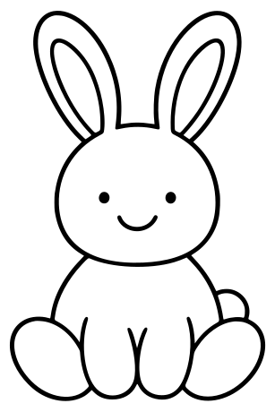

Friendly upright bunny with long ears.

- **Tags:** rabbit, bunny, animal, spring, garden
- **Roles:** subject
- **Detail:** moderate; **Facing:** front
- **Dimensions:** 307 x 460 scene units; **Visible Bounds:** left=11, top=12, right=296, bottom=447.75
- **Placement:** Use flipX to change facing where useful. Preserve aspect ratio and leave comfortable coloring space.
- **Files:** [SVG](../../src/assets/vector/spring-bunny.svg), [Definition](../../src/assets/vector/spring-bunny.json), [Source](../../art/source/spring/bunny.png)
- **Scene Examples:** [springScene.ts](../../src/editor/springScene.ts)

## Bird

`spring-bird`

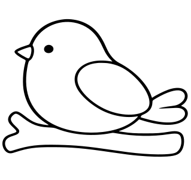

Small friendly bird.

- **Tags:** bird, animal, spring, garden, sky
- **Roles:** accent, subject
- **Detail:** moderate; **Facing:** none
- **Dimensions:** 319 x 300 scene units; **Visible Bounds:** left=4, top=31.75, right=313.75, bottom=261.25
- **Placement:** Use flipX to change facing where useful. Preserve aspect ratio and leave comfortable coloring space.
- **Files:** [SVG](../../src/assets/vector/spring-bird.svg), [Definition](../../src/assets/vector/spring-bird.json), [Source](../../art/source/spring/bird.png)
- **Scene Examples:** [springScene.ts](../../src/editor/springScene.ts)

## Reindeer

`winter-reindeer`

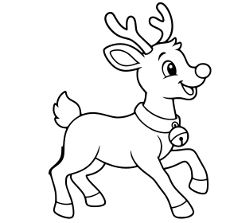

Leaping four-legged reindeer with antlers and collar.

- **Tags:** reindeer, animal, christmas, winter
- **Roles:** subject
- **Detail:** moderate; **Facing:** right
- **Dimensions:** 284 x 280 scene units; **Visible Bounds:** left=61, top=2.75, right=265.5, bottom=274.5
- **Placement:** Use flipX to change facing where useful. Preserve aspect ratio and leave comfortable coloring space.
- **Files:** [SVG](../../src/assets/vector/winter-reindeer.svg), [Definition](../../src/assets/vector/winter-reindeer.json), [Source](../../art/source/winter/reindeer.png)
- **Scene Examples:** [winterScene.ts](../../src/editor/winterScene.ts)

## Butterfly

`spring-butterfly`

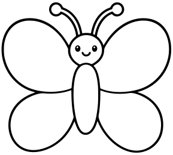

Large butterfly with patterned wings.

- **Tags:** butterfly, insect, spring, garden
- **Roles:** accent, subject
- **Detail:** moderate; **Facing:** none
- **Dimensions:** 289 x 260 scene units; **Visible Bounds:** left=2.5, top=4, right=286, bottom=256
- **Placement:** Use flipX to change facing where useful. Preserve aspect ratio and leave comfortable coloring space.
- **Files:** [SVG](../../src/assets/vector/spring-butterfly.svg), [Definition](../../src/assets/vector/spring-butterfly.json), [Source](../../art/source/spring/butterfly.png)
- **Scene Examples:** [springScene.ts](../../src/editor/springScene.ts)

## Garden Butterfly

`garden-butterfly`

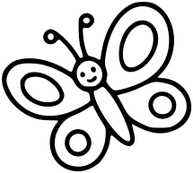

Garden butterfly with decorative wings; flip to change direction.

- **Tags:** butterfly, insect, garden, spring, nature
- **Roles:** accent, subject
- **Detail:** moderate; **Facing:** none
- **Dimensions:** 215 x 193 scene units; **Visible Bounds:** left=2.25, top=2, right=213, bottom=191.25
- **Placement:** Use flipX to change facing where useful. Preserve aspect ratio and leave comfortable coloring space.
- **Files:** [SVG](../../src/assets/vector/garden-butterfly.svg), [Definition](../../src/assets/vector/garden-butterfly.json), [Source](../../art/source/cottage-garden-PAINT-READY.bmp)
- **Scene Examples:** [gardenScene.ts](../../src/editor/gardenScene.ts)

## Giraffe

`animal-giraffe`

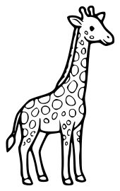

Standing long-necked giraffe with outlined spots.

- **Tags:** giraffe, animal, safari, savanna, wildlife, spots
- **Roles:** subject
- **Detail:** detailed; **Facing:** right
- **Dimensions:** 170 x 270 scene units; **Visible Bounds:** left=8.5, top=7.75, right=162, bottom=262
- **Placement:** Keep relatively large on the page so stripe or spot regions remain comfortable to color.
- **Files:** [SVG](../../src/assets/vector/animal-giraffe.svg), [Definition](../../src/assets/vector/animal-giraffe.json), [Source](../../art/source/animals/safari-sheet.jpg)
- **Scene Examples:** [safariScene.ts](../../src/editor/safariScene.ts)

## Elephant

`animal-elephant`

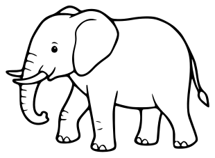

Standing elephant with large ears and curled trunk.

- **Tags:** elephant, animal, safari, savanna, wildlife
- **Roles:** subject
- **Detail:** moderate; **Facing:** left
- **Dimensions:** 310 x 227 scene units; **Visible Bounds:** left=8.25, top=8, right=301.75, bottom=218.25
- **Placement:** Use flipX to change facing where useful. Preserve aspect ratio and leave comfortable coloring space.
- **Files:** [SVG](../../src/assets/vector/animal-elephant.svg), [Definition](../../src/assets/vector/animal-elephant.json), [Source](../../art/source/animals/safari-sheet.jpg)
- **Scene Examples:** [safariScene.ts](../../src/editor/safariScene.ts)

## Lion

`animal-lion`

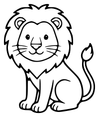

Seated friendly lion with mane and curled tail.

- **Tags:** lion, animal, safari, savanna, wildlife, mane
- **Roles:** subject
- **Detail:** moderate; **Facing:** front
- **Dimensions:** 199 x 234 scene units; **Visible Bounds:** left=8, top=8, right=191, bottom=226.25
- **Placement:** Use flipX to change facing where useful. Preserve aspect ratio and leave comfortable coloring space.
- **Files:** [SVG](../../src/assets/vector/animal-lion.svg), [Definition](../../src/assets/vector/animal-lion.json), [Source](../../art/source/animals/safari-sheet.jpg)
- **Scene Examples:** [safariScene.ts](../../src/editor/safariScene.ts)

## Hippo

`animal-hippo`

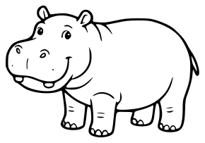

Friendly standing hippo with broad muzzle.

- **Tags:** hippo, animal, safari, water, watering-hole, wildlife
- **Roles:** subject
- **Detail:** moderate; **Facing:** left
- **Dimensions:** 290 x 203 scene units; **Visible Bounds:** left=8, top=7.75, right=281.75, bottom=195
- **Placement:** Use flipX to change facing where useful. Preserve aspect ratio and leave comfortable coloring space.
- **Files:** [SVG](../../src/assets/vector/animal-hippo.svg), [Definition](../../src/assets/vector/animal-hippo.json), [Source](../../art/source/animals/safari-sheet.jpg)
- **Scene Examples:** [safariScene.ts](../../src/editor/safariScene.ts)

## Zebra

`animal-zebra`

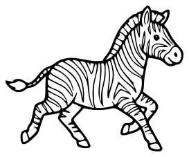

Walking zebra with many narrow stripe regions.

- **Tags:** zebra, animal, safari, savanna, wildlife, stripes
- **Roles:** subject
- **Detail:** detailed; **Facing:** right
- **Dimensions:** 273 x 227 scene units; **Visible Bounds:** left=8, top=8, right=265, bottom=219
- **Placement:** Keep relatively large on the page so stripe or spot regions remain comfortable to color.
- **Files:** [SVG](../../src/assets/vector/animal-zebra.svg), [Definition](../../src/assets/vector/animal-zebra.json), [Source](../../art/source/animals/safari-sheet.jpg)
- **Scene Examples:** [safariScene.ts](../../src/editor/safariScene.ts)

## Rhino

`animal-rhino`

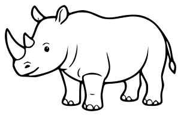

Standing rhinoceros with horns and folded skin lines.

- **Tags:** rhino, animal, safari, savanna, wildlife
- **Roles:** subject
- **Detail:** moderate; **Facing:** left
- **Dimensions:** 302 x 194 scene units; **Visible Bounds:** left=8, top=8.5, right=294, bottom=185.75
- **Placement:** Use flipX to change facing where useful. Preserve aspect ratio and leave comfortable coloring space.
- **Files:** [SVG](../../src/assets/vector/animal-rhino.svg), [Definition](../../src/assets/vector/animal-rhino.json), [Source](../../art/source/animals/safari-sheet.jpg)
- **Scene Examples:** Not yet used in a built-in scene.

## Leopard

`animal-leopard`

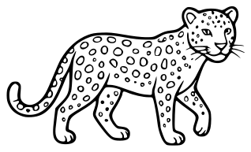

Walking big cat with numerous outlined spots.

- **Tags:** leopard, animal, safari, savanna, wildlife, spots
- **Roles:** subject
- **Detail:** detailed; **Facing:** right
- **Dimensions:** 318 x 193 scene units; **Visible Bounds:** left=8.5, top=8, right=310, bottom=184.75
- **Placement:** Keep relatively large on the page so stripe or spot regions remain comfortable to color.
- **Files:** [SVG](../../src/assets/vector/animal-leopard.svg), [Definition](../../src/assets/vector/animal-leopard.json), [Source](../../art/source/animals/safari-sheet.jpg)
- **Scene Examples:** Not yet used in a built-in scene.

## Ostrich

`animal-ostrich`

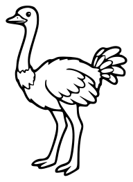

Standing long-necked ostrich with feathered wings and tail.

- **Tags:** ostrich, bird, animal, safari, savanna, wildlife
- **Roles:** subject
- **Detail:** moderate; **Facing:** left
- **Dimensions:** 192 x 262 scene units; **Visible Bounds:** left=8.25, top=8.25, right=183.5, bottom=253.25
- **Placement:** Use flipX to change facing where useful. Preserve aspect ratio and leave comfortable coloring space.
- **Files:** [SVG](../../src/assets/vector/animal-ostrich.svg), [Definition](../../src/assets/vector/animal-ostrich.json), [Source](../../art/source/animals/safari-sheet.jpg)
- **Scene Examples:** [safariScene.ts](../../src/editor/safariScene.ts)

## Buffalo

`animal-buffalo`

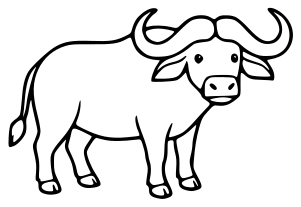

Standing buffalo with wide curved horns, facing the viewer.

- **Tags:** buffalo, animal, safari, savanna, wildlife, horns
- **Roles:** subject
- **Detail:** moderate; **Facing:** front
- **Dimensions:** 301 x 207 scene units; **Visible Bounds:** left=8.5, top=7.75, right=293, bottom=199
- **Placement:** Use flipX to change facing where useful. Preserve aspect ratio and leave comfortable coloring space.
- **Files:** [SVG](../../src/assets/vector/animal-buffalo.svg), [Definition](../../src/assets/vector/animal-buffalo.json), [Source](../../art/source/animals/safari-sheet.jpg)
- **Scene Examples:** Not yet used in a built-in scene.

## Meerkat

`animal-meerkat`

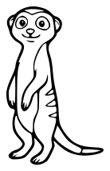

Small upright meerkat with long tail.

- **Tags:** meerkat, animal, safari, savanna, wildlife
- **Roles:** subject
- **Detail:** moderate; **Facing:** front
- **Dimensions:** 138 x 214 scene units; **Visible Bounds:** left=8, top=8, right=130, bottom=206.25
- **Placement:** Use flipX to change facing where useful. Preserve aspect ratio and leave comfortable coloring space.
- **Files:** [SVG](../../src/assets/vector/animal-meerkat.svg), [Definition](../../src/assets/vector/animal-meerkat.json), [Source](../../art/source/animals/safari-sheet.jpg)
- **Scene Examples:** [safariScene.ts](../../src/editor/safariScene.ts)

## Warthog

`animal-warthog`

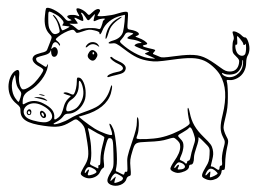

Standing warthog with tusks and raised tail.

- **Tags:** warthog, animal, safari, savanna, wildlife, tusks
- **Roles:** subject
- **Detail:** moderate; **Facing:** left
- **Dimensions:** 258 x 194 scene units; **Visible Bounds:** left=8.5, top=7.75, right=249.5, bottom=185.75
- **Placement:** Use flipX to change facing where useful. Preserve aspect ratio and leave comfortable coloring space.
- **Files:** [SVG](../../src/assets/vector/animal-warthog.svg), [Definition](../../src/assets/vector/animal-warthog.json), [Source](../../art/source/animals/safari-sheet.jpg)
- **Scene Examples:** Not yet used in a built-in scene.

## Crocodile

`animal-crocodile`

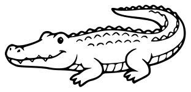

Low crocodile with long tail, scales and visible teeth.

- **Tags:** crocodile, animal, safari, water, watering-hole, wildlife
- **Roles:** subject
- **Detail:** moderate; **Facing:** left
- **Dimensions:** 312 x 151 scene units; **Visible Bounds:** left=8, top=7.75, right=303.5, bottom=142.75
- **Placement:** Use flipX to change facing where useful. Preserve aspect ratio and leave comfortable coloring space.
- **Files:** [SVG](../../src/assets/vector/animal-crocodile.svg), [Definition](../../src/assets/vector/animal-crocodile.json), [Source](../../art/source/animals/safari-sheet.jpg)
- **Scene Examples:** [safariScene.ts](../../src/editor/safariScene.ts)

