# Animals

[All Assets](../CATALOG.md) | [Searchable Visual Browser](index.html) | [Machine Index](index.json)

Generated by `node scripts/build-asset-catalog.mjs`; edit metadata in `art/stickers.json`.

## Bunny

`spring-bunny`

Friendly upright bunny with long ears.

- **Tags:** rabbit, bunny, animal, spring, garden
- **Roles:** subject
- **Detail:** moderate; **Facing:** front
- **Dimensions:** 307 x 460 scene units; **Visible Bounds:** left=11, top=12, right=296, bottom=447.75
- **Placement:** Use flipX to change facing where useful. Preserve aspect ratio and leave comfortable coloring space.
- **Files:** [SVG](../../src/assets/vector/spring-bunny.svg), [Definition](../../src/assets/vector/spring-bunny.svg), [Source](../../art/source/spring/bunny.png)
- **Scene Examples:** [springScene.ts](../../src/editor/springScene.ts)

## Bird

`spring-bird`

Small friendly bird.

- **Tags:** bird, animal, spring, garden, sky
- **Roles:** accent, subject
- **Detail:** moderate; **Facing:** none
- **Dimensions:** 319 x 300 scene units; **Visible Bounds:** left=4, top=31.75, right=313.75, bottom=261.25
- **Placement:** Use flipX to change facing where useful. Preserve aspect ratio and leave comfortable coloring space.
- **Files:** [SVG](../../src/assets/vector/spring-bird.svg), [Definition](../../src/assets/vector/spring-bird.svg), [Source](../../art/source/spring/bird.png)
- **Scene Examples:** [springScene.ts](../../src/editor/springScene.ts)

## Reindeer

`winter-reindeer`

Leaping four-legged reindeer with antlers and collar.

- **Tags:** reindeer, animal, christmas, winter
- **Roles:** subject
- **Detail:** moderate; **Facing:** right
- **Dimensions:** 284 x 280 scene units; **Visible Bounds:** left=61, top=2.75, right=265.5, bottom=274.5
- **Placement:** Use flipX to change facing where useful. Preserve aspect ratio and leave comfortable coloring space.
- **Files:** [SVG](../../src/assets/vector/winter-reindeer.svg), [Definition](../../src/assets/vector/winter-reindeer.svg), [Source](../../art/source/winter/reindeer.png)
- **Scene Examples:** [winterScene.ts](../../src/editor/winterScene.ts)

## Butterfly

`spring-butterfly`

Large butterfly with patterned wings.

- **Tags:** butterfly, insect, spring, garden
- **Roles:** accent, subject
- **Detail:** moderate; **Facing:** none
- **Dimensions:** 289 x 260 scene units; **Visible Bounds:** left=2.5, top=4, right=286, bottom=256
- **Placement:** Use flipX to change facing where useful. Preserve aspect ratio and leave comfortable coloring space.
- **Files:** [SVG](../../src/assets/vector/spring-butterfly.svg), [Definition](../../src/assets/vector/spring-butterfly.svg), [Source](../../art/source/spring/butterfly.png)
- **Scene Examples:** [springScene.ts](../../src/editor/springScene.ts)

## Garden Butterfly

`garden-butterfly`

Garden butterfly with decorative wings; flip to change direction.

- **Tags:** butterfly, insect, garden, spring, nature
- **Roles:** accent, subject
- **Detail:** moderate; **Facing:** none
- **Dimensions:** 215 x 193 scene units; **Visible Bounds:** left=2.25, top=2, right=213, bottom=191.25
- **Placement:** Use flipX to change facing where useful. Preserve aspect ratio and leave comfortable coloring space.
- **Files:** [SVG](../../src/assets/vector/garden-butterfly.svg), [Definition](../../src/assets/vector/garden-butterfly.svg), [Source](../../art/source/cottage-garden-PAINT-READY.bmp)
- **Scene Examples:** [gardenScene.ts](../../src/editor/gardenScene.ts)

## Giraffe

`animal-giraffe`

Standing long-necked giraffe with outlined spots.

- **Tags:** giraffe, animal, safari, savanna, wildlife, spots
- **Roles:** subject
- **Detail:** detailed; **Facing:** right
- **Dimensions:** 170 x 270 scene units; **Visible Bounds:** left=8.5, top=7.75, right=162, bottom=262
- **Placement:** Keep relatively large on the page so stripe or spot regions remain comfortable to color.
- **Files:** [SVG](../../src/assets/vector/animal-giraffe.svg), [Definition](../../src/assets/vector/animal-giraffe.svg), [Source](../../art/source/animals/safari-sheet.jpg)
- **Scene Examples:** [safariScene.ts](../../src/editor/safariScene.ts)

## Elephant

`animal-elephant`

Standing elephant with large ears and curled trunk.

- **Tags:** elephant, animal, safari, savanna, wildlife
- **Roles:** subject
- **Detail:** moderate; **Facing:** left
- **Dimensions:** 310 x 227 scene units; **Visible Bounds:** left=8.25, top=8, right=301.75, bottom=218.25
- **Placement:** Use flipX to change facing where useful. Preserve aspect ratio and leave comfortable coloring space.
- **Files:** [SVG](../../src/assets/vector/animal-elephant.svg), [Definition](../../src/assets/vector/animal-elephant.svg), [Source](../../art/source/animals/safari-sheet.jpg)
- **Scene Examples:** [safariScene.ts](../../src/editor/safariScene.ts)

## Lion

`animal-lion`

Seated friendly lion with mane and curled tail.

- **Tags:** lion, animal, safari, savanna, wildlife, mane
- **Roles:** subject
- **Detail:** moderate; **Facing:** front
- **Dimensions:** 199 x 234 scene units; **Visible Bounds:** left=8, top=8, right=191, bottom=226.25
- **Placement:** Use flipX to change facing where useful. Preserve aspect ratio and leave comfortable coloring space.
- **Files:** [SVG](../../src/assets/vector/animal-lion.svg), [Definition](../../src/assets/vector/animal-lion.svg), [Source](../../art/source/animals/safari-sheet.jpg)
- **Scene Examples:** [safariScene.ts](../../src/editor/safariScene.ts)

## Hippo

`animal-hippo`

Friendly standing hippo with broad muzzle.

- **Tags:** hippo, animal, safari, water, watering-hole, wildlife
- **Roles:** subject
- **Detail:** moderate; **Facing:** left
- **Dimensions:** 290 x 203 scene units; **Visible Bounds:** left=8, top=7.75, right=281.75, bottom=195
- **Placement:** Use flipX to change facing where useful. Preserve aspect ratio and leave comfortable coloring space.
- **Files:** [SVG](../../src/assets/vector/animal-hippo.svg), [Definition](../../src/assets/vector/animal-hippo.svg), [Source](../../art/source/animals/safari-sheet.jpg)
- **Scene Examples:** [safariScene.ts](../../src/editor/safariScene.ts)

## Zebra

`animal-zebra`

Walking zebra with many narrow stripe regions.

- **Tags:** zebra, animal, safari, savanna, wildlife, stripes
- **Roles:** subject
- **Detail:** detailed; **Facing:** right
- **Dimensions:** 273 x 227 scene units; **Visible Bounds:** left=8, top=8, right=265, bottom=219
- **Placement:** Keep relatively large on the page so stripe or spot regions remain comfortable to color.
- **Files:** [SVG](../../src/assets/vector/animal-zebra.svg), [Definition](../../src/assets/vector/animal-zebra.svg), [Source](../../art/source/animals/safari-sheet.jpg)
- **Scene Examples:** [safariScene.ts](../../src/editor/safariScene.ts)

## Rhino

`animal-rhino`

Standing rhinoceros with horns and folded skin lines.

- **Tags:** rhino, animal, safari, savanna, wildlife
- **Roles:** subject
- **Detail:** moderate; **Facing:** left
- **Dimensions:** 302 x 194 scene units; **Visible Bounds:** left=8, top=8.5, right=294, bottom=185.75
- **Placement:** Use flipX to change facing where useful. Preserve aspect ratio and leave comfortable coloring space.
- **Files:** [SVG](../../src/assets/vector/animal-rhino.svg), [Definition](../../src/assets/vector/animal-rhino.svg), [Source](../../art/source/animals/safari-sheet.jpg)
- **Scene Examples:** Not yet used in a built-in scene.

## Leopard

`animal-leopard`

Walking big cat with numerous outlined spots.

- **Tags:** leopard, animal, safari, savanna, wildlife, spots
- **Roles:** subject
- **Detail:** detailed; **Facing:** right
- **Dimensions:** 318 x 193 scene units; **Visible Bounds:** left=8.5, top=8, right=310, bottom=184.75
- **Placement:** Keep relatively large on the page so stripe or spot regions remain comfortable to color.
- **Files:** [SVG](../../src/assets/vector/animal-leopard.svg), [Definition](../../src/assets/vector/animal-leopard.svg), [Source](../../art/source/animals/safari-sheet.jpg)
- **Scene Examples:** Not yet used in a built-in scene.

## Ostrich

`animal-ostrich`

Standing long-necked ostrich with feathered wings and tail.

- **Tags:** ostrich, bird, animal, safari, savanna, wildlife
- **Roles:** subject
- **Detail:** moderate; **Facing:** left
- **Dimensions:** 192 x 262 scene units; **Visible Bounds:** left=8.25, top=8.25, right=183.5, bottom=253.25
- **Placement:** Use flipX to change facing where useful. Preserve aspect ratio and leave comfortable coloring space.
- **Files:** [SVG](../../src/assets/vector/animal-ostrich.svg), [Definition](../../src/assets/vector/animal-ostrich.svg), [Source](../../art/source/animals/safari-sheet.jpg)
- **Scene Examples:** [safariScene.ts](../../src/editor/safariScene.ts)

## Buffalo

`animal-buffalo`

Standing buffalo with wide curved horns, facing the viewer.

- **Tags:** buffalo, animal, safari, savanna, wildlife, horns
- **Roles:** subject
- **Detail:** moderate; **Facing:** front
- **Dimensions:** 301 x 207 scene units; **Visible Bounds:** left=8.5, top=7.75, right=293, bottom=199
- **Placement:** Use flipX to change facing where useful. Preserve aspect ratio and leave comfortable coloring space.
- **Files:** [SVG](../../src/assets/vector/animal-buffalo.svg), [Definition](../../src/assets/vector/animal-buffalo.svg), [Source](../../art/source/animals/safari-sheet.jpg)
- **Scene Examples:** Not yet used in a built-in scene.

## Meerkat

`animal-meerkat`

Small upright meerkat with long tail.

- **Tags:** meerkat, animal, safari, savanna, wildlife
- **Roles:** subject
- **Detail:** moderate; **Facing:** front
- **Dimensions:** 138 x 214 scene units; **Visible Bounds:** left=8, top=8, right=130, bottom=206.25
- **Placement:** Use flipX to change facing where useful. Preserve aspect ratio and leave comfortable coloring space.
- **Files:** [SVG](../../src/assets/vector/animal-meerkat.svg), [Definition](../../src/assets/vector/animal-meerkat.svg), [Source](../../art/source/animals/safari-sheet.jpg)
- **Scene Examples:** [safariScene.ts](../../src/editor/safariScene.ts)

## Warthog

`animal-warthog`

Standing warthog with tusks and raised tail.

- **Tags:** warthog, animal, safari, savanna, wildlife, tusks
- **Roles:** subject
- **Detail:** moderate; **Facing:** left
- **Dimensions:** 258 x 194 scene units; **Visible Bounds:** left=8.5, top=7.75, right=249.5, bottom=185.75
- **Placement:** Use flipX to change facing where useful. Preserve aspect ratio and leave comfortable coloring space.
- **Files:** [SVG](../../src/assets/vector/animal-warthog.svg), [Definition](../../src/assets/vector/animal-warthog.svg), [Source](../../art/source/animals/safari-sheet.jpg)
- **Scene Examples:** Not yet used in a built-in scene.

## Crocodile

`animal-crocodile`

Low crocodile with long tail, scales and visible teeth.

- **Tags:** crocodile, animal, safari, water, watering-hole, wildlife
- **Roles:** subject
- **Detail:** moderate; **Facing:** left
- **Dimensions:** 312 x 151 scene units; **Visible Bounds:** left=8, top=7.75, right=303.5, bottom=142.75
- **Placement:** Use flipX to change facing where useful. Preserve aspect ratio and leave comfortable coloring space.
- **Files:** [SVG](../../src/assets/vector/animal-crocodile.svg), [Definition](../../src/assets/vector/animal-crocodile.svg), [Source](../../art/source/animals/safari-sheet.jpg)
- **Scene Examples:** [safariScene.ts](../../src/editor/safariScene.ts)

## Fiddle Cat

`nursery-rhymes-fiddle-cat`

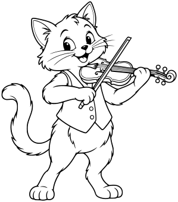

Classic Hey Diddle Diddle cat, full body, small waistcoat, long curled tail, holds a violin correctly under chin with one paw on neck and another holding bow across strings. Simple instrument details, distinct paws and bow, no extra limbs or floating notes.

- **Tags:** nursery-rhymes, Hey Diddle Diddle, animals, fiddle-cat
- **Roles:** subject, accent
- **Detail:** moderate; **Facing:** none
- **Dimensions:** 299 x 340 scene units; **Visible Bounds:** left=2.5, top=2.25, right=296.5, bottom=337.75
- **Placement:** Preserve aspect ratio; flip and scale to suit the scene. Source conversion is ready for visual review.
- **Files:** [SVG](../../src/assets/vector/nursery-rhymes-fiddle-cat.svg), [Definition](../../src/assets/vector/nursery-rhymes-fiddle-cat.svg), [Source](../../art/source/nursery-rhymes/fiddle-cat.png)
- **Scene Examples:** Not yet used in a built-in scene.

## Jumping Cow

`nursery-rhymes-jumping-cow`

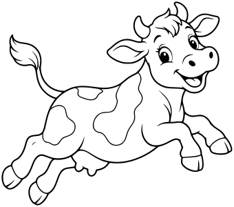

Clear side three-quarter view, body arched in a gentle leap with all four legs visible and bent, small horns, ears and smiling muzzle, a few large outlined patches left white, tail raised. NO moon or stars or ground included; separate composable cow asset.

- **Tags:** nursery-rhymes, Hey Diddle Diddle, animals, jumping-cow
- **Roles:** subject, accent
- **Detail:** moderate; **Facing:** none
- **Dimensions:** 340 x 300 scene units; **Visible Bounds:** left=2.25, top=2.25, right=337.5, bottom=297.5
- **Placement:** Preserve aspect ratio; flip and scale to suit the scene. Source conversion is ready for visual review.
- **Files:** [SVG](../../src/assets/vector/nursery-rhymes-jumping-cow.svg), [Definition](../../src/assets/vector/nursery-rhymes-jumping-cow.svg), [Source](../../art/source/nursery-rhymes/jumping-cow.png)
- **Scene Examples:** Not yet used in a built-in scene.

## Climbing Mouse

`nursery-rhymes-climbing-mouse`

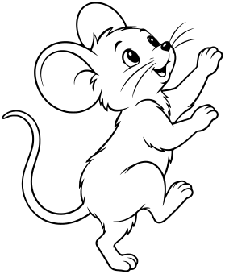

Full mouse viewed from side three-quarter, facing upward, two front paws reaching and hind paws braced, large round ears, tiny nose, long curved tail separate from limbs. Friendly expression, no clock or ladder or ground. Silhouette usable climbing beside a clock.

- **Tags:** nursery-rhymes, Hickory Dickory Dock, animals, climbing-mouse
- **Roles:** subject, accent
- **Detail:** moderate; **Facing:** none
- **Dimensions:** 279 x 340 scene units; **Visible Bounds:** left=2.5, top=2.5, right=276.5, bottom=337.5
- **Placement:** Preserve aspect ratio; flip and scale to suit the scene. Source conversion is ready for visual review.
- **Files:** [SVG](../../src/assets/vector/nursery-rhymes-climbing-mouse.svg), [Definition](../../src/assets/vector/nursery-rhymes-climbing-mouse.svg), [Source](../../art/source/nursery-rhymes/climbing-mouse.png)
- **Scene Examples:** Not yet used in a built-in scene.

## Friendly Spider

`nursery-rhymes-friendly-spider`

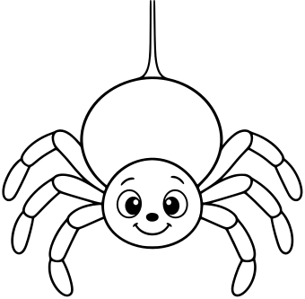

One round small head and rounded larger abdomen, exactly EIGHT short curved legs arranged clearly four on each side, cheerful two-eye face. Single short silk thread attached above abdomen, no web or drainpipe. Not scary, no fangs.

- **Tags:** nursery-rhymes, Incy Wincy Spider, animals, friendly-spider
- **Roles:** subject, accent
- **Detail:** moderate; **Facing:** none
- **Dimensions:** 340 x 333 scene units; **Visible Bounds:** left=2.5, top=0, right=337.5, bottom=330.25
- **Placement:** Preserve aspect ratio; flip and scale to suit the scene. Source conversion is ready for visual review.
- **Files:** [SVG](../../src/assets/vector/nursery-rhymes-friendly-spider.svg), [Definition](../../src/assets/vector/nursery-rhymes-friendly-spider.svg), [Source](../../art/source/nursery-rhymes/friendly-spider.png)
- **Scene Examples:** Not yet used in a built-in scene.

## Woolly Lamb

`nursery-rhymes-woolly-lamb`

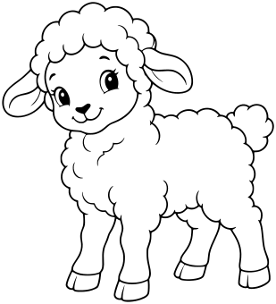

Full side three-quarter view standing with all four little legs visible, large soft scalloped wool shapes, small ears and sweet face, short tail. No collar words, no grass, no fence. Simple broad wool shapes rather than tiny curls.

- **Tags:** nursery-rhymes, Mary Had a Little Lamb, animals, woolly-lamb
- **Roles:** subject, accent
- **Detail:** moderate; **Facing:** none
- **Dimensions:** 309 x 340 scene units; **Visible Bounds:** left=2.5, top=2.25, right=306.75, bottom=337.5
- **Placement:** Preserve aspect ratio; flip and scale to suit the scene. Source conversion is ready for visual review.
- **Files:** [SVG](../../src/assets/vector/nursery-rhymes-woolly-lamb.svg), [Definition](../../src/assets/vector/nursery-rhymes-woolly-lamb.svg), [Source](../../art/source/nursery-rhymes/woolly-lamb.png)
- **Scene Examples:** Not yet used in a built-in scene.

## Mother Duck

`nursery-rhymes-mother-duck`

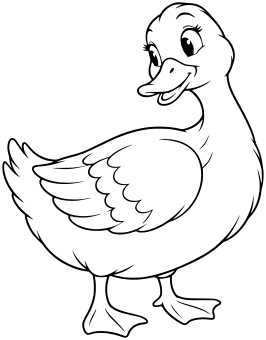

Full standing side three-quarter view, rounded body, folded wing, gently curved neck, broad bill and friendly eye, two webbed feet visible. Looking back over shoulder as if watching ducklings, no ducklings included, no pond or ground.

- **Tags:** nursery-rhymes, Five Little Ducks, animals, mother-duck
- **Roles:** subject, accent
- **Detail:** moderate; **Facing:** none
- **Dimensions:** 266 x 340 scene units; **Visible Bounds:** left=2.5, top=2.25, right=263.5, bottom=337.75
- **Placement:** Preserve aspect ratio; flip and scale to suit the scene. Source conversion is ready for visual review.
- **Files:** [SVG](../../src/assets/vector/nursery-rhymes-mother-duck.svg), [Definition](../../src/assets/vector/nursery-rhymes-mother-duck.svg), [Source](../../art/source/nursery-rhymes/mother-duck.png)
- **Scene Examples:** Not yet used in a built-in scene.

## Duckling

`nursery-rhymes-duckling`

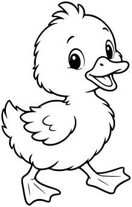

Full walking side three-quarter view, round head and body, tiny wing, small broad beak, two webbed feet, a little tuft on top. Friendly simple face, no mother duck or water or ground. Distinct baby proportions.

- **Tags:** nursery-rhymes, Five Little Ducks, animals, duckling
- **Roles:** subject, accent
- **Detail:** moderate; **Facing:** none
- **Dimensions:** 218 x 340 scene units; **Visible Bounds:** left=2.25, top=2.5, right=215.75, bottom=337.75
- **Placement:** Preserve aspect ratio; flip and scale to suit the scene. Source conversion is ready for visual review.
- **Files:** [SVG](../../src/assets/vector/nursery-rhymes-duckling.svg), [Definition](../../src/assets/vector/nursery-rhymes-duckling.svg), [Source](../../art/source/nursery-rhymes/duckling.png)
- **Scene Examples:** Not yet used in a built-in scene.

## King's Horse

`nursery-rhymes-royal-horse`

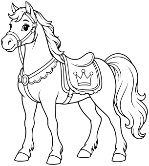

Whole standing horse in side three-quarter view, simple bridle and decorative saddle blanket with one outlined crown motif, short flowing mane, long tail and all four hooves visible. Friendly expression, NO rider, no actual crown on head, no ground.

- **Tags:** nursery-rhymes, Humpty Dumpty, animals, royal-horse
- **Roles:** subject, accent
- **Detail:** moderate; **Facing:** none
- **Dimensions:** 305 x 340 scene units; **Visible Bounds:** left=2.5, top=2.5, right=302.5, bottom=337.5
- **Placement:** Preserve aspect ratio; flip and scale to suit the scene. Source conversion is ready for visual review.
- **Files:** [SVG](../../src/assets/vector/nursery-rhymes-royal-horse.svg), [Definition](../../src/assets/vector/nursery-rhymes-royal-horse.svg), [Source](../../art/source/nursery-rhymes/royal-horse.png)
- **Scene Examples:** Not yet used in a built-in scene.

## Baa Baa Sheep

`nursery-rhymes-baa-baa-sheep`

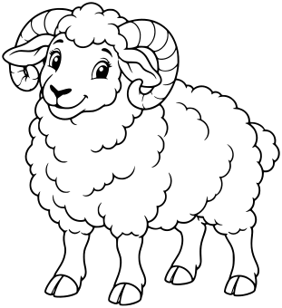

Standing three-quarter view, rounded horns curling beside ears, broad scalloped fleece, smiling face and four clearly visible hooves. Leave ALL wool and face white for coloring black if desired; no dark filled fleece. No sacks or ground.

- **Tags:** nursery-rhymes, Baa Baa Black Sheep, animals, baa-baa-sheep
- **Roles:** subject, accent
- **Detail:** moderate; **Facing:** none
- **Dimensions:** 311 x 340 scene units; **Visible Bounds:** left=2.25, top=2.25, right=308.75, bottom=337.5
- **Placement:** Preserve aspect ratio; flip and scale to suit the scene. Source conversion is ready for visual review.
- **Files:** [SVG](../../src/assets/vector/nursery-rhymes-baa-baa-sheep.svg), [Definition](../../src/assets/vector/nursery-rhymes-baa-baa-sheep.svg), [Source](../../art/source/nursery-rhymes/baa-baa-sheep.png)
- **Scene Examples:** Not yet used in a built-in scene.

## Mother Goose

`nursery-rhymes-mother-goose`

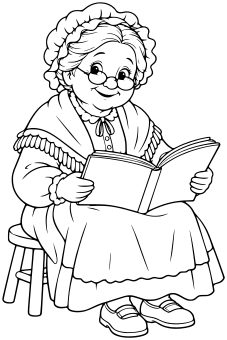

Whole older woman seated on a simple low stool, spectacles, bonnet, shawl and long modest dress, sturdy shoes. Open book on lap with BLANK pages, two hands holding it naturally, no goose or background. No words.

- **Tags:** nursery-rhymes, Mother Goose, animals, mother-goose
- **Roles:** subject, accent
- **Detail:** moderate; **Facing:** none
- **Dimensions:** 227 x 340 scene units; **Visible Bounds:** left=2.25, top=2.25, right=224.75, bottom=337.75
- **Placement:** Preserve aspect ratio; flip and scale to suit the scene. Source conversion is ready for visual review.
- **Files:** [SVG](../../src/assets/vector/nursery-rhymes-mother-goose.svg), [Definition](../../src/assets/vector/nursery-rhymes-mother-goose.svg), [Source](../../art/source/nursery-rhymes/mother-goose.png)
- **Scene Examples:** Not yet used in a built-in scene.

## Storybook Goose

`nursery-rhymes-goose`

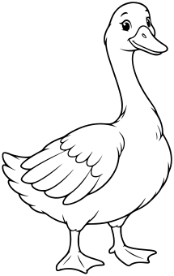

Whole standing three-quarter side view, long curved neck, broad bill, two webbed feet and folded wing with a few broad feather sections. Looking forward with kind expression. No bonnet, people, eggs or ground.

- **Tags:** nursery-rhymes, Mother Goose, animals, goose
- **Roles:** subject, accent
- **Detail:** moderate; **Facing:** none
- **Dimensions:** 215 x 340 scene units; **Visible Bounds:** left=2.5, top=2.25, right=212.75, bottom=337.5
- **Placement:** Preserve aspect ratio; flip and scale to suit the scene. Source conversion is ready for visual review.
- **Files:** [SVG](../../src/assets/vector/nursery-rhymes-goose.svg), [Definition](../../src/assets/vector/nursery-rhymes-goose.svg), [Source](../../art/source/nursery-rhymes/goose.png)
- **Scene Examples:** Not yet used in a built-in scene.

## Singing Blackbird

`nursery-rhymes-singing-blackbird`

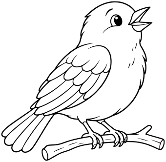

Whole small songbird perched on a short simple twig included, beak gently open, two folded wings and tail, a few broad feather panels. Leave ALL feathers WHITE for coloring, small black pupil only. No music notes, words or scenery.

- **Tags:** nursery-rhymes, Sing a Song of Sixpence, animals, singing-blackbird
- **Roles:** subject, accent
- **Detail:** moderate; **Facing:** none
- **Dimensions:** 340 x 332 scene units; **Visible Bounds:** left=2.5, top=2.75, right=337.25, bottom=329.5
- **Placement:** Preserve aspect ratio; flip and scale to suit the scene. Source conversion is ready for visual review.
- **Files:** [SVG](../../src/assets/vector/nursery-rhymes-singing-blackbird.svg), [Definition](../../src/assets/vector/nursery-rhymes-singing-blackbird.svg), [Source](../../art/source/nursery-rhymes/singing-blackbird.png)
- **Scene Examples:** Not yet used in a built-in scene.

## Squirrel with Acorn

`fall-squirrel-acorn`

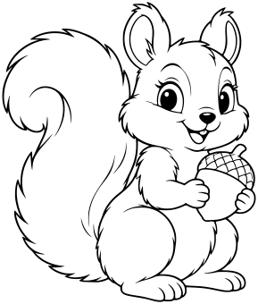

Seated three-quarter pose with large bushy curled tail, small paws holding a clearly outlined acorn, rounded ears and friendly face. Simple fur edges and no dense hair texture, no ground or surrounding objects.

- **Tags:** fall, Fall Animals, animals, squirrel-acorn
- **Roles:** subject, accent
- **Detail:** moderate; **Facing:** none
- **Dimensions:** 289 x 340 scene units; **Visible Bounds:** left=2.5, top=2.25, right=286.5, bottom=337.75
- **Placement:** Preserve aspect ratio; flip and scale to suit the scene. Source conversion is ready for visual review.
- **Files:** [SVG](../../src/assets/vector/fall-squirrel-acorn.svg), [Definition](../../src/assets/vector/fall-squirrel-acorn.svg), [Source](../../art/source/fall/squirrel-acorn.png)
- **Scene Examples:** Not yet used in a built-in scene.

## Hedgehog

`fall-hedgehog`

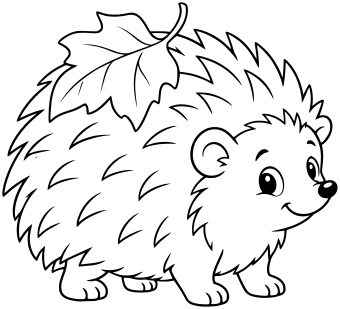

Full side three-quarter view, rounded body with a few broad pointed spine clusters around outside, small face and round nose, four short feet. A single broad leaf resting on its back. No dense internal spine hatching or ground.

- **Tags:** fall, Fall Animals, animals, hedgehog
- **Roles:** subject, accent
- **Detail:** moderate; **Facing:** none
- **Dimensions:** 340 x 309 scene units; **Visible Bounds:** left=2.25, top=2.25, right=337.5, bottom=306.75
- **Placement:** Preserve aspect ratio; flip and scale to suit the scene. Source conversion is ready for visual review.
- **Files:** [SVG](../../src/assets/vector/fall-hedgehog.svg), [Definition](../../src/assets/vector/fall-hedgehog.svg), [Source](../../art/source/fall/hedgehog.png)
- **Scene Examples:** Not yet used in a built-in scene.

## Woodland Fox

`fall-fox`

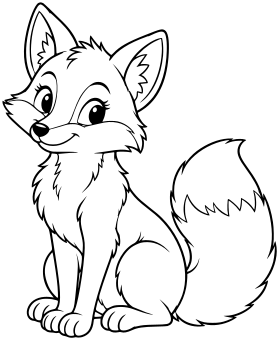

Full seated three-quarter view, pointed ears, long muzzle and fluffy curled tail with large outlined tip patch, white muzzle/chest regions outlined and left uncolored. Gentle bright face, complete visible paws, no ground or surrounding leaves.

- **Tags:** fall, Fall Animals, animals, fox
- **Roles:** subject, accent
- **Detail:** moderate; **Facing:** none
- **Dimensions:** 279 x 340 scene units; **Visible Bounds:** left=2.5, top=2.5, right=276.75, bottom=337.75
- **Placement:** Preserve aspect ratio; flip and scale to suit the scene. Source conversion is ready for visual review.
- **Files:** [SVG](../../src/assets/vector/fall-fox.svg), [Definition](../../src/assets/vector/fall-fox.svg), [Source](../../art/source/fall/fox.png)
- **Scene Examples:** Not yet used in a built-in scene.

## Woodland Owl

`fall-owl`

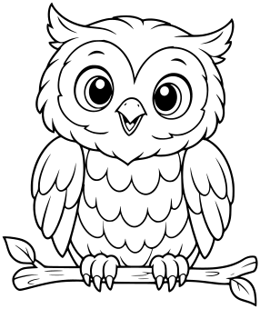

Full owl perched directly on a SHORT simple branch included as part of asset, large rounded eyes with pupils, two folded wings, broad feather panels on chest, little talons visibly gripping branch. No dense feather texture or scenery.

- **Tags:** fall, Fall Animals, animals, owl
- **Roles:** subject, accent
- **Detail:** moderate; **Facing:** none
- **Dimensions:** 286 x 340 scene units; **Visible Bounds:** left=2.75, top=2.75, right=283.5, bottom=337.25
- **Placement:** Preserve aspect ratio; flip and scale to suit the scene. Source conversion is ready for visual review.
- **Files:** [SVG](../../src/assets/vector/fall-owl.svg), [Definition](../../src/assets/vector/fall-owl.svg), [Source](../../art/source/fall/owl.png)
- **Scene Examples:** Not yet used in a built-in scene.

## Turkey

`fall-turkey`

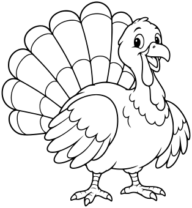

Full standing three-quarter front view, broad fan tail with about seven large feather sections, two folded wings, small head with beak and simple wattle, two sturdy feet. Cheerful but natural bird, no pilgrim costume, no ground or dense feather detail.

- **Tags:** fall, Fall Animals, animals, turkey
- **Roles:** subject, accent
- **Detail:** moderate; **Facing:** none
- **Dimensions:** 314 x 340 scene units; **Visible Bounds:** left=2.5, top=2.5, right=311.5, bottom=337.5
- **Placement:** Preserve aspect ratio; flip and scale to suit the scene. Source conversion is ready for visual review.
- **Files:** [SVG](../../src/assets/vector/fall-turkey.svg), [Definition](../../src/assets/vector/fall-turkey.svg), [Source](../../art/source/fall/turkey.png)
- **Scene Examples:** Not yet used in a built-in scene.

## Garden Snail

`fall-snail`

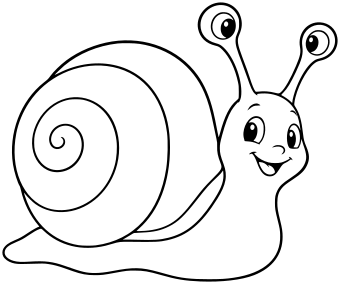

Whole side three-quarter view, large rounded spiral shell with two or three broad turns, simple curved foot, two eye stalks with friendly eyes. No slime trail or ground, all shell and body areas white. Clear outline and sparse detail.

- **Tags:** fall, Fall Woodland, animals, snail
- **Roles:** subject, accent
- **Detail:** moderate; **Facing:** none
- **Dimensions:** 340 x 284 scene units; **Visible Bounds:** left=2.5, top=2.5, right=337.5, bottom=281.5
- **Placement:** Preserve aspect ratio; flip and scale to suit the scene. Source conversion is ready for visual review.
- **Files:** [SVG](../../src/assets/vector/fall-snail.svg), [Definition](../../src/assets/vector/fall-snail.svg), [Source](../../art/source/fall/snail.png)
- **Scene Examples:** Not yet used in a built-in scene.

## Woodland Raccoon

`fall-raccoon`

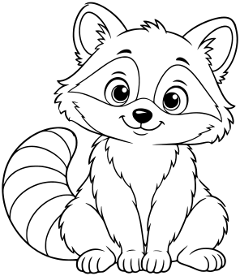

Whole seated raccoon with rounded ears, outlined mask patches around two eyes left WHITE for coloring, curled tail with broad outlined rings, front paws resting together. No solid black mask or tail stripes, no clothes, ground or props.

- **Tags:** fall, Fall Animals, animals, raccoon
- **Roles:** subject, accent
- **Detail:** moderate; **Facing:** none
- **Dimensions:** 296 x 340 scene units; **Visible Bounds:** left=2.25, top=2.75, right=293.75, bottom=337.25
- **Placement:** Preserve aspect ratio; flip and scale to suit the scene. Source conversion is ready for visual review.
- **Files:** [SVG](../../src/assets/vector/fall-raccoon.svg), [Definition](../../src/assets/vector/fall-raccoon.svg), [Source](../../art/source/fall/raccoon.png)
- **Scene Examples:** Not yet used in a built-in scene.

## Woodland Badger

`fall-badger`

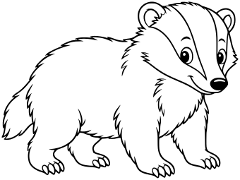

Whole low standing badger in three-quarter side view, rounded body, small ears, pointed muzzle and short legs with visible paws. Two broad face stripe regions outlined and left white, sparse fur tufts only, no ground or props.

- **Tags:** fall, Fall Animals, animals, badger
- **Roles:** subject, accent
- **Detail:** moderate; **Facing:** none
- **Dimensions:** 340 x 255 scene units; **Visible Bounds:** left=2.5, top=2.25, right=337.5, bottom=252.5
- **Placement:** Preserve aspect ratio; flip and scale to suit the scene. Source conversion is ready for visual review.
- **Files:** [SVG](../../src/assets/vector/fall-badger.svg), [Definition](../../src/assets/vector/fall-badger.svg), [Source](../../art/source/fall/badger.png)
- **Scene Examples:** Not yet used in a built-in scene.

## Woodland Beaver

`fall-beaver`

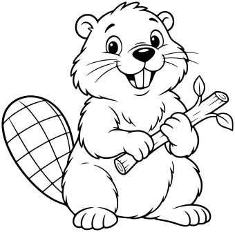

Whole seated beaver holding one short branch in two paws, broad flat paddle tail visible to side with only a few large crosshatch cells, small round ears and two front teeth. No water, dam or ground. Clear paws and branch ends.

- **Tags:** fall, Fall Animals, animals, beaver
- **Roles:** subject, accent
- **Detail:** moderate; **Facing:** none
- **Dimensions:** 340 x 336 scene units; **Visible Bounds:** left=2.5, top=2.5, right=337.5, bottom=333.5
- **Placement:** Preserve aspect ratio; flip and scale to suit the scene. Source conversion is ready for visual review.
- **Files:** [SVG](../../src/assets/vector/fall-beaver.svg), [Definition](../../src/assets/vector/fall-beaver.svg), [Source](../../art/source/fall/beaver.png)
- **Scene Examples:** Not yet used in a built-in scene.

## Sea Turtle

`category-expansion-sea-turtle`

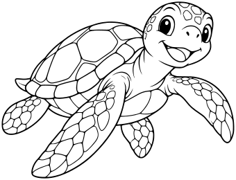

A cheerful sea turtle swimming in three-quarter view, four flippers, one head and short tail, broad shell plates, anatomically coherent. No bubbles.

- **Tags:** category-expansion, animals, sea-turtle
- **Roles:** subject, accent
- **Detail:** moderate; **Facing:** none
- **Dimensions:** 340 x 260 scene units; **Visible Bounds:** left=2.5, top=2.5, right=337.5, bottom=257.75
- **Placement:** Preserve aspect ratio; flip and scale to suit the scene. Source conversion is ready for visual review.
- **Files:** [SVG](../../src/assets/vector/category-expansion-sea-turtle.svg), [Definition](../../src/assets/vector/category-expansion-sea-turtle.svg), [Source](../../art/source/category-expansion/sea-turtle.png)
- **Scene Examples:** Not yet used in a built-in scene.

## Octopus

`category-expansion-octopus`

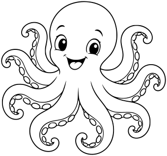

A cheerful octopus with exactly eight clearly readable curling arms arranged with spacious gaps, simple face, few large suction cups.

- **Tags:** category-expansion, animals, octopus
- **Roles:** subject, accent
- **Detail:** moderate; **Facing:** none
- **Dimensions:** 340 x 316 scene units; **Visible Bounds:** left=2.5, top=2.25, right=337.75, bottom=313.5
- **Placement:** Preserve aspect ratio; flip and scale to suit the scene. Source conversion is ready for visual review.
- **Files:** [SVG](../../src/assets/vector/category-expansion-octopus.svg), [Definition](../../src/assets/vector/category-expansion-octopus.svg), [Source](../../art/source/category-expansion/octopus.png)
- **Scene Examples:** Not yet used in a built-in scene.

## Dolphin

`category-expansion-dolphin`

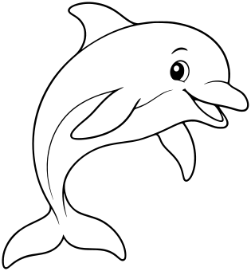

A friendly dolphin curving in a gentle swimming pose, clear beak, dorsal fin, two pectoral flippers and horizontal tail flukes. No splash.

- **Tags:** category-expansion, animals, dolphin
- **Roles:** subject, accent
- **Detail:** moderate; **Facing:** none
- **Dimensions:** 315 x 340 scene units; **Visible Bounds:** left=2.5, top=2.5, right=312.25, bottom=337.5
- **Placement:** Preserve aspect ratio; flip and scale to suit the scene. Source conversion is ready for visual review.
- **Files:** [SVG](../../src/assets/vector/category-expansion-dolphin.svg), [Definition](../../src/assets/vector/category-expansion-dolphin.svg), [Source](../../art/source/category-expansion/dolphin.png)
- **Scene Examples:** Not yet used in a built-in scene.

## Tropical Fish

`category-expansion-tropical-fish`

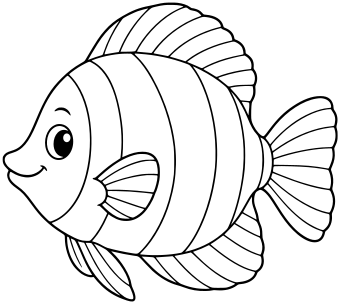

One friendly tropical fish side view with broad body, large simple stripe regions, dorsal and lower fins and a fan tail. No water or bubbles.

- **Tags:** category-expansion, animals, tropical-fish
- **Roles:** subject, accent
- **Detail:** moderate; **Facing:** none
- **Dimensions:** 340 x 304 scene units; **Visible Bounds:** left=2.75, top=2.5, right=337.5, bottom=301.5
- **Placement:** Preserve aspect ratio; flip and scale to suit the scene. Source conversion is ready for visual review.
- **Files:** [SVG](../../src/assets/vector/category-expansion-tropical-fish.svg), [Definition](../../src/assets/vector/category-expansion-tropical-fish.svg), [Source](../../art/source/category-expansion/tropical-fish.png)
- **Scene Examples:** Not yet used in a built-in scene.

## Pet Dog

`collection-expansion-pet-dog`

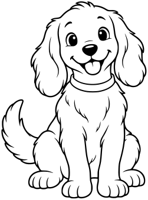

One friendly seated floppy-eared pet dog, natural canine proportions, four coherent legs/paws, curved tail, simple collar, small happy face. No accessories or props.

- **Tags:** collection-expansion, Pets & Farm, animals, pet-dog
- **Roles:** subject, accent
- **Detail:** moderate; **Facing:** none
- **Dimensions:** 251 x 340 scene units; **Visible Bounds:** left=2.5, top=2.25, right=248.5, bottom=337.25
- **Placement:** Preserve aspect ratio; flip and scale to suit the scene. Source conversion is ready for visual review.
- **Files:** [SVG](../../src/assets/vector/collection-expansion-pet-dog.svg), [Definition](../../src/assets/vector/collection-expansion-pet-dog.svg), [Source](../../art/source/collection-expansion/pet-dog.png)
- **Scene Examples:** Not yet used in a built-in scene.

## Pet Cat

`collection-expansion-pet-cat`

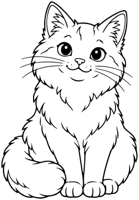

One friendly seated domestic cat, pointed ears, curled tail beside paws, simple whiskers and broad optional fur patches, no accessories.

- **Tags:** collection-expansion, Pets & Farm, animals, pet-cat
- **Roles:** subject, accent
- **Detail:** moderate; **Facing:** none
- **Dimensions:** 236 x 340 scene units; **Visible Bounds:** left=2.25, top=2.25, right=233.5, bottom=337.75
- **Placement:** Preserve aspect ratio; flip and scale to suit the scene. Source conversion is ready for visual review.
- **Files:** [SVG](../../src/assets/vector/collection-expansion-pet-cat.svg), [Definition](../../src/assets/vector/collection-expansion-pet-cat.svg), [Source](../../art/source/collection-expansion/pet-cat.png)
- **Scene Examples:** Not yet used in a built-in scene.

## Farm Pig

`collection-expansion-farm-pig`

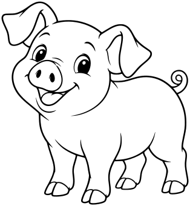

One cheerful young farm pig standing in three-quarter view, four short legs with cloven hooves, rounded snout, two ears, short curled tail. No clothing.

- **Tags:** collection-expansion, Pets & Farm, animals, farm-pig
- **Roles:** subject, accent
- **Detail:** moderate; **Facing:** none
- **Dimensions:** 314 x 340 scene units; **Visible Bounds:** left=2.5, top=2.5, right=311.5, bottom=337.75
- **Placement:** Preserve aspect ratio; flip and scale to suit the scene. Source conversion is ready for visual review.
- **Files:** [SVG](../../src/assets/vector/collection-expansion-farm-pig.svg), [Definition](../../src/assets/vector/collection-expansion-farm-pig.svg), [Source](../../art/source/collection-expansion/farm-pig.png)
- **Scene Examples:** Not yet used in a built-in scene.

## Farm Goat

`collection-expansion-farm-goat`

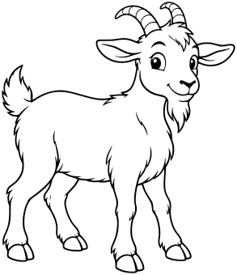

One friendly standing goat in side three-quarter view, four legs with cloven hooves, two short curved horns, small beard and short upright tail. No clothing.

- **Tags:** collection-expansion, Pets & Farm, animals, farm-goat
- **Roles:** subject, accent
- **Detail:** moderate; **Facing:** none
- **Dimensions:** 293 x 340 scene units; **Visible Bounds:** left=2.25, top=2.25, right=290.75, bottom=337.5
- **Placement:** Preserve aspect ratio; flip and scale to suit the scene. Source conversion is ready for visual review.
- **Files:** [SVG](../../src/assets/vector/collection-expansion-farm-goat.svg), [Definition](../../src/assets/vector/collection-expansion-farm-goat.svg), [Source](../../art/source/collection-expansion/farm-goat.png)
- **Scene Examples:** Not yet used in a built-in scene.

## Farm Hen

`collection-expansion-farm-hen`

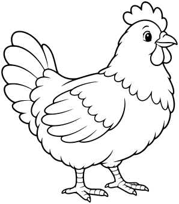

One friendly farm hen standing side view, rounded body, one visible folded wing, clear comb, wattle, beak and two legs with readable toes, simple broad tail feathers.

- **Tags:** collection-expansion, Pets & Farm, animals, farm-hen
- **Roles:** subject, accent
- **Detail:** moderate; **Facing:** none
- **Dimensions:** 298 x 340 scene units; **Visible Bounds:** left=2.25, top=2.25, right=295.75, bottom=337.75
- **Placement:** Preserve aspect ratio; flip and scale to suit the scene. Source conversion is ready for visual review.
- **Files:** [SVG](../../src/assets/vector/collection-expansion-farm-hen.svg), [Definition](../../src/assets/vector/collection-expansion-farm-hen.svg), [Source](../../art/source/collection-expansion/farm-hen.png)
- **Scene Examples:** Not yet used in a built-in scene.

## Farm Donkey

`collection-expansion-farm-donkey`

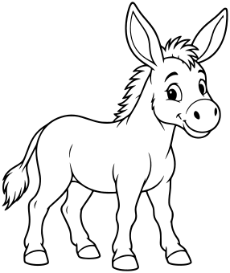

One friendly standing donkey in three-quarter side view, long ears, short upright mane, four coherent legs with hooves and a tufted tail. No saddle or clothing.

- **Tags:** collection-expansion, Pets & Farm, animals, farm-donkey
- **Roles:** subject, accent
- **Detail:** moderate; **Facing:** none
- **Dimensions:** 286 x 340 scene units; **Visible Bounds:** left=2.5, top=2.25, right=283.5, bottom=337.75
- **Placement:** Preserve aspect ratio; flip and scale to suit the scene. Source conversion is ready for visual review.
- **Files:** [SVG](../../src/assets/vector/collection-expansion-farm-donkey.svg), [Definition](../../src/assets/vector/collection-expansion-farm-donkey.svg), [Source](../../art/source/collection-expansion/farm-donkey.png)
- **Scene Examples:** Not yet used in a built-in scene.

## Branching Coral

`collection-expansion-branching-coral`

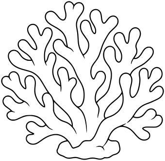

One compact branching coral colony with broad rounded finger-like branches, readable intentional holes and spacious gaps, small attached base. No fine pores or texture. Coral is an animal biologically; category intent should be Animals, scenery use.

- **Tags:** collection-expansion, Underwater, animals, branching-coral
- **Roles:** subject, accent
- **Detail:** moderate; **Facing:** none
- **Dimensions:** 340 x 331 scene units; **Visible Bounds:** left=2.5, top=2.25, right=337.75, bottom=328.5
- **Placement:** Preserve aspect ratio; flip and scale to suit the scene. Source conversion is ready for visual review.
- **Files:** [SVG](../../src/assets/vector/collection-expansion-branching-coral.svg), [Definition](../../src/assets/vector/collection-expansion-branching-coral.svg), [Source](../../art/source/collection-expansion/branching-coral.png)
- **Scene Examples:** Not yet used in a built-in scene.

## Tube Sponge

`collection-expansion-tube-sponge`

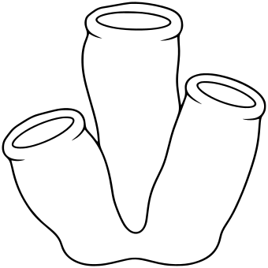

One small colony of three broad tube sponges joined at their base, rounded open rims shown with clear inner elliptical openings, smooth sides, no pores, no surrounding scene.

- **Tags:** collection-expansion, Underwater, animals, tube-sponge
- **Roles:** subject, accent
- **Detail:** moderate; **Facing:** none
- **Dimensions:** 340 x 340 scene units; **Visible Bounds:** left=2.5, top=2.5, right=337.5, bottom=337.5
- **Placement:** Preserve aspect ratio; flip and scale to suit the scene. Source conversion is ready for visual review.
- **Files:** [SVG](../../src/assets/vector/collection-expansion-tube-sponge.svg), [Definition](../../src/assets/vector/collection-expansion-tube-sponge.svg), [Source](../../art/source/collection-expansion/tube-sponge.png)
- **Scene Examples:** Not yet used in a built-in scene.

## Clam With Pearl

`collection-expansion-clam-with-pearl`

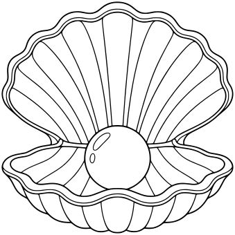

One open clam shell with clearly connected upper and lower shell halves, broad radiating ribs and one round pearl resting inside lower half, clean hinge and open cavity. No face or sea floor.

- **Tags:** collection-expansion, Underwater, animals, clam-with-pearl
- **Roles:** subject, accent
- **Detail:** moderate; **Facing:** none
- **Dimensions:** 339 x 340 scene units; **Visible Bounds:** left=2.5, top=2.5, right=336.5, bottom=337.5
- **Placement:** Preserve aspect ratio; flip and scale to suit the scene. Source conversion is ready for visual review.
- **Files:** [SVG](../../src/assets/vector/collection-expansion-clam-with-pearl.svg), [Definition](../../src/assets/vector/collection-expansion-clam-with-pearl.svg), [Source](../../art/source/collection-expansion/clam-with-pearl.png)
- **Scene Examples:** Not yet used in a built-in scene.

## Triceratops

`collection-expansion-triceratops`

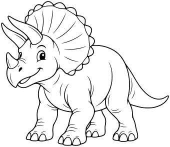

One friendly triceratops standing side three-quarter view, three horns (two brow horns and one short nose horn), broad scalloped frill, four sturdy legs and long tapering tail. Clean coherent anatomy.

- **Tags:** collection-expansion, Dinosaurs, animals, triceratops
- **Roles:** subject, accent
- **Detail:** moderate; **Facing:** none
- **Dimensions:** 340 x 294 scene units; **Visible Bounds:** left=2.25, top=2.25, right=337.75, bottom=291.5
- **Placement:** Preserve aspect ratio; flip and scale to suit the scene. Source conversion is ready for visual review.
- **Files:** [SVG](../../src/assets/vector/collection-expansion-triceratops.svg), [Definition](../../src/assets/vector/collection-expansion-triceratops.svg), [Source](../../art/source/collection-expansion/triceratops.png)
- **Scene Examples:** Not yet used in a built-in scene.

## Stegosaurus

`collection-expansion-stegosaurus`

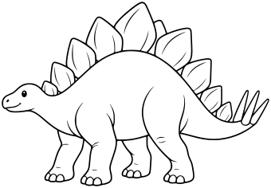

One friendly stegosaurus side view, small head, arched back with two staggered rows of broad plates, four sturdy legs, long tail ending in four simple spikes. No extra limbs.

- **Tags:** collection-expansion, Dinosaurs, animals, stegosaurus
- **Roles:** subject, accent
- **Detail:** moderate; **Facing:** none
- **Dimensions:** 340 x 236 scene units; **Visible Bounds:** left=2.25, top=2.25, right=337.75, bottom=233.75
- **Placement:** Preserve aspect ratio; flip and scale to suit the scene. Source conversion is ready for visual review.
- **Files:** [SVG](../../src/assets/vector/collection-expansion-stegosaurus.svg), [Definition](../../src/assets/vector/collection-expansion-stegosaurus.svg), [Source](../../art/source/collection-expansion/stegosaurus.png)
- **Scene Examples:** Not yet used in a built-in scene.

## Brachiosaurus

`collection-expansion-brachiosaurus`

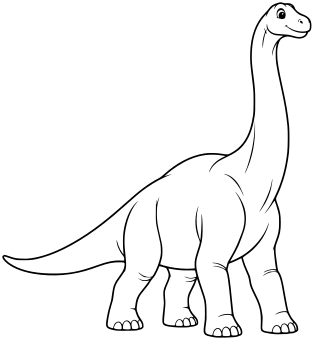

One friendly brachiosaurus in side three-quarter view, tall upward long neck and small head, front legs slightly longer than back legs, four feet, long tapering tail, broad clear body.

- **Tags:** collection-expansion, Dinosaurs, animals, brachiosaurus
- **Roles:** subject, accent
- **Detail:** moderate; **Facing:** none
- **Dimensions:** 314 x 340 scene units; **Visible Bounds:** left=2.25, top=2.25, right=311.5, bottom=337.75
- **Placement:** Preserve aspect ratio; flip and scale to suit the scene. Source conversion is ready for visual review.
- **Files:** [SVG](../../src/assets/vector/collection-expansion-brachiosaurus.svg), [Definition](../../src/assets/vector/collection-expansion-brachiosaurus.svg), [Source](../../art/source/collection-expansion/brachiosaurus.png)
- **Scene Examples:** Not yet used in a built-in scene.

## Tyrannosaurus

`collection-expansion-tyrannosaurus`

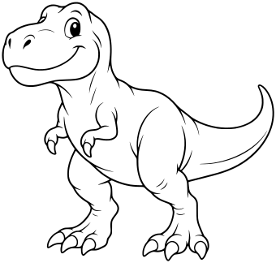

One friendly tyrannosaurus standing side three-quarter view, large head, two short arms each with two fingers, two sturdy hind legs, long balancing tail. Gentle closed-mouth smile, no ferocity.

- **Tags:** collection-expansion, Dinosaurs, animals, tyrannosaurus
- **Roles:** subject, accent
- **Detail:** moderate; **Facing:** none
- **Dimensions:** 340 x 324 scene units; **Visible Bounds:** left=2.5, top=2.5, right=337.75, bottom=321.75
- **Placement:** Preserve aspect ratio; flip and scale to suit the scene. Source conversion is ready for visual review.
- **Files:** [SVG](../../src/assets/vector/collection-expansion-tyrannosaurus.svg), [Definition](../../src/assets/vector/collection-expansion-tyrannosaurus.svg), [Source](../../art/source/collection-expansion/tyrannosaurus.png)
- **Scene Examples:** Not yet used in a built-in scene.

## Parasaurolophus

`collection-expansion-parasaurolophus`

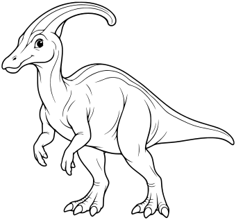

One friendly parasaurolophus side three-quarter view, distinctive long backward-curving hollow crest joined to skull, duck-like bill, two small forelimbs and two strong hind legs in grounded pose, long tail.

- **Tags:** collection-expansion, Dinosaurs, animals, parasaurolophus
- **Roles:** subject, accent
- **Detail:** moderate; **Facing:** none
- **Dimensions:** 340 x 317 scene units; **Visible Bounds:** left=2.25, top=2.5, right=337.75, bottom=314.75
- **Placement:** Preserve aspect ratio; flip and scale to suit the scene. Source conversion is ready for visual review.
- **Files:** [SVG](../../src/assets/vector/collection-expansion-parasaurolophus.svg), [Definition](../../src/assets/vector/collection-expansion-parasaurolophus.svg), [Source](../../art/source/collection-expansion/parasaurolophus.png)
- **Scene Examples:** Not yet used in a built-in scene.

## Pteranodon

`collection-expansion-pteranodon`

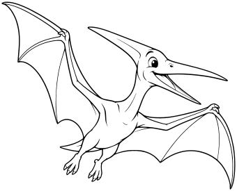

One friendly pteranodon flying, long toothless pointed beak and backward head crest, two coherent fully spread membrane wings supported by elongated wing fingers, two small hind feet and short tail. Entire wings clearly within frame.

- **Tags:** collection-expansion, Dinosaurs, animals, pteranodon
- **Roles:** subject, accent
- **Detail:** moderate; **Facing:** none
- **Dimensions:** 340 x 275 scene units; **Visible Bounds:** left=2.25, top=2.5, right=337.5, bottom=272.75
- **Placement:** Preserve aspect ratio; flip and scale to suit the scene. Source conversion is ready for visual review.
- **Files:** [SVG](../../src/assets/vector/collection-expansion-pteranodon.svg), [Definition](../../src/assets/vector/collection-expansion-pteranodon.svg), [Source](../../art/source/collection-expansion/pteranodon.png)
- **Scene Examples:** Not yet used in a built-in scene.

## Spotted Long-Neck Dinosaur

`dinosaur-spotted-long-neck`

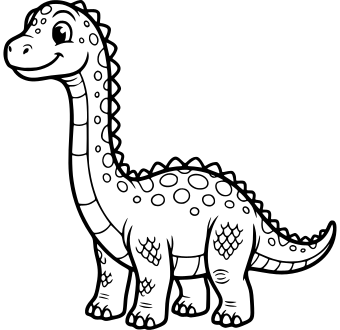

A cheerful long-neck dinosaur with spots, back spines and broad belly bands.

- **Tags:** dinosaurs, prehistoric, spotted-long-neck, user-supplied
- **Roles:** subject, accent
- **Detail:** detailed; **Facing:** left
- **Dimensions:** 340 x 330 scene units; **Visible Bounds:** left=3.5, top=0, right=336.5, bottom=330
- **Placement:** Decorative dinosaur variant. Preserve aspect ratio; flip to face right. Place feet on scene ground.
- **Files:** [SVG](../../src/assets/vector/dinosaur-spotted-long-neck.svg), [Definition](../../src/assets/vector/dinosaur-spotted-long-neck.svg), [Source](../../art/source/dinosaurs/spotted-long-neck.jpg)
- **Scene Examples:** Not yet used in a built-in scene.

## Striped Tyrannosaurus

`dinosaur-striped-tyrannosaurus`

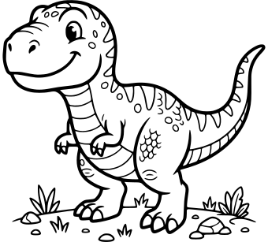

A cheerful striped tyrannosaurus standing on a small grassy ground patch.

- **Tags:** dinosaurs, prehistoric, striped-tyrannosaurus, user-supplied
- **Roles:** subject, accent
- **Detail:** detailed; **Facing:** left
- **Dimensions:** 340 x 307 scene units; **Visible Bounds:** left=3.5, top=0, right=336.5, bottom=307
- **Placement:** Decorative dinosaur variant. Preserve aspect ratio; flip to face right. Includes its original ground patch.
- **Files:** [SVG](../../src/assets/vector/dinosaur-striped-tyrannosaurus.svg), [Definition](../../src/assets/vector/dinosaur-striped-tyrannosaurus.svg), [Source](../../art/source/dinosaurs/striped-tyrannosaurus.jpg)
- **Scene Examples:** Not yet used in a built-in scene.

## Spotted Triceratops

`dinosaur-spotted-triceratops`

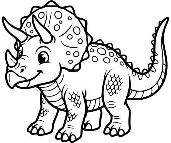

A cheerful spotted triceratops with decorative scales and back spines.

- **Tags:** dinosaurs, prehistoric, spotted-triceratops, user-supplied
- **Roles:** subject, accent
- **Detail:** detailed; **Facing:** left
- **Dimensions:** 340 x 284 scene units; **Visible Bounds:** left=3, top=0, right=336.75, bottom=284
- **Placement:** Decorative dinosaur variant. Preserve aspect ratio; flip to face right. Place feet on scene ground.
- **Files:** [SVG](../../src/assets/vector/dinosaur-spotted-triceratops.svg), [Definition](../../src/assets/vector/dinosaur-spotted-triceratops.svg), [Source](../../art/source/dinosaurs/spotted-triceratops.jpg)
- **Scene Examples:** Not yet used in a built-in scene.

## Dragon Hatchling

`fantasy-dragon-hatchling`

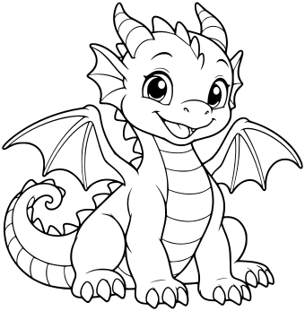

One playful baby dragon sitting, four legs plus two small separate membrane wings, rounded head, two short horns, curled tail, broad belly plates. No egg or props.

- **Tags:** fantasy, creatures, dragon-hatchling
- **Roles:** subject, accent
- **Detail:** moderate; **Facing:** none
- **Dimensions:** 340 x 347 scene units; **Visible Bounds:** left=2.25, top=2.5, right=337.5, bottom=344.75
- **Placement:** Preserve aspect ratio; position and scale to suit the scene. Review enclosed negative spaces after conversion.
- **Files:** [SVG](../../src/assets/vector/fantasy-dragon-hatchling.svg), [Definition](../../src/assets/vector/fantasy-dragon-hatchling.svg), [Source](../../art/source/fantasy/dragon-hatchling.png)
- **Scene Examples:** Not yet used in a built-in scene.

## Mountain Dragon

`fantasy-mountain-dragon`

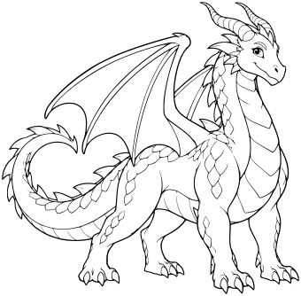

One majestic friendly adult western dragon standing in three-quarter side view, exactly four legs plus two folded membrane wings, two horns, long tail and broad belly plates. Sparse large scale details.

- **Tags:** fantasy, creatures, mountain-dragon
- **Roles:** subject, accent
- **Detail:** moderate; **Facing:** none
- **Dimensions:** 340 x 334 scene units; **Visible Bounds:** left=2.25, top=2.25, right=337.75, bottom=331.75
- **Placement:** Preserve aspect ratio; position and scale to suit the scene. Review enclosed negative spaces after conversion.
- **Files:** [SVG](../../src/assets/vector/fantasy-mountain-dragon.svg), [Definition](../../src/assets/vector/fantasy-mountain-dragon.svg), [Source](../../art/source/fantasy/mountain-dragon.png)
- **Scene Examples:** Not yet used in a built-in scene.

## Flying Wyvern

`fantasy-flying-wyvern`

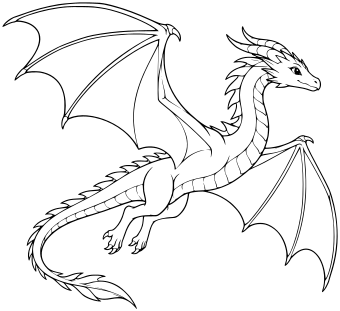

One graceful wyvern flying in profile, exactly two hind legs and two membrane wings that serve as forelimbs, long neck and tapering tail. Entire wings within frame, no extra front legs.

- **Tags:** fantasy, creatures, flying-wyvern
- **Roles:** subject, accent
- **Detail:** moderate; **Facing:** none
- **Dimensions:** 340 x 311 scene units; **Visible Bounds:** left=2.5, top=2.25, right=337.75, bottom=308.75
- **Placement:** Preserve aspect ratio; position and scale to suit the scene. Review enclosed negative spaces after conversion.
- **Files:** [SVG](../../src/assets/vector/fantasy-flying-wyvern.svg), [Definition](../../src/assets/vector/fantasy-flying-wyvern.svg), [Source](../../art/source/fantasy/flying-wyvern.png)
- **Scene Examples:** Not yet used in a built-in scene.

## Cloud Serpent

`fantasy-cloud-serpent`

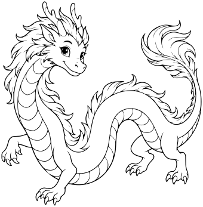

One friendly long serpentine dragon curled in a spacious S pose, four small clawed legs, no wings, two small branching horns and a simple flowing mane. No clouds or whisker tangles.

- **Tags:** fantasy, creatures, cloud-serpent
- **Roles:** subject, accent
- **Detail:** moderate; **Facing:** none
- **Dimensions:** 340 x 347 scene units; **Visible Bounds:** left=2.5, top=2.5, right=337.5, bottom=344.5
- **Placement:** Preserve aspect ratio; position and scale to suit the scene. Review enclosed negative spaces after conversion.
- **Files:** [SVG](../../src/assets/vector/fantasy-cloud-serpent.svg), [Definition](../../src/assets/vector/fantasy-cloud-serpent.svg), [Source](../../art/source/fantasy/cloud-serpent.png)
- **Scene Examples:** Not yet used in a built-in scene.

## Three-Headed Hydra

`fantasy-three-headed-hydra`

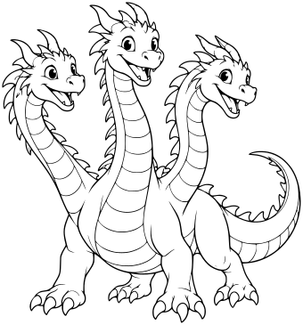

One friendly hydra with exactly three distinct long necks and three heads, one shared broad reptile body, four legs and one tail. Spacious readable neck gaps, no wings.

- **Tags:** fantasy, creatures, three-headed-hydra
- **Roles:** subject, accent
- **Detail:** moderate; **Facing:** none
- **Dimensions:** 340 x 365 scene units; **Visible Bounds:** left=2.5, top=2.5, right=337.5, bottom=362.5
- **Placement:** Preserve aspect ratio; position and scale to suit the scene. Review enclosed negative spaces after conversion.
- **Files:** [SVG](../../src/assets/vector/fantasy-three-headed-hydra.svg), [Definition](../../src/assets/vector/fantasy-three-headed-hydra.svg), [Source](../../art/source/fantasy/three-headed-hydra.png)
- **Scene Examples:** Not yet used in a built-in scene.

## Griffin

`fantasy-griffin`

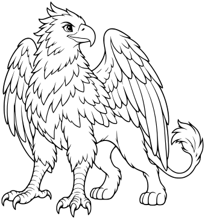

One proud friendly griffin standing, eagle head and beak, two broad folded feathered wings, two eagle front legs and two lion hind legs, one lion tail. Coherent clean hybrid anatomy.

- **Tags:** fantasy, creatures, griffin
- **Roles:** subject, accent
- **Detail:** moderate; **Facing:** none
- **Dimensions:** 340 x 362 scene units; **Visible Bounds:** left=2.5, top=2.5, right=337.5, bottom=359.5
- **Placement:** Preserve aspect ratio; position and scale to suit the scene. Review enclosed negative spaces after conversion.
- **Files:** [SVG](../../src/assets/vector/fantasy-griffin.svg), [Definition](../../src/assets/vector/fantasy-griffin.svg), [Source](../../art/source/fantasy/griffin.png)
- **Scene Examples:** Not yet used in a built-in scene.

## Phoenix

`fantasy-phoenix`

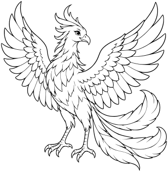

One graceful fantasy phoenix perched in a balanced pose with two wings partly spread, two feet, small head crest and three broad sweeping tail feathers. Feather shapes only, no fire or particles.

- **Tags:** fantasy, creatures, phoenix
- **Roles:** subject, accent
- **Detail:** moderate; **Facing:** none
- **Dimensions:** 340 x 349 scene units; **Visible Bounds:** left=2.25, top=2.25, right=337.75, bottom=346.5
- **Placement:** Preserve aspect ratio; position and scale to suit the scene. Review enclosed negative spaces after conversion.
- **Files:** [SVG](../../src/assets/vector/fantasy-phoenix.svg), [Definition](../../src/assets/vector/fantasy-phoenix.svg), [Source](../../art/source/fantasy/phoenix.png)
- **Scene Examples:** Not yet used in a built-in scene.

## Pegasus

`fantasy-pegasus`

One friendly winged horse standing in three-quarter side view, four horse legs, two clearly separate folded feathered wings, flowing mane and one tail, no horn.

- **Tags:** fantasy, creatures, pegasus
- **Roles:** subject, accent
- **Detail:** moderate; **Facing:** none
- **Dimensions:** 340 x 380 scene units; **Visible Bounds:** left=2.5, top=2.5, right=337.5, bottom=377.25
- **Placement:** Preserve aspect ratio; position and scale to suit the scene. Review enclosed negative spaces after conversion.
- **Files:** [SVG](../../src/assets/vector/fantasy-pegasus.svg), [Definition](../../src/assets/vector/fantasy-pegasus.svg), [Source](../../art/source/fantasy/pegasus.png)
- **Scene Examples:** Not yet used in a built-in scene.

## Unicorn

`fantasy-unicorn`

One friendly unicorn standing side three-quarter view, exactly one spiral forehead horn, four horse legs, flowing mane and tail. No wings or accessories.

- **Tags:** fantasy, creatures, unicorn
- **Roles:** subject, accent
- **Detail:** moderate; **Facing:** none
- **Dimensions:** 340 x 389 scene units; **Visible Bounds:** left=2.75, top=2.5, right=337.25, bottom=386.25
- **Placement:** Preserve aspect ratio; position and scale to suit the scene. Review enclosed negative spaces after conversion.
- **Files:** [SVG](../../src/assets/vector/fantasy-unicorn.svg), [Definition](../../src/assets/vector/fantasy-unicorn.svg), [Source](../../art/source/fantasy/unicorn.png)
- **Scene Examples:** Not yet used in a built-in scene.

## Cave Bat

`fantasy-cave-bat`

One friendly fantasy bat flying front three-quarter view, two large membrane wings, two small feet, pointed ears and a rounded furry body. Entire wing tips in frame.

- **Tags:** fantasy, creatures, cave-bat
- **Roles:** subject, accent
- **Detail:** moderate; **Facing:** none
- **Dimensions:** 340 x 262 scene units; **Visible Bounds:** left=2.25, top=2.25, right=337.75, bottom=259.75
- **Placement:** Preserve aspect ratio; position and scale to suit the scene. Review enclosed negative spaces after conversion.
- **Files:** [SVG](../../src/assets/vector/fantasy-cave-bat.svg), [Definition](../../src/assets/vector/fantasy-cave-bat.svg), [Source](../../art/source/fantasy/cave-bat.png)
- **Scene Examples:** Not yet used in a built-in scene.

## Smiling Slime

`fantasy-smiling-slime`

One friendly fantasy slime creature, low rounded translucent-looking blob outlined in black, simple eyes and smile, two broad enclosed highlight shapes. White interiors only, no drips detached from body.

- **Tags:** fantasy, creatures, smiling-slime
- **Roles:** subject, accent
- **Detail:** moderate; **Facing:** none
- **Dimensions:** 340 x 242 scene units; **Visible Bounds:** left=2.5, top=2.25, right=337.5, bottom=239.75
- **Placement:** Preserve aspect ratio; position and scale to suit the scene. Review enclosed negative spaces after conversion.
- **Files:** [SVG](../../src/assets/vector/fantasy-smiling-slime.svg), [Definition](../../src/assets/vector/fantasy-smiling-slime.svg), [Source](../../art/source/fantasy/smiling-slime.png)
- **Scene Examples:** Not yet used in a built-in scene.

