# Buildings

[All Assets](../CATALOG.md) | [Searchable Visual Browser](index.html) | [Machine Index](index.json)

Generated by `node scripts/build-asset-catalog.mjs`; edit metadata in `art/stickers.json`.

## Cottage

`garden-house`

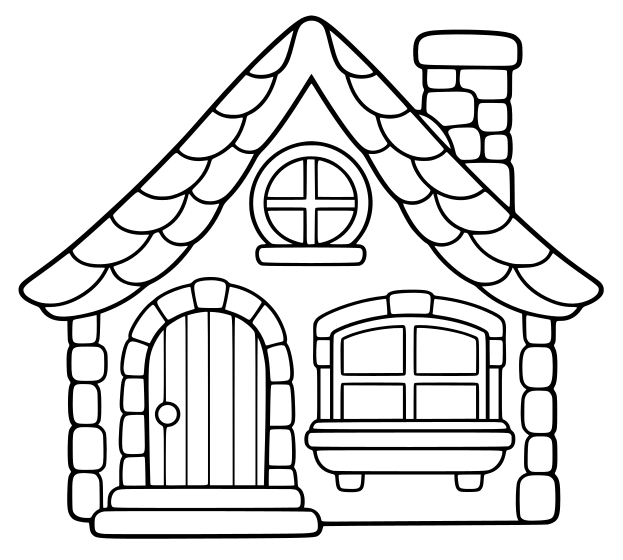

Cottage with roof, door and small architectural details.

- **Tags:** house, cottage, garden, village, home
- **Roles:** background, subject
- **Detail:** moderate; **Facing:** front
- **Dimensions:** 623 x 560 scene units; **Visible Bounds:** left=18.5, top=15.5, right=604, bottom=538.5
- **Placement:** Use flipX to change facing where useful. Preserve aspect ratio and leave comfortable coloring space.
- **Files:** [SVG](../../src/assets/vector/garden-house.svg), [Definition](../../src/assets/vector/garden-house.svg), [Source](../../art/source/generated/house.png)
- **Scene Examples:** [gardenScene.ts](../../src/editor/gardenScene.ts)

## Snowy Cabin

`winter-cabin`

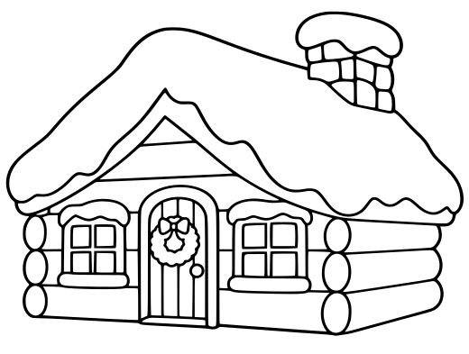

Snowy cabin with roof and architectural details.

- **Tags:** cabin, house, snow, winter, christmas
- **Roles:** background, subject
- **Detail:** detailed; **Facing:** front
- **Dimensions:** 520 x 393 scene units; **Visible Bounds:** left=6.75, top=12.75, right=514, bottom=372.75
- **Placement:** Use flipX to change facing where useful. Preserve aspect ratio and leave comfortable coloring space.
- **Files:** [SVG](../../src/assets/vector/winter-cabin.svg), [Definition](../../src/assets/vector/winter-cabin.svg), [Source](../../art/source/winter/cabin.png)
- **Scene Examples:** [winterScene.ts](../../src/editor/winterScene.ts)

## Window

`garden-window`

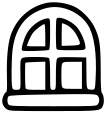

Decorative window to add to a building or scene.

- **Tags:** window, building, house, village
- **Roles:** accent
- **Detail:** moderate; **Facing:** front
- **Dimensions:** 106 x 113 scene units; **Visible Bounds:** left=2.25, top=2.25, right=103.75, bottom=111
- **Placement:** Use flipX to change facing where useful. Preserve aspect ratio and leave comfortable coloring space.
- **Files:** [SVG](../../src/assets/vector/garden-window.svg), [Definition](../../src/assets/vector/garden-window.svg), [Source](../../art/source/cottage-garden-PAINT-READY.bmp)
- **Scene Examples:** Not yet used in a built-in scene.

## Fence

`garden-fence`

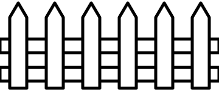

Repeated pointed pickets linked by two rails, with clear gaps.

- **Tags:** fence, garden, farm, village
- **Roles:** background, foreground
- **Detail:** moderate; **Facing:** front
- **Dimensions:** 360 x 148 scene units; **Visible Bounds:** left=0, top=2.5, right=360, bottom=147.5
- **Placement:** Use flipX to change facing where useful. Preserve aspect ratio and leave comfortable coloring space.
- **Files:** [SVG](../../src/assets/vector/garden-fence.svg), [Definition](../../src/assets/vector/garden-fence.svg), [Source](../../art/source/generated/fence.svg)
- **Scene Examples:** [gardenScene.ts](../../src/editor/gardenScene.ts)

## House Drainpipe

`nursery-rhymes-drainpipe`

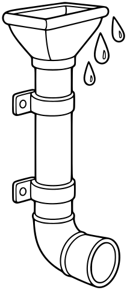

Standalone vertical rainwater pipe with a short gutter funnel at top and a curved outward elbow at bottom, two simple mounting brackets. A few broad outlined raindrops outside near upper end. No house wall, no spider, no background. Clear hollow opening at lower end.

- **Tags:** nursery-rhymes, Incy Wincy Spider, buildings, drainpipe
- **Roles:** subject, accent
- **Detail:** moderate; **Facing:** none
- **Dimensions:** 211 x 480 scene units; **Visible Bounds:** left=3.5, top=3.25, right=207.75, bottom=476.75
- **Placement:** Preserve aspect ratio; flip and scale to suit the scene. Source conversion is ready for visual review.
- **Files:** [SVG](../../src/assets/vector/nursery-rhymes-drainpipe.svg), [Definition](../../src/assets/vector/nursery-rhymes-drainpipe.svg), [Source](../../art/source/nursery-rhymes/drainpipe.png)
- **Scene Examples:** Not yet used in a built-in scene.

## Stone Well

`nursery-rhymes-stone-well`

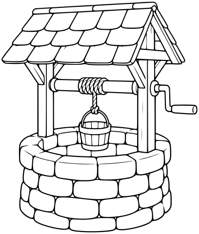

Three-quarter view, round low stone well with clearly open oval mouth, two posts and small pitched shingle roof, simple crank and rope suspending a little bucket near mouth. Large stone blocks and broad roof panels, no words, no children or ground.

- **Tags:** nursery-rhymes, Jack and Jill, buildings, stone-well
- **Roles:** subject, accent
- **Detail:** moderate; **Facing:** none
- **Dimensions:** 408 x 480 scene units; **Visible Bounds:** left=3, top=3.5, right=404.75, bottom=476.5
- **Placement:** Preserve aspect ratio; flip and scale to suit the scene. Source conversion is ready for visual review.
- **Files:** [SVG](../../src/assets/vector/nursery-rhymes-stone-well.svg), [Definition](../../src/assets/vector/nursery-rhymes-stone-well.svg), [Source](../../art/source/nursery-rhymes/stone-well.png)
- **Scene Examples:** Not yet used in a built-in scene.

## Storybook Barn

`nursery-rhymes-barn`

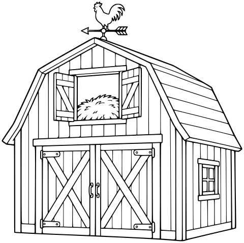

Whole front three-quarter view, gambrel roof, large double doors with broad X braces, open-looking hayloft window, simple boards and a weather vane with rooster silhouette but no letters. No animals, fence, landscape or ground. Moderately detailed spacious coloring regions.

- **Tags:** nursery-rhymes, Old MacDonald Had a Farm, buildings, barn
- **Roles:** subject, accent
- **Detail:** moderate; **Facing:** none
- **Dimensions:** 480 x 478 scene units; **Visible Bounds:** left=3.25, top=3.25, right=476.75, bottom=474.5
- **Placement:** Preserve aspect ratio; flip and scale to suit the scene. Source conversion is ready for visual review.
- **Files:** [SVG](../../src/assets/vector/nursery-rhymes-barn.svg), [Definition](../../src/assets/vector/nursery-rhymes-barn.svg), [Source](../../art/source/nursery-rhymes/barn.png)
- **Scene Examples:** Not yet used in a built-in scene.

## Humpty's Brick Wall

`nursery-rhymes-brick-wall`

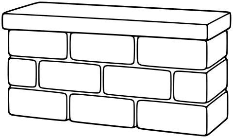

Low wide freestanding wall in slight three-quarter view, flat broad coping cap on top suitable for placing Humpty, three rows of large rectangular bricks, visible short end face. Clean intact wall, no people or ground or background. No tiny mortar texture.

- **Tags:** nursery-rhymes, Humpty Dumpty, buildings, brick-wall
- **Roles:** subject, accent
- **Detail:** moderate; **Facing:** none
- **Dimensions:** 480 x 284 scene units; **Visible Bounds:** left=3.25, top=3.5, right=476.5, bottom=280.5
- **Placement:** Preserve aspect ratio; flip and scale to suit the scene. Source conversion is ready for visual review.
- **Files:** [SVG](../../src/assets/vector/nursery-rhymes-brick-wall.svg), [Definition](../../src/assets/vector/nursery-rhymes-brick-wall.svg), [Source](../../art/source/nursery-rhymes/brick-wall.png)
- **Scene Examples:** Not yet used in a built-in scene.

## Little Schoolhouse

`nursery-rhymes-schoolhouse`

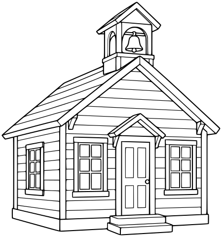

Whole front three-quarter view, simple pitched roof with little bell cupola, front door and two broad windows, two low steps. No letters, signs, flag, people or landscape; clean moderately detailed spacious coloring-book architecture.

- **Tags:** nursery-rhymes, Mary Had a Little Lamb, buildings, schoolhouse
- **Roles:** subject, accent
- **Detail:** moderate; **Facing:** none
- **Dimensions:** 450 x 480 scene units; **Visible Bounds:** left=3.25, top=3.75, right=446.5, bottom=476.5
- **Placement:** Preserve aspect ratio; flip and scale to suit the scene. Source conversion is ready for visual review.
- **Files:** [SVG](../../src/assets/vector/nursery-rhymes-schoolhouse.svg), [Definition](../../src/assets/vector/nursery-rhymes-schoolhouse.svg), [Source](../../art/source/nursery-rhymes/schoolhouse.png)
- **Scene Examples:** Not yet used in a built-in scene.

## Stone Bridge

`nursery-rhymes-stone-bridge`

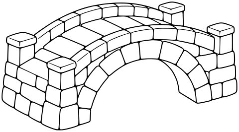

Whole bridge in slight three-quarter side view, broad curved walking top, low stone parapets and one large clear arch underneath. Large stone blocks, no river, people, plants or ground. Keep arch opening unobstructed and stone shapes white.

- **Tags:** nursery-rhymes, London Bridge, buildings, stone-bridge
- **Roles:** subject, accent
- **Detail:** moderate; **Facing:** none
- **Dimensions:** 480 x 266 scene units; **Visible Bounds:** left=3.25, top=3.25, right=476.75, bottom=262.5
- **Placement:** Preserve aspect ratio; flip and scale to suit the scene. Source conversion is ready for visual review.
- **Files:** [SVG](../../src/assets/vector/nursery-rhymes-stone-bridge.svg), [Definition](../../src/assets/vector/nursery-rhymes-stone-bridge.svg), [Source](../../art/source/nursery-rhymes/stone-bridge.png)
- **Scene Examples:** Not yet used in a built-in scene.

## Storybook Castle

`nursery-rhymes-storybook-castle`

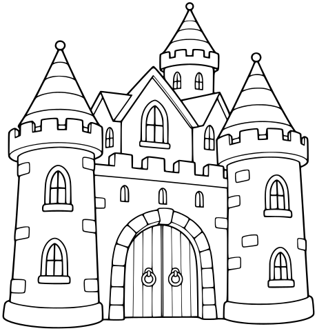

Whole compact castle front three-quarter view, two broad round towers with conical roofs, central arched double gate, a few large windows and simple crenellations. No flags with symbols, no words, no moat, no ground or people. Spacious coloring areas, moderate detail.

- **Tags:** nursery-rhymes, Humpty Dumpty, buildings, storybook-castle
- **Roles:** subject, accent
- **Detail:** moderate; **Facing:** none
- **Dimensions:** 460 x 480 scene units; **Visible Bounds:** left=3.5, top=3.25, right=456.25, bottom=476.25
- **Placement:** Preserve aspect ratio; flip and scale to suit the scene. Source conversion is ready for visual review.
- **Files:** [SVG](../../src/assets/vector/nursery-rhymes-storybook-castle.svg), [Definition](../../src/assets/vector/nursery-rhymes-storybook-castle.svg), [Source](../../art/source/nursery-rhymes/storybook-castle.png)
- **Scene Examples:** Not yet used in a built-in scene.

## Shoe House

`nursery-rhymes-shoe-house`

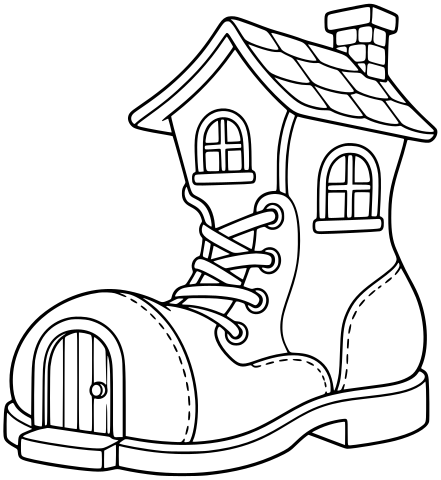

Whole large lace-up boot with a small front door in toe, two broad windows in upper boot, simple pitched roof over cuff and short chimney. Few broad lace loops, clear sole. No people, smoke, flowers or ground. Cozy fairy-tale architecture, no lettering.

- **Tags:** nursery-rhymes, There Was an Old Woman Who Lived in a Shoe, buildings, shoe-house
- **Roles:** subject, accent
- **Detail:** moderate; **Facing:** none
- **Dimensions:** 441 x 480 scene units; **Visible Bounds:** left=3.25, top=3.75, right=437.5, bottom=476.25
- **Placement:** Preserve aspect ratio; flip and scale to suit the scene. Source conversion is ready for visual review.
- **Files:** [SVG](../../src/assets/vector/nursery-rhymes-shoe-house.svg), [Definition](../../src/assets/vector/nursery-rhymes-shoe-house.svg), [Source](../../art/source/nursery-rhymes/shoe-house.png)
- **Scene Examples:** Not yet used in a built-in scene.

## Town House

`category-expansion-town-house`

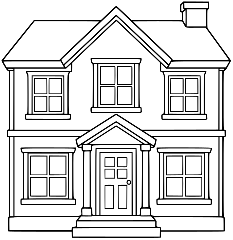

One standalone welcoming two-story town house, simple pitched roof, chimney, front door, broad windows and two front steps. No surrounding plants or ground.

- **Tags:** category-expansion, buildings, town-house
- **Roles:** subject, accent
- **Detail:** moderate; **Facing:** none
- **Dimensions:** 466 x 480 scene units; **Visible Bounds:** left=3.5, top=3.5, right=462.5, bottom=476
- **Placement:** Preserve aspect ratio; flip and scale to suit the scene. Source conversion is ready for visual review.
- **Files:** [SVG](../../src/assets/vector/category-expansion-town-house.svg), [Definition](../../src/assets/vector/category-expansion-town-house.svg), [Source](../../art/source/category-expansion/town-house.png)
- **Scene Examples:** Not yet used in a built-in scene.

## Fire Station

`category-expansion-fire-station`

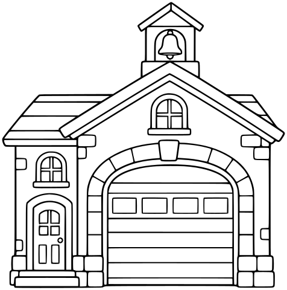

One small friendly fire station building, broad arched garage door, smaller entry door, simple windows and roof bell. No text, emblem, vehicle or surrounding scene.

- **Tags:** category-expansion, buildings, fire-station
- **Roles:** subject, accent
- **Detail:** moderate; **Facing:** none
- **Dimensions:** 476 x 480 scene units; **Visible Bounds:** left=3.5, top=3.25, right=472.5, bottom=476.75
- **Placement:** Preserve aspect ratio; flip and scale to suit the scene. Source conversion is ready for visual review.
- **Files:** [SVG](../../src/assets/vector/category-expansion-fire-station.svg), [Definition](../../src/assets/vector/category-expansion-fire-station.svg), [Source](../../art/source/category-expansion/fire-station.png)
- **Scene Examples:** Not yet used in a built-in scene.

## Lighthouse

`category-expansion-lighthouse`

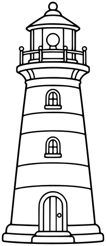

One standalone lighthouse with broad stripe bands, a clear lantern room and simple railing, small base door. No rocks, sea or ground.

- **Tags:** category-expansion, buildings, lighthouse
- **Roles:** subject, accent
- **Detail:** moderate; **Facing:** none
- **Dimensions:** 207 x 480 scene units; **Visible Bounds:** left=3.75, top=3.25, right=203.5, bottom=476.5
- **Placement:** Preserve aspect ratio; flip and scale to suit the scene. Source conversion is ready for visual review.
- **Files:** [SVG](../../src/assets/vector/category-expansion-lighthouse.svg), [Definition](../../src/assets/vector/category-expansion-lighthouse.svg), [Source](../../art/source/category-expansion/lighthouse.png)
- **Scene Examples:** Not yet used in a built-in scene.

## Windmill

`category-expansion-windmill`

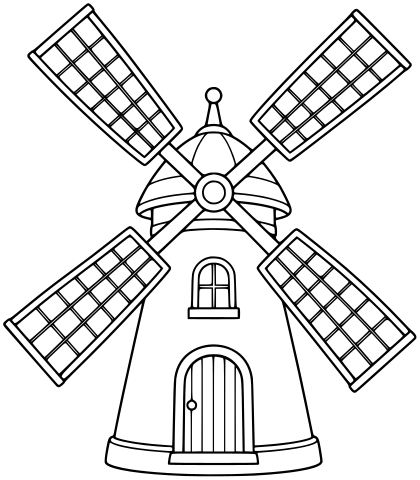

One charming traditional windmill building with four broad complete sails arranged diagonally, tapered tower, simple door and window. No landscape.

- **Tags:** category-expansion, buildings, windmill
- **Roles:** subject, accent
- **Detail:** moderate; **Facing:** none
- **Dimensions:** 420 x 480 scene units; **Visible Bounds:** left=3.25, top=3.25, right=416.5, bottom=476.25
- **Placement:** Preserve aspect ratio; flip and scale to suit the scene. Source conversion is ready for visual review.
- **Files:** [SVG](../../src/assets/vector/category-expansion-windmill.svg), [Definition](../../src/assets/vector/category-expansion-windmill.svg), [Source](../../art/source/category-expansion/windmill.png)
- **Scene Examples:** Not yet used in a built-in scene.

## Wizard Tower

`fantasy-wizard-tower`

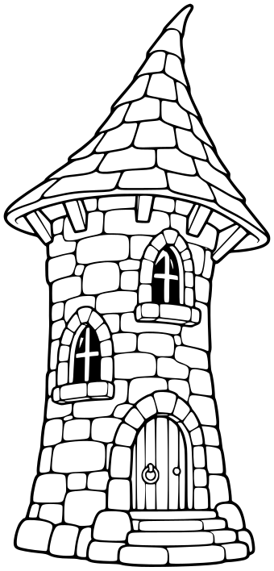

One standalone whimsical wizard tower, slightly crooked stone cylinder, broad pointed roof, two arched windows and one door with short steps. No scenery, stars, runes or flags.

- **Tags:** fantasy, fantasy props, wizard-tower
- **Roles:** subject, accent
- **Detail:** moderate; **Facing:** none
- **Dimensions:** 340 x 708 scene units; **Visible Bounds:** left=4.5, top=4.75, right=335.25, bottom=703
- **Placement:** Preserve aspect ratio; position and scale to suit the scene. Review enclosed negative spaces after conversion.
- **Files:** [SVG](../../src/assets/vector/fantasy-wizard-tower.svg), [Definition](../../src/assets/vector/fantasy-wizard-tower.svg), [Source](../../art/source/fantasy/wizard-tower.png)
- **Scene Examples:** Not yet used in a built-in scene.

## Castle Gate

`fantasy-castle-gate`

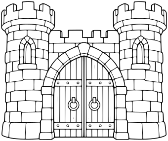

One freestanding fantasy castle gateway with two simple crenellated towers joined by an arched gate opening and a broad wooden gate with clear panels. No flags, text or landscape.

- **Tags:** fantasy, fantasy props, castle-gate
- **Roles:** subject, accent
- **Detail:** moderate; **Facing:** none
- **Dimensions:** 340 x 286 scene units; **Visible Bounds:** left=2.25, top=2.25, right=337.5, bottom=283.75
- **Placement:** Preserve aspect ratio; position and scale to suit the scene. Review enclosed negative spaces after conversion.
- **Files:** [SVG](../../src/assets/vector/fantasy-castle-gate.svg), [Definition](../../src/assets/vector/fantasy-castle-gate.svg), [Source](../../art/source/fantasy/castle-gate.png)
- **Scene Examples:** Not yet used in a built-in scene.

## Enchanted Door

`fantasy-enchanted-door`

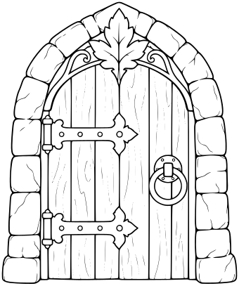

One freestanding arched wooden fantasy door in a simple stone frame with broad hinges, round handle and one large leaf motif at top. No text, runes, landscape or light effect.

- **Tags:** fantasy, fantasy props, enchanted-door
- **Roles:** subject, accent
- **Detail:** moderate; **Facing:** none
- **Dimensions:** 340 x 407 scene units; **Visible Bounds:** left=2.75, top=2.75, right=337.25, bottom=404
- **Placement:** Preserve aspect ratio; position and scale to suit the scene. Review enclosed negative spaces after conversion.
- **Files:** [SVG](../../src/assets/vector/fantasy-enchanted-door.svg), [Definition](../../src/assets/vector/fantasy-enchanted-door.svg), [Source](../../art/source/fantasy/enchanted-door.png)
- **Scene Examples:** Not yet used in a built-in scene.

