# Characters

[All Assets](../CATALOG.md) | [Searchable Visual Browser](index.html) | [Machine Index](index.json)

Generated by `node scripts/build-asset-catalog.mjs`; edit metadata in `art/stickers.json`.

## 1 - Astronaut

`counting-01`

Personified number one dressed as an astronaut.

- **Tags:** number, one, counting, astronaut, space, costume
- **Roles:** subject
- **Detail:** detailed; **Facing:** front
- **Dimensions:** 229 x 340 scene units; **Visible Bounds:** left=16.25, top=17.5, right=212.75, bottom=322.75
- **Placement:** Use flipX to change facing where useful. Preserve aspect ratio and leave comfortable coloring space.
- **Files:** [SVG](../../src/assets/vector/counting-01.svg), [Definition](../../src/assets/vector/counting-01.svg), [Source](../../art/source/counting/01.png)
- **Scene Examples:** [countingScene.ts](../../src/editor/countingScene.ts)

## 2 - Pirate

`counting-02`

Personified number two dressed as a pirate.

- **Tags:** number, two, counting, pirate, adventure, costume
- **Roles:** subject
- **Detail:** detailed; **Facing:** front
- **Dimensions:** 300 x 331 scene units; **Visible Bounds:** left=6.75, top=15.25, right=294.5, bottom=313
- **Placement:** Use flipX to change facing where useful. Preserve aspect ratio and leave comfortable coloring space.
- **Files:** [SVG](../../src/assets/vector/counting-02.svg), [Definition](../../src/assets/vector/counting-02.svg), [Source](../../art/source/counting/02.png)
- **Scene Examples:** [countingScene.ts](../../src/editor/countingScene.ts)

## 3 - Chef

`counting-03`

Personified number three dressed as a chef.

- **Tags:** number, three, counting, chef, kitchen, costume
- **Roles:** subject
- **Detail:** detailed; **Facing:** front
- **Dimensions:** 228 x 340 scene units; **Visible Bounds:** left=8.5, top=2.75, right=208.5, bottom=336.5
- **Placement:** Use flipX to change facing where useful. Preserve aspect ratio and leave comfortable coloring space.
- **Files:** [SVG](../../src/assets/vector/counting-03.svg), [Definition](../../src/assets/vector/counting-03.svg), [Source](../../art/source/counting/03.png)
- **Scene Examples:** [countingScene.ts](../../src/editor/countingScene.ts)

## 4 - Gardener

`counting-04`

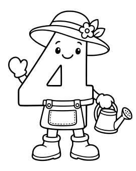

Personified number four dressed as a gardener.

- **Tags:** number, four, counting, gardener, garden, costume
- **Roles:** subject
- **Detail:** detailed; **Facing:** front
- **Dimensions:** 270 x 340 scene units; **Visible Bounds:** left=16.25, top=21, right=262.75, bottom=320.25
- **Placement:** Use flipX to change facing where useful. Preserve aspect ratio and leave comfortable coloring space.
- **Files:** [SVG](../../src/assets/vector/counting-04.svg), [Definition](../../src/assets/vector/counting-04.svg), [Source](../../art/source/counting/04.png)
- **Scene Examples:** [countingScene.ts](../../src/editor/countingScene.ts)

## 5 - Knight

`counting-05`

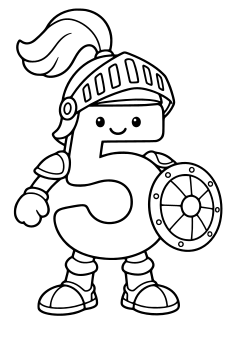

Personified number five dressed as a knight.

- **Tags:** number, five, counting, knight, castle, costume
- **Roles:** subject
- **Detail:** detailed; **Facing:** front
- **Dimensions:** 229 x 340 scene units; **Visible Bounds:** left=14, top=8.5, right=222.5, bottom=315.75
- **Placement:** Use flipX to change facing where useful. Preserve aspect ratio and leave comfortable coloring space.
- **Files:** [SVG](../../src/assets/vector/counting-05.svg), [Definition](../../src/assets/vector/counting-05.svg), [Source](../../art/source/counting/05.png)
- **Scene Examples:** [countingScene.ts](../../src/editor/countingScene.ts)

## 6 - Wizard

`counting-06`

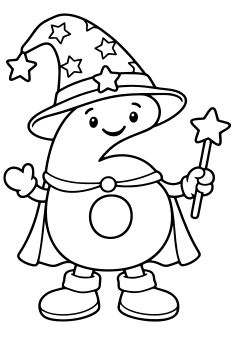

Personified number six dressed as a wizard.

- **Tags:** number, six, counting, wizard, fantasy, costume
- **Roles:** subject
- **Detail:** detailed; **Facing:** front
- **Dimensions:** 233 x 340 scene units; **Visible Bounds:** left=3.5, top=13.5, right=231, bottom=321.5
- **Placement:** Use flipX to change facing where useful. Preserve aspect ratio and leave comfortable coloring space.
- **Files:** [SVG](../../src/assets/vector/counting-06.svg), [Definition](../../src/assets/vector/counting-06.svg), [Source](../../art/source/counting/06.png)
- **Scene Examples:** [countingScene.ts](../../src/editor/countingScene.ts)

## 7 - Explorer

`counting-07`

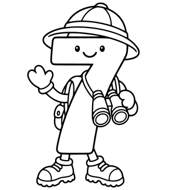

Personified number seven dressed as an explorer.

- **Tags:** number, seven, counting, explorer, adventure, safari, costume
- **Roles:** subject
- **Detail:** detailed; **Facing:** front
- **Dimensions:** 300 x 324 scene units; **Visible Bounds:** left=46.25, top=4.5, right=238, bottom=319.75
- **Placement:** Use flipX to change facing where useful. Preserve aspect ratio and leave comfortable coloring space.
- **Files:** [SVG](../../src/assets/vector/counting-07.svg), [Definition](../../src/assets/vector/counting-07.svg), [Source](../../art/source/counting/07.png)
- **Scene Examples:** [countingScene.ts](../../src/editor/countingScene.ts)

## 8 - Dancer

`counting-08`

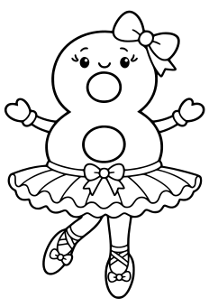

Personified number eight dressed as a dancer.

- **Tags:** number, eight, counting, dancer, music, costume
- **Roles:** subject
- **Detail:** detailed; **Facing:** front
- **Dimensions:** 232 x 340 scene units; **Visible Bounds:** left=5, top=11.75, right=227.5, bottom=331
- **Placement:** Use flipX to change facing where useful. Preserve aspect ratio and leave comfortable coloring space.
- **Files:** [SVG](../../src/assets/vector/counting-08.svg), [Definition](../../src/assets/vector/counting-08.svg), [Source](../../art/source/counting/08.png)
- **Scene Examples:** [countingScene.ts](../../src/editor/countingScene.ts)

## 9 - Firefighter

`counting-09`

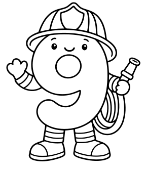

Personified number nine dressed as a firefighter.

- **Tags:** number, nine, counting, firefighter, helper, costume
- **Roles:** subject
- **Detail:** detailed; **Facing:** front
- **Dimensions:** 288 x 340 scene units; **Visible Bounds:** left=12.5, top=4.5, right=276.75, bottom=318.75
- **Placement:** Use flipX to change facing where useful. Preserve aspect ratio and leave comfortable coloring space.
- **Files:** [SVG](../../src/assets/vector/counting-09.svg), [Definition](../../src/assets/vector/counting-09.svg), [Source](../../art/source/counting/09.png)
- **Scene Examples:** [countingScene.ts](../../src/editor/countingScene.ts)

## 10 - Musician

`counting-10`

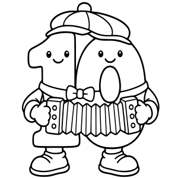

Personified number ten dressed as a musician.

- **Tags:** number, ten, counting, musician, music, costume
- **Roles:** subject
- **Detail:** detailed; **Facing:** front
- **Dimensions:** 300 x 300 scene units; **Visible Bounds:** left=37, top=3.5, right=268.75, bottom=298.25
- **Placement:** Use flipX to change facing where useful. Preserve aspect ratio and leave comfortable coloring space.
- **Files:** [SVG](../../src/assets/vector/counting-10.svg), [Definition](../../src/assets/vector/counting-10.svg), [Source](../../art/source/counting/10.png)
- **Scene Examples:** [countingScene.ts](../../src/editor/countingScene.ts)

## Skater

`winter-skater`

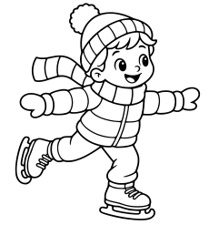

Child ice skating with scarf and winter clothes.

- **Tags:** child, skater, person, winter, ice
- **Roles:** subject
- **Detail:** moderate; **Facing:** right
- **Dimensions:** 230 x 247 scene units; **Visible Bounds:** left=16.75, top=3.5, right=220.25, bottom=241.75
- **Placement:** Use flipX to change facing where useful. Preserve aspect ratio and leave comfortable coloring space.
- **Files:** [SVG](../../src/assets/vector/winter-skater.svg), [Definition](../../src/assets/vector/winter-skater.svg), [Source](../../art/source/winter/skater.png)
- **Scene Examples:** [winterScene.ts](../../src/editor/winterScene.ts)

## Skating Friend

`winter-skater-friend`

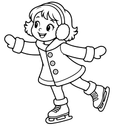

Second child ice skating in warm clothes.

- **Tags:** child, skater, person, winter, ice
- **Roles:** subject
- **Detail:** moderate; **Facing:** left
- **Dimensions:** 230 x 247 scene units; **Visible Bounds:** left=8.25, top=3.25, right=214, bottom=243
- **Placement:** Use flipX to change facing where useful. Preserve aspect ratio and leave comfortable coloring space.
- **Files:** [SVG](../../src/assets/vector/winter-skater-friend.svg), [Definition](../../src/assets/vector/winter-skater-friend.svg), [Source](../../art/source/winter/skater-friend.png)
- **Scene Examples:** [winterScene.ts](../../src/editor/winterScene.ts)

## Santa And Sleigh

`winter-santa-sleigh`

Santa sitting in a decorative sleigh.

- **Tags:** santa, sleigh, christmas, winter, holiday
- **Roles:** subject
- **Detail:** detailed; **Facing:** none
- **Dimensions:** 480 x 340 scene units; **Visible Bounds:** left=43.5, top=6, right=433.75, bottom=330.5
- **Placement:** Use flipX to change facing where useful. Preserve aspect ratio and leave comfortable coloring space.
- **Files:** [SVG](../../src/assets/vector/winter-santa-sleigh.svg), [Definition](../../src/assets/vector/winter-santa-sleigh.svg), [Source](../../art/source/winter/santa-sleigh.png)
- **Scene Examples:** [winterScene.ts](../../src/editor/winterScene.ts)

## Alien Explorer

`space-alien`

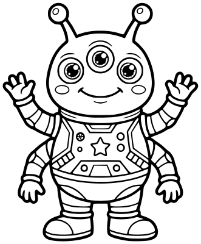

Friendly three-eyed alien in a detailed spacesuit.

- **Tags:** alien, space, explorer, character, astronaut
- **Roles:** subject
- **Detail:** detailed; **Facing:** front
- **Dimensions:** 331 x 400 scene units; **Visible Bounds:** left=4.5, top=4.75, right=326.25, bottom=395.5
- **Placement:** Use flipX to change facing where useful. Preserve aspect ratio and leave comfortable coloring space.
- **Files:** [SVG](../../src/assets/vector/space-alien.svg), [Definition](../../src/assets/vector/space-alien.svg), [Source](../../art/source/space/alien.jpg)
- **Scene Examples:** Not yet used in a built-in scene.

## A - Astronaut

`alphabet-a-astronaut`

Astronaut

- **Tags:** alphabet, characters, a-astronaut
- **Roles:** subject, accent
- **Detail:** moderate; **Facing:** none
- **Dimensions:** 292 x 340 scene units; **Visible Bounds:** left=2.25, top=2.25, right=289.5, bottom=337.75
- **Placement:** Preserve aspect ratio; flip and scale to suit the scene. Source conversion is ready for visual review.
- **Files:** [SVG](../../src/assets/vector/alphabet-a-astronaut.svg), [Definition](../../src/assets/vector/alphabet-a-astronaut.svg), [Source](../../art/source/alphabet/a-astronaut.png)
- **Scene Examples:** Not yet used in a built-in scene.

## B - Bee

`alphabet-b-bee`

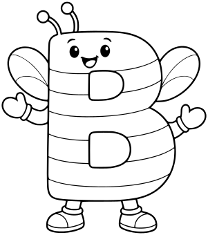

Bee

- **Tags:** alphabet, characters, b-bee
- **Roles:** subject, accent
- **Detail:** moderate; **Facing:** none
- **Dimensions:** 301 x 340 scene units; **Visible Bounds:** left=2.5, top=2.75, right=298.75, bottom=337.5
- **Placement:** Preserve aspect ratio; flip and scale to suit the scene. Source conversion is ready for visual review.
- **Files:** [SVG](../../src/assets/vector/alphabet-b-bee.svg), [Definition](../../src/assets/vector/alphabet-b-bee.svg), [Source](../../art/source/alphabet/b-bee.png)
- **Scene Examples:** Not yet used in a built-in scene.

## C - Cat

`alphabet-c-cat`

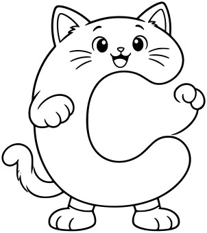

Cat

- **Tags:** alphabet, characters, c-cat
- **Roles:** subject, accent
- **Detail:** moderate; **Facing:** none
- **Dimensions:** 302 x 340 scene units; **Visible Bounds:** left=2.5, top=2.5, right=299.75, bottom=337.25
- **Placement:** Preserve aspect ratio; flip and scale to suit the scene. Source conversion is ready for visual review.
- **Files:** [SVG](../../src/assets/vector/alphabet-c-cat.svg), [Definition](../../src/assets/vector/alphabet-c-cat.svg), [Source](../../art/source/alphabet/c-cat.png)
- **Scene Examples:** Not yet used in a built-in scene.

## D - Dragon

`alphabet-d-dragon`

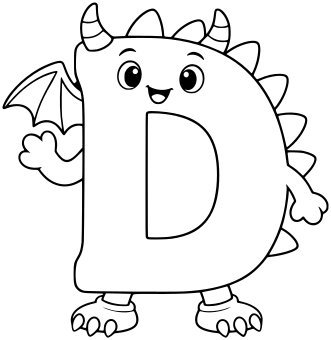

Dragon

- **Tags:** alphabet, characters, d-dragon
- **Roles:** subject, accent
- **Detail:** moderate; **Facing:** none
- **Dimensions:** 331 x 340 scene units; **Visible Bounds:** left=2.5, top=2.5, right=328.5, bottom=337.75
- **Placement:** Preserve aspect ratio; flip and scale to suit the scene. Source conversion is ready for visual review.
- **Files:** [SVG](../../src/assets/vector/alphabet-d-dragon.svg), [Definition](../../src/assets/vector/alphabet-d-dragon.svg), [Source](../../art/source/alphabet/d-dragon.png)
- **Scene Examples:** Not yet used in a built-in scene.

## E - Elephant

`alphabet-e-elephant`

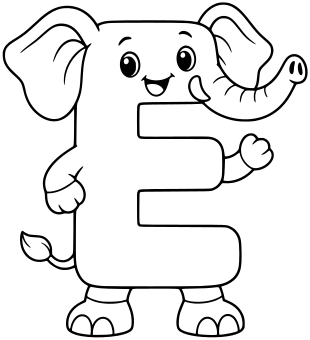

Elephant

- **Tags:** alphabet, characters, e-elephant
- **Roles:** subject, accent
- **Detail:** moderate; **Facing:** none
- **Dimensions:** 310 x 340 scene units; **Visible Bounds:** left=2.75, top=2.5, right=307.5, bottom=337.25
- **Placement:** Preserve aspect ratio; flip and scale to suit the scene. Source conversion is ready for visual review.
- **Files:** [SVG](../../src/assets/vector/alphabet-e-elephant.svg), [Definition](../../src/assets/vector/alphabet-e-elephant.svg), [Source](../../art/source/alphabet/e-elephant.png)
- **Scene Examples:** Not yet used in a built-in scene.

## F - Firefighter

`alphabet-f-firefighter`

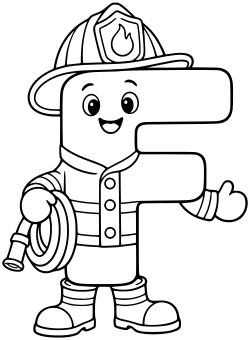

Firefighter

- **Tags:** alphabet, characters, f-firefighter
- **Roles:** subject, accent
- **Detail:** moderate; **Facing:** none
- **Dimensions:** 250 x 340 scene units; **Visible Bounds:** left=2.25, top=2.5, right=247.75, bottom=337.5
- **Placement:** Preserve aspect ratio; flip and scale to suit the scene. Source conversion is ready for visual review.
- **Files:** [SVG](../../src/assets/vector/alphabet-f-firefighter.svg), [Definition](../../src/assets/vector/alphabet-f-firefighter.svg), [Source](../../art/source/alphabet/f-firefighter.png)
- **Scene Examples:** Not yet used in a built-in scene.

## G - Giraffe

`alphabet-g-giraffe`

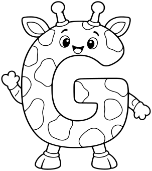

Giraffe

- **Tags:** alphabet, characters, g-giraffe
- **Roles:** subject, accent
- **Detail:** moderate; **Facing:** none
- **Dimensions:** 303 x 340 scene units; **Visible Bounds:** left=2.5, top=2.25, right=300.5, bottom=337.5
- **Placement:** Preserve aspect ratio; flip and scale to suit the scene. Source conversion is ready for visual review.
- **Files:** [SVG](../../src/assets/vector/alphabet-g-giraffe.svg), [Definition](../../src/assets/vector/alphabet-g-giraffe.svg), [Source](../../art/source/alphabet/g-giraffe.png)
- **Scene Examples:** Not yet used in a built-in scene.

## H - Horse

`alphabet-h-horse`

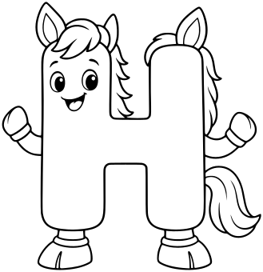

Horse

- **Tags:** alphabet, characters, h-horse
- **Roles:** subject, accent
- **Detail:** moderate; **Facing:** none
- **Dimensions:** 329 x 340 scene units; **Visible Bounds:** left=2.5, top=2.25, right=326.75, bottom=337.5
- **Placement:** Preserve aspect ratio; flip and scale to suit the scene. Source conversion is ready for visual review.
- **Files:** [SVG](../../src/assets/vector/alphabet-h-horse.svg), [Definition](../../src/assets/vector/alphabet-h-horse.svg), [Source](../../art/source/alphabet/h-horse.png)
- **Scene Examples:** Not yet used in a built-in scene.

## I - Ice Cream

`alphabet-i-ice-cream`

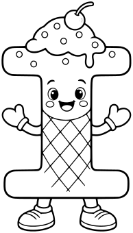

Ice Cream

- **Tags:** alphabet, characters, i-ice-cream
- **Roles:** subject, accent
- **Detail:** moderate; **Facing:** none
- **Dimensions:** 194 x 340 scene units; **Visible Bounds:** left=2.25, top=2.25, right=191.5, bottom=337.75
- **Placement:** Preserve aspect ratio; flip and scale to suit the scene. Source conversion is ready for visual review.
- **Files:** [SVG](../../src/assets/vector/alphabet-i-ice-cream.svg), [Definition](../../src/assets/vector/alphabet-i-ice-cream.svg), [Source](../../art/source/alphabet/i-ice-cream.png)
- **Scene Examples:** Not yet used in a built-in scene.

## J - Jellyfish

`alphabet-j-jellyfish`

Jellyfish

- **Tags:** alphabet, characters, j-jellyfish
- **Roles:** subject, accent
- **Detail:** moderate; **Facing:** none
- **Dimensions:** 248 x 340 scene units; **Visible Bounds:** left=2.25, top=2.5, right=245.5, bottom=337.75
- **Placement:** Preserve aspect ratio; flip and scale to suit the scene. Source conversion is ready for visual review.
- **Files:** [SVG](../../src/assets/vector/alphabet-j-jellyfish.svg), [Definition](../../src/assets/vector/alphabet-j-jellyfish.svg), [Source](../../art/source/alphabet/j-jellyfish.png)
- **Scene Examples:** Not yet used in a built-in scene.

## K - Kangaroo

`alphabet-k-kangaroo`

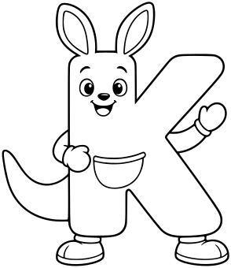

Kangaroo

- **Tags:** alphabet, characters, k-kangaroo
- **Roles:** subject, accent
- **Detail:** moderate; **Facing:** none
- **Dimensions:** 294 x 340 scene units; **Visible Bounds:** left=2.5, top=2.25, right=291.75, bottom=337.5
- **Placement:** Preserve aspect ratio; flip and scale to suit the scene. Source conversion is ready for visual review.
- **Files:** [SVG](../../src/assets/vector/alphabet-k-kangaroo.svg), [Definition](../../src/assets/vector/alphabet-k-kangaroo.svg), [Source](../../art/source/alphabet/k-kangaroo.png)
- **Scene Examples:** Not yet used in a built-in scene.

## L - Lion

`alphabet-l-lion`

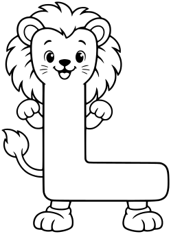

Lion

- **Tags:** alphabet, characters, l-lion
- **Roles:** subject, accent
- **Detail:** moderate; **Facing:** none
- **Dimensions:** 249 x 340 scene units; **Visible Bounds:** left=2.5, top=2.5, right=246.75, bottom=337.5
- **Placement:** Preserve aspect ratio; flip and scale to suit the scene. Source conversion is ready for visual review.
- **Files:** [SVG](../../src/assets/vector/alphabet-l-lion.svg), [Definition](../../src/assets/vector/alphabet-l-lion.svg), [Source](../../art/source/alphabet/l-lion.png)
- **Scene Examples:** Not yet used in a built-in scene.

## M - Monkey

`alphabet-m-monkey`

Monkey

- **Tags:** alphabet, characters, m-monkey
- **Roles:** subject, accent
- **Detail:** moderate; **Facing:** none
- **Dimensions:** 340 x 292 scene units; **Visible Bounds:** left=2.75, top=2.25, right=337.75, bottom=289.5
- **Placement:** Preserve aspect ratio; flip and scale to suit the scene. Source conversion is ready for visual review.
- **Files:** [SVG](../../src/assets/vector/alphabet-m-monkey.svg), [Definition](../../src/assets/vector/alphabet-m-monkey.svg), [Source](../../art/source/alphabet/m-monkey.png)
- **Scene Examples:** Not yet used in a built-in scene.

## N - Nurse

`alphabet-n-nurse`

Nurse

- **Tags:** alphabet, characters, n-nurse
- **Roles:** subject, accent
- **Detail:** moderate; **Facing:** none
- **Dimensions:** 335 x 340 scene units; **Visible Bounds:** left=2.75, top=2.5, right=332.5, bottom=337.5
- **Placement:** Preserve aspect ratio; flip and scale to suit the scene. Source conversion is ready for visual review.
- **Files:** [SVG](../../src/assets/vector/alphabet-n-nurse.svg), [Definition](../../src/assets/vector/alphabet-n-nurse.svg), [Source](../../art/source/alphabet/n-nurse.png)
- **Scene Examples:** Not yet used in a built-in scene.

## O - Octopus

`alphabet-o-octopus`

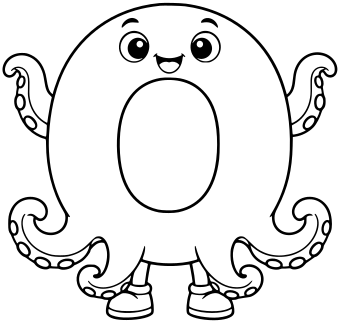

Octopus

- **Tags:** alphabet, characters, o-octopus
- **Roles:** subject, accent
- **Detail:** moderate; **Facing:** none
- **Dimensions:** 340 x 323 scene units; **Visible Bounds:** left=2.5, top=2.75, right=337.25, bottom=320.25
- **Placement:** Preserve aspect ratio; flip and scale to suit the scene. Source conversion is ready for visual review.
- **Files:** [SVG](../../src/assets/vector/alphabet-o-octopus.svg), [Definition](../../src/assets/vector/alphabet-o-octopus.svg), [Source](../../art/source/alphabet/o-octopus.png)
- **Scene Examples:** Not yet used in a built-in scene.

## P - Pirate

`alphabet-p-pirate`

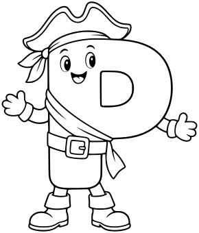

Pirate

- **Tags:** alphabet, characters, p-pirate
- **Roles:** subject, accent
- **Detail:** moderate; **Facing:** none
- **Dimensions:** 290 x 340 scene units; **Visible Bounds:** left=2.5, top=2.25, right=287.5, bottom=337.75
- **Placement:** Preserve aspect ratio; flip and scale to suit the scene. Source conversion is ready for visual review.
- **Files:** [SVG](../../src/assets/vector/alphabet-p-pirate.svg), [Definition](../../src/assets/vector/alphabet-p-pirate.svg), [Source](../../art/source/alphabet/p-pirate.png)
- **Scene Examples:** Not yet used in a built-in scene.

## Q - Queen

`alphabet-q-queen`

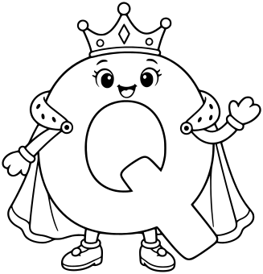

Queen

- **Tags:** alphabet, characters, q-queen
- **Roles:** subject, accent
- **Detail:** moderate; **Facing:** none
- **Dimensions:** 327 x 340 scene units; **Visible Bounds:** left=2.5, top=2.5, right=324.75, bottom=337.5
- **Placement:** Preserve aspect ratio; flip and scale to suit the scene. Source conversion is ready for visual review.
- **Files:** [SVG](../../src/assets/vector/alphabet-q-queen.svg), [Definition](../../src/assets/vector/alphabet-q-queen.svg), [Source](../../art/source/alphabet/q-queen.png)
- **Scene Examples:** Not yet used in a built-in scene.

## R - Robot

`alphabet-r-robot`

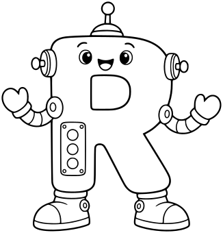

Robot

- **Tags:** alphabet, characters, r-robot
- **Roles:** subject, accent
- **Detail:** moderate; **Facing:** none
- **Dimensions:** 326 x 340 scene units; **Visible Bounds:** left=2.25, top=2.25, right=323.5, bottom=337.75
- **Placement:** Preserve aspect ratio; flip and scale to suit the scene. Source conversion is ready for visual review.
- **Files:** [SVG](../../src/assets/vector/alphabet-r-robot.svg), [Definition](../../src/assets/vector/alphabet-r-robot.svg), [Source](../../art/source/alphabet/r-robot.png)
- **Scene Examples:** Not yet used in a built-in scene.

## S - Snake

`alphabet-s-snake`

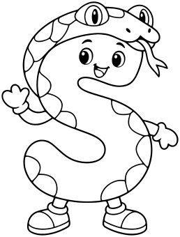

Snake

- **Tags:** alphabet, characters, s-snake
- **Roles:** subject, accent
- **Detail:** moderate; **Facing:** none
- **Dimensions:** 258 x 340 scene units; **Visible Bounds:** left=2.25, top=2.25, right=255.5, bottom=337.5
- **Placement:** Preserve aspect ratio; flip and scale to suit the scene. Source conversion is ready for visual review.
- **Files:** [SVG](../../src/assets/vector/alphabet-s-snake.svg), [Definition](../../src/assets/vector/alphabet-s-snake.svg), [Source](../../art/source/alphabet/s-snake.png)
- **Scene Examples:** Not yet used in a built-in scene.

## T - Tiger

`alphabet-t-tiger`

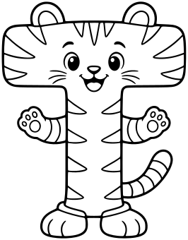

Tiger

- **Tags:** alphabet, characters, t-tiger
- **Roles:** subject, accent
- **Detail:** moderate; **Facing:** none
- **Dimensions:** 266 x 340 scene units; **Visible Bounds:** left=2.5, top=2.25, right=263.25, bottom=337.75
- **Placement:** Preserve aspect ratio; flip and scale to suit the scene. Source conversion is ready for visual review.
- **Files:** [SVG](../../src/assets/vector/alphabet-t-tiger.svg), [Definition](../../src/assets/vector/alphabet-t-tiger.svg), [Source](../../art/source/alphabet/t-tiger.png)
- **Scene Examples:** Not yet used in a built-in scene.

## U - Unicorn

`alphabet-u-unicorn`

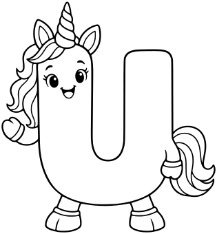

Unicorn

- **Tags:** alphabet, characters, u-unicorn
- **Roles:** subject, accent
- **Detail:** moderate; **Facing:** none
- **Dimensions:** 315 x 340 scene units; **Visible Bounds:** left=2.25, top=2.5, right=312.75, bottom=337.5
- **Placement:** Preserve aspect ratio; flip and scale to suit the scene. Source conversion is ready for visual review.
- **Files:** [SVG](../../src/assets/vector/alphabet-u-unicorn.svg), [Definition](../../src/assets/vector/alphabet-u-unicorn.svg), [Source](../../art/source/alphabet/u-unicorn.png)
- **Scene Examples:** Not yet used in a built-in scene.

## V - Viking

`alphabet-v-viking`

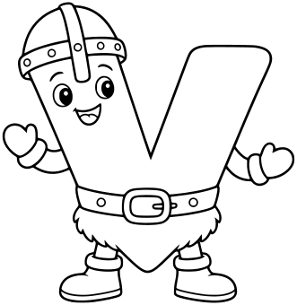

Viking

- **Tags:** alphabet, characters, v-viking
- **Roles:** subject, accent
- **Detail:** moderate; **Facing:** none
- **Dimensions:** 331 x 340 scene units; **Visible Bounds:** left=2.75, top=2.5, right=328, bottom=337.5
- **Placement:** Preserve aspect ratio; flip and scale to suit the scene. Source conversion is ready for visual review.
- **Files:** [SVG](../../src/assets/vector/alphabet-v-viking.svg), [Definition](../../src/assets/vector/alphabet-v-viking.svg), [Source](../../art/source/alphabet/v-viking.png)
- **Scene Examples:** Not yet used in a built-in scene.

## W - Wizard

`alphabet-w-wizard`

Wizard

- **Tags:** alphabet, characters, w-wizard
- **Roles:** subject, accent
- **Detail:** moderate; **Facing:** none
- **Dimensions:** 340 x 318 scene units; **Visible Bounds:** left=2.25, top=2.75, right=337.75, bottom=315.75
- **Placement:** Preserve aspect ratio; flip and scale to suit the scene. Source conversion is ready for visual review.
- **Files:** [SVG](../../src/assets/vector/alphabet-w-wizard.svg), [Definition](../../src/assets/vector/alphabet-w-wizard.svg), [Source](../../art/source/alphabet/w-wizard.png)
- **Scene Examples:** Not yet used in a built-in scene.

## X - X-ray

`alphabet-x-x-ray`

X-ray

- **Tags:** alphabet, characters, x-x-ray
- **Roles:** subject, accent
- **Detail:** moderate; **Facing:** none
- **Dimensions:** 296 x 340 scene units; **Visible Bounds:** left=2.25, top=2.5, right=293.75, bottom=337.5
- **Placement:** Preserve aspect ratio; flip and scale to suit the scene. Source conversion is ready for visual review.
- **Files:** [SVG](../../src/assets/vector/alphabet-x-x-ray.svg), [Definition](../../src/assets/vector/alphabet-x-x-ray.svg), [Source](../../art/source/alphabet/x-x-ray.png)
- **Scene Examples:** Not yet used in a built-in scene.

## Y - Yak

`alphabet-y-yak`

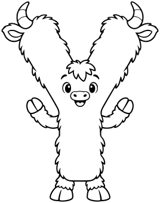

Yak

- **Tags:** alphabet, characters, y-yak
- **Roles:** subject, accent
- **Detail:** moderate; **Facing:** none
- **Dimensions:** 268 x 340 scene units; **Visible Bounds:** left=2.5, top=2.25, right=265.5, bottom=337.75
- **Placement:** Preserve aspect ratio; flip and scale to suit the scene. Source conversion is ready for visual review.
- **Files:** [SVG](../../src/assets/vector/alphabet-y-yak.svg), [Definition](../../src/assets/vector/alphabet-y-yak.svg), [Source](../../art/source/alphabet/y-yak.png)
- **Scene Examples:** Not yet used in a built-in scene.

## Z - Zebra

`alphabet-z-zebra`

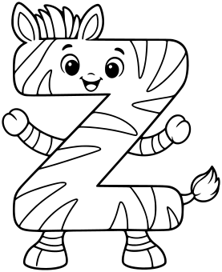

Zebra

- **Tags:** alphabet, characters, z-zebra
- **Roles:** subject, accent
- **Detail:** moderate; **Facing:** none
- **Dimensions:** 277 x 340 scene units; **Visible Bounds:** left=2.5, top=2.5, right=274.5, bottom=337.5
- **Placement:** Preserve aspect ratio; flip and scale to suit the scene. Source conversion is ready for visual review.
- **Files:** [SVG](../../src/assets/vector/alphabet-z-zebra.svg), [Definition](../../src/assets/vector/alphabet-z-zebra.svg), [Source](../../art/source/alphabet/z-zebra.png)
- **Scene Examples:** Not yet used in a built-in scene.

## Humpty Dumpty

`nursery-rhymes-humpty-dumpty`

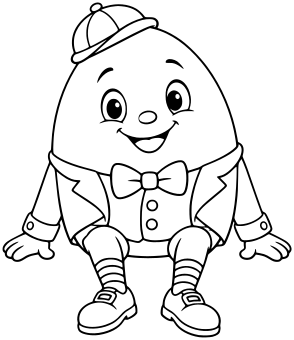

Whole intact egg character, small cap and bow tie, little jacket with buttons, striped socks and shoes. Seated pose with knees hanging down and hands resting beside hips. NO wall, no cracks, no extra egg, no scenery. Later placed on a separate wall asset.

- **Tags:** nursery-rhymes, Humpty Dumpty, characters, humpty-dumpty
- **Roles:** subject, accent
- **Detail:** moderate; **Facing:** none
- **Dimensions:** 294 x 340 scene units; **Visible Bounds:** left=2.5, top=2.5, right=291.5, bottom=337.5
- **Placement:** Preserve aspect ratio; flip and scale to suit the scene. Source conversion is ready for visual review.
- **Files:** [SVG](../../src/assets/vector/nursery-rhymes-humpty-dumpty.svg), [Definition](../../src/assets/vector/nursery-rhymes-humpty-dumpty.svg), [Source](../../art/source/nursery-rhymes/humpty-dumpty.png)
- **Scene Examples:** Not yet used in a built-in scene.

## Baby in Cradle

`nursery-rhymes-baby-cradle`

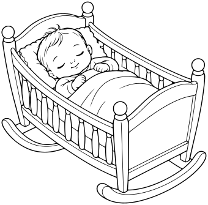

One integrated baby-and-cradle asset, three-quarter view, baby's peaceful face visible above a simple blanket, sturdy curved rockers, simple spindle ends. No overhead mobile or surrounding scene, no text.

- **Tags:** nursery-rhymes, Rock-a-bye Baby, characters, baby-cradle
- **Roles:** subject, accent
- **Detail:** moderate; **Facing:** none
- **Dimensions:** 340 x 335 scene units; **Visible Bounds:** left=2.5, top=2.5, right=337.5, bottom=332.5
- **Placement:** Preserve aspect ratio; flip and scale to suit the scene. Source conversion is ready for visual review.
- **Files:** [SVG](../../src/assets/vector/nursery-rhymes-baby-cradle.svg), [Definition](../../src/assets/vector/nursery-rhymes-baby-cradle.svg), [Source](../../art/source/nursery-rhymes/baby-cradle.png)
- **Scene Examples:** Not yet used in a built-in scene.

## Little Bo Peep

`nursery-rhymes-shepherd-child`

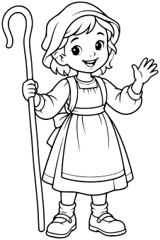

Whole child standing, simple bonnet, modest knee-length dress with apron, sturdy shoes, one hand holding a tall curved shepherd crook beside body, other hand waving. Clear hands, no sheep or landscape, no letters.

- **Tags:** nursery-rhymes, Little Bo Peep, characters, shepherd-child
- **Roles:** subject, accent
- **Detail:** moderate; **Facing:** none
- **Dimensions:** 226 x 340 scene units; **Visible Bounds:** left=2.5, top=2.25, right=223.75, bottom=337.75
- **Placement:** Preserve aspect ratio; flip and scale to suit the scene. Source conversion is ready for visual review.
- **Files:** [SVG](../../src/assets/vector/nursery-rhymes-shepherd-child.svg), [Definition](../../src/assets/vector/nursery-rhymes-shepherd-child.svg), [Source](../../art/source/nursery-rhymes/shepherd-child.png)
- **Scene Examples:** Not yet used in a built-in scene.

## Jack with Pail

`nursery-rhymes-jack-pail`

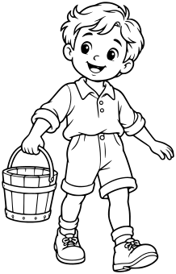

Whole cheerful child standing in simple old-fashioned shirt, shorts and sturdy shoes, one hand carrying a clearly outlined wooden pail with handle, other arm balancing. No hill, no Jill or well, no injury or bandage. Face friendly and clear.

- **Tags:** nursery-rhymes, Jack and Jill, characters, jack-pail
- **Roles:** subject, accent
- **Detail:** moderate; **Facing:** none
- **Dimensions:** 218 x 340 scene units; **Visible Bounds:** left=2.25, top=2.25, right=215.75, bottom=337.75
- **Placement:** Preserve aspect ratio; flip and scale to suit the scene. Source conversion is ready for visual review.
- **Files:** [SVG](../../src/assets/vector/nursery-rhymes-jack-pail.svg), [Definition](../../src/assets/vector/nursery-rhymes-jack-pail.svg), [Source](../../art/source/nursery-rhymes/jack-pail.png)
- **Scene Examples:** Not yet used in a built-in scene.

## Jill

`nursery-rhymes-jill`

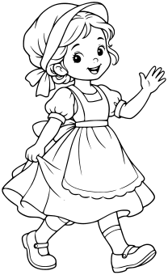

Whole cheerful child in simple bonnet or tied-back hair, knee-length dress with apron and sturdy shoes, one hand waving and other lightly lifting skirt hem for walking. Modest classic storybook style, no pail, hill or Jack.

- **Tags:** nursery-rhymes, Jack and Jill, characters, jill
- **Roles:** subject, accent
- **Detail:** moderate; **Facing:** none
- **Dimensions:** 208 x 340 scene units; **Visible Bounds:** left=2.25, top=2.25, right=205.75, bottom=337.25
- **Placement:** Preserve aspect ratio; flip and scale to suit the scene. Source conversion is ready for visual review.
- **Files:** [SVG](../../src/assets/vector/nursery-rhymes-jill.svg), [Definition](../../src/assets/vector/nursery-rhymes-jill.svg), [Source](../../art/source/nursery-rhymes/jill.png)
- **Scene Examples:** Not yet used in a built-in scene.

## Old MacDonald Farmer

`nursery-rhymes-farmer`

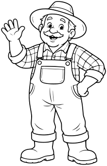

Whole older farmer with broad hat, round face, small mustache, checked shirt with only a few broad lines, overalls and boots, one hand waving and other resting on hip. No pitchfork, no animals, no words or farm background.

- **Tags:** nursery-rhymes, Old MacDonald Had a Farm, characters, farmer
- **Roles:** subject, accent
- **Detail:** moderate; **Facing:** none
- **Dimensions:** 220 x 340 scene units; **Visible Bounds:** left=2.25, top=2.25, right=217.75, bottom=337.5
- **Placement:** Preserve aspect ratio; flip and scale to suit the scene. Source conversion is ready for visual review.
- **Files:** [SVG](../../src/assets/vector/nursery-rhymes-farmer.svg), [Definition](../../src/assets/vector/nursery-rhymes-farmer.svg), [Source](../../art/source/nursery-rhymes/farmer.png)
- **Scene Examples:** Not yet used in a built-in scene.

## Running Dish and Spoon

`nursery-rhymes-dish-spoon`

ONE connected character-pair sticker: one round plate with a face and little legs on left, one upright spoon with face in bowl and little legs on right, holding hands in middle, running playfully. Clean separated outlines, no food, no words or scenery.

- **Tags:** nursery-rhymes, Hey Diddle Diddle, characters, dish-spoon
- **Roles:** subject, accent
- **Detail:** moderate; **Facing:** none
- **Dimensions:** 340 x 272 scene units; **Visible Bounds:** left=2.25, top=2.5, right=337.5, bottom=269.75
- **Placement:** Preserve aspect ratio; flip and scale to suit the scene. Source conversion is ready for visual review.
- **Files:** [SVG](../../src/assets/vector/nursery-rhymes-dish-spoon.svg), [Definition](../../src/assets/vector/nursery-rhymes-dish-spoon.svg), [Source](../../art/source/nursery-rhymes/dish-spoon.png)
- **Scene Examples:** Not yet used in a built-in scene.

## Royal Guard

`nursery-rhymes-royal-guard`

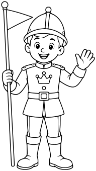

Whole guard standing in a simple rounded helmet, tunic with small outlined crown emblem, belt and boots, holding a tall pennant pole with a plain triangular flag, other hand waving. No weapons or armor complexity, no horse or scenery.

- **Tags:** nursery-rhymes, Humpty Dumpty, characters, royal-guard
- **Roles:** subject, accent
- **Detail:** moderate; **Facing:** none
- **Dimensions:** 191 x 340 scene units; **Visible Bounds:** left=2.5, top=2.5, right=188.5, bottom=337.75
- **Placement:** Preserve aspect ratio; flip and scale to suit the scene. Source conversion is ready for visual review.
- **Files:** [SVG](../../src/assets/vector/nursery-rhymes-royal-guard.svg), [Definition](../../src/assets/vector/nursery-rhymes-royal-guard.svg), [Source](../../art/source/nursery-rhymes/royal-guard.png)
- **Scene Examples:** Not yet used in a built-in scene.

## Mary with Schoolbook

`nursery-rhymes-mary`

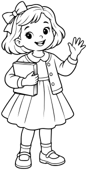

Whole child standing in simple knee-length dress and cardigan, bobbed hair with bow, sturdy shoes. One arm hugs a closed book with blank cover, other hand waves. No lamb or schoolhouse or lettering.

- **Tags:** nursery-rhymes, Mary Had a Little Lamb, characters, mary
- **Roles:** subject, accent
- **Detail:** moderate; **Facing:** none
- **Dimensions:** 174 x 340 scene units; **Visible Bounds:** left=2.5, top=2.25, right=171.75, bottom=337.75
- **Placement:** Preserve aspect ratio; flip and scale to suit the scene. Source conversion is ready for visual review.
- **Files:** [SVG](../../src/assets/vector/nursery-rhymes-mary.svg), [Definition](../../src/assets/vector/nursery-rhymes-mary.svg), [Source](../../art/source/nursery-rhymes/mary.png)
- **Scene Examples:** Not yet used in a built-in scene.

## Little Miss Muffet

`nursery-rhymes-miss-muffet`

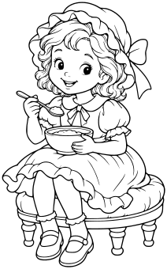

ONE integrated seated character and tuffet asset. Whole cheerful child in bonnet and simple dress, feet visible, small bowl on lap held in one hand and spoon in other. Low rounded cushioned stool under child, no spider or surrounding scene.

- **Tags:** nursery-rhymes, Little Miss Muffet, characters, miss-muffet
- **Roles:** subject, accent
- **Detail:** moderate; **Facing:** none
- **Dimensions:** 212 x 340 scene units; **Visible Bounds:** left=2.75, top=2.5, right=209.5, bottom=337.75
- **Placement:** Preserve aspect ratio; flip and scale to suit the scene. Source conversion is ready for visual review.
- **Files:** [SVG](../../src/assets/vector/nursery-rhymes-miss-muffet.svg), [Definition](../../src/assets/vector/nursery-rhymes-miss-muffet.svg), [Source](../../art/source/nursery-rhymes/miss-muffet.png)
- **Scene Examples:** Not yet used in a built-in scene.

## Pat-a-Cake Baker

`nursery-rhymes-baker`

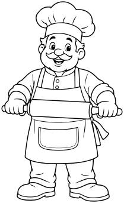

Whole baker in chef hat, simple shirt and apron, sturdy shoes, holding a rolling pin horizontally with two clear hands in front. Friendly face, no counters, pastries or words. Complete arm outlines and closed clothing shapes.

- **Tags:** nursery-rhymes, Pat-a-Cake, characters, baker
- **Roles:** subject, accent
- **Detail:** moderate; **Facing:** none
- **Dimensions:** 209 x 340 scene units; **Visible Bounds:** left=2.5, top=2.25, right=206.5, bottom=337.75
- **Placement:** Preserve aspect ratio; flip and scale to suit the scene. Source conversion is ready for visual review.
- **Files:** [SVG](../../src/assets/vector/nursery-rhymes-baker.svg), [Definition](../../src/assets/vector/nursery-rhymes-baker.svg), [Source](../../art/source/nursery-rhymes/baker.png)
- **Scene Examples:** Not yet used in a built-in scene.

## Little Boy Blue

`nursery-rhymes-little-boy-blue`

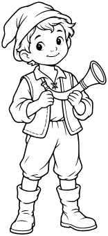

Whole child standing with simple floppy cap, shirt, vest, knee-length trousers and boots, holding a short curved brass horn with both hands at chest height. No color, no musical notes or words, no sheep or haystack.

- **Tags:** nursery-rhymes, Little Boy Blue, characters, little-boy-blue
- **Roles:** subject, accent
- **Detail:** moderate; **Facing:** none
- **Dimensions:** 156 x 340 scene units; **Visible Bounds:** left=2.25, top=2.5, right=153.75, bottom=337.75
- **Placement:** Preserve aspect ratio; flip and scale to suit the scene. Source conversion is ready for visual review.
- **Files:** [SVG](../../src/assets/vector/nursery-rhymes-little-boy-blue.svg), [Definition](../../src/assets/vector/nursery-rhymes-little-boy-blue.svg), [Source](../../art/source/nursery-rhymes/little-boy-blue.png)
- **Scene Examples:** Not yet used in a built-in scene.

## Jack Be Nimble

`nursery-rhymes-jack-be-nimble`

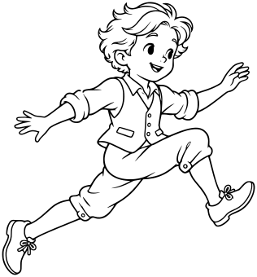

Whole cheerful child in simple waistcoat, shirt, knee-length trousers and soft shoes, athletic side-on leap with one knee up and other leg extended backward, arms balancing. No candlestick, flames, ground or motion lines; standalone character to place over separate candle.

- **Tags:** nursery-rhymes, Jack Be Nimble, characters, jack-be-nimble
- **Roles:** subject, accent
- **Detail:** moderate; **Facing:** none
- **Dimensions:** 316 x 340 scene units; **Visible Bounds:** left=2.5, top=2.5, right=313.5, bottom=337.25
- **Placement:** Preserve aspect ratio; flip and scale to suit the scene. Source conversion is ready for visual review.
- **Files:** [SVG](../../src/assets/vector/nursery-rhymes-jack-be-nimble.svg), [Definition](../../src/assets/vector/nursery-rhymes-jack-be-nimble.svg), [Source](../../art/source/nursery-rhymes/jack-be-nimble.png)
- **Scene Examples:** Not yet used in a built-in scene.

## Old King Cole

`nursery-rhymes-old-king-cole`

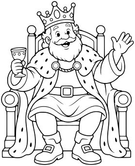

Whole jovial older king seated on a simple broad throne, crown, rounded face and small beard, royal cape and tunic, sturdy shoes. Holding a small plain goblet in one hand and waving other, no pipe, smoke, lettering or surrounding scene. Generous white clothing areas.

- **Tags:** nursery-rhymes, Old King Cole, characters, old-king-cole
- **Roles:** subject, accent
- **Detail:** moderate; **Facing:** none
- **Dimensions:** 278 x 340 scene units; **Visible Bounds:** left=2.25, top=2.25, right=275.5, bottom=337.75
- **Placement:** Preserve aspect ratio; flip and scale to suit the scene. Source conversion is ready for visual review.
- **Files:** [SVG](../../src/assets/vector/nursery-rhymes-old-king-cole.svg), [Definition](../../src/assets/vector/nursery-rhymes-old-king-cole.svg), [Source](../../art/source/nursery-rhymes/old-king-cole.png)
- **Scene Examples:** Not yet used in a built-in scene.

## Storybook Fiddler

`nursery-rhymes-storybook-fiddler`

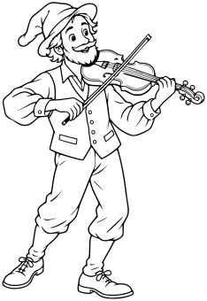

Whole adult fiddler in floppy cap, waistcoat, shirt, trousers and shoes, violin beneath chin, one hand on violin neck and other holding bow across strings. Clear coherent hand positions, simple instrument, no music notes, words or scenery.

- **Tags:** nursery-rhymes, Old King Cole, characters, storybook-fiddler
- **Roles:** subject, accent
- **Detail:** moderate; **Facing:** none
- **Dimensions:** 234 x 340 scene units; **Visible Bounds:** left=2.5, top=2.25, right=231.5, bottom=337.5
- **Placement:** Preserve aspect ratio; flip and scale to suit the scene. Source conversion is ready for visual review.
- **Files:** [SVG](../../src/assets/vector/nursery-rhymes-storybook-fiddler.svg), [Definition](../../src/assets/vector/nursery-rhymes-storybook-fiddler.svg), [Source](../../art/source/nursery-rhymes/storybook-fiddler.png)
- **Scene Examples:** Not yet used in a built-in scene.

## Nursery Garden Child

`nursery-rhymes-garden-child`

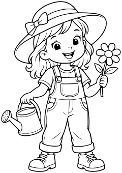

Whole child in simple broad sunhat, overalls over shirt and sturdy shoes, holding small watering can with one hand and a broad flower in other. Clear handles and complete arm outlines, no water stream, plants, ground or words.

- **Tags:** nursery-rhymes, Mary Mary Quite Contrary, characters, garden-child
- **Roles:** subject, accent
- **Detail:** moderate; **Facing:** none
- **Dimensions:** 240 x 340 scene units; **Visible Bounds:** left=2.5, top=2.25, right=237.5, bottom=337.75
- **Placement:** Preserve aspect ratio; flip and scale to suit the scene. Source conversion is ready for visual review.
- **Files:** [SVG](../../src/assets/vector/nursery-rhymes-garden-child.svg), [Definition](../../src/assets/vector/nursery-rhymes-garden-child.svg), [Source](../../art/source/nursery-rhymes/garden-child.png)
- **Scene Examples:** Not yet used in a built-in scene.

## Rowing Child

`nursery-rhymes-rowing-child`

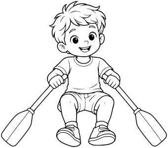

Whole cheerful child in simple shirt and shorts, soft shoes, seated pose with knees bent and feet visible, two hands each gripping an oar handle with blades extending out to sides. NO boat or bench; intended to layer over separate rowboat. All oar tips within image, coherent hands and limbs.

- **Tags:** nursery-rhymes, Row Row Row Your Boat, characters, rowing-child
- **Roles:** subject, accent
- **Detail:** moderate; **Facing:** none
- **Dimensions:** 340 x 300 scene units; **Visible Bounds:** left=2.25, top=2.25, right=337.75, bottom=297.75
- **Placement:** Preserve aspect ratio; flip and scale to suit the scene. Source conversion is ready for visual review.
- **Files:** [SVG](../../src/assets/vector/nursery-rhymes-rowing-child.svg), [Definition](../../src/assets/vector/nursery-rhymes-rowing-child.svg), [Source](../../art/source/nursery-rhymes/rowing-child.png)
- **Scene Examples:** Not yet used in a built-in scene.

## Bus Driver

`nursery-rhymes-bus-driver`

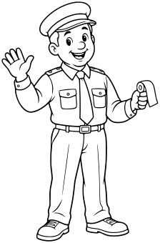

Whole adult driver standing in simple peaked cap without insignia, collared uniform shirt, trousers and shoes, one hand waving and other holding a small plain ticket roll. No text, badge lettering, bus or scenery. Friendly face and clear complete limbs.

- **Tags:** nursery-rhymes, The Wheels on the Bus, characters, bus-driver
- **Roles:** subject, accent
- **Detail:** moderate; **Facing:** none
- **Dimensions:** 224 x 340 scene units; **Visible Bounds:** left=2.25, top=2.25, right=221.5, bottom=337.75
- **Placement:** Preserve aspect ratio; flip and scale to suit the scene. Source conversion is ready for visual review.
- **Files:** [SVG](../../src/assets/vector/nursery-rhymes-bus-driver.svg), [Definition](../../src/assets/vector/nursery-rhymes-bus-driver.svg), [Source](../../art/source/nursery-rhymes/bus-driver.png)
- **Scene Examples:** Not yet used in a built-in scene.

## Friendly Scarecrow

`fall-scarecrow`

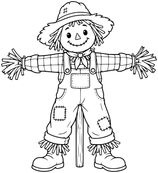

Smiling round cloth face with simple stitched smile, floppy straw hat, plaid-style shirt with only a few broad lines, patchwork overalls, small straw tufts at cuffs and boots. Arms open in welcoming pose, supported by one simple wooden post visible between legs. No field or birds.

- **Tags:** fall, Fall Characters, characters, scarecrow
- **Roles:** subject, accent
- **Detail:** moderate; **Facing:** none
- **Dimensions:** 311 x 340 scene units; **Visible Bounds:** left=2.25, top=2.25, right=308.75, bottom=337.75
- **Placement:** Preserve aspect ratio; flip and scale to suit the scene. Source conversion is ready for visual review.
- **Files:** [SVG](../../src/assets/vector/fall-scarecrow.svg), [Definition](../../src/assets/vector/fall-scarecrow.svg), [Source](../../art/source/fall/scarecrow.png)
- **Scene Examples:** Not yet used in a built-in scene.

## Child Raking Leaves

`fall-child-raking`

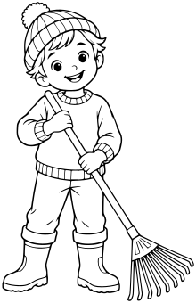

Whole child in sweater, rolled trousers and rain boots, knit hat, holding a small fan rake with both hands sensibly spaced on handle, rake head resting to one side. All limbs and rake tips fully visible. No pile or ground. Simple broad clothing details.

- **Tags:** fall, Fall Activities, characters, child-raking
- **Roles:** subject, accent
- **Detail:** moderate; **Facing:** none
- **Dimensions:** 220 x 340 scene units; **Visible Bounds:** left=2.5, top=2.25, right=217.75, bottom=337.75
- **Placement:** Preserve aspect ratio; flip and scale to suit the scene. Source conversion is ready for visual review.
- **Files:** [SVG](../../src/assets/vector/fall-child-raking.svg), [Definition](../../src/assets/vector/fall-child-raking.svg), [Source](../../art/source/fall/child-raking.png)
- **Scene Examples:** Not yet used in a built-in scene.

## Child Jumping into Leaves

`fall-child-leaf-jump`

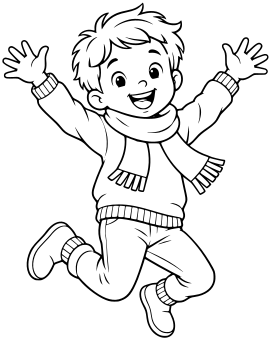

Whole child airborne with bent knees, sweater, scarf with short ends, trousers and ankle boots, smiling face. NO leaves or leaf pile included; intended to place above our separate leaf pile. Clear complete arm and leg contours, no motion lines or ground.

- **Tags:** fall, Fall Activities, characters, child-leaf-jump
- **Roles:** subject, accent
- **Detail:** moderate; **Facing:** none
- **Dimensions:** 271 x 340 scene units; **Visible Bounds:** left=2.5, top=2.75, right=268.5, bottom=337.75
- **Placement:** Preserve aspect ratio; flip and scale to suit the scene. Source conversion is ready for visual review.
- **Files:** [SVG](../../src/assets/vector/fall-child-leaf-jump.svg), [Definition](../../src/assets/vector/fall-child-leaf-jump.svg), [Source](../../art/source/fall/child-leaf-jump.png)
- **Scene Examples:** Not yet used in a built-in scene.

## Child Carrying Apples

`fall-apple-picking-child`

Whole child in sweater, trousers and ankle boots, short curly hair, carrying small handled basket with three visible apples in front with BOTH hands naturally holding handle. No tree, ladder, ground or surrounding fruit. Broad simple clothing details.

- **Tags:** fall, Fall Activities, characters, apple-picking-child
- **Roles:** subject, accent
- **Detail:** moderate; **Facing:** none
- **Dimensions:** 144 x 340 scene units; **Visible Bounds:** left=2.5, top=2.25, right=141.5, bottom=337.5
- **Placement:** Preserve aspect ratio; flip and scale to suit the scene. Source conversion is ready for visual review.
- **Files:** [SVG](../../src/assets/vector/fall-apple-picking-child.svg), [Definition](../../src/assets/vector/fall-apple-picking-child.svg), [Source](../../art/source/fall/apple-picking-child.png)
- **Scene Examples:** Not yet used in a built-in scene.

## Waving Child

`collection-expansion-child-waving`

One young child standing and waving one open hand, short curly hair, simple T-shirt, shorts and sneakers, friendly modest face, other arm relaxed. Exactly two arms and two legs, readable fingers.

- **Tags:** collection-expansion, Everyday People, characters, child-waving
- **Roles:** subject, accent
- **Detail:** moderate; **Facing:** none
- **Dimensions:** 175 x 340 scene units; **Visible Bounds:** left=2.25, top=2.25, right=172.5, bottom=337.5
- **Placement:** Preserve aspect ratio; flip and scale to suit the scene. Source conversion is ready for visual review.
- **Files:** [SVG](../../src/assets/vector/collection-expansion-child-waving.svg), [Definition](../../src/assets/vector/collection-expansion-child-waving.svg), [Source](../../art/source/collection-expansion/child-waving.png)
- **Scene Examples:** Not yet used in a built-in scene.

## Child With Backpack

`collection-expansion-child-with-backpack`

One young child with two braids wearing a simple backpack, long trousers and sneakers, walking gently in three-quarter view. Both arms and legs clear, no lettering, backpack straps and arm boundaries distinct.

- **Tags:** collection-expansion, Everyday People, characters, child-with-backpack
- **Roles:** subject, accent
- **Detail:** moderate; **Facing:** none
- **Dimensions:** 178 x 340 scene units; **Visible Bounds:** left=2.25, top=2.25, right=175.5, bottom=337.75
- **Placement:** Preserve aspect ratio; flip and scale to suit the scene. Source conversion is ready for visual review.
- **Files:** [SVG](../../src/assets/vector/collection-expansion-child-with-backpack.svg), [Definition](../../src/assets/vector/collection-expansion-child-with-backpack.svg), [Source](../../art/source/collection-expansion/child-with-backpack.png)
- **Scene Examples:** Not yet used in a built-in scene.

## Child Using a Wheelchair

`collection-expansion-child-wheelchair`

One cheerful child sitting naturally in a manual wheelchair, three-quarter view, clear two large rear wheels with push rims and two small front casters as visible, hands resting on lap, feet on footplates, simple clothes. Coherent practical chair, clean readable overlaps, no medical scene.

- **Tags:** collection-expansion, Everyday People, characters, child-wheelchair
- **Roles:** subject, accent
- **Detail:** moderate; **Facing:** none
- **Dimensions:** 262 x 340 scene units; **Visible Bounds:** left=2.25, top=2.25, right=259.75, bottom=337.75
- **Placement:** Preserve aspect ratio; flip and scale to suit the scene. Source conversion is ready for visual review.
- **Files:** [SVG](../../src/assets/vector/collection-expansion-child-wheelchair.svg), [Definition](../../src/assets/vector/collection-expansion-child-wheelchair.svg), [Source](../../art/source/collection-expansion/child-wheelchair.png)
- **Scene Examples:** Not yet used in a built-in scene.

## Grandparent

`collection-expansion-grandparent`

One smiling grandparent standing in simple cardigan and trousers, round glasses and short wavy hair, one hand raised in greeting, natural friendly proportions. No prop or ground.

- **Tags:** collection-expansion, Everyday People, characters, grandparent
- **Roles:** subject, accent
- **Detail:** moderate; **Facing:** none
- **Dimensions:** 168 x 340 scene units; **Visible Bounds:** left=2.25, top=2.25, right=165.75, bottom=337.75
- **Placement:** Preserve aspect ratio; flip and scale to suit the scene. Source conversion is ready for visual review.
- **Files:** [SVG](../../src/assets/vector/collection-expansion-grandparent.svg), [Definition](../../src/assets/vector/collection-expansion-grandparent.svg), [Source](../../art/source/collection-expansion/grandparent.png)
- **Scene Examples:** Not yet used in a built-in scene.

## Firefighter

`collection-expansion-firefighter`

One friendly adult firefighter standing, recognizable helmet and protective coat with broad stripe bands, trousers and boots, hands relaxed. No text, numbers, badges, hose or surrounding equipment. Human character, not a letter or number costume.

- **Tags:** collection-expansion, Everyday People, characters, firefighter
- **Roles:** subject, accent
- **Detail:** moderate; **Facing:** none
- **Dimensions:** 163 x 340 scene units; **Visible Bounds:** left=2.25, top=2.25, right=160.75, bottom=337.75
- **Placement:** Preserve aspect ratio; flip and scale to suit the scene. Source conversion is ready for visual review.
- **Files:** [SVG](../../src/assets/vector/collection-expansion-firefighter.svg), [Definition](../../src/assets/vector/collection-expansion-firefighter.svg), [Source](../../art/source/collection-expansion/firefighter.png)
- **Scene Examples:** Not yet used in a built-in scene.

## Gardener

`collection-expansion-gardener`

One friendly adult gardener standing in overalls, simple shirt and broad sun hat, holding a small hand trowel at one side. Human character, not a letter or number costume. Two arms and legs with clearly separated outlines.

- **Tags:** collection-expansion, Everyday People, characters, gardener
- **Roles:** subject, accent
- **Detail:** moderate; **Facing:** none
- **Dimensions:** 187 x 340 scene units; **Visible Bounds:** left=2.25, top=2.25, right=184.75, bottom=337.25
- **Placement:** Preserve aspect ratio; flip and scale to suit the scene. Source conversion is ready for visual review.
- **Files:** [SVG](../../src/assets/vector/collection-expansion-gardener.svg), [Definition](../../src/assets/vector/collection-expansion-gardener.svg), [Source](../../art/source/collection-expansion/gardener.png)
- **Scene Examples:** Not yet used in a built-in scene.

## Wandering Wizard

`fantasy-wandering-wizard`

An elderly wizard with a long beard, floppy pointed hat, plain layered robe and simple wooden staff topped with a smooth orb. No runes.

- **Tags:** fantasy, adventurers, wandering-wizard
- **Roles:** subject, accent
- **Detail:** moderate; **Facing:** none
- **Dimensions:** 340 x 450 scene units; **Visible Bounds:** left=3, top=3, right=337, bottom=447
- **Placement:** Preserve aspect ratio; position and scale to suit the scene. Review enclosed negative spaces after conversion.
- **Files:** [SVG](../../src/assets/vector/fantasy-wandering-wizard.svg), [Definition](../../src/assets/vector/fantasy-wandering-wizard.svg), [Source](../../art/source/fantasy/wandering-wizard.png)
- **Scene Examples:** Not yet used in a built-in scene.

## Moon Sorceress

`fantasy-moon-sorceress`

An adult sorceress with flowing braided hair, modest long layered gown, crescent hair ornament and a slim wand held away from her body. No spell effect or floating objects.

- **Tags:** fantasy, adventurers, moon-sorceress
- **Roles:** subject, accent
- **Detail:** moderate; **Facing:** none
- **Dimensions:** 340 x 480 scene units; **Visible Bounds:** left=3.125, top=2.25, right=336.875, bottom=477.875
- **Placement:** Preserve aspect ratio; position and scale to suit the scene. Review enclosed negative spaces after conversion.
- **Files:** [SVG](../../src/assets/vector/fantasy-moon-sorceress.svg), [Definition](../../src/assets/vector/fantasy-moon-sorceress.svg), [Source](../../art/source/fantasy/moon-sorceress.png)
- **Scene Examples:** Not yet used in a built-in scene.

## Armored Warrior

`fantasy-armored-warrior`

A friendly adult woman warrior in practical full plate armor, closed sheathed sword at hip and a broad plain shield held at her side. Face visible, no emblem.

- **Tags:** fantasy, adventurers, armored-warrior
- **Roles:** subject, accent
- **Detail:** moderate; **Facing:** none
- **Dimensions:** 340 x 695 scene units; **Visible Bounds:** left=4.75, top=4.75, right=335.5, bottom=690.25
- **Placement:** Preserve aspect ratio; position and scale to suit the scene. Review enclosed negative spaces after conversion.
- **Files:** [SVG](../../src/assets/vector/fantasy-armored-warrior.svg), [Definition](../../src/assets/vector/fantasy-armored-warrior.svg), [Source](../../art/source/fantasy/armored-warrior.png)
- **Scene Examples:** Not yet used in a built-in scene.

## Woodland Ranger

`fantasy-woodland-ranger`

An adult elf ranger with pointed ears, hood down, simple tunic and boots, holding an unstrung curved bow at side, small quiver behind shoulder. Clear separated equipment.

- **Tags:** fantasy, adventurers, woodland-ranger
- **Roles:** subject, accent
- **Detail:** moderate; **Facing:** none
- **Dimensions:** 340 x 671 scene units; **Visible Bounds:** left=4.25, top=4.5, right=335.75, bottom=666.25
- **Placement:** Preserve aspect ratio; position and scale to suit the scene. Review enclosed negative spaces after conversion.
- **Files:** [SVG](../../src/assets/vector/fantasy-woodland-ranger.svg), [Definition](../../src/assets/vector/fantasy-woodland-ranger.svg), [Source](../../art/source/fantasy/woodland-ranger.png)
- **Scene Examples:** Not yet used in a built-in scene.

## Dwarf Guardian

`fantasy-dwarf-guardian`

A stocky dwarf guardian with broad beard, round helmet, simple scale tunic and boots, one compact hammer resting head-down at side. No insignia.

- **Tags:** fantasy, adventurers, dwarf-guardian
- **Roles:** subject, accent
- **Detail:** moderate; **Facing:** none
- **Dimensions:** 340 x 467 scene units; **Visible Bounds:** left=3, top=3.25, right=336.75, bottom=463.75
- **Placement:** Preserve aspect ratio; position and scale to suit the scene. Review enclosed negative spaces after conversion.
- **Files:** [SVG](../../src/assets/vector/fantasy-dwarf-guardian.svg), [Definition](../../src/assets/vector/fantasy-dwarf-guardian.svg), [Source](../../art/source/fantasy/dwarf-guardian.png)
- **Scene Examples:** Not yet used in a built-in scene.

## Halfling Traveler

`fantasy-halfling-traveler`

A short adult fantasy traveler with curly hair, rounded ears, cloak, waistcoat, bare large feet and a walking stick. One compact backpack, no other props.

- **Tags:** fantasy, adventurers, halfling-traveler
- **Roles:** subject, accent
- **Detail:** moderate; **Facing:** none
- **Dimensions:** 340 x 487 scene units; **Visible Bounds:** left=3.5, top=3.25, right=336.5, bottom=483.5
- **Placement:** Preserve aspect ratio; position and scale to suit the scene. Review enclosed negative spaces after conversion.
- **Files:** [SVG](../../src/assets/vector/fantasy-halfling-traveler.svg), [Definition](../../src/assets/vector/fantasy-halfling-traveler.svg), [Source](../../art/source/fantasy/halfling-traveler.png)
- **Scene Examples:** Not yet used in a built-in scene.

## Traveling Bard

`fantasy-human-bard`

An adult woman bard in simple fantasy travel clothes, holding one lute naturally against her body, broad clear strings and sound hole, no ornate embroidery.

- **Tags:** fantasy, adventurers, human-bard
- **Roles:** subject, accent
- **Detail:** moderate; **Facing:** none
- **Dimensions:** 340 x 624 scene units; **Visible Bounds:** left=4, top=4.25, right=336, bottom=620
- **Placement:** Preserve aspect ratio; position and scale to suit the scene. Review enclosed negative spaces after conversion.
- **Files:** [SVG](../../src/assets/vector/fantasy-human-bard.svg), [Definition](../../src/assets/vector/fantasy-human-bard.svg), [Source](../../art/source/fantasy/human-bard.png)
- **Scene Examples:** Not yet used in a built-in scene.

## Hooded Scout

`fantasy-hooded-scout`

An adult human scout in a simple hooded cloak with face visible, soft boots and belt pouch, crouched slightly in a friendly alert pose, no weapon.

- **Tags:** fantasy, adventurers, hooded-scout
- **Roles:** subject, accent
- **Detail:** moderate; **Facing:** none
- **Dimensions:** 340 x 417 scene units; **Visible Bounds:** left=2.75, top=2.75, right=337, bottom=414
- **Placement:** Preserve aspect ratio; position and scale to suit the scene. Review enclosed negative spaces after conversion.
- **Files:** [SVG](../../src/assets/vector/fantasy-hooded-scout.svg), [Definition](../../src/assets/vector/fantasy-hooded-scout.svg), [Source](../../art/source/fantasy/hooded-scout.png)
- **Scene Examples:** Not yet used in a built-in scene.

## Nature Druid

`fantasy-nature-druid`

An adult druid with curly hair, a simple leaf-shaped mantle over a plain robe, holding one gently curved wooden staff with a single broad leaf at its top. No antlers or extra animals.

- **Tags:** fantasy, adventurers, nature-druid
- **Roles:** subject, accent
- **Detail:** moderate; **Facing:** none
- **Dimensions:** 340 x 541 scene units; **Visible Bounds:** left=3.75, top=3.5, right=336.5, bottom=537.25
- **Placement:** Preserve aspect ratio; position and scale to suit the scene. Review enclosed negative spaces after conversion.
- **Files:** [SVG](../../src/assets/vector/fantasy-nature-druid.svg), [Definition](../../src/assets/vector/fantasy-nature-druid.svg), [Source](../../art/source/fantasy/nature-druid.png)
- **Scene Examples:** Not yet used in a built-in scene.

## Healing Cleric

`fantasy-healing-cleric`

An adult fantasy healer in a simple robe and short cape, holding a closed satchel at one side and a plain staff in the other. A generic sunburst clasp, no real-world religious symbols.

- **Tags:** fantasy, adventurers, healing-cleric
- **Roles:** subject, accent
- **Detail:** moderate; **Facing:** none
- **Dimensions:** 340 x 590 scene units; **Visible Bounds:** left=4, top=3.75, right=336.25, bottom=586
- **Placement:** Preserve aspect ratio; position and scale to suit the scene. Review enclosed negative spaces after conversion.
- **Files:** [SVG](../../src/assets/vector/fantasy-healing-cleric.svg), [Definition](../../src/assets/vector/fantasy-healing-cleric.svg), [Source](../../art/source/fantasy/healing-cleric.png)
- **Scene Examples:** Not yet used in a built-in scene.

## Young Apprentice

`fantasy-young-apprentice`

A child magic apprentice with oversized pointed hat, short robe over trousers and boots, holding one closed spellbook against chest with both arms, excited gentle expression.

- **Tags:** fantasy, adventurers, young-apprentice
- **Roles:** subject, accent
- **Detail:** moderate; **Facing:** none
- **Dimensions:** 340 x 705 scene units; **Visible Bounds:** left=4.75, top=4.75, right=335.5, bottom=700.25
- **Placement:** Preserve aspect ratio; position and scale to suit the scene. Review enclosed negative spaces after conversion.
- **Files:** [SVG](../../src/assets/vector/fantasy-young-apprentice.svg), [Definition](../../src/assets/vector/fantasy-young-apprentice.svg), [Source](../../art/source/fantasy/young-apprentice.png)
- **Scene Examples:** Not yet used in a built-in scene.

## Potion Alchemist

`fantasy-potion-alchemist`

An adult alchemist with round goggles on forehead, practical apron over fantasy travel clothes, holding one large stoppered potion bottle with an enclosed liquid line. No other bottles.

- **Tags:** fantasy, adventurers, potion-alchemist
- **Roles:** subject, accent
- **Detail:** moderate; **Facing:** none
- **Dimensions:** 340 x 732 scene units; **Visible Bounds:** left=4.75, top=4.75, right=335.25, bottom=727.25
- **Placement:** Preserve aspect ratio; position and scale to suit the scene. Review enclosed negative spaces after conversion.
- **Files:** [SVG](../../src/assets/vector/fantasy-potion-alchemist.svg), [Definition](../../src/assets/vector/fantasy-potion-alchemist.svg), [Source](../../art/source/fantasy/potion-alchemist.png)
- **Scene Examples:** Not yet used in a built-in scene.

## Goblin Tinkerer

`fantasy-goblin-tinkerer`

One friendly small goblin with large pointed ears, broad nose, simple vest and boots, holding one oversized wrench. Clever playful expression, no weapons.

- **Tags:** fantasy, magical folk, goblin-tinkerer
- **Roles:** subject, accent
- **Detail:** moderate; **Facing:** none
- **Dimensions:** 340 x 365 scene units; **Visible Bounds:** left=2.5, top=2.5, right=337.5, bottom=362.5
- **Placement:** Preserve aspect ratio; position and scale to suit the scene. Review enclosed negative spaces after conversion.
- **Files:** [SVG](../../src/assets/vector/fantasy-goblin-tinkerer.svg), [Definition](../../src/assets/vector/fantasy-goblin-tinkerer.svg), [Source](../../art/source/fantasy/goblin-tinkerer.png)
- **Scene Examples:** Not yet used in a built-in scene.

## Goblin Traveler

`fantasy-goblin-traveler`

One friendly small goblin with large pointed ears, a hooded travel cape, small backpack and walking stick. Full standing pose, simple face.

- **Tags:** fantasy, magical folk, goblin-traveler
- **Roles:** subject, accent
- **Detail:** moderate; **Facing:** none
- **Dimensions:** 340 x 471 scene units; **Visible Bounds:** left=3, top=3, right=336.75, bottom=468
- **Placement:** Preserve aspect ratio; position and scale to suit the scene. Review enclosed negative spaces after conversion.
- **Files:** [SVG](../../src/assets/vector/fantasy-goblin-traveler.svg), [Definition](../../src/assets/vector/fantasy-goblin-traveler.svg), [Source](../../art/source/fantasy/goblin-traveler.png)
- **Scene Examples:** Not yet used in a built-in scene.

## Forest Elf

`fantasy-forest-elf`

One adult forest elf with long pointed ears, flowing hair and a simple long tunic with broad leaf-shaped belt detail, holding hands loosely at sides. No weapon.

- **Tags:** fantasy, magical folk, forest-elf
- **Roles:** subject, accent
- **Detail:** moderate; **Facing:** none
- **Dimensions:** 340 x 867 scene units; **Visible Bounds:** left=6, top=5.75, right=334.25, bottom=861.5
- **Placement:** Preserve aspect ratio; position and scale to suit the scene. Review enclosed negative spaces after conversion.
- **Files:** [SVG](../../src/assets/vector/fantasy-forest-elf.svg), [Definition](../../src/assets/vector/fantasy-forest-elf.svg), [Source](../../art/source/fantasy/forest-elf.png)
- **Scene Examples:** Not yet used in a built-in scene.

## Flower Fairy

`fantasy-flower-fairy`

One cheerful adult fairy with two pairs of broad butterfly wings, modest petal-shaped dress and simple shoes, hovering with knees gently bent. Four wings readable, no wand or particles.

- **Tags:** fantasy, magical folk, flower-fairy
- **Roles:** subject, accent
- **Detail:** moderate; **Facing:** none
- **Dimensions:** 340 x 400 scene units; **Visible Bounds:** left=2.75, top=2.75, right=337.25, bottom=397.25
- **Placement:** Preserve aspect ratio; position and scale to suit the scene. Review enclosed negative spaces after conversion.
- **Files:** [SVG](../../src/assets/vector/fantasy-flower-fairy.svg), [Definition](../../src/assets/vector/fantasy-flower-fairy.svg), [Source](../../art/source/fantasy/flower-fairy.png)
- **Scene Examples:** Not yet used in a built-in scene.

## Mushroom Fairy

`fantasy-mushroom-fairy`

One cheerful small fairy wearing a mushroom-cap hat and modest tunic, two broad insect wings with simple closed panels, standing naturally. No surrounding mushrooms.

- **Tags:** fantasy, magical folk, mushroom-fairy
- **Roles:** subject, accent
- **Detail:** moderate; **Facing:** none
- **Dimensions:** 340 x 420 scene units; **Visible Bounds:** left=3, top=3, right=337.25, bottom=417.25
- **Placement:** Preserve aspect ratio; position and scale to suit the scene. Review enclosed negative spaces after conversion.
- **Files:** [SVG](../../src/assets/vector/fantasy-mushroom-fairy.svg), [Definition](../../src/assets/vector/fantasy-mushroom-fairy.svg), [Source](../../art/source/fantasy/mushroom-fairy.png)
- **Scene Examples:** Not yet used in a built-in scene.

## Shell Mermaid

`fantasy-shell-mermaid`

One friendly adult mermaid with long wavy hair, modest sleeveless vest and a single broad fish tail curved sideways with a large tail fin, hands relaxed, no shell bra or props.

- **Tags:** fantasy, magical folk, shell-mermaid
- **Roles:** subject, accent
- **Detail:** moderate; **Facing:** none
- **Dimensions:** 340 x 396 scene units; **Visible Bounds:** left=2.75, top=2.75, right=337.25, bottom=393.25
- **Placement:** Preserve aspect ratio; position and scale to suit the scene. Review enclosed negative spaces after conversion.
- **Files:** [SVG](../../src/assets/vector/fantasy-shell-mermaid.svg), [Definition](../../src/assets/vector/fantasy-shell-mermaid.svg), [Source](../../art/source/fantasy/shell-mermaid.png)
- **Scene Examples:** Not yet used in a built-in scene.

## Merfolk Explorer

`fantasy-merfolk-explorer`

One friendly adult merman with short curly hair, modest fitted fantasy vest, single broad fish tail and clear fan fin, holding a small closed travel satchel. No trident.

- **Tags:** fantasy, magical folk, merfolk-explorer
- **Roles:** subject, accent
- **Detail:** moderate; **Facing:** none
- **Dimensions:** 340 x 461 scene units; **Visible Bounds:** left=3, top=2, right=336.75, bottom=458
- **Placement:** Preserve aspect ratio; position and scale to suit the scene. Review enclosed negative spaces after conversion.
- **Files:** [SVG](../../src/assets/vector/fantasy-merfolk-explorer.svg), [Definition](../../src/assets/vector/fantasy-merfolk-explorer.svg), [Source](../../art/source/fantasy/merfolk-explorer.png)
- **Scene Examples:** Not yet used in a built-in scene.

## Centaur Guide

`fantasy-centaur-guide`

One friendly adult woman centaur, modest sleeveless tunic on human torso joined clearly to horse body with exactly four horse legs and one tail. Two relaxed human arms, simple hair, no weapons.

- **Tags:** fantasy, magical folk, centaur-guide
- **Roles:** subject, accent
- **Detail:** moderate; **Facing:** none
- **Dimensions:** 340 x 436 scene units; **Visible Bounds:** left=3, top=3, right=337, bottom=433
- **Placement:** Preserve aspect ratio; position and scale to suit the scene. Review enclosed negative spaces after conversion.
- **Files:** [SVG](../../src/assets/vector/fantasy-centaur-guide.svg), [Definition](../../src/assets/vector/fantasy-centaur-guide.svg), [Source](../../art/source/fantasy/centaur-guide.png)
- **Scene Examples:** Not yet used in a built-in scene.

## Faun Musician

`fantasy-faun-musician`

One cheerful adult faun with two small curved horns, modest tunic, two goat legs with cloven hooves, holding one simple panpipe at waist height. Clear complete arm outlines.

- **Tags:** fantasy, magical folk, faun-musician
- **Roles:** subject, accent
- **Detail:** moderate; **Facing:** none
- **Dimensions:** 340 x 867 scene units; **Visible Bounds:** left=6, top=5.75, right=334.25, bottom=861.5
- **Placement:** Preserve aspect ratio; position and scale to suit the scene. Review enclosed negative spaces after conversion.
- **Files:** [SVG](../../src/assets/vector/fantasy-faun-musician.svg), [Definition](../../src/assets/vector/fantasy-faun-musician.svg), [Source](../../art/source/fantasy/faun-musician.png)
- **Scene Examples:** Not yet used in a built-in scene.

## Stone Giant

`fantasy-stone-giant`

One gentle large fantasy giant with broad rounded features, simple patchwork tunic and boots, holding a small plain walking staff. Broad body, no stone texture.

- **Tags:** fantasy, magical folk, stone-giant
- **Roles:** subject, accent
- **Detail:** moderate; **Facing:** none
- **Dimensions:** 340 x 441 scene units; **Visible Bounds:** left=3, top=3.25, right=337, bottom=438
- **Placement:** Preserve aspect ratio; position and scale to suit the scene. Review enclosed negative spaces after conversion.
- **Files:** [SVG](../../src/assets/vector/fantasy-stone-giant.svg), [Definition](../../src/assets/vector/fantasy-stone-giant.svg), [Source](../../art/source/fantasy/stone-giant.png)
- **Scene Examples:** Not yet used in a built-in scene.

## Woodland Gnome

`fantasy-woodland-gnome`

One friendly small adult gnome with pointed hat, round nose, short beard, simple coat and boots, carrying one small closed toolbox. No garden scene.

- **Tags:** fantasy, magical folk, woodland-gnome
- **Roles:** subject, accent
- **Detail:** moderate; **Facing:** none
- **Dimensions:** 340 x 507 scene units; **Visible Bounds:** left=3.5, top=3.25, right=336.25, bottom=503.5
- **Placement:** Preserve aspect ratio; position and scale to suit the scene. Review enclosed negative spaces after conversion.
- **Files:** [SVG](../../src/assets/vector/fantasy-woodland-gnome.svg), [Definition](../../src/assets/vector/fantasy-woodland-gnome.svg), [Source](../../art/source/fantasy/woodland-gnome.png)
- **Scene Examples:** Not yet used in a built-in scene.

## Orc Adventurer

`fantasy-kindly-orc`

One friendly adult orc adventurer with small lower tusks, broad ears, sturdy build, practical plain tunic, trousers and boots, a round shield at side and no weapon. Original generic fantasy design.

- **Tags:** fantasy, magical folk, kindly-orc
- **Roles:** subject, accent
- **Detail:** moderate; **Facing:** none
- **Dimensions:** 340 x 520 scene units; **Visible Bounds:** left=3.5, top=3.5, right=336.25, bottom=516.5
- **Placement:** Preserve aspect ratio; position and scale to suit the scene. Review enclosed negative spaces after conversion.
- **Files:** [SVG](../../src/assets/vector/fantasy-kindly-orc.svg), [Definition](../../src/assets/vector/fantasy-kindly-orc.svg), [Source](../../art/source/fantasy/kindly-orc.png)
- **Scene Examples:** Not yet used in a built-in scene.

## Stone Golem

`fantasy-stone-golem`

One gentle humanoid stone golem made of a few large smooth boulder shapes, one head, two arms and two legs, simple round eyes, broad panel divisions. No rune or fine cracks.

- **Tags:** fantasy, creatures, stone-golem
- **Roles:** subject, accent
- **Detail:** moderate; **Facing:** none
- **Dimensions:** 340 x 352 scene units; **Visible Bounds:** left=2.5, top=2.25, right=337.5, bottom=349.75
- **Placement:** Preserve aspect ratio; position and scale to suit the scene. Review enclosed negative spaces after conversion.
- **Files:** [SVG](../../src/assets/vector/fantasy-stone-golem.svg), [Definition](../../src/assets/vector/fantasy-stone-golem.svg), [Source](../../art/source/fantasy/stone-golem.png)
- **Scene Examples:** Not yet used in a built-in scene.

## Walking Tree

`fantasy-forest-treant`

One friendly walking tree creature, expressive face on broad trunk, exactly two branch arms and two root feet, a broad leafy crown. Sparse large bark divisions, no surrounding scene.

- **Tags:** fantasy, creatures, forest-treant
- **Roles:** subject, accent
- **Detail:** moderate; **Facing:** none
- **Dimensions:** 340 x 419 scene units; **Visible Bounds:** left=2.75, top=2.75, right=337.25, bottom=416.25
- **Placement:** Preserve aspect ratio; position and scale to suit the scene. Review enclosed negative spaces after conversion.
- **Files:** [SVG](../../src/assets/vector/fantasy-forest-treant.svg), [Definition](../../src/assets/vector/fantasy-forest-treant.svg), [Source](../../art/source/fantasy/forest-treant.png)
- **Scene Examples:** Not yet used in a built-in scene.

## Cave Troll

`fantasy-cave-troll`

One friendly squat cave troll with large rounded nose, small ears, shaggy hair, simple patchwork tunic and bare feet, hands relaxed. No weapon, spikes or frightening expression.

- **Tags:** fantasy, creatures, cave-troll
- **Roles:** subject, accent
- **Detail:** moderate; **Facing:** none
- **Dimensions:** 340 x 407 scene units; **Visible Bounds:** left=2.75, top=2.75, right=337.25, bottom=404.25
- **Placement:** Preserve aspect ratio; position and scale to suit the scene. Review enclosed negative spaces after conversion.
- **Files:** [SVG](../../src/assets/vector/fantasy-cave-troll.svg), [Definition](../../src/assets/vector/fantasy-cave-troll.svg), [Source](../../art/source/fantasy/cave-troll.png)
- **Scene Examples:** Not yet used in a built-in scene.

## Skeleton Guardian

`fantasy-skeleton-guardian`

One friendly cartoon skeleton standing in a simple helmet and short tabard, broad simple rib shapes, exactly two arms and two legs, one plain round shield at side. No gore or weapon.

- **Tags:** fantasy, creatures, skeleton-guardian
- **Roles:** subject, accent
- **Detail:** moderate; **Facing:** none
- **Dimensions:** 340 x 616 scene units; **Visible Bounds:** left=4.25, top=4.25, right=336, bottom=612
- **Placement:** Preserve aspect ratio; position and scale to suit the scene. Review enclosed negative spaces after conversion.
- **Files:** [SVG](../../src/assets/vector/fantasy-skeleton-guardian.svg), [Definition](../../src/assets/vector/fantasy-skeleton-guardian.svg), [Source](../../art/source/fantasy/skeleton-guardian.png)
- **Scene Examples:** Not yet used in a built-in scene.

## Enchanted Armour

`fantasy-enchanted-armour`

One empty suit of enchanted medieval armor standing, closed helmet with broad visor slots, two arms and two legs, large plain plate shapes and gauntlets. No weapon, no glowing particles.

- **Tags:** fantasy, creatures, enchanted-armour
- **Roles:** subject, accent
- **Detail:** moderate; **Facing:** none
- **Dimensions:** 340 x 626 scene units; **Visible Bounds:** left=4.25, top=4.25, right=336, bottom=621.75
- **Placement:** Preserve aspect ratio; position and scale to suit the scene. Review enclosed negative spaces after conversion.
- **Files:** [SVG](../../src/assets/vector/fantasy-enchanted-armour.svg), [Definition](../../src/assets/vector/fantasy-enchanted-armour.svg), [Source](../../art/source/fantasy/enchanted-armour.png)
- **Scene Examples:** Not yet used in a built-in scene.

