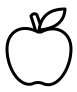

# Food

[All Assets](../CATALOG.md) | [Searchable Visual Browser](index.html) | [Machine Index](index.json)

Generated by `node scripts/build-asset-catalog.mjs`; edit metadata in `art/stickers.json`.

## Apple

`garden-apple`

Single apple with a leaf and stem.

- **Tags:** apple, fruit, food, garden, orchard
- **Roles:** accent, subject
- **Detail:** simple; **Facing:** none
- **Dimensions:** 77 x 92 scene units; **Visible Bounds:** left=5.5, top=7.5, right=72.5, bottom=86.25
- **Placement:** Use flipX to change facing where useful. Preserve aspect ratio and leave comfortable coloring space.
- **Files:** [SVG](../../src/assets/vector/garden-apple.svg), [Definition](../../src/assets/vector/garden-apple.json), [Source](../../art/source/generated/apple.svg)
- **Scene Examples:** [gardenScene.ts](../../src/editor/gardenScene.ts)

