# Food

[All Assets](../CATALOG.md) | [Searchable Visual Browser](index.html) | [Machine Index](index.json)

Generated by `node scripts/build-asset-catalog.mjs`; edit metadata in `art/stickers.json`.

## Apple

`garden-apple`

Single apple with a leaf and stem.

- **Tags:** apple, fruit, food, garden, orchard
- **Roles:** accent, subject
- **Detail:** simple; **Facing:** none
- **Dimensions:** 77 x 92 scene units; **Visible Bounds:** left=5.5, top=7.5, right=72.5, bottom=86.25
- **Placement:** Use flipX to change facing where useful. Preserve aspect ratio and leave comfortable coloring space.
- **Files:** [SVG](../../src/assets/vector/garden-apple.svg), [Definition](../../src/assets/vector/garden-apple.svg), [Source](../../art/source/generated/apple.svg)
- **Scene Examples:** [gardenScene.ts](../../src/editor/gardenScene.ts)

## Storybook Pie

`nursery-rhymes-storybook-pie`

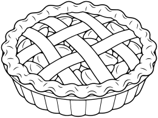

Whole round pie in a shallow fluted dish, three-quarter view, broad crimped crust and five simple lattice strips crossing over fruit filling with large spaces. No birds emerging, steam, faces or words. White interiors, clear closed pie rim.

- **Tags:** nursery-rhymes, Sing a Song of Sixpence, food, storybook-pie
- **Roles:** subject, accent
- **Detail:** moderate; **Facing:** none
- **Dimensions:** 260 x 194 scene units; **Visible Bounds:** left=1.75, top=1.75, right=258.25, bottom=192.25
- **Placement:** Preserve aspect ratio; flip and scale to suit the scene. Source conversion is ready for visual review.
- **Files:** [SVG](../../src/assets/vector/nursery-rhymes-storybook-pie.svg), [Definition](../../src/assets/vector/nursery-rhymes-storybook-pie.svg), [Source](../../art/source/nursery-rhymes/storybook-pie.png)
- **Scene Examples:** Not yet used in a built-in scene.

## Hot Cross Buns

`nursery-rhymes-hot-cross-buns`

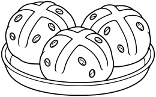

Three round buns on a shallow oval tray, each with one broad clearly outlined raised cross on top, a few small outlined raisin circles, white interiors. No faces, steam, labels or lettering. Broad closed coloring shapes.

- **Tags:** nursery-rhymes, Hot Cross Buns, food, hot-cross-buns
- **Roles:** subject, accent
- **Detail:** moderate; **Facing:** none
- **Dimensions:** 260 x 161 scene units; **Visible Bounds:** left=2, top=1.75, right=258, bottom=159.25
- **Placement:** Preserve aspect ratio; flip and scale to suit the scene. Source conversion is ready for visual review.
- **Files:** [SVG](../../src/assets/vector/nursery-rhymes-hot-cross-buns.svg), [Definition](../../src/assets/vector/nursery-rhymes-hot-cross-buns.svg), [Source](../../art/source/nursery-rhymes/hot-cross-buns.png)
- **Scene Examples:** Not yet used in a built-in scene.

## Pumpkin

`fall-pumpkin`

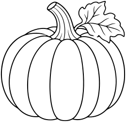

Large rounded ribbed pumpkin with a curved stem and one broad leaf attached near stem. Natural friendly object, no face, no jack-o-lantern carving. Closed rib divisions where practical, no tangled vine.

- **Tags:** fall, Fall Harvest, food, pumpkin
- **Roles:** subject, accent
- **Detail:** moderate; **Facing:** none
- **Dimensions:** 260 x 253 scene units; **Visible Bounds:** left=1.75, top=1.75, right=258, bottom=251
- **Placement:** Preserve aspect ratio; flip and scale to suit the scene. Source conversion is ready for visual review.
- **Files:** [SVG](../../src/assets/vector/fall-pumpkin.svg), [Definition](../../src/assets/vector/fall-pumpkin.svg), [Source](../../art/source/fall/pumpkin.png)
- **Scene Examples:** Not yet used in a built-in scene.

## Apple Basket

`fall-apple-basket`

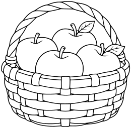

Three-quarter view of a sturdy low basket, about five large clearly outlined apples peeking over rim, one or two leaves, single curved handle behind apples. Broad simple basket weave bands, no tiny lattice or ground. No face.

- **Tags:** fall, Fall Harvest, food, apple-basket
- **Roles:** subject, accent
- **Detail:** moderate; **Facing:** none
- **Dimensions:** 260 x 255 scene units; **Visible Bounds:** left=2.25, top=2.25, right=258, bottom=253
- **Placement:** Preserve aspect ratio; flip and scale to suit the scene. Source conversion is ready for visual review.
- **Files:** [SVG](../../src/assets/vector/fall-apple-basket.svg), [Definition](../../src/assets/vector/fall-apple-basket.svg), [Source](../../art/source/fall/apple-basket.png)
- **Scene Examples:** Not yet used in a built-in scene.

## Acorn

`fall-acorn`

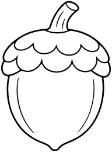

One plump oval nut with a broad scalloped cap and short curved stem, two or three simple cap details rather than tiny scales. No face, no leaf or extra acorns. Clean shape with plenty of white coloring space.

- **Tags:** fall, Fall Harvest, food, acorn
- **Roles:** subject, accent
- **Detail:** moderate; **Facing:** none
- **Dimensions:** 192 x 260 scene units; **Visible Bounds:** left=2, top=1.75, right=190, bottom=258
- **Placement:** Preserve aspect ratio; flip and scale to suit the scene. Source conversion is ready for visual review.
- **Files:** [SVG](../../src/assets/vector/fall-acorn.svg), [Definition](../../src/assets/vector/fall-acorn.svg), [Source](../../art/source/fall/acorn.png)
- **Scene Examples:** Not yet used in a built-in scene.

## Corn on the Cob

`fall-corn`

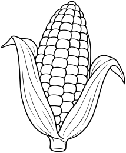

Broad corn cob with simple rows of large rounded kernels, two long husk leaves peeling to sides and short stalk end. No tiny silk strands, no face, no other vegetables. Clear entire silhouette.

- **Tags:** fall, Fall Harvest, food, corn
- **Roles:** subject, accent
- **Detail:** moderate; **Facing:** none
- **Dimensions:** 214 x 260 scene units; **Visible Bounds:** left=1.75, top=1.75, right=212.25, bottom=258.25
- **Placement:** Preserve aspect ratio; flip and scale to suit the scene. Source conversion is ready for visual review.
- **Files:** [SVG](../../src/assets/vector/fall-corn.svg), [Definition](../../src/assets/vector/fall-corn.svg), [Source](../../art/source/fall/corn.png)
- **Scene Examples:** Not yet used in a built-in scene.

## Harvest Basket

`fall-harvest-basket`

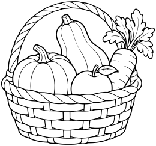

Three-quarter low basket containing one small pumpkin, one squash, one carrot with broad leaves and one apple. Clearly separated large produce, simple wide woven bands and curved handle, no tiny clutter or surrounding loose vegetables.

- **Tags:** fall, Fall Harvest, food, harvest-basket
- **Roles:** subject, accent
- **Detail:** moderate; **Facing:** none
- **Dimensions:** 260 x 243 scene units; **Visible Bounds:** left=2, top=2, right=258, bottom=241
- **Placement:** Preserve aspect ratio; flip and scale to suit the scene. Source conversion is ready for visual review.
- **Files:** [SVG](../../src/assets/vector/fall-harvest-basket.svg), [Definition](../../src/assets/vector/fall-harvest-basket.svg), [Source](../../art/source/fall/harvest-basket.png)
- **Scene Examples:** Not yet used in a built-in scene.

## Pumpkin Cluster

`fall-pumpkin-cluster`

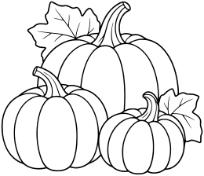

One large pumpkin with two smaller differing pumpkins overlapping at base, clear curved stems and just two large leaves. Natural objects without faces or carvings. Closed broad rib areas, no vines or surrounding scene.

- **Tags:** fall, Fall Harvest, food, pumpkin-cluster
- **Roles:** subject, accent
- **Detail:** moderate; **Facing:** none
- **Dimensions:** 260 x 224 scene units; **Visible Bounds:** left=1.75, top=1.75, right=258.25, bottom=222
- **Placement:** Preserve aspect ratio; flip and scale to suit the scene. Source conversion is ready for visual review.
- **Files:** [SVG](../../src/assets/vector/fall-pumpkin-cluster.svg), [Definition](../../src/assets/vector/fall-pumpkin-cluster.svg), [Source](../../art/source/fall/pumpkin-cluster.png)
- **Scene Examples:** Not yet used in a built-in scene.

## Chestnuts

`fall-chestnuts`

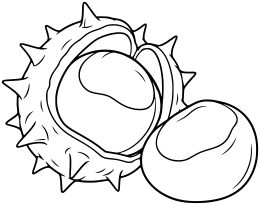

Compact group: one split rounded prickly husk cupping a large smooth chestnut, second chestnut resting directly beside it. Use a few broad triangular husk spikes, no dense hairs or shading. Clear outlined pale chestnut patches, no leaves or ground.

- **Tags:** fall, Fall Harvest, food, chestnuts
- **Roles:** subject, accent
- **Detail:** moderate; **Facing:** none
- **Dimensions:** 260 x 205 scene units; **Visible Bounds:** left=1.75, top=1.75, right=258.25, bottom=203
- **Placement:** Preserve aspect ratio; flip and scale to suit the scene. Source conversion is ready for visual review.
- **Files:** [SVG](../../src/assets/vector/fall-chestnuts.svg), [Definition](../../src/assets/vector/fall-chestnuts.svg), [Source](../../art/source/fall/chestnuts.png)
- **Scene Examples:** Not yet used in a built-in scene.

## Decorative Gourds

`fall-gourds`

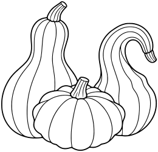

Three compact overlapping natural gourds: one bottle-shaped, one squat scalloped and one curved-neck squash. Broad outlined stripe sections and clear stems, no faces, pumpkins, vines or background. Whole group visible.

- **Tags:** fall, Fall Harvest, food, gourds
- **Roles:** subject, accent
- **Detail:** moderate; **Facing:** none
- **Dimensions:** 260 x 250 scene units; **Visible Bounds:** left=2, top=2, right=258.25, bottom=248
- **Placement:** Preserve aspect ratio; flip and scale to suit the scene. Source conversion is ready for visual review.
- **Files:** [SVG](../../src/assets/vector/fall-gourds.svg), [Definition](../../src/assets/vector/fall-gourds.svg), [Source](../../art/source/fall/gourds.png)
- **Scene Examples:** Not yet used in a built-in scene.

## Harvest Pear

`fall-pear`

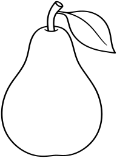

Whole large classic pear, narrow neck and plump rounded base, short curved stem and one broad leaf. No face, texture, shading or other fruit. Simple clean closed outline and just one leaf vein.

- **Tags:** fall, Fall Harvest, food, pear
- **Roles:** subject, accent
- **Detail:** moderate; **Facing:** none
- **Dimensions:** 193 x 260 scene units; **Visible Bounds:** left=1.75, top=1.75, right=191.25, bottom=258.25
- **Placement:** Preserve aspect ratio; flip and scale to suit the scene. Source conversion is ready for visual review.
- **Files:** [SVG](../../src/assets/vector/fall-pear.svg), [Definition](../../src/assets/vector/fall-pear.svg), [Source](../../art/source/fall/pear.png)
- **Scene Examples:** Not yet used in a built-in scene.

## Harvest Plum

`fall-plum`

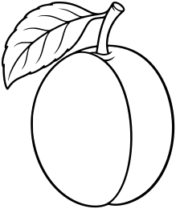

Whole plump oval plum with simple curved central seam, short stem and one broad leaf. No face, shine shapes, shading or extra fruit. Clear closed silhouette with generous coloring space.

- **Tags:** fall, Fall Harvest, food, plum
- **Roles:** subject, accent
- **Detail:** moderate; **Facing:** none
- **Dimensions:** 219 x 260 scene units; **Visible Bounds:** left=2, top=2, right=217.25, bottom=258
- **Placement:** Preserve aspect ratio; flip and scale to suit the scene. Source conversion is ready for visual review.
- **Files:** [SVG](../../src/assets/vector/fall-plum.svg), [Definition](../../src/assets/vector/fall-plum.svg), [Source](../../art/source/fall/plum.png)
- **Scene Examples:** Not yet used in a built-in scene.

## Cornucopia

`fall-cornucopia`

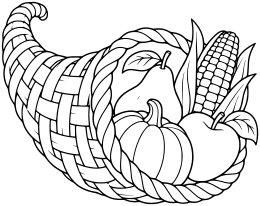

One simple woven horn-shaped basket lying on side with curved narrow tip visible, its broad mouth holding one small pumpkin, pear, apple and ear of corn. All produce clustered at mouth, broad weave bands, no loose scattered items or ground. Moderate detail.

- **Tags:** fall, Fall Harvest, food, cornucopia
- **Roles:** subject, accent
- **Detail:** moderate; **Facing:** none
- **Dimensions:** 260 x 206 scene units; **Visible Bounds:** left=1.75, top=1.75, right=258.25, bottom=204.25
- **Placement:** Preserve aspect ratio; flip and scale to suit the scene. Source conversion is ready for visual review.
- **Files:** [SVG](../../src/assets/vector/fall-cornucopia.svg), [Definition](../../src/assets/vector/fall-cornucopia.svg), [Source](../../art/source/fall/cornucopia.png)
- **Scene Examples:** Not yet used in a built-in scene.

## Banana Bunch

`category-expansion-banana-bunch`

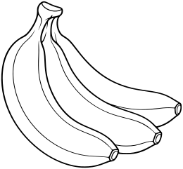

A small bunch of three whole curved bananas joined at one stem, clean readable overlaps and large coloring areas. No face.

- **Tags:** category-expansion, food, banana-bunch
- **Roles:** subject, accent
- **Detail:** moderate; **Facing:** none
- **Dimensions:** 260 x 241 scene units; **Visible Bounds:** left=1.75, top=1.75, right=258, bottom=239.25
- **Placement:** Preserve aspect ratio; flip and scale to suit the scene. Source conversion is ready for visual review.
- **Files:** [SVG](../../src/assets/vector/category-expansion-banana-bunch.svg), [Definition](../../src/assets/vector/category-expansion-banana-bunch.svg), [Source](../../art/source/category-expansion/banana-bunch.png)
- **Scene Examples:** Not yet used in a built-in scene.

## Strawberry

`category-expansion-strawberry`

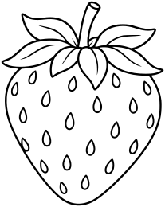

One plump strawberry with broad leafy crown and sparse large teardrop seeds, simple enclosed shapes. No face.

- **Tags:** category-expansion, food, strawberry
- **Roles:** subject, accent
- **Detail:** moderate; **Facing:** none
- **Dimensions:** 207 x 260 scene units; **Visible Bounds:** left=1.75, top=1.75, right=205.25, bottom=258.25
- **Placement:** Preserve aspect ratio; flip and scale to suit the scene. Source conversion is ready for visual review.
- **Files:** [SVG](../../src/assets/vector/category-expansion-strawberry.svg), [Definition](../../src/assets/vector/category-expansion-strawberry.svg), [Source](../../art/source/category-expansion/strawberry.png)
- **Scene Examples:** Not yet used in a built-in scene.

## Sandwich

`category-expansion-sandwich`

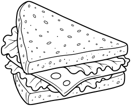

One triangular sandwich wedge, three-quarter view, two bread slices with clear cheese and lettuce filling layers. Broad clean shapes.

- **Tags:** category-expansion, food, sandwich
- **Roles:** subject, accent
- **Detail:** moderate; **Facing:** none
- **Dimensions:** 260 x 211 scene units; **Visible Bounds:** left=1.75, top=1.75, right=258.25, bottom=209
- **Placement:** Preserve aspect ratio; flip and scale to suit the scene. Source conversion is ready for visual review.
- **Files:** [SVG](../../src/assets/vector/category-expansion-sandwich.svg), [Definition](../../src/assets/vector/category-expansion-sandwich.svg), [Source](../../art/source/category-expansion/sandwich.png)
- **Scene Examples:** Not yet used in a built-in scene.

## Birthday Cake

`category-expansion-birthday-cake`

One small round birthday cake on a simple plate, smooth icing drip border, three short candles with small enclosed flames. No numbers or writing.

- **Tags:** category-expansion, food, birthday-cake
- **Roles:** subject, accent
- **Detail:** moderate; **Facing:** none
- **Dimensions:** 260 x 250 scene units; **Visible Bounds:** left=2, top=2, right=258, bottom=248
- **Placement:** Preserve aspect ratio; flip and scale to suit the scene. Source conversion is ready for visual review.
- **Files:** [SVG](../../src/assets/vector/category-expansion-birthday-cake.svg), [Definition](../../src/assets/vector/category-expansion-birthday-cake.svg), [Source](../../art/source/category-expansion/birthday-cake.png)
- **Scene Examples:** Not yet used in a built-in scene.

