# Landscapes

[All Assets](../CATALOG.md) | [Searchable Visual Browser](index.html) | [Machine Index](index.json)

Generated by `node scripts/build-asset-catalog.mjs`; edit metadata in `art/stickers.json`.

## Meadow Horizon

`spring-meadow`

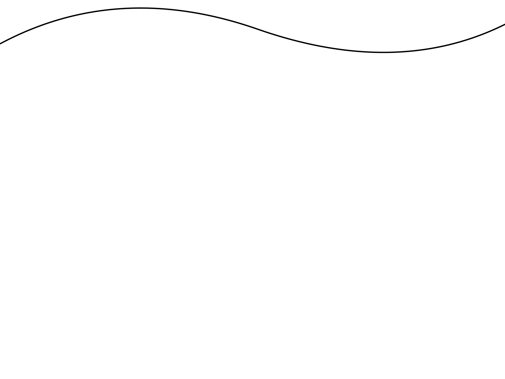

Rolling grass horizon with a deep closed ground silhouette.

- **Tags:** horizon, ground, meadow, safari, garden, spring
- **Roles:** background
- **Detail:** simple; **Facing:** none
- **Dimensions:** 1920 x 1440 scene units; **Visible Bounds:** left=0, top=28, right=1920, bottom=1440
- **Placement:** Place first, behind other stickers. Logical height includes extended ground; keep the lower silhouette beyond the page edge. Use horizonStart for interactive placement, not as a center coordinate.
- **Files:** [SVG](../../src/assets/vector/spring-meadow.svg), [Definition](../../src/assets/vector/spring-meadow.svg), [Source](../../art/source/spring/meadow.svg)
- **Scene Examples:** [gardenScene.ts](../../src/editor/gardenScene.ts), [safariScene.ts](../../src/editor/safariScene.ts), [springScene.ts](../../src/editor/springScene.ts)

## Seashore Horizon

`beach-shore`

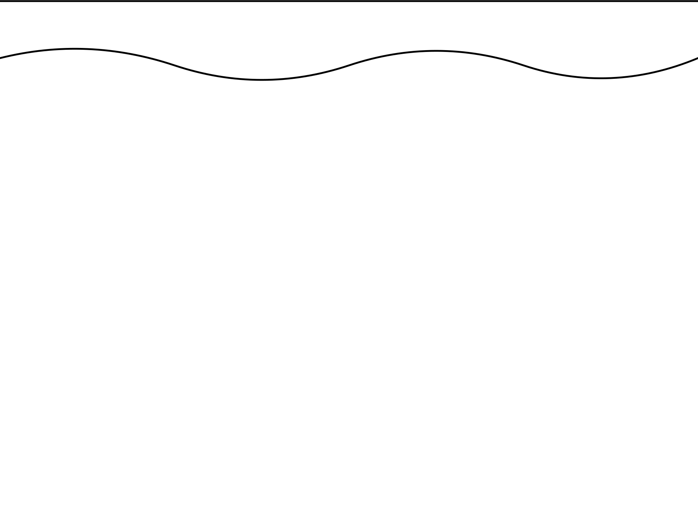

Shoreline horizon and extended ground for a beach scene.

- **Tags:** horizon, ground, shore, beach, island, water
- **Roles:** background
- **Detail:** simple; **Facing:** none
- **Dimensions:** 1920 x 1440 scene units; **Visible Bounds:** left=0, top=0.5, right=1920, bottom=1440
- **Placement:** Place first, behind other stickers. Logical height includes extended ground; keep the lower silhouette beyond the page edge. Use horizonStart for interactive placement, not as a center coordinate.
- **Files:** [SVG](../../src/assets/vector/beach-shore.svg), [Definition](../../src/assets/vector/beach-shore.svg), [Source](../../art/source/beach/shore.svg)
- **Scene Examples:** [beachScene.ts](../../src/editor/beachScene.ts)

## Snow Horizon

`winter-snow`

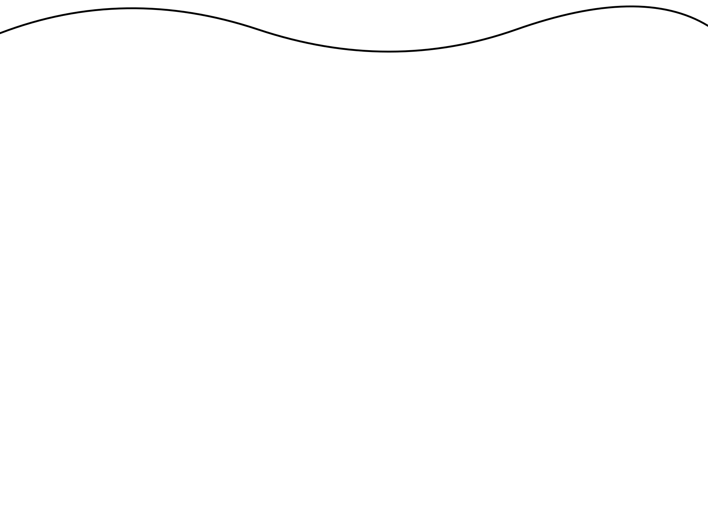

Rolling snow horizon with extended closed ground.

- **Tags:** horizon, ground, snow, winter, christmas
- **Roles:** background
- **Detail:** simple; **Facing:** none
- **Dimensions:** 1920 x 1440 scene units; **Visible Bounds:** left=0, top=15, right=1920, bottom=1440
- **Placement:** Place first, behind other stickers. Logical height includes extended ground; keep the lower silhouette beyond the page edge. Use horizonStart for interactive placement, not as a center coordinate.
- **Files:** [SVG](../../src/assets/vector/winter-snow.svg), [Definition](../../src/assets/vector/winter-snow.svg), [Source](../../art/source/winter/snow.svg)
- **Scene Examples:** [winterScene.ts](../../src/editor/winterScene.ts)

## Pond

`winter-pond`

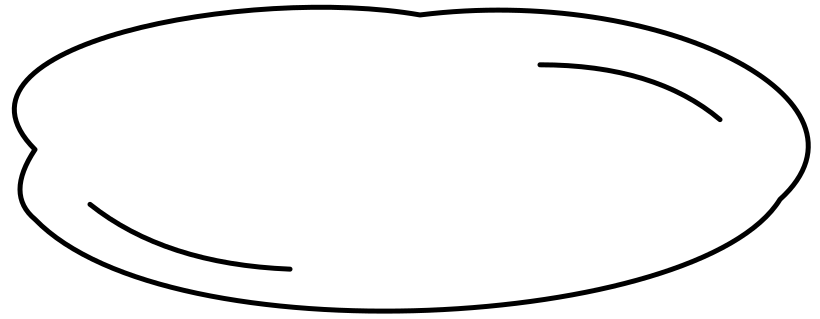

Oval pond outline with short curved water lines; reusable beyond winter.

- **Tags:** pond, water, watering-hole, safari, wildlife, winter
- **Roles:** background
- **Detail:** simple; **Facing:** none
- **Dimensions:** 820 x 319 scene units; **Visible Bounds:** left=11.75, top=4.75, right=810.75, bottom=313.5
- **Placement:** Place behind animals. Despite its winter prefix, the art has no snow or skaters and works as a safari watering hole.
- **Files:** [SVG](../../src/assets/vector/winter-pond.svg), [Definition](../../src/assets/vector/winter-pond.svg), [Source](../../art/source/winter/pond.svg)
- **Scene Examples:** [safariScene.ts](../../src/editor/safariScene.ts), [winterScene.ts](../../src/editor/winterScene.ts)

## Path

`garden-path`

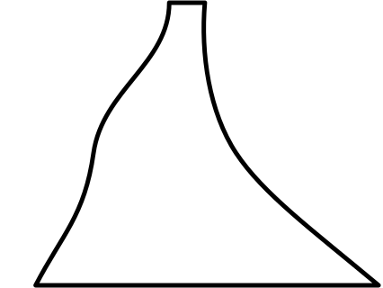

Curving path that widens toward the viewer.

- **Tags:** path, garden, walkway, village
- **Roles:** background
- **Detail:** simple; **Facing:** none
- **Dimensions:** 426 x 320 scene units; **Visible Bounds:** left=37.25, top=0.5, right=423.5, bottom=319.5
- **Placement:** Use flipX to change facing where useful. Preserve aspect ratio and leave comfortable coloring space.
- **Files:** [SVG](../../src/assets/vector/garden-path.svg), [Definition](../../src/assets/vector/garden-path.svg), [Source](../../art/source/generated/path.svg)
- **Scene Examples:** [gardenScene.ts](../../src/editor/gardenScene.ts)

## Stone

`garden-stone`

Low rounded stone suitable for paths and shorelines.

- **Tags:** rock, stone, safari, garden, beach, space
- **Roles:** foreground, accent
- **Detail:** simple; **Facing:** none
- **Dimensions:** 120 x 41 scene units; **Visible Bounds:** left=0, top=3, right=120, bottom=39.25
- **Placement:** Use flipX to change facing where useful. Preserve aspect ratio and leave comfortable coloring space.
- **Files:** [SVG](../../src/assets/vector/garden-stone.svg), [Definition](../../src/assets/vector/garden-stone.svg), [Source](../../art/source/generated/stone.svg)
- **Scene Examples:** [gardenScene.ts](../../src/editor/gardenScene.ts), [safariScene.ts](../../src/editor/safariScene.ts)

## Shell

`beach-shell`

Small seashell with radiating lines.

- **Tags:** shell, beach, sea, shore
- **Roles:** foreground, accent
- **Detail:** simple; **Facing:** none
- **Dimensions:** 160 x 128 scene units; **Visible Bounds:** left=0, top=1.25, right=160, bottom=126.5
- **Placement:** Use flipX to change facing where useful. Preserve aspect ratio and leave comfortable coloring space.
- **Files:** [SVG](../../src/assets/vector/beach-shell.svg), [Definition](../../src/assets/vector/beach-shell.svg), [Source](../../art/source/beach/shell.svg)
- **Scene Examples:** [beachScene.ts](../../src/editor/beachScene.ts)

## Moon Crater

`space-crater`

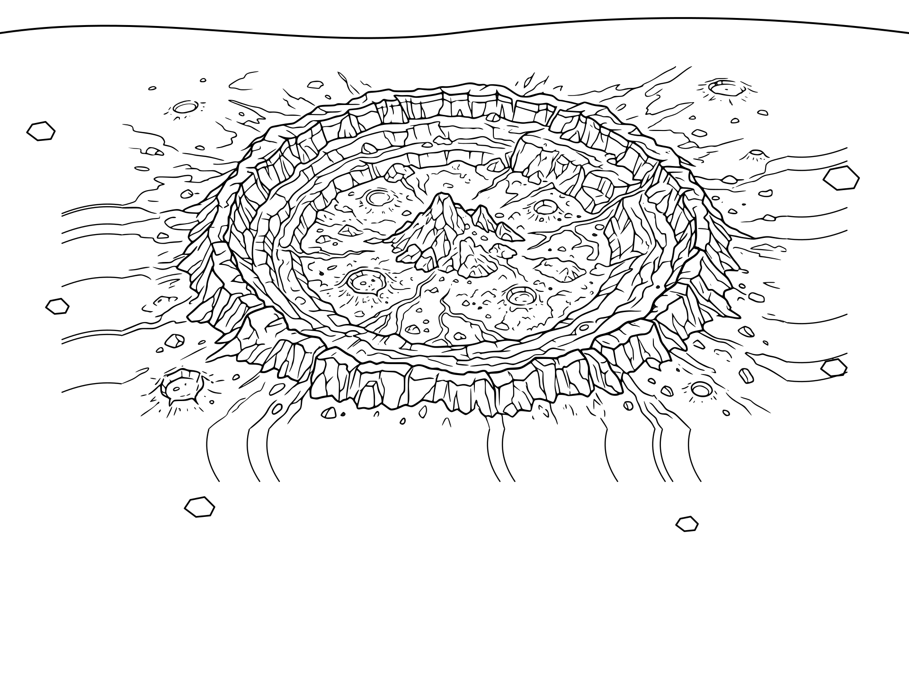

Large detailed lunar crater integrated into rolling moon ground.

- **Tags:** crater, moon, space, horizon, ground, rocks
- **Roles:** background, subject
- **Detail:** detailed; **Facing:** none
- **Dimensions:** 1920 x 1440 scene units; **Visible Bounds:** left=0, top=35.5, right=1920, bottom=1440
- **Placement:** Place first, behind other stickers. Logical height includes extended ground; keep the lower silhouette beyond the page edge. Use horizonStart for interactive placement, not as a center coordinate.
- **Files:** [SVG](../../src/assets/vector/space-crater.svg), [Definition](../../src/assets/vector/space-crater.svg), [Source](../../art/source/space/crater-horizon.svg)
- **Scene Examples:** Not yet used in a built-in scene.

## Grassy Hill

`nursery-rhymes-grassy-hill`

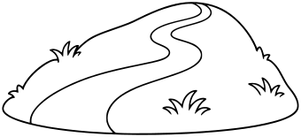

A freestanding closed landscape sticker: broad gently curved crest rising toward right, gently rounded closed lower edge, one winding path from lower left to crest and three small broad grass tufts. NO trees, sky, well or characters. White interiors; entire shape contained with margins, no rectangular border.

- **Tags:** nursery-rhymes, Jack and Jill, landscapes, grassy-hill
- **Roles:** subject, accent
- **Detail:** moderate; **Facing:** none
- **Dimensions:** 340 x 155 scene units; **Visible Bounds:** left=2.5, top=2.25, right=337.5, bottom=152.75
- **Placement:** Preserve aspect ratio; flip and scale to suit the scene. Source conversion is ready for visual review.
- **Files:** [SVG](../../src/assets/vector/nursery-rhymes-grassy-hill.svg), [Definition](../../src/assets/vector/nursery-rhymes-grassy-hill.svg), [Source](../../art/source/nursery-rhymes/grassy-hill.png)
- **Scene Examples:** Not yet used in a built-in scene.

## Duck Pond

`nursery-rhymes-duck-pond`

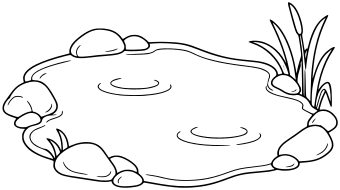

A closed shallow pond shape viewed obliquely, natural irregular oval shore with a few large shoreline stones and one simple reed cluster on right edge, two short curved ripple outlines in open center. No ducks or surrounding landscape. White water area, entire pond isolated with margins.

- **Tags:** nursery-rhymes, Five Little Ducks, landscapes, duck-pond
- **Roles:** subject, accent
- **Detail:** moderate; **Facing:** none
- **Dimensions:** 340 x 190 scene units; **Visible Bounds:** left=2.5, top=2.25, right=337.75, bottom=187.75
- **Placement:** Preserve aspect ratio; flip and scale to suit the scene. Source conversion is ready for visual review.
- **Files:** [SVG](../../src/assets/vector/nursery-rhymes-duck-pond.svg), [Definition](../../src/assets/vector/nursery-rhymes-duck-pond.svg), [Source](../../art/source/nursery-rhymes/duck-pond.png)
- **Scene Examples:** Not yet used in a built-in scene.

## Cockle Shell

`nursery-rhymes-cockle-shell`

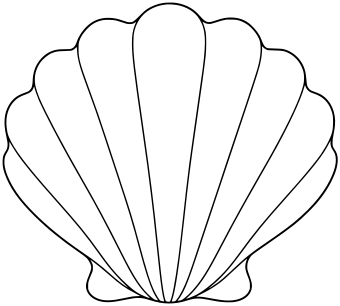

One broad fan-shaped seashell with scalloped outer rim and about seven broad radial rib sections, slight three-quarter view and clean closed silhouette. No pearl, face, sand or scenery. White interiors, no dense ridges.

- **Tags:** nursery-rhymes, Mary Mary Quite Contrary, landscapes, cockle-shell
- **Roles:** subject, accent
- **Detail:** moderate; **Facing:** none
- **Dimensions:** 340 x 306 scene units; **Visible Bounds:** left=2.5, top=2.5, right=337.75, bottom=303.5
- **Placement:** Preserve aspect ratio; flip and scale to suit the scene. Source conversion is ready for visual review.
- **Files:** [SVG](../../src/assets/vector/nursery-rhymes-cockle-shell.svg), [Definition](../../src/assets/vector/nursery-rhymes-cockle-shell.svg), [Source](../../art/source/nursery-rhymes/cockle-shell.png)
- **Scene Examples:** Not yet used in a built-in scene.

## Alpine Peaks

`horizons-alpine-peaks`

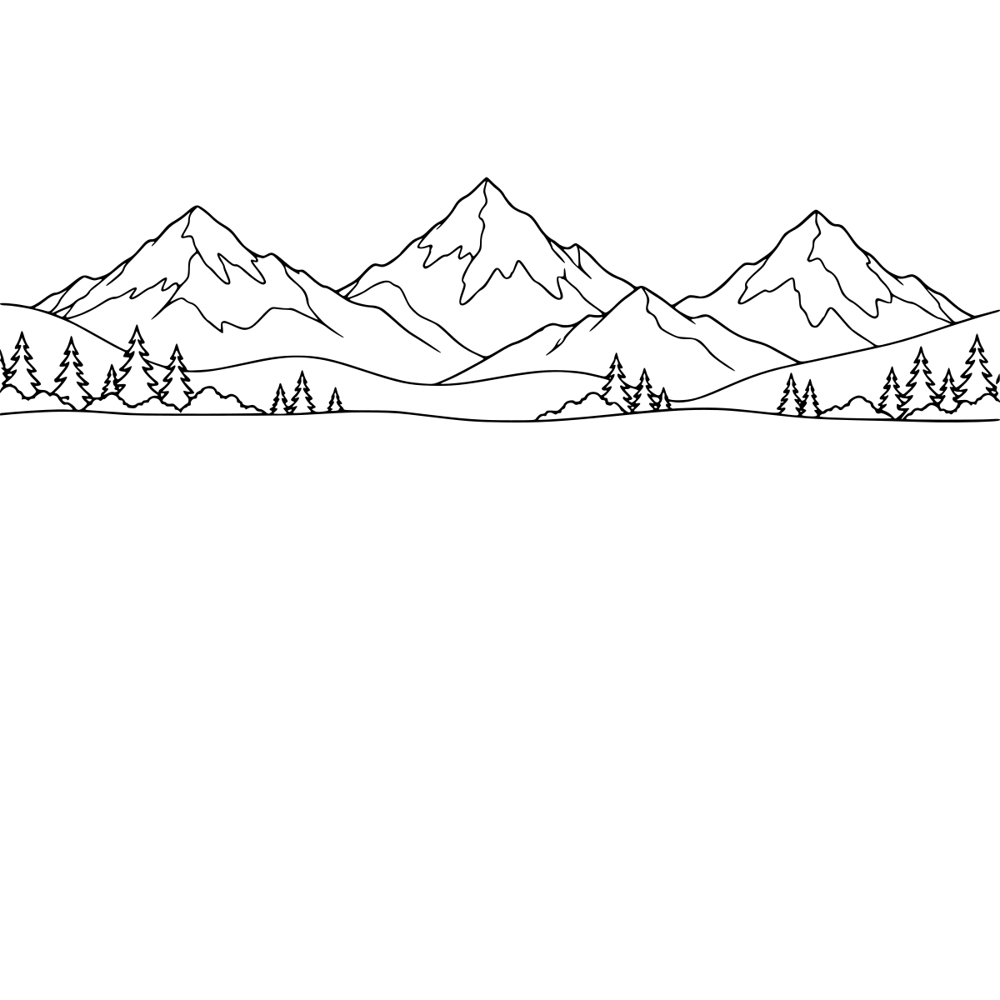

A broad distant alpine mountain range with three main triangular peaks, a few smaller connecting shoulders and simple clearly closed snowcap regions. One gentle foothill contour across the base. Peaks stay entirely in frame, no tiny rock texture.

- **Tags:** horizons, Horizon Backgrounds, landscapes, alpine-peaks
- **Roles:** background
- **Detail:** moderate; **Facing:** none
- **Dimensions:** 1200 x 1200 scene units; **Visible Bounds:** left=0, top=212.5, right=1200, bottom=1200
- **Placement:** Keep full square canvas. Oversized background with open foreground; move vertically to adjust horizon. No visible frame.
- **Files:** [SVG](../../src/assets/vector/horizons-alpine-peaks.svg), [Definition](../../src/assets/vector/horizons-alpine-peaks.svg), [Source](../../art/source/horizons/alpine-peaks.png)
- **Scene Examples:** Not yet used in a built-in scene.

## Rounded Mountains

`horizons-rounded-mountains`

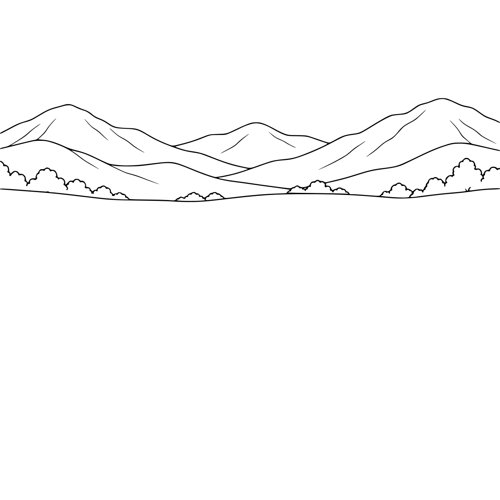

A broad range of gentle rounded old mountains, three overlapping broad ridgelines, low central saddle and higher shoulders at sides. Just a few clean slope contours, no snowcaps or sharp crags.

- **Tags:** horizons, Horizon Backgrounds, landscapes, rounded-mountains
- **Roles:** background
- **Detail:** moderate; **Facing:** none
- **Dimensions:** 1200 x 1200 scene units; **Visible Bounds:** left=0, top=235.5, right=1200, bottom=1200
- **Placement:** Keep full square canvas. Oversized background with open foreground; move vertically to adjust horizon. No visible frame.
- **Files:** [SVG](../../src/assets/vector/horizons-rounded-mountains.svg), [Definition](../../src/assets/vector/horizons-rounded-mountains.svg), [Source](../../art/source/horizons/rounded-mountains.png)
- **Scene Examples:** Not yet used in a built-in scene.

## Layered Foothills

`horizons-layered-foothills`

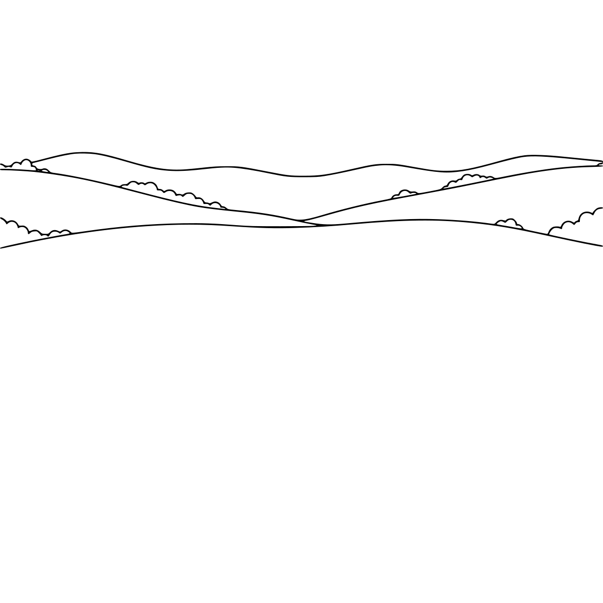

Three overlapping long gently rolling hill bands, a distant low ridge, middle undulating slopes and one foreground hill crest. Uneven organic rhythm, low dip near center for placing characters, no trees or buildings.

- **Tags:** horizons, Horizon Backgrounds, landscapes, layered-foothills
- **Roles:** background
- **Detail:** moderate; **Facing:** none
- **Dimensions:** 1200 x 1200 scene units; **Visible Bounds:** left=0, top=302.5, right=1200, bottom=1200
- **Placement:** Keep full square canvas. Oversized background with open foreground; move vertically to adjust horizon. No visible frame.
- **Files:** [SVG](../../src/assets/vector/horizons-layered-foothills.svg), [Definition](../../src/assets/vector/horizons-layered-foothills.svg), [Source](../../art/source/horizons/layered-foothills.png)
- **Scene Examples:** Not yet used in a built-in scene.

## Flat Prairie

`horizons-flat-prairie`

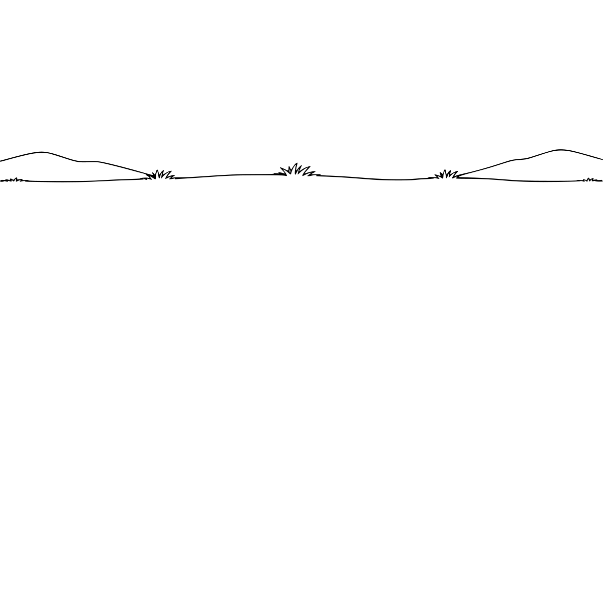

Very flat open grassland horizon with slight natural undulation, two low faraway hill humps near the extreme sides and only three sparse broad grass tufts along the horizon. Vast uninterrupted blank foreground, no fence or trees.

- **Tags:** horizons, Horizon Backgrounds, landscapes, flat-prairie
- **Roles:** background
- **Detail:** moderate; **Facing:** none
- **Dimensions:** 1200 x 1200 scene units; **Visible Bounds:** left=0, top=297, right=1200, bottom=1200
- **Placement:** Keep full square canvas. Oversized background with open foreground; move vertically to adjust horizon. No visible frame.
- **Files:** [SVG](../../src/assets/vector/horizons-flat-prairie.svg), [Definition](../../src/assets/vector/horizons-flat-prairie.svg), [Source](../../art/source/horizons/flat-prairie.png)
- **Scene Examples:** Not yet used in a built-in scene.

## Rolling Farmland

`horizons-rolling-farmland`

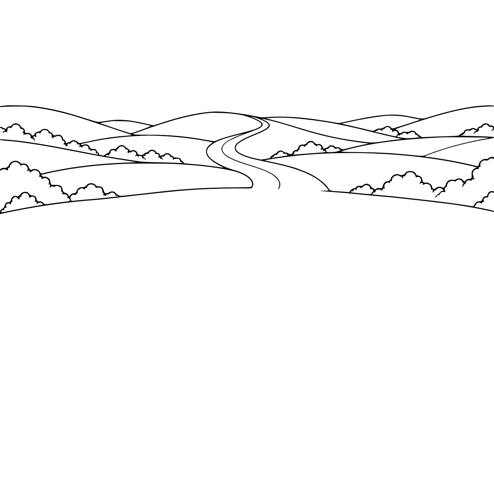

Broad rolling farmland hills divided into a few large gently curved field sections, one winding lane disappearing over a distant crest near center. No buildings, vehicles, fences or tiny crops. Calm open central composition.

- **Tags:** horizons, Horizon Backgrounds, landscapes, rolling-farmland
- **Roles:** background
- **Detail:** moderate; **Facing:** none
- **Dimensions:** 1200 x 1200 scene units; **Visible Bounds:** left=0, top=256, right=1200, bottom=1200
- **Placement:** Keep full square canvas. Oversized background with open foreground; move vertically to adjust horizon. No visible frame.
- **Files:** [SVG](../../src/assets/vector/horizons-rolling-farmland.svg), [Definition](../../src/assets/vector/horizons-rolling-farmland.svg), [Source](../../art/source/horizons/rolling-farmland.png)
- **Scene Examples:** Not yet used in a built-in scene.

## Desert Dunes

`horizons-desert-dunes`

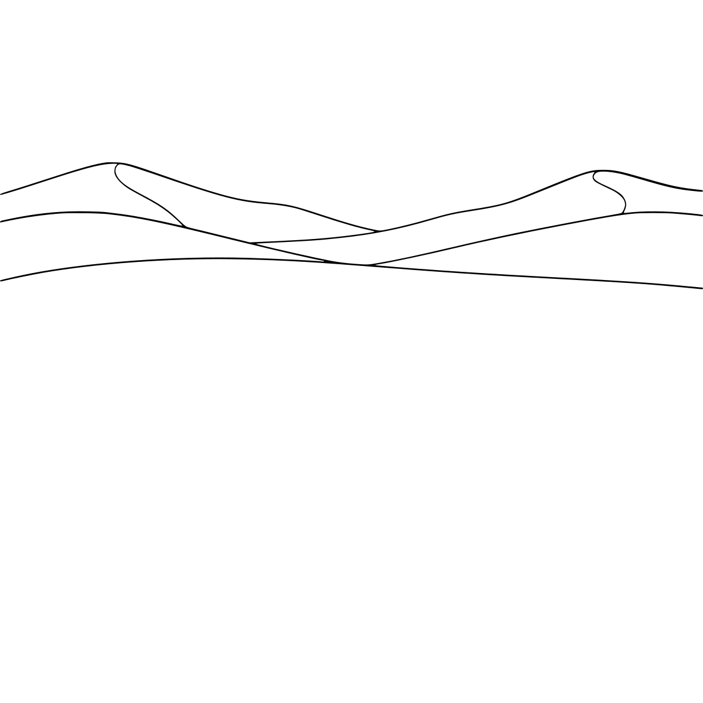

Three layers of broad sweeping desert sand dunes, asymmetric flowing crests, a low central saddle and taller dune shoulders near sides. No texture marks, cacti, oasis or objects. Spacious smooth coloring shapes.

- **Tags:** horizons, Horizon Backgrounds, landscapes, desert-dunes
- **Roles:** background
- **Detail:** moderate; **Facing:** none
- **Dimensions:** 1200 x 1200 scene units; **Visible Bounds:** left=0, top=277, right=1200, bottom=1200
- **Placement:** Keep full square canvas. Oversized background with open foreground; move vertically to adjust horizon. No visible frame.
- **Files:** [SVG](../../src/assets/vector/horizons-desert-dunes.svg), [Definition](../../src/assets/vector/horizons-desert-dunes.svg), [Source](../../art/source/horizons/desert-dunes.png)
- **Scene Examples:** Not yet used in a built-in scene.

## Red Rock Mesas

`horizons-red-rock-mesas`

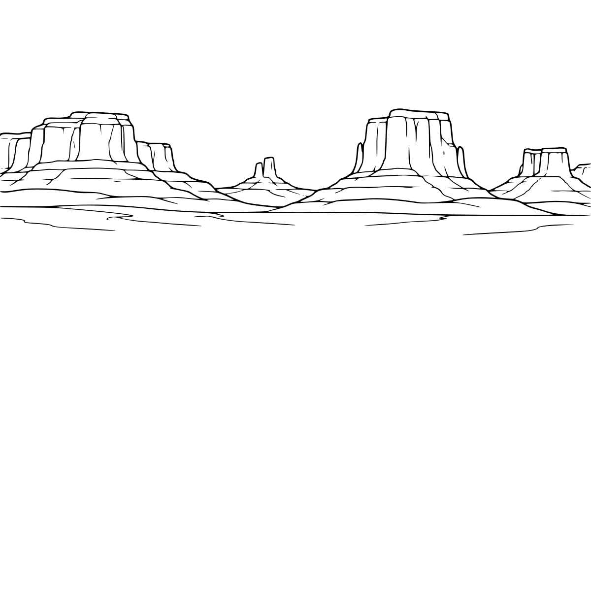

Distant desert mesas and buttes with broad flat tops and stepped sides, separated by low saddles. Five or fewer major rock formations, a few bold broad rock strata only, no tiny hatching or plants.

- **Tags:** horizons, Horizon Backgrounds, landscapes, red-rock-mesas
- **Roles:** background
- **Detail:** moderate; **Facing:** none
- **Dimensions:** 1200 x 1200 scene units; **Visible Bounds:** left=0, top=220.5, right=1200, bottom=1200
- **Placement:** Keep full square canvas. Oversized background with open foreground; move vertically to adjust horizon. No visible frame.
- **Files:** [SVG](../../src/assets/vector/horizons-red-rock-mesas.svg), [Definition](../../src/assets/vector/horizons-red-rock-mesas.svg), [Source](../../art/source/horizons/red-rock-mesas.png)
- **Scene Examples:** Not yet used in a built-in scene.

## Canyon Valley

`horizons-canyon-valley`

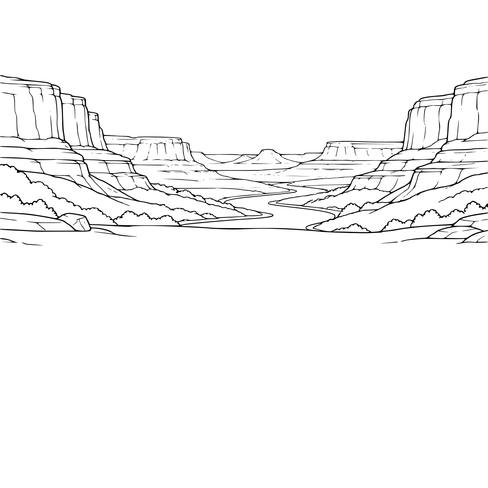

Wide canyon vista with two broad stepped rock walls toward left and right framing an open central valley, faraway low plateau connecting distance, one simple winding river ribbon starting at horizon and extending partway downward. Broad cliff layers, no dense cracks. Central lower foreground largely empty.

- **Tags:** horizons, Horizon Backgrounds, landscapes, canyon-valley
- **Roles:** background
- **Detail:** moderate; **Facing:** none
- **Dimensions:** 1200 x 1200 scene units; **Visible Bounds:** left=0, top=185, right=1200, bottom=1200
- **Placement:** Keep full square canvas. Oversized background with open foreground; move vertically to adjust horizon. No visible frame.
- **Files:** [SVG](../../src/assets/vector/horizons-canyon-valley.svg), [Definition](../../src/assets/vector/horizons-canyon-valley.svg), [Source](../../art/source/horizons/canyon-valley.png)
- **Scene Examples:** Not yet used in a built-in scene.

## River Valley

`horizons-river-valley`

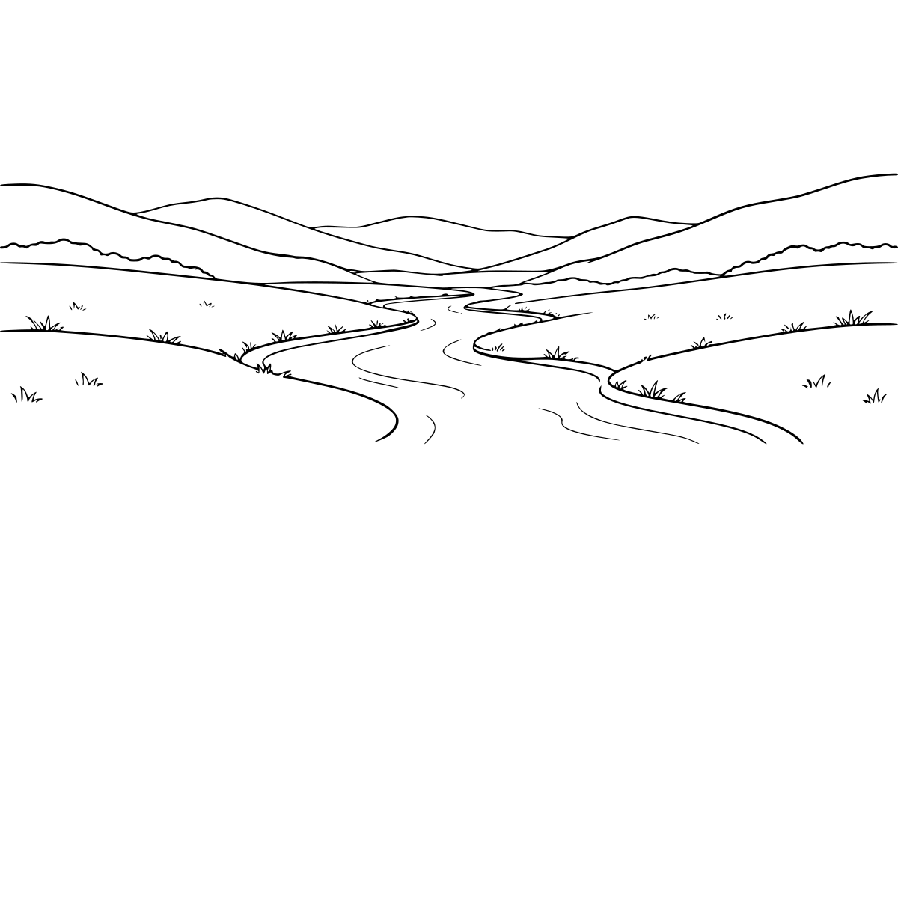

Gentle rolling valley opening at center between two broad low hill shoulders, distant ridges, one simple river ribbon curving toward the viewer in the CENTER of the page. River banks are smooth and separated, lower left and right areas open for stickers, no trees or buildings.

- **Tags:** horizons, Horizon Backgrounds, landscapes, river-valley
- **Roles:** background
- **Detail:** moderate; **Facing:** none
- **Dimensions:** 1200 x 1200 scene units; **Visible Bounds:** left=0, top=231.5, right=1200, bottom=1200
- **Placement:** Keep full square canvas. Oversized background with open foreground; move vertically to adjust horizon. No visible frame.
- **Files:** [SVG](../../src/assets/vector/horizons-river-valley.svg), [Definition](../../src/assets/vector/horizons-river-valley.svg), [Source](../../art/source/horizons/river-valley.png)
- **Scene Examples:** Not yet used in a built-in scene.

## Lake Basin

`horizons-lake-basin`

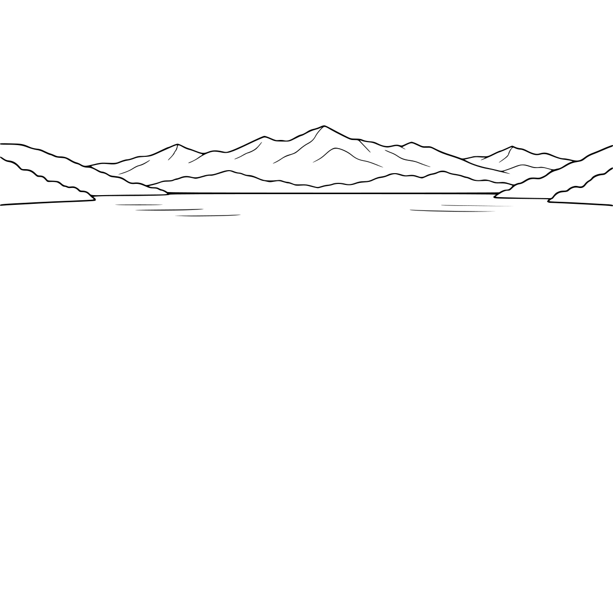

Calm broad lake beneath a distant low mountain ridge, a few overlapping hillside shoulders framing the lake near far left and right, clean natural shoreline and two short water ripple curves near distant shore. No boats, trees, rocks in foreground or buildings. Large open white water/foreground.

- **Tags:** horizons, Horizon Backgrounds, landscapes, lake-basin
- **Roles:** background
- **Detail:** moderate; **Facing:** none
- **Dimensions:** 1200 x 1200 scene units; **Visible Bounds:** left=0, top=245.5, right=1200, bottom=1200
- **Placement:** Keep full square canvas. Oversized background with open foreground; move vertically to adjust horizon. No visible frame.
- **Files:** [SVG](../../src/assets/vector/horizons-lake-basin.svg), [Definition](../../src/assets/vector/horizons-lake-basin.svg), [Source](../../art/source/horizons/lake-basin.png)
- **Scene Examples:** Not yet used in a built-in scene.

## Layered Pine Forest

`horizons-pine-forest`

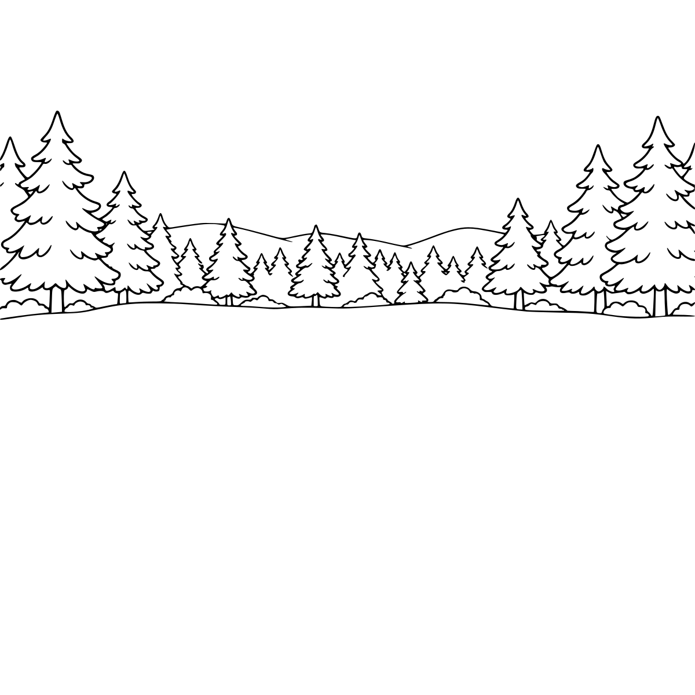

A distant horizon of layered evergreen trees in three rows, larger broad rounded triangular pine silhouettes at sides and smaller trees in center. Distinct simple tree group contours with a few visible trunks, broad branch tiers not tiny needles. Low forest floor line, empty open foreground.

- **Tags:** horizons, Horizon Backgrounds, landscapes, pine-forest
- **Roles:** background
- **Detail:** moderate; **Facing:** none
- **Dimensions:** 1200 x 1200 scene units; **Visible Bounds:** left=0, top=191, right=1200, bottom=1200
- **Placement:** Keep full square canvas. Oversized background with open foreground; move vertically to adjust horizon. No visible frame.
- **Files:** [SVG](../../src/assets/vector/horizons-pine-forest.svg), [Definition](../../src/assets/vector/horizons-pine-forest.svg), [Source](../../art/source/horizons/pine-forest.png)
- **Scene Examples:** Not yet used in a built-in scene.

## Layered Deciduous Forest

`horizons-deciduous-forest`

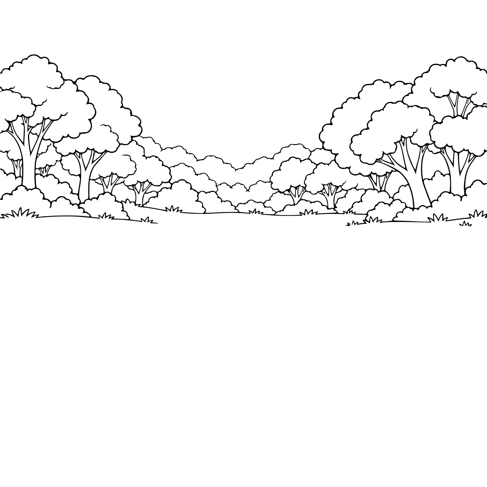

A distant layered broadleaf forest with overlapping rounded canopies, taller groups on left and right, lower canopy dip in center. A few visible branching trunks underneath, large canopy clusters and generous enclosed leaf areas. No individual tiny leaves. Wide clear foreground.

- **Tags:** horizons, Horizon Backgrounds, landscapes, deciduous-forest
- **Roles:** background
- **Detail:** moderate; **Facing:** none
- **Dimensions:** 1200 x 1200 scene units; **Visible Bounds:** left=0, top=134, right=1200, bottom=1200
- **Placement:** Keep full square canvas. Oversized background with open foreground; move vertically to adjust horizon. No visible frame.
- **Files:** [SVG](../../src/assets/vector/horizons-deciduous-forest.svg), [Definition](../../src/assets/vector/horizons-deciduous-forest.svg), [Source](../../art/source/horizons/deciduous-forest.png)
- **Scene Examples:** Not yet used in a built-in scene.

## Forest Clearing

`horizons-forest-clearing`

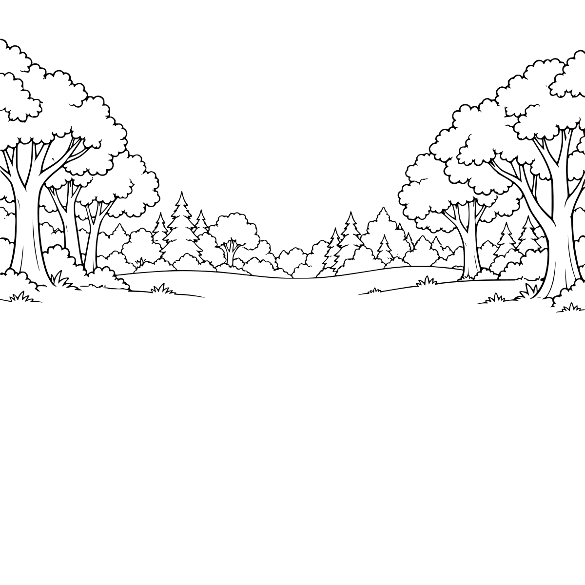

A welcoming woodland clearing framed by tree groups on far left and right, broad rounded leaf canopies and simple visible trunks, distant smaller forest row across middle with a WIDE central opening. Open white central clearing and foreground. No overhead canopy arch closing sky, no grass clutter.

- **Tags:** horizons, Horizon Backgrounds, landscapes, forest-clearing
- **Roles:** background
- **Detail:** moderate; **Facing:** none
- **Dimensions:** 1200 x 1200 scene units; **Visible Bounds:** left=0, top=79.5, right=1200, bottom=1200
- **Placement:** Keep full square canvas. Oversized background with open foreground; move vertically to adjust horizon. No visible frame.
- **Files:** [SVG](../../src/assets/vector/horizons-forest-clearing.svg), [Definition](../../src/assets/vector/horizons-forest-clearing.svg), [Source](../../art/source/horizons/forest-clearing.png)
- **Scene Examples:** Not yet used in a built-in scene.

## Woodland Trail

`horizons-woodland-trail`

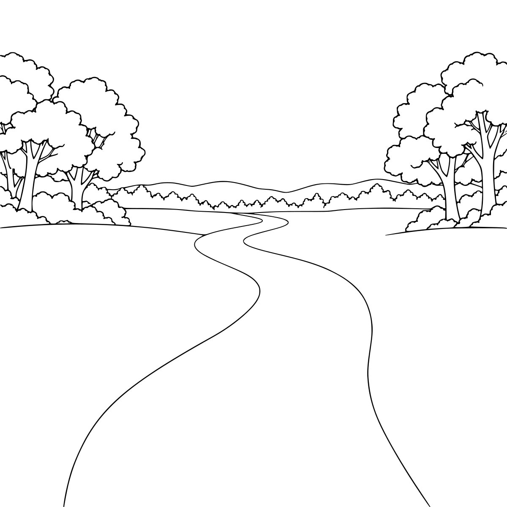

Two simple forest groups at far left and right with rounded broadleaf canopies, a distant low tree line and a wide gently winding path leading through a central gap. Path begins near lower center, sides have ample white planting space, no small objects or dense grass.

- **Tags:** horizons, Horizon Backgrounds, landscapes, woodland-trail
- **Roles:** background
- **Detail:** moderate; **Facing:** none
- **Dimensions:** 1200 x 1200 scene units; **Visible Bounds:** left=0, top=122.5, right=1200, bottom=1200
- **Placement:** Keep full square canvas. Oversized background with open foreground; move vertically to adjust horizon. No visible frame.
- **Files:** [SVG](../../src/assets/vector/horizons-woodland-trail.svg), [Definition](../../src/assets/vector/horizons-woodland-trail.svg), [Source](../../art/source/horizons/woodland-trail.png)
- **Scene Examples:** Not yet used in a built-in scene.

## Jungle Opening

`horizons-jungle-opening`

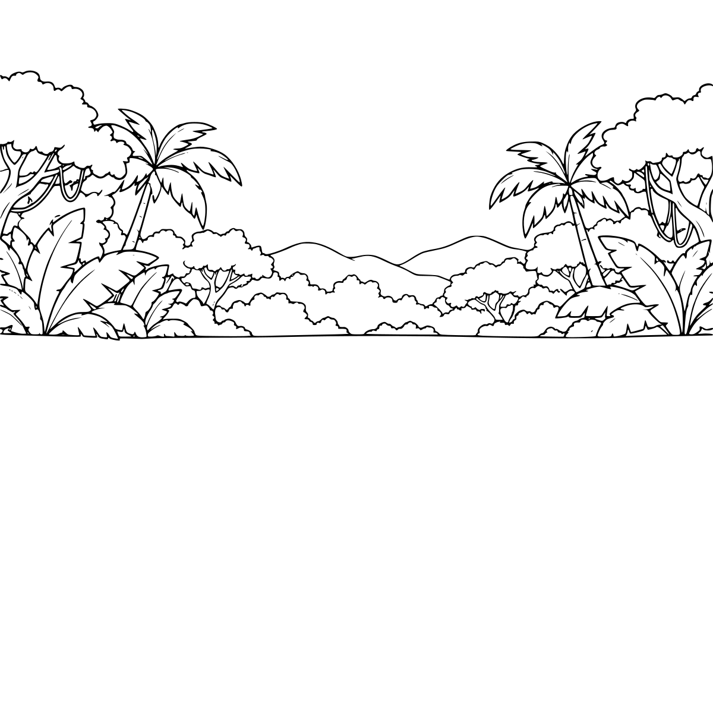

A distant tropical jungle horizon with broad banana-like leaves and rounded tree canopies at left and right framing an open central gap. Two simple palms among broadleaf trees, restrained thick vines confined to side groups. No animals, fruit, tiny fern texture or foreground objects.

- **Tags:** horizons, Horizon Backgrounds, landscapes, jungle-opening
- **Roles:** background
- **Detail:** moderate; **Facing:** none
- **Dimensions:** 1200 x 1200 scene units; **Visible Bounds:** left=0, top=118.5, right=1200, bottom=1200
- **Placement:** Keep full square canvas. Oversized background with open foreground; move vertically to adjust horizon. No visible frame.
- **Files:** [SVG](../../src/assets/vector/horizons-jungle-opening.svg), [Definition](../../src/assets/vector/horizons-jungle-opening.svg), [Source](../../art/source/horizons/jungle-opening.png)
- **Scene Examples:** Not yet used in a built-in scene.

## Birch Woodland

`horizons-birch-woodland`

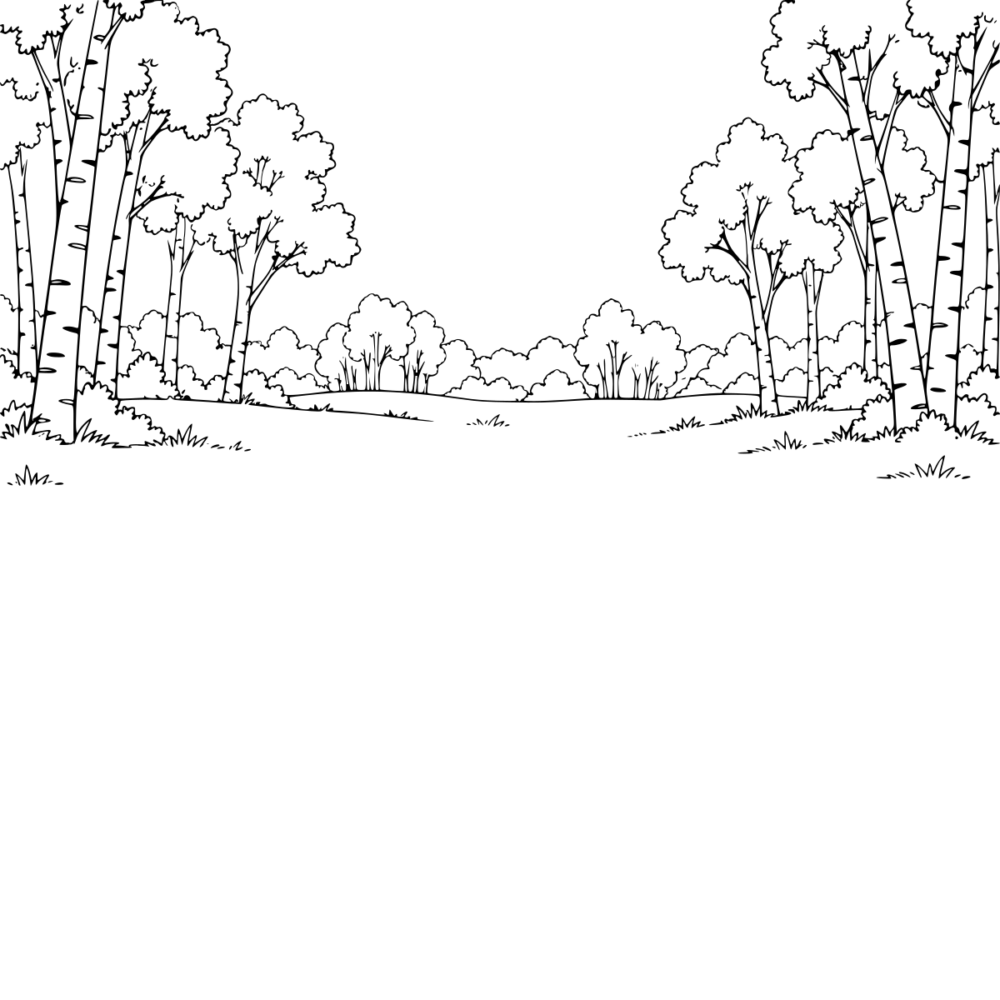

A light open birch woodland backdrop, slender but clearly outlined trunks in loose groups toward sides, rounded sparse canopies in upper middle and distant lower forest row. Trunks have only a few short broad bark marks, no dense hatching. Large open central and lower clearing.

- **Tags:** horizons, Horizon Backgrounds, landscapes, birch-woodland
- **Roles:** background
- **Detail:** moderate; **Facing:** none
- **Dimensions:** 1200 x 1200 scene units; **Visible Bounds:** left=0, top=0, right=1200, bottom=1200
- **Placement:** Keep full square canvas. Oversized background with open foreground; move vertically to adjust horizon. No visible frame.
- **Files:** [SVG](../../src/assets/vector/horizons-birch-woodland.svg), [Definition](../../src/assets/vector/horizons-birch-woodland.svg), [Source](../../art/source/horizons/birch-woodland.png)
- **Scene Examples:** Not yet used in a built-in scene.

## Autumn Woodland

`horizons-autumn-woodland`

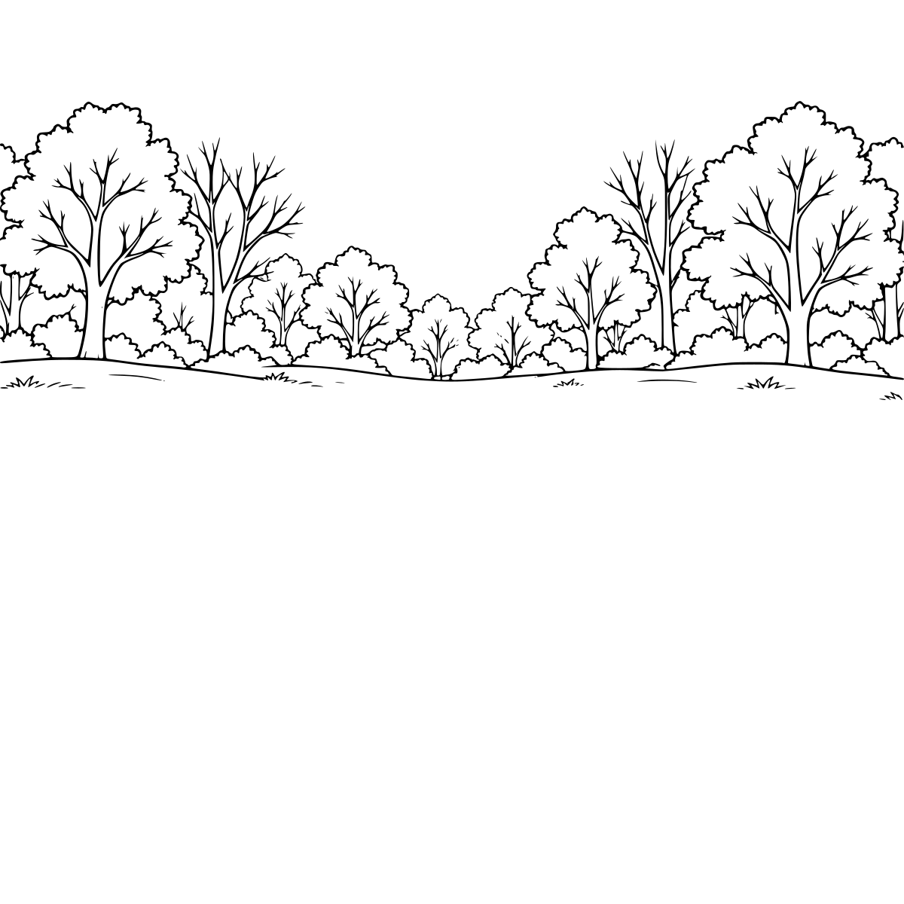

An autumn woodland horizon with broad irregular oak/maple canopy clusters and a few bare branching trees interspersed, taller tree groups at sides and a lower central gap. No detached falling leaves or leaf piles, no color or dense tiny leaf details. Broad white foreground.

- **Tags:** horizons, Horizon Backgrounds, landscapes, autumn-woodland
- **Roles:** background
- **Detail:** moderate; **Facing:** none
- **Dimensions:** 1200 x 1200 scene units; **Visible Bounds:** left=0, top=134, right=1200, bottom=1200
- **Placement:** Keep full square canvas. Oversized background with open foreground; move vertically to adjust horizon. No visible frame.
- **Files:** [SVG](../../src/assets/vector/horizons-autumn-woodland.svg), [Definition](../../src/assets/vector/horizons-autumn-woodland.svg), [Source](../../art/source/horizons/autumn-woodland.png)
- **Scene Examples:** Not yet used in a built-in scene.

## Snowy Forest

`horizons-snowy-forest`

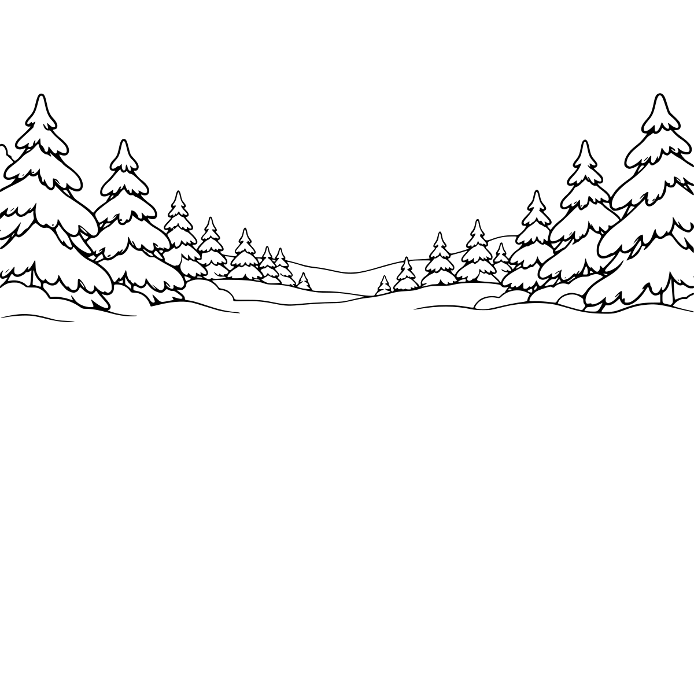

A distant winter evergreen forest with broad pine boughs carrying thick outlined snow caps, gentle low snowbank contour across base. Larger simple pines near sides, smaller trees toward center and an open central gap. No snowflakes or foreground footprints, no hatching.

- **Tags:** horizons, Horizon Backgrounds, landscapes, snowy-forest
- **Roles:** background
- **Detail:** moderate; **Facing:** none
- **Dimensions:** 1200 x 1200 scene units; **Visible Bounds:** left=0, top=161, right=1200, bottom=1200
- **Placement:** Keep full square canvas. Oversized background with open foreground; move vertically to adjust horizon. No visible frame.
- **Files:** [SVG](../../src/assets/vector/horizons-snowy-forest.svg), [Definition](../../src/assets/vector/horizons-snowy-forest.svg), [Source](../../art/source/horizons/snowy-forest.png)
- **Scene Examples:** Not yet used in a built-in scene.

## Coastal Cliffs

`horizons-coastal-cliffs`

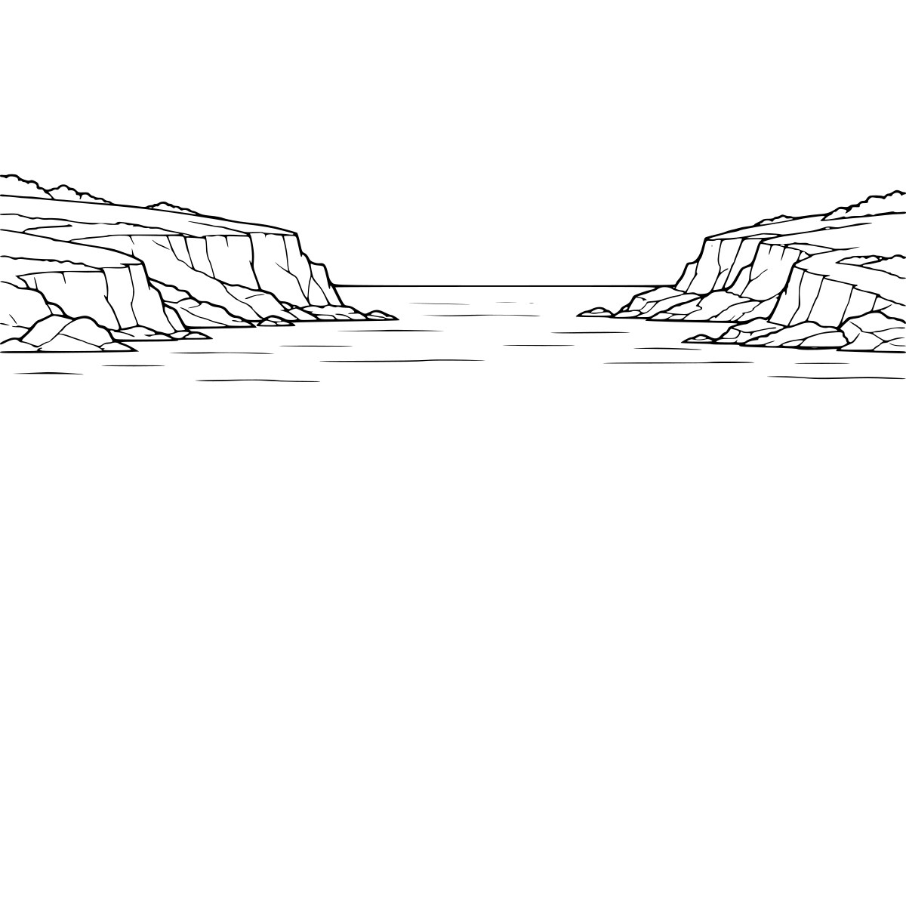

A distant coastal horizon with two broad gently stepped cliffs extending inward from left and right, a wide open sea gap between, simple horizontal ocean horizon visible through center and a few clean broad rock strata. No lighthouse, boats, sky objects or tiny waves. Open lower white water/shore.

- **Tags:** horizons, Horizon Backgrounds, landscapes, coastal-cliffs
- **Roles:** background
- **Detail:** moderate; **Facing:** none
- **Dimensions:** 1200 x 1200 scene units; **Visible Bounds:** left=0, top=230.5, right=1200, bottom=1200
- **Placement:** Keep full square canvas. Oversized background with open foreground; move vertically to adjust horizon. No visible frame.
- **Files:** [SVG](../../src/assets/vector/horizons-coastal-cliffs.svg), [Definition](../../src/assets/vector/horizons-coastal-cliffs.svg), [Source](../../art/source/horizons/coastal-cliffs.png)
- **Scene Examples:** Not yet used in a built-in scene.

## Beach Dunes

`horizons-beach-dunes`

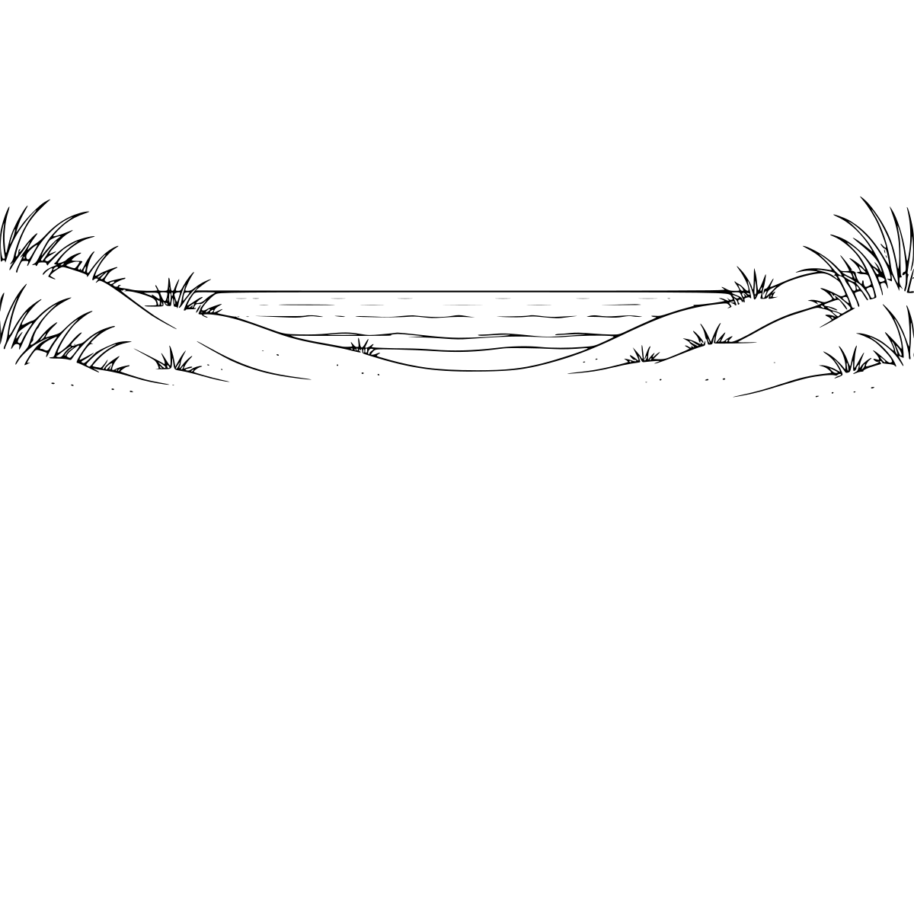

Low seaside dunes across the horizon, small broad beach-grass clusters only near far sides, gentle distant sea horizon visible in the low central opening. Two or three broad dune contours, no shells, palms, buildings or boats. Very open white foreground for arranging beach stickers.

- **Tags:** horizons, Horizon Backgrounds, landscapes, beach-dunes
- **Roles:** background
- **Detail:** moderate; **Facing:** none
- **Dimensions:** 1200 x 1200 scene units; **Visible Bounds:** left=0, top=258, right=1200, bottom=1200
- **Placement:** Keep full square canvas. Oversized background with open foreground; move vertically to adjust horizon. No visible frame.
- **Files:** [SVG](../../src/assets/vector/horizons-beach-dunes.svg), [Definition](../../src/assets/vector/horizons-beach-dunes.svg), [Source](../../art/source/horizons/beach-dunes.png)
- **Scene Examples:** Not yet used in a built-in scene.

## Village Rooftops

`horizons-village-rooftops`

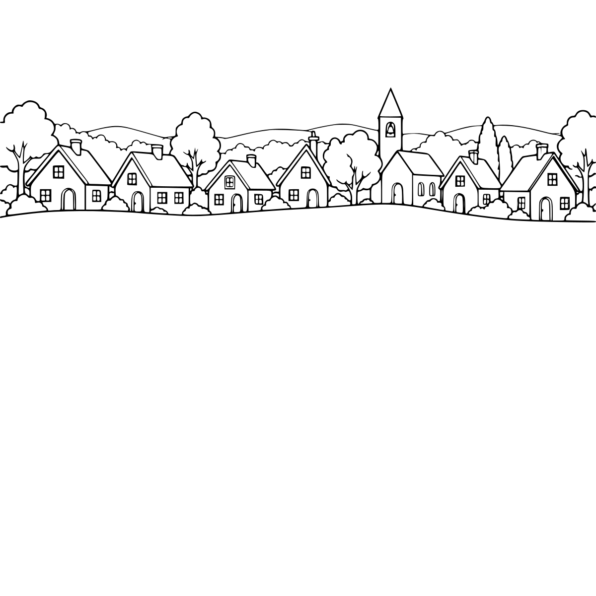

A distant cozy village rooftop horizon with about seven simple small cottages with varied pitched roofs, one modest bell tower and a few rounded trees between. Buildings stand on one shared gentle ground contour, clear large doors/windows, no text, signs, roads or tiny bricks. Wide blank foreground.

- **Tags:** horizons, Horizon Backgrounds, landscapes, village-rooftops
- **Roles:** background
- **Detail:** moderate; **Facing:** none
- **Dimensions:** 1200 x 1200 scene units; **Visible Bounds:** left=0, top=176, right=1200, bottom=1200
- **Placement:** Keep full square canvas. Oversized background with open foreground; move vertically to adjust horizon. No visible frame.
- **Files:** [SVG](../../src/assets/vector/horizons-village-rooftops.svg), [Definition](../../src/assets/vector/horizons-village-rooftops.svg), [Source](../../art/source/horizons/village-rooftops.png)
- **Scene Examples:** Not yet used in a built-in scene.

## Suburban Neighborhood

`horizons-suburban-neighborhood`

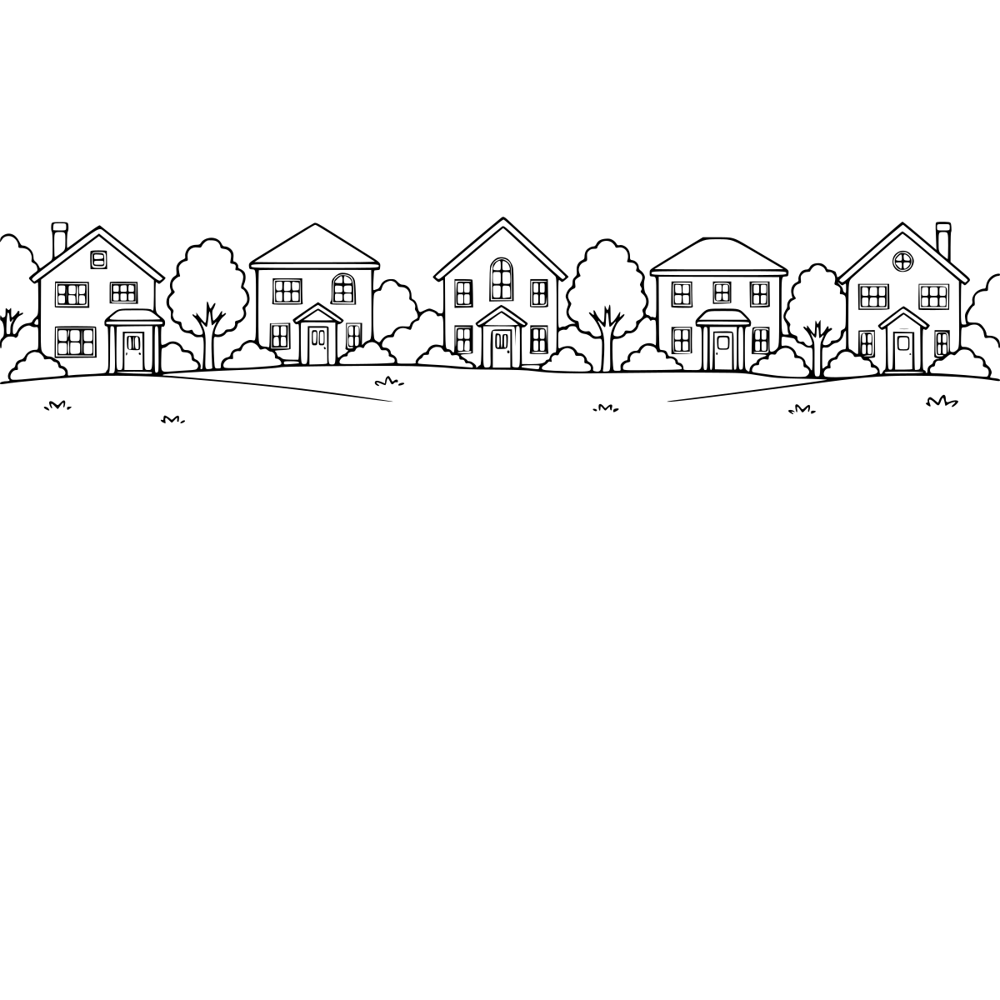

A distant friendly suburban neighborhood horizon with five simple separated two-storey houses, different roof shapes, broad windows and doors, a few rounded trees between. One continuous gently rolling ground line. No cars, people, fences, utility wires, tiny roof tiles or street markings. Open foreground.

- **Tags:** horizons, Horizon Backgrounds, landscapes, suburban-neighborhood
- **Roles:** background
- **Detail:** moderate; **Facing:** none
- **Dimensions:** 1200 x 1200 scene units; **Visible Bounds:** left=0, top=260, right=1200, bottom=1200
- **Placement:** Keep full square canvas. Oversized background with open foreground; move vertically to adjust horizon. No visible frame.
- **Files:** [SVG](../../src/assets/vector/horizons-suburban-neighborhood.svg), [Definition](../../src/assets/vector/horizons-suburban-neighborhood.svg), [Source](../../art/source/horizons/suburban-neighborhood.png)
- **Scene Examples:** Not yet used in a built-in scene.

## City Skyline

`horizons-city-skyline`

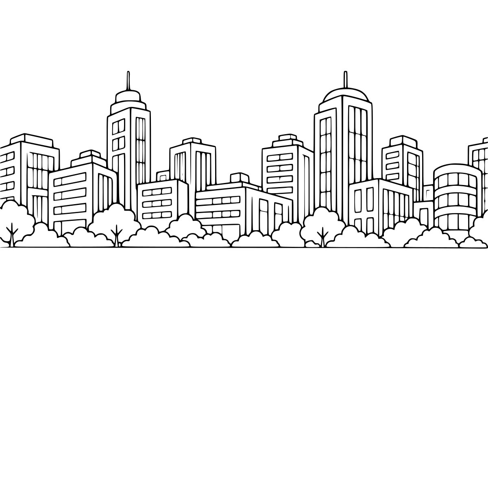

A friendly modern city skyline band with varied broad rectangular buildings, two taller towers and several lower buildings overlapping. A few LARGE window groups per building, simple rounded tower tops and rooftop shapes. No logos, signs, tiny window grids, cars or roads. Buildings sit on shared continuous base horizon; open blank foreground.

- **Tags:** horizons, Horizon Backgrounds, landscapes, city-skyline
- **Roles:** background
- **Detail:** moderate; **Facing:** none
- **Dimensions:** 1200 x 1200 scene units; **Visible Bounds:** left=0, top=174, right=1200, bottom=1200
- **Placement:** Keep full square canvas. Oversized background with open foreground; move vertically to adjust horizon. No visible frame.
- **Files:** [SVG](../../src/assets/vector/horizons-city-skyline.svg), [Definition](../../src/assets/vector/horizons-city-skyline.svg), [Source](../../art/source/horizons/city-skyline.png)
- **Scene Examples:** Not yet used in a built-in scene.

## Harbor Skyline

`horizons-harbor-skyline`

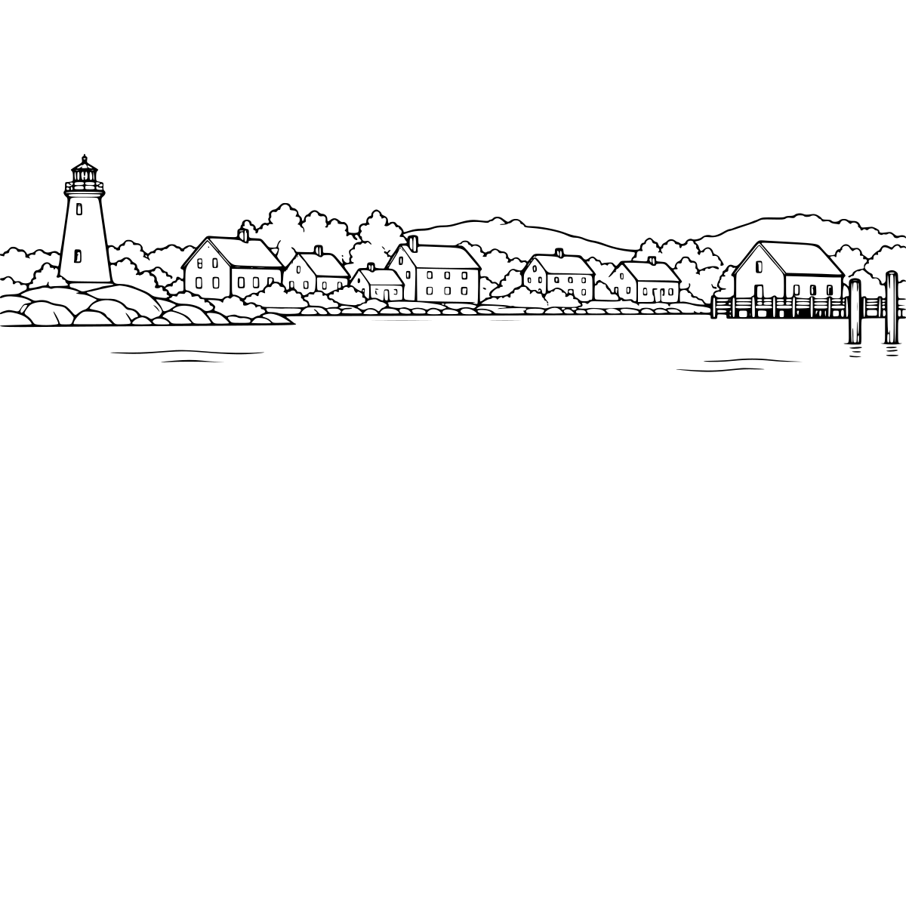

A distant small harbor-town horizon with low simple waterfront buildings on far bank, one lighthouse near far left, one modest dock structure and two simple mooring posts near far right. Broad calm water in front with just two short ripple contours. NO boats, birds, text, ropes or foreground objects. Clear skyline band with large open white water below.

- **Tags:** horizons, Horizon Backgrounds, landscapes, harbor-skyline
- **Roles:** background
- **Detail:** moderate; **Facing:** none
- **Dimensions:** 1200 x 1200 scene units; **Visible Bounds:** left=0, top=204, right=1200, bottom=1200
- **Placement:** Keep full square canvas. Oversized background with open foreground; move vertically to adjust horizon. No visible frame.
- **Files:** [SVG](../../src/assets/vector/horizons-harbor-skyline.svg), [Definition](../../src/assets/vector/horizons-harbor-skyline.svg), [Source](../../art/source/horizons/harbor-skyline.png)
- **Scene Examples:** Not yet used in a built-in scene.

## Underwater Rocks

`collection-expansion-underwater-rocks`

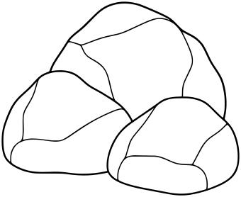

One low cluster of three overlapping rounded underwater boulders, clear contours and a few broad face divisions, no texture, no ground line, no seaweed.

- **Tags:** collection-expansion, Underwater, landscapes, underwater-rocks
- **Roles:** subject, accent
- **Detail:** moderate; **Facing:** none
- **Dimensions:** 340 x 278 scene units; **Visible Bounds:** left=2.25, top=2.25, right=337.75, bottom=275.75
- **Placement:** Preserve aspect ratio; flip and scale to suit the scene. Source conversion is ready for visual review.
- **Files:** [SVG](../../src/assets/vector/collection-expansion-underwater-rocks.svg), [Definition](../../src/assets/vector/collection-expansion-underwater-rocks.svg), [Source](../../art/source/collection-expansion/underwater-rocks.png)
- **Scene Examples:** Not yet used in a built-in scene.

## Seabed Horizon

`collection-expansion-seabed-horizon`

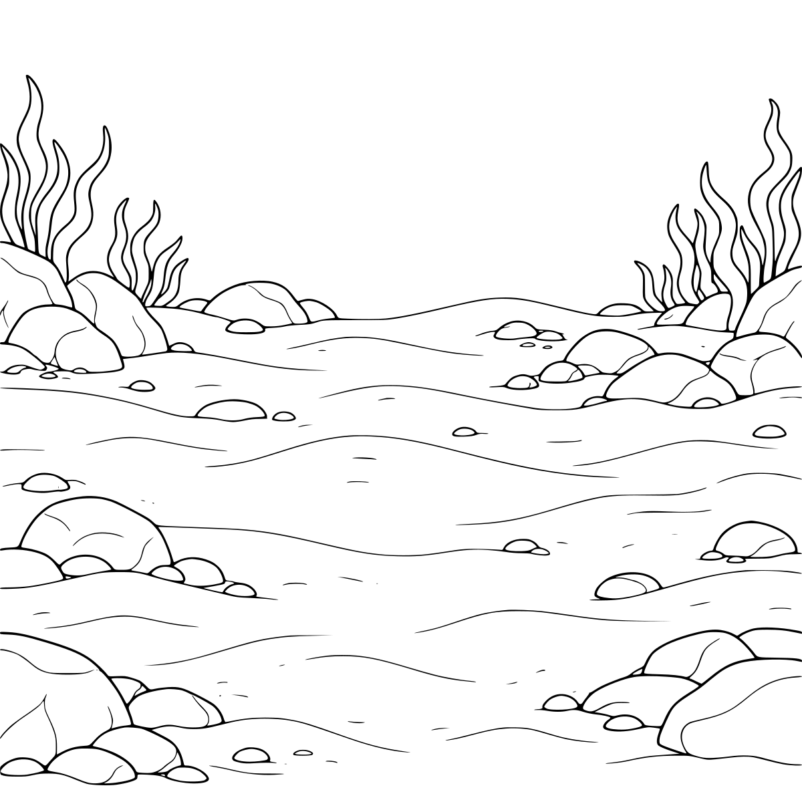

BACKGROUND: a broad gently undulating sandy sea floor horizon around 38 percent down, low rounded rock groups and sparse broad seaweed at far sides, mostly open lower foreground and open white water above. No animals, bubbles, surface waves or sky. Scenery continues off left and right edges. No rectangular frame or bottom closing line. Preserve full square canvas for 1200 by 1200 logical overscan, not isolated cutout composition.

- **Tags:** collection-expansion, Underwater, landscapes, seabed-horizon
- **Roles:** background
- **Detail:** moderate; **Facing:** none
- **Dimensions:** 1200 x 1200 scene units; **Visible Bounds:** left=0, top=112, right=1200, bottom=1200
- **Placement:** Keep full square canvas. Oversized background with open foreground; move vertically to adjust horizon. No visible frame.
- **Files:** [SVG](../../src/assets/vector/collection-expansion-seabed-horizon.svg), [Definition](../../src/assets/vector/collection-expansion-seabed-horizon.svg), [Source](../../art/source/collection-expansion/seabed-horizon.png)
- **Scene Examples:** Not yet used in a built-in scene.

## Cave Chamber

`interiors-cave-chamber`

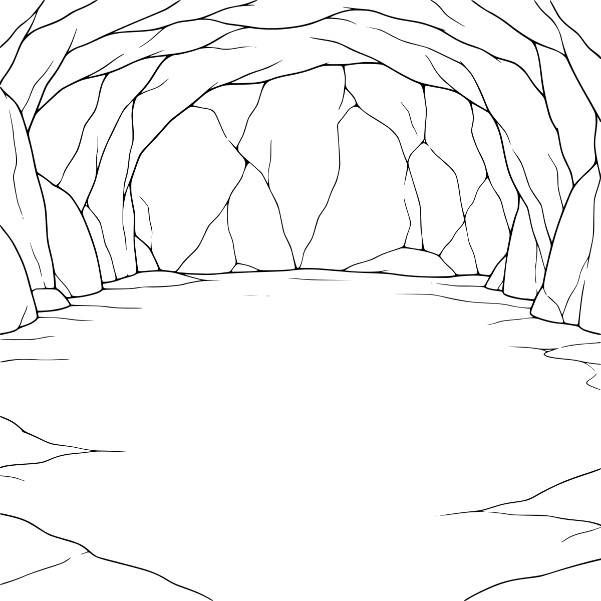

An empty broad rounded natural cave chamber, viewed straight into the room. Curving ceiling and rocky side walls frame a distant back wall with a few large rock facets. Wall-to-floor transition near 40 percent from top. Broad uncluttered floor. No stalactites, loose rocks, fire, crystals or furnishings.

- **Tags:** interiors, caves, cave-chamber
- **Roles:** background
- **Detail:** moderate; **Facing:** none
- **Dimensions:** 1200 x 1200 scene units; **Visible Bounds:** left=0, top=0, right=1200, bottom=1200
- **Placement:** Full paintable interior canvas; covers the page with slight overscan. Reposition to adjust the crop.
- **Files:** [SVG](../../src/assets/vector/interiors-cave-chamber.svg), [Definition](../../src/assets/vector/interiors-cave-chamber.svg), [Source](../../art/source/interiors/cave-chamber.png)
- **Scene Examples:** Not yet used in a built-in scene.

## Cave Side Passage

`interiors-cave-side-passage`

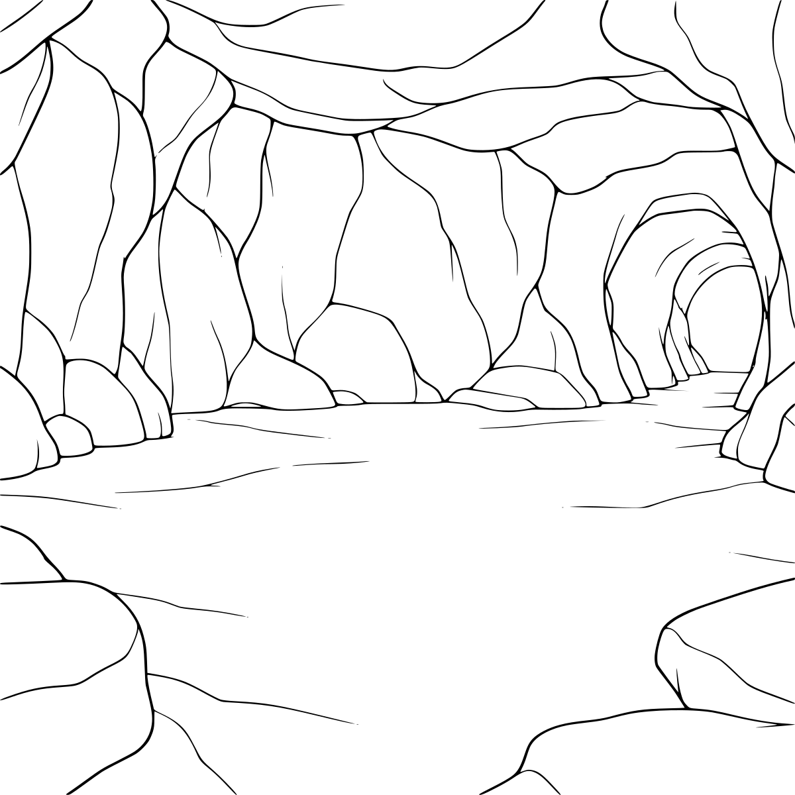

An empty spacious natural cave room in gentle three-quarter view, with a rounded side passage opening on the rear right wall and a few broad rock planes. Passage stays WHITE inside with simple receding contour, never solid black. Open broad floor, no props.

- **Tags:** interiors, caves, cave-side-passage
- **Roles:** background
- **Detail:** moderate; **Facing:** none
- **Dimensions:** 1200 x 1200 scene units; **Visible Bounds:** left=0, top=0, right=1200, bottom=1200
- **Placement:** Full paintable interior canvas; covers the page with slight overscan. Reposition to adjust the crop.
- **Files:** [SVG](../../src/assets/vector/interiors-cave-side-passage.svg), [Definition](../../src/assets/vector/interiors-cave-side-passage.svg), [Source](../../art/source/interiors/cave-side-passage.png)
- **Scene Examples:** Not yet used in a built-in scene.

## Tavern Room

`interiors-tavern-room`

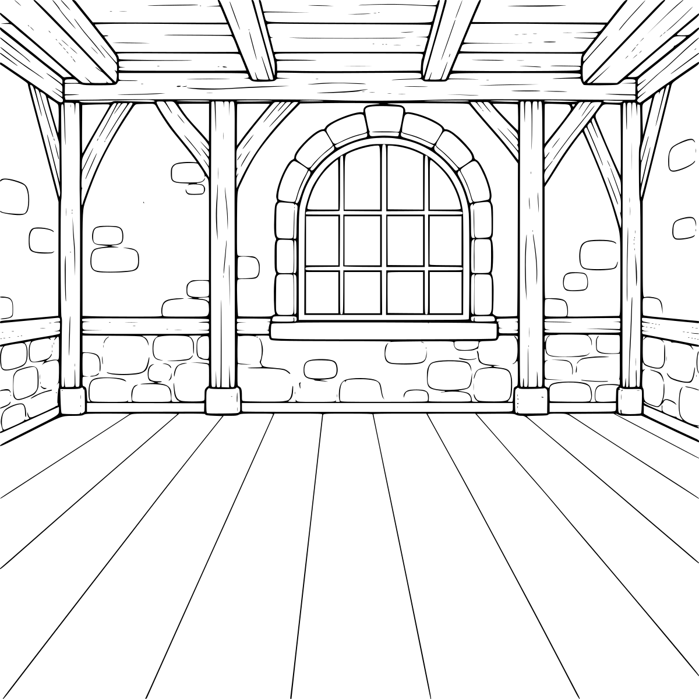

An empty welcoming medieval tavern interior viewed straight on. Simple timber-framed back wall, one broad arched window with WHITE panes, exposed ceiling beam and a wall-to-floor line near 40 percent from top. Sparse wide floorboards in lower area. No tables, chairs, bar, mugs, fireplace or loose props.

- **Tags:** interiors, taverns, tavern-room
- **Roles:** background
- **Detail:** moderate; **Facing:** none
- **Dimensions:** 1200 x 1200 scene units; **Visible Bounds:** left=0, top=0, right=1200, bottom=1200
- **Placement:** Full paintable interior canvas; covers the page with slight overscan. Reposition to adjust the crop.
- **Files:** [SVG](../../src/assets/vector/interiors-tavern-room.svg), [Definition](../../src/assets/vector/interiors-tavern-room.svg), [Source](../../art/source/interiors/tavern-room.png)
- **Scene Examples:** Not yet used in a built-in scene.

## Tavern Corner

`interiors-tavern-corner`

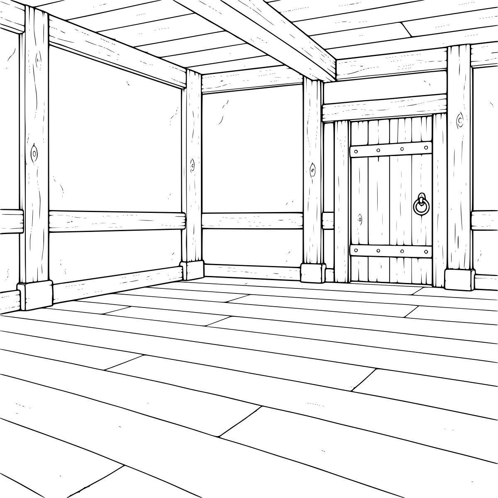

An empty rustic tavern corner in gentle three-quarter perspective, broad plaster wall panels divided by thick timber posts, a closed wooden back door, one ceiling beam, broad uncluttered plank floor. No furniture or loose props.

- **Tags:** interiors, taverns, tavern-corner
- **Roles:** background
- **Detail:** moderate; **Facing:** none
- **Dimensions:** 1200 x 1200 scene units; **Visible Bounds:** left=0, top=0, right=1200, bottom=1200
- **Placement:** Full paintable interior canvas; covers the page with slight overscan. Reposition to adjust the crop.
- **Files:** [SVG](../../src/assets/vector/interiors-tavern-corner.svg), [Definition](../../src/assets/vector/interiors-tavern-corner.svg), [Source](../../art/source/interiors/tavern-corner.png)
- **Scene Examples:** Not yet used in a built-in scene.

## Palace Chamber

`interiors-palace-chamber`

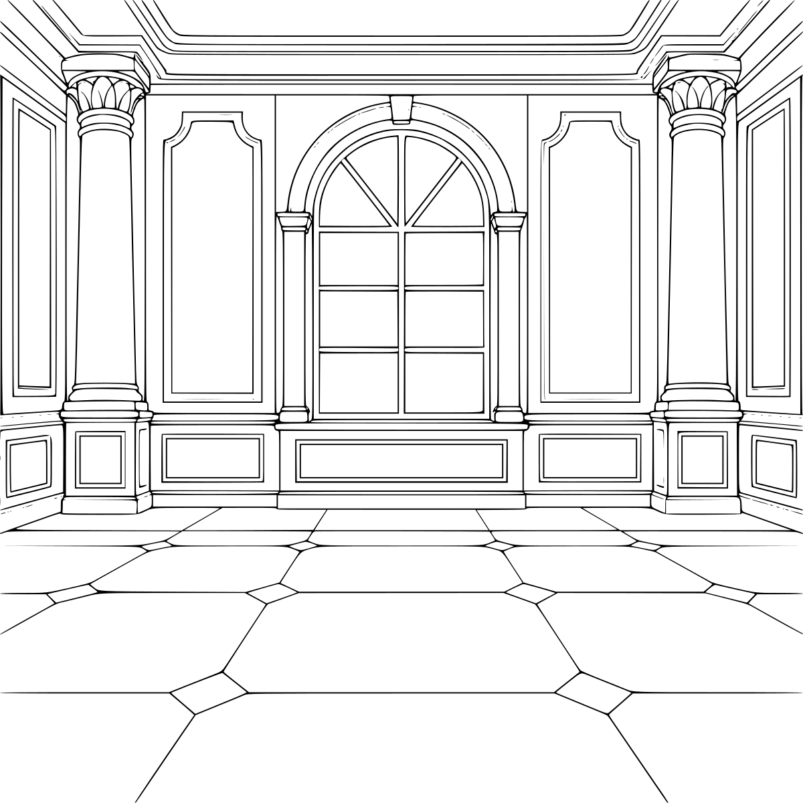

An empty elegant palace room viewed straight on, broad wall panels, two graceful built-in columns at sides, a simple arched central window with WHITE panes and a few broad geometric floor tiles. Wall-to-floor transition near 40 percent. No throne, curtains, furniture, chandelier or loose props.

- **Tags:** interiors, palaces, palace-chamber
- **Roles:** background
- **Detail:** moderate; **Facing:** none
- **Dimensions:** 1200 x 1200 scene units; **Visible Bounds:** left=0, top=0, right=1200, bottom=1200
- **Placement:** Full paintable interior canvas; covers the page with slight overscan. Reposition to adjust the crop.
- **Files:** [SVG](../../src/assets/vector/interiors-palace-chamber.svg), [Definition](../../src/assets/vector/interiors-palace-chamber.svg), [Source](../../art/source/interiors/palace-chamber.png)
- **Scene Examples:** Not yet used in a built-in scene.

## Palace Gallery

`interiors-palace-gallery`

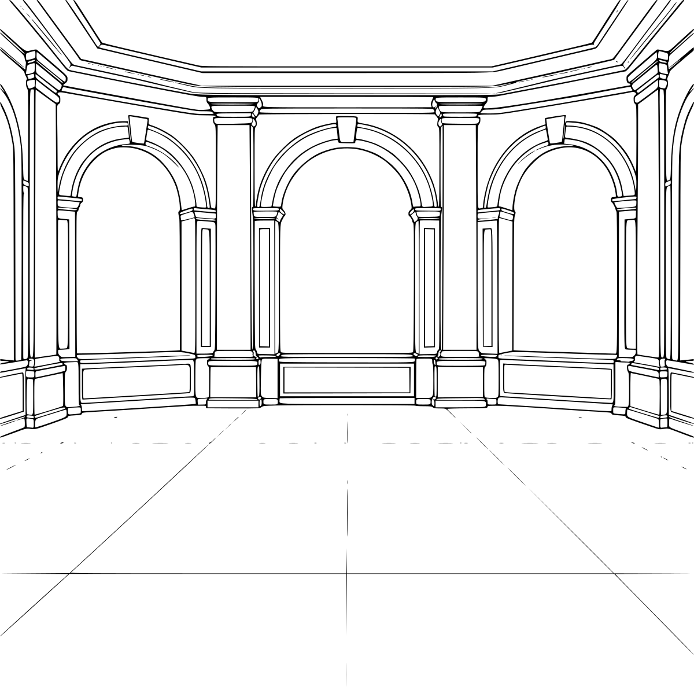

An empty palace gallery in gentle three-quarter perspective, broad arched wall niches and simple pilasters along rear wall, restrained ceiling cornice, large spacious smooth floor with very few tile lines. Niches WHITE inside. No furniture or statues.

- **Tags:** interiors, palaces, palace-gallery
- **Roles:** background
- **Detail:** moderate; **Facing:** none
- **Dimensions:** 1200 x 1200 scene units; **Visible Bounds:** left=0, top=0, right=1200, bottom=1200
- **Placement:** Full paintable interior canvas; covers the page with slight overscan. Reposition to adjust the crop.
- **Files:** [SVG](../../src/assets/vector/interiors-palace-gallery.svg), [Definition](../../src/assets/vector/interiors-palace-gallery.svg), [Source](../../art/source/interiors/palace-gallery.png)
- **Scene Examples:** Not yet used in a built-in scene.

## Great Hall

`interiors-great-hall`

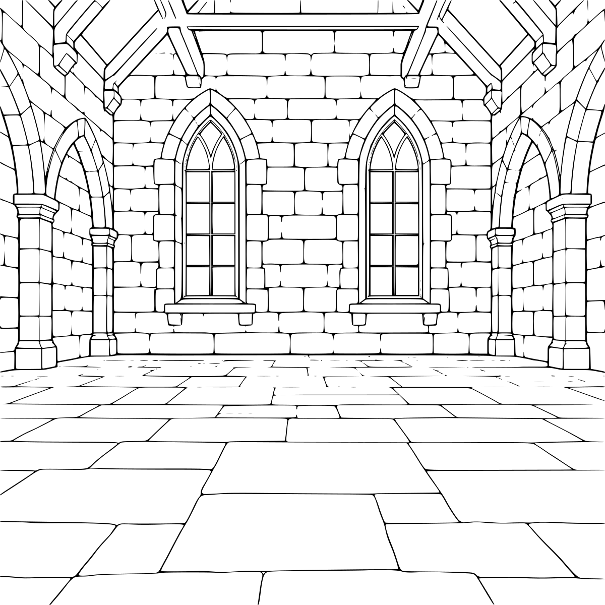

An empty spacious medieval great hall viewed straight on, broad stone back wall, two tall narrow arched windows with WHITE panes and a few exposed roof beams. High open space, broad uncluttered flagstone floor starting near 40 percent down. No banners, torches, benches, table, weapons or furniture.

- **Tags:** interiors, halls, great-hall
- **Roles:** background
- **Detail:** moderate; **Facing:** none
- **Dimensions:** 1200 x 1200 scene units; **Visible Bounds:** left=0, top=0, right=1200, bottom=1200
- **Placement:** Full paintable interior canvas; covers the page with slight overscan. Reposition to adjust the crop.
- **Files:** [SVG](../../src/assets/vector/interiors-great-hall.svg), [Definition](../../src/assets/vector/interiors-great-hall.svg), [Source](../../art/source/interiors/great-hall.png)
- **Scene Examples:** Not yet used in a built-in scene.

## Arched Hallway

`interiors-arched-hallway`

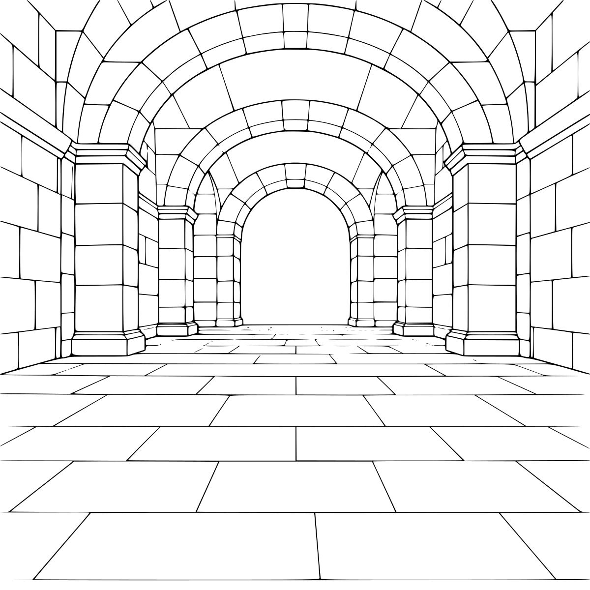

An empty wide stone hallway in gentle one-point perspective with three broad receding arches, broad wall blocks and a generous open floor. Keep side architecture sparse, distant exit WHITE, no black tunnel, no doors or loose props.

- **Tags:** interiors, halls, arched-hallway
- **Roles:** background
- **Detail:** moderate; **Facing:** none
- **Dimensions:** 1200 x 1200 scene units; **Visible Bounds:** left=0, top=0, right=1200, bottom=1200
- **Placement:** Full paintable interior canvas; covers the page with slight overscan. Reposition to adjust the crop.
- **Files:** [SVG](../../src/assets/vector/interiors-arched-hallway.svg), [Definition](../../src/assets/vector/interiors-arched-hallway.svg), [Source](../../art/source/interiors/arched-hallway.png)
- **Scene Examples:** Not yet used in a built-in scene.

## Cottage Kitchen

`interiors-cottage-kitchen`

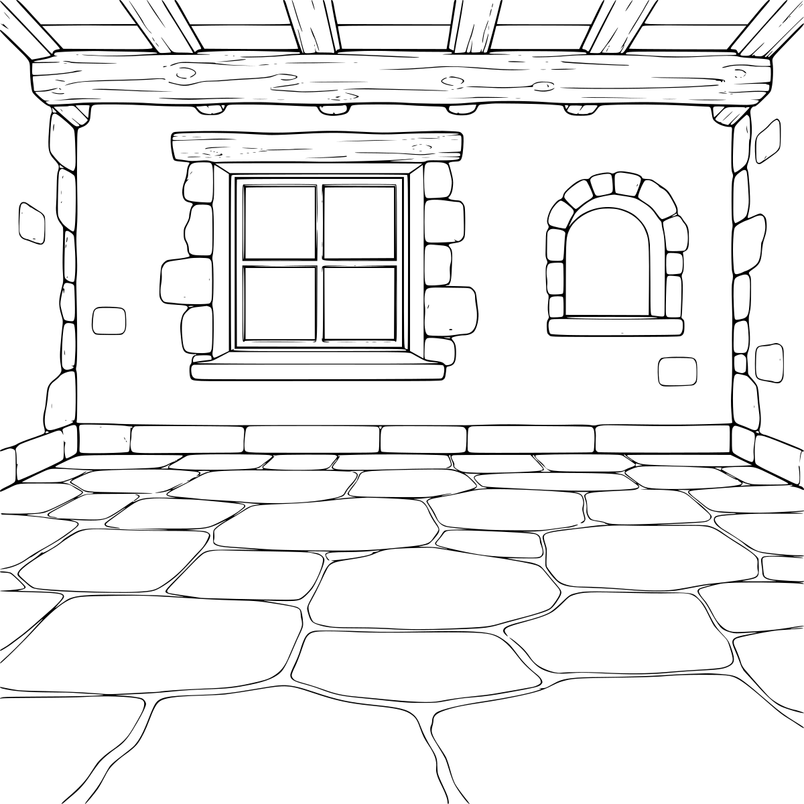

An empty cozy cottage kitchen shell viewed straight on: simple plaster back wall, one broad square window with WHITE panes, exposed wooden ceiling beam and broad stone floor. A small built-in recessed wall niche. No counters, cupboards, fireplace, cookware, baskets or furniture. Floor begins near 40 percent from top.

- **Tags:** interiors, cottages, cottage-kitchen
- **Roles:** background
- **Detail:** moderate; **Facing:** none
- **Dimensions:** 1200 x 1200 scene units; **Visible Bounds:** left=0, top=0, right=1200, bottom=1200
- **Placement:** Full paintable interior canvas; covers the page with slight overscan. Reposition to adjust the crop.
- **Files:** [SVG](../../src/assets/vector/interiors-cottage-kitchen.svg), [Definition](../../src/assets/vector/interiors-cottage-kitchen.svg), [Source](../../art/source/interiors/cottage-kitchen.png)
- **Scene Examples:** Not yet used in a built-in scene.

## Cottage Attic

`interiors-cottage-attic`

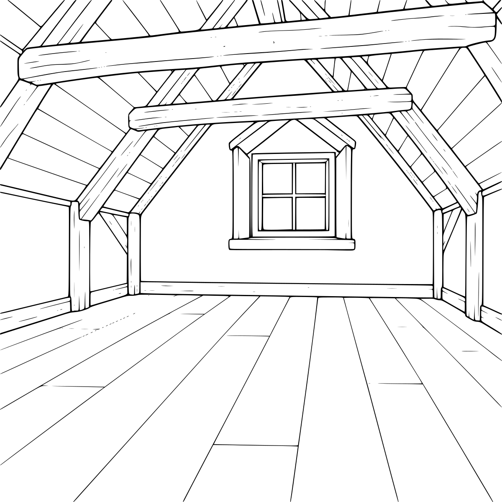

An empty cozy cottage attic room in gentle three-quarter view with sloped ceiling, three broad timber beams, one small rear dormer window with WHITE panes, simple plaster walls and broad open plank floor. No furnishings or loose props.

- **Tags:** interiors, cottages, cottage-attic
- **Roles:** background
- **Detail:** moderate; **Facing:** none
- **Dimensions:** 1200 x 1200 scene units; **Visible Bounds:** left=0, top=0, right=1200, bottom=1200
- **Placement:** Full paintable interior canvas; covers the page with slight overscan. Reposition to adjust the crop.
- **Files:** [SVG](../../src/assets/vector/interiors-cottage-attic.svg), [Definition](../../src/assets/vector/interiors-cottage-attic.svg), [Source](../../art/source/interiors/cottage-attic.png)
- **Scene Examples:** Not yet used in a built-in scene.

## Home Living Room

`interiors-home-living-room`

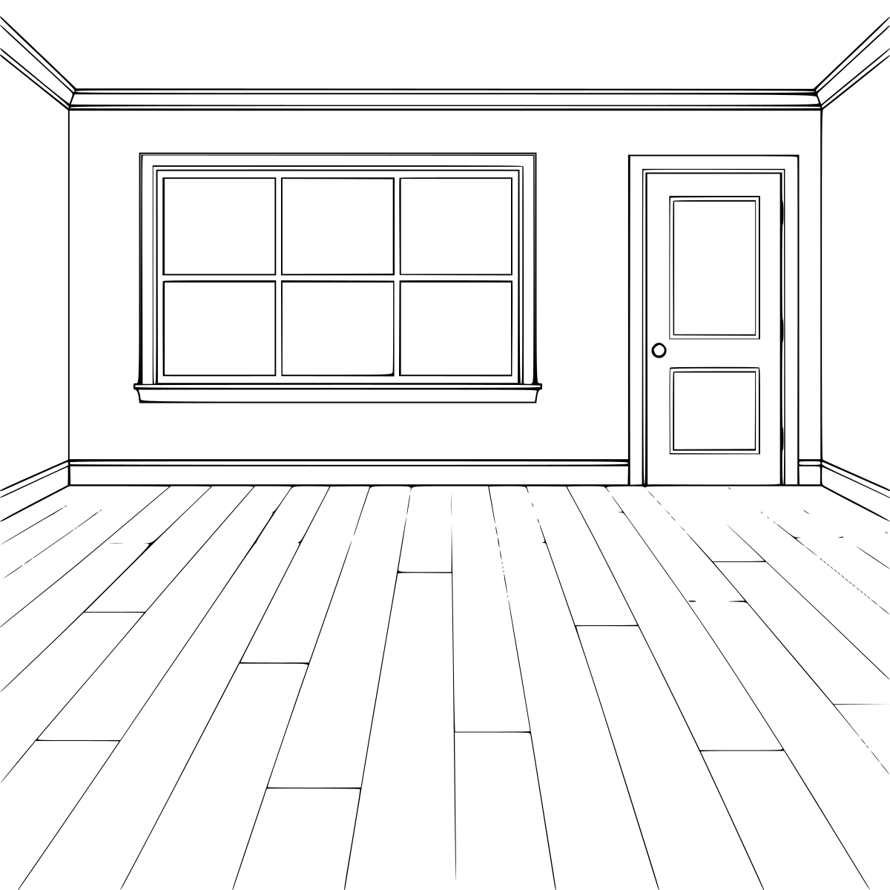

An empty modern home living room shell viewed straight on. Broad smooth back wall, one large rectangular window with WHITE panes and a closed simple door near one side. Plain baseboard, wall-to-floor line near 40 percent down, broad open floor with few plank seams. No furniture, curtains, rugs, lamps or decorations.

- **Tags:** interiors, living rooms, home-living-room
- **Roles:** background
- **Detail:** moderate; **Facing:** none
- **Dimensions:** 1200 x 1200 scene units; **Visible Bounds:** left=0, top=0, right=1200, bottom=1200
- **Placement:** Full paintable interior canvas; covers the page with slight overscan. Reposition to adjust the crop.
- **Files:** [SVG](../../src/assets/vector/interiors-home-living-room.svg), [Definition](../../src/assets/vector/interiors-home-living-room.svg), [Source](../../art/source/interiors/home-living-room.png)
- **Scene Examples:** Not yet used in a built-in scene.

## Home Room Corner

`interiors-home-room-corner`

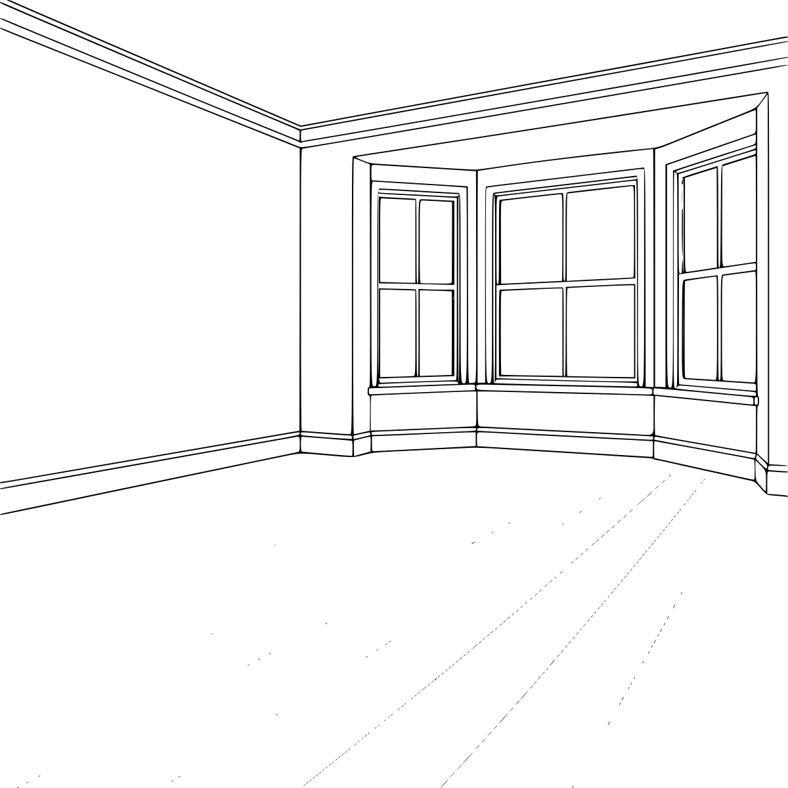

An empty welcoming contemporary living room corner in gentle three-quarter perspective, smooth walls, a broad bay-window recess with WHITE panes, simple baseboards and spacious uncluttered floor. No furniture, curtains, rugs, plants or wall art.

- **Tags:** interiors, living rooms, home-room-corner
- **Roles:** background
- **Detail:** moderate; **Facing:** none
- **Dimensions:** 1200 x 1200 scene units; **Visible Bounds:** left=0, top=0, right=1200, bottom=1200
- **Placement:** Full paintable interior canvas; covers the page with slight overscan. Reposition to adjust the crop.
- **Files:** [SVG](../../src/assets/vector/interiors-home-room-corner.svg), [Definition](../../src/assets/vector/interiors-home-room-corner.svg), [Source](../../art/source/interiors/home-room-corner.png)
- **Scene Examples:** Not yet used in a built-in scene.

## Office Room

`interiors-office-room`

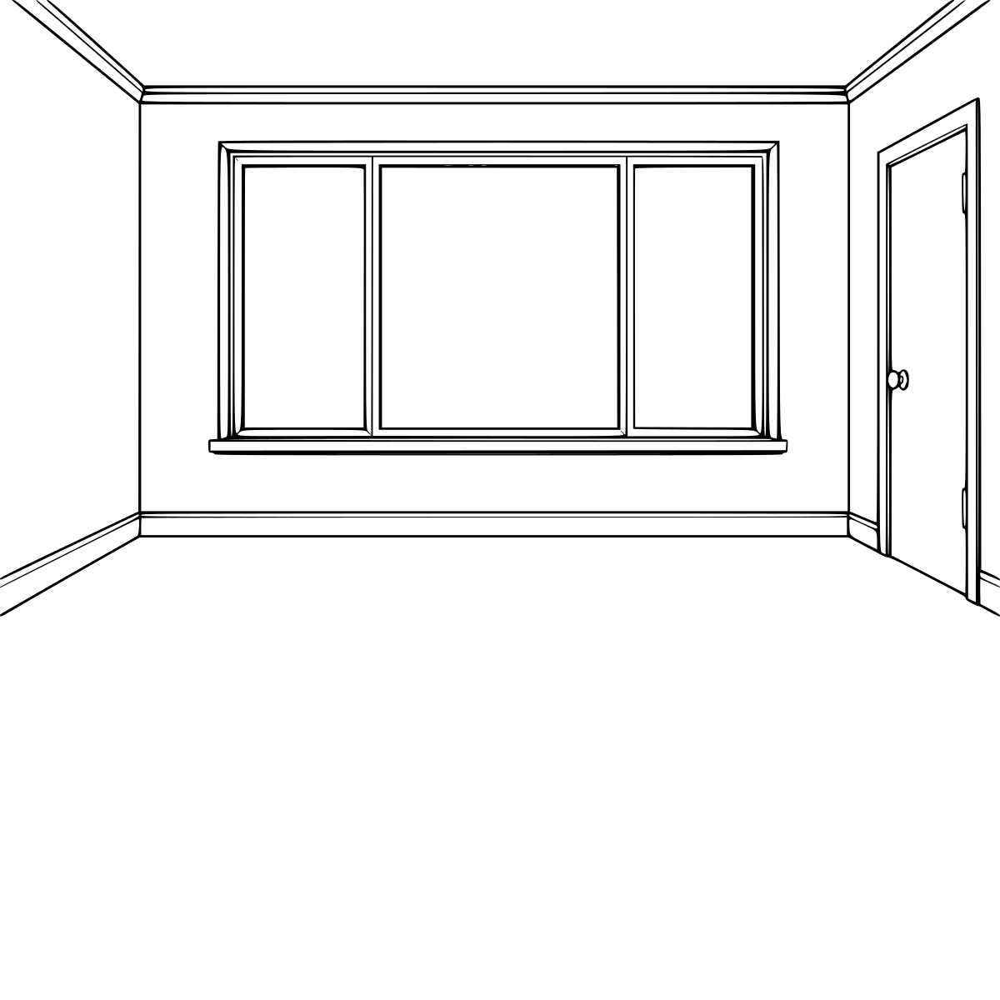

An empty small contemporary office interior viewed straight on, broad smooth walls, a wide rear window with WHITE panes, a closed plain side door and simple baseboards. Open floor starting near 40 percent down. No desks, chairs, cabinets, screens, shelves or decorations.

- **Tags:** interiors, offices, office-room
- **Roles:** background
- **Detail:** moderate; **Facing:** none
- **Dimensions:** 1200 x 1200 scene units; **Visible Bounds:** left=0, top=0, right=1200, bottom=1200
- **Placement:** Full paintable interior canvas; covers the page with slight overscan. Reposition to adjust the crop.
- **Files:** [SVG](../../src/assets/vector/interiors-office-room.svg), [Definition](../../src/assets/vector/interiors-office-room.svg), [Source](../../art/source/interiors/office-room.png)
- **Scene Examples:** Not yet used in a built-in scene.

## Office Corner

`interiors-office-corner`

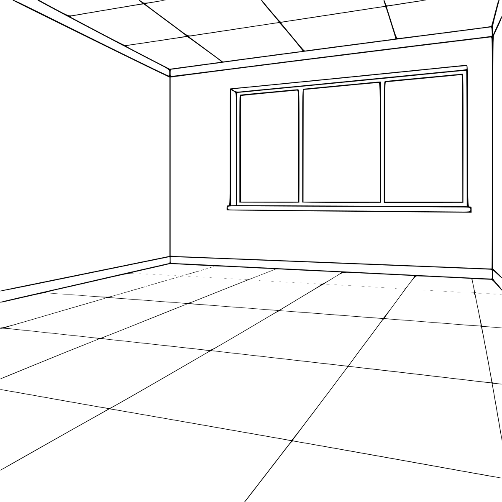

An empty modern office corner in gentle three-quarter perspective, broad smooth wall planes, a simple high rectangular rear window with WHITE panes, a ceiling corner and broad uncluttered tile floor. No furniture or equipment.

- **Tags:** interiors, offices, office-corner
- **Roles:** background
- **Detail:** moderate; **Facing:** none
- **Dimensions:** 1200 x 1200 scene units; **Visible Bounds:** left=0, top=0, right=1200, bottom=1200
- **Placement:** Full paintable interior canvas; covers the page with slight overscan. Reposition to adjust the crop.
- **Files:** [SVG](../../src/assets/vector/interiors-office-corner.svg), [Definition](../../src/assets/vector/interiors-office-corner.svg), [Source](../../art/source/interiors/office-corner.png)
- **Scene Examples:** Not yet used in a built-in scene.

## Bedroom Room

`interiors-bedroom-room`

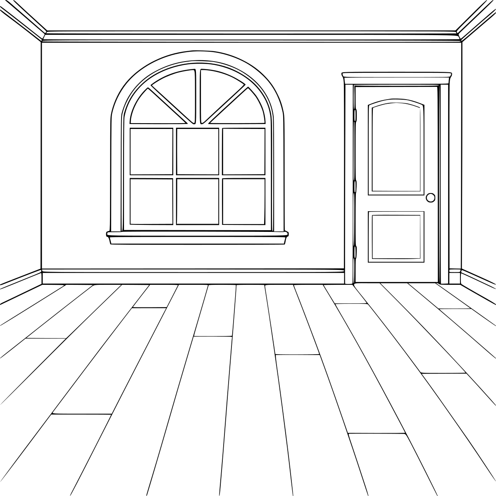

An empty cozy bedroom shell viewed straight on, smooth wall with one broad arched window and WHITE panes, a closed simple door near a side, plain baseboards and broad open plank floor. Floor begins near 40 percent down. No bed, furniture, curtains, rugs, lamps or decorations.

- **Tags:** interiors, bedrooms, bedroom-room
- **Roles:** background
- **Detail:** moderate; **Facing:** none
- **Dimensions:** 1200 x 1200 scene units; **Visible Bounds:** left=0, top=0, right=1200, bottom=1200
- **Placement:** Full paintable interior canvas; covers the page with slight overscan. Reposition to adjust the crop.
- **Files:** [SVG](../../src/assets/vector/interiors-bedroom-room.svg), [Definition](../../src/assets/vector/interiors-bedroom-room.svg), [Source](../../art/source/interiors/bedroom-room.png)
- **Scene Examples:** Not yet used in a built-in scene.

## Bedroom Corner

`interiors-bedroom-corner`

An empty cozy bedroom corner in gentle three-quarter perspective with smooth broad wall panels, one small square window with WHITE panes, a sloped ceiling edge at one side and broad open floor. No furniture, curtains, rugs or decorations.

- **Tags:** interiors, bedrooms, bedroom-corner
- **Roles:** background
- **Detail:** moderate; **Facing:** none
- **Dimensions:** 1200 x 1200 scene units; **Visible Bounds:** left=0, top=0, right=1200, bottom=1200
- **Placement:** Full paintable interior canvas; covers the page with slight overscan. Reposition to adjust the crop.
- **Files:** [SVG](../../src/assets/vector/interiors-bedroom-corner.svg), [Definition](../../src/assets/vector/interiors-bedroom-corner.svg), [Source](../../art/source/interiors/bedroom-corner.png)
- **Scene Examples:** Not yet used in a built-in scene.

