# Objects

[All Assets](../CATALOG.md) | [Searchable Visual Browser](index.html) | [Machine Index](index.json)

Generated by `node scripts/build-asset-catalog.mjs`; edit metadata in `art/stickers.json`.

## Watering Can

`spring-watering-can`

Garden watering can with handle and spout.

- **Tags:** watering-can, tool, garden, spring
- **Roles:** foreground, accent
- **Detail:** moderate; **Facing:** none
- **Dimensions:** 380 x 288 scene units; **Visible Bounds:** left=3.25, top=33, right=377, bottom=267.5
- **Placement:** Use flipX to change facing where useful. Preserve aspect ratio and leave comfortable coloring space.
- **Files:** [SVG](../../src/assets/vector/spring-watering-can.svg), [Definition](../../src/assets/vector/spring-watering-can.svg), [Source](../../art/source/spring/watering-can.png)
- **Scene Examples:** [springScene.ts](../../src/editor/springScene.ts)

## Umbrella

`beach-umbrella`

Beach umbrella on a pole.

- **Tags:** umbrella, beach, summer, picnic
- **Roles:** subject, background
- **Detail:** moderate; **Facing:** none
- **Dimensions:** 627 x 580 scene units; **Visible Bounds:** left=15, top=16, right=617, bottom=565
- **Placement:** Use flipX to change facing where useful. Preserve aspect ratio and leave comfortable coloring space.
- **Files:** [SVG](../../src/assets/vector/beach-umbrella.svg), [Definition](../../src/assets/vector/beach-umbrella.svg), [Source](../../art/source/beach/umbrella.png)
- **Scene Examples:** [beachScene.ts](../../src/editor/beachScene.ts)

## Ball

`beach-ball`

Striped beach ball with large colorable panels.

- **Tags:** ball, toy, beach, summer, play
- **Roles:** foreground, accent
- **Detail:** simple; **Facing:** none
- **Dimensions:** 277 x 280 scene units; **Visible Bounds:** left=14.5, top=16, right=262, bottom=263
- **Placement:** Use flipX to change facing where useful. Preserve aspect ratio and leave comfortable coloring space.
- **Files:** [SVG](../../src/assets/vector/beach-ball.svg), [Definition](../../src/assets/vector/beach-ball.svg), [Source](../../art/source/beach/ball.png)
- **Scene Examples:** [beachScene.ts](../../src/editor/beachScene.ts)

## Towel

`beach-towel`

Flat rectangular beach towel with decorative lines.

- **Tags:** towel, beach, picnic, summer
- **Roles:** foreground, accent
- **Detail:** simple; **Facing:** none
- **Dimensions:** 460 x 180 scene units; **Visible Bounds:** left=0.5, top=0.5, right=459.5, bottom=179.5
- **Placement:** Use flipX to change facing where useful. Preserve aspect ratio and leave comfortable coloring space.
- **Files:** [SVG](../../src/assets/vector/beach-towel.svg), [Definition](../../src/assets/vector/beach-towel.svg), [Source](../../art/source/beach/towel.svg)
- **Scene Examples:** [beachScene.ts](../../src/editor/beachScene.ts)

## Present

`winter-present`

Wrapped gift box with a bow.

- **Tags:** gift, present, christmas, birthday, celebration
- **Roles:** foreground, accent
- **Detail:** moderate; **Facing:** none
- **Dimensions:** 150 x 151 scene units; **Visible Bounds:** left=2.5, top=11.25, right=147.5, bottom=148.75
- **Placement:** Use flipX to change facing where useful. Preserve aspect ratio and leave comfortable coloring space.
- **Files:** [SVG](../../src/assets/vector/winter-present.svg), [Definition](../../src/assets/vector/winter-present.svg), [Source](../../art/source/winter/present.svg)
- **Scene Examples:** [winterScene.ts](../../src/editor/winterScene.ts)

## Bunting

`counting-bunting`

Long string of hanging triangular pennants.

- **Tags:** bunting, party, celebration, counting, garden
- **Roles:** background, accent
- **Detail:** simple; **Facing:** none
- **Dimensions:** 1800 x 76 scene units; **Visible Bounds:** left=4, top=5, right=1796, bottom=72.75
- **Placement:** Use flipX to change facing where useful. Preserve aspect ratio and leave comfortable coloring space.
- **Files:** [SVG](../../src/assets/vector/counting-bunting.svg), [Definition](../../src/assets/vector/counting-bunting.svg), [Source](../../art/source/counting/bunting.svg)
- **Scene Examples:** [countingScene.ts](../../src/editor/countingScene.ts)

## Grandfather Clock

`nursery-rhymes-grandfather-clock`

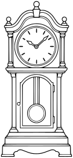

Full tall wooden clock with rounded decorative top, large round clock face with simple twelve tick marks and two clear hands but NO numerals or words, lower glass window and pendulum. Sturdy base, slight whimsical warmth without a face. No mouse included.

- **Tags:** nursery-rhymes, Hickory Dickory Dock, objects, grandfather-clock
- **Roles:** subject, accent
- **Detail:** moderate; **Facing:** none
- **Dimensions:** 121 x 260 scene units; **Visible Bounds:** left=1.75, top=1.75, right=119.25, bottom=258
- **Placement:** Preserve aspect ratio; flip and scale to suit the scene. Source conversion is ready for visual review.
- **Files:** [SVG](../../src/assets/vector/nursery-rhymes-grandfather-clock.svg), [Definition](../../src/assets/vector/nursery-rhymes-grandfather-clock.svg), [Source](../../art/source/nursery-rhymes/grandfather-clock.png)
- **Scene Examples:** Not yet used in a built-in scene.

## Three Wool Sacks

`nursery-rhymes-wool-sacks`

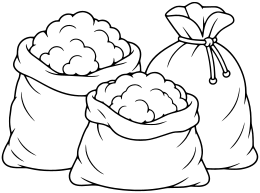

Three rounded sacks side by side with slight overlap, two open showing broad fluffy wool tufts and one tied at neck with simple string. Plain fabric with a few seam/fold lines, no writing, no patterned texture. Whole compact group visible.

- **Tags:** nursery-rhymes, Baa Baa Black Sheep, objects, wool-sacks
- **Roles:** subject, accent
- **Detail:** moderate; **Facing:** none
- **Dimensions:** 260 x 193 scene units; **Visible Bounds:** left=1.75, top=2, right=258.25, bottom=191.25
- **Placement:** Preserve aspect ratio; flip and scale to suit the scene. Source conversion is ready for visual review.
- **Files:** [SVG](../../src/assets/vector/nursery-rhymes-wool-sacks.svg), [Definition](../../src/assets/vector/nursery-rhymes-wool-sacks.svg), [Source](../../art/source/nursery-rhymes/wool-sacks.png)
- **Scene Examples:** Not yet used in a built-in scene.

## Little Teapot

`nursery-rhymes-little-teapot`

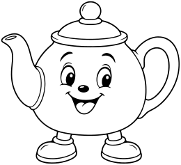

Whole plump classic teapot, curved spout on left and large loop handle on right, domed lid with knob, small smiling face on main body and two little shoe feet. Keep handle hole clear; no arms, steam, cup or background.

- **Tags:** nursery-rhymes, I'm a Little Teapot, objects, little-teapot
- **Roles:** subject, accent
- **Detail:** moderate; **Facing:** none
- **Dimensions:** 260 x 237 scene units; **Visible Bounds:** left=1.75, top=1.75, right=258, bottom=235
- **Placement:** Preserve aspect ratio; flip and scale to suit the scene. Source conversion is ready for visual review.
- **Files:** [SVG](../../src/assets/vector/nursery-rhymes-little-teapot.svg), [Definition](../../src/assets/vector/nursery-rhymes-little-teapot.svg), [Source](../../art/source/nursery-rhymes/little-teapot.png)
- **Scene Examples:** Not yet used in a built-in scene.

## Muffin Tray

`nursery-rhymes-muffin-tray`

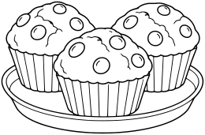

Three broad domed muffins in simple fluted paper cases sitting on one shallow oval tray, three-quarter view. No faces, text, steam or surrounding objects, a few large topping circles only. No dense crumb texture.

- **Tags:** nursery-rhymes, The Muffin Man, objects, muffin-tray
- **Roles:** subject, accent
- **Detail:** moderate; **Facing:** none
- **Dimensions:** 260 x 171 scene units; **Visible Bounds:** left=1.75, top=1.75, right=258.25, bottom=169.25
- **Placement:** Preserve aspect ratio; flip and scale to suit the scene. Source conversion is ready for visual review.
- **Files:** [SVG](../../src/assets/vector/nursery-rhymes-muffin-tray.svg), [Definition](../../src/assets/vector/nursery-rhymes-muffin-tray.svg), [Source](../../art/source/nursery-rhymes/muffin-tray.png)
- **Scene Examples:** Not yet used in a built-in scene.

## Candlestick

`nursery-rhymes-candlestick`

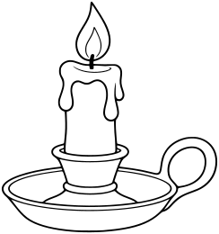

Whole short candle with small flame and two broad wax drips, seated in a shallow metal dish with loop finger handle. Clear closed handle opening, no glow rays, soot, face or background.

- **Tags:** nursery-rhymes, Jack Be Nimble, objects, candlestick
- **Roles:** subject, accent
- **Detail:** moderate; **Facing:** none
- **Dimensions:** 244 x 260 scene units; **Visible Bounds:** left=2, top=1.75, right=242, bottom=258.25
- **Placement:** Preserve aspect ratio; flip and scale to suit the scene. Source conversion is ready for visual review.
- **Files:** [SVG](../../src/assets/vector/nursery-rhymes-candlestick.svg), [Definition](../../src/assets/vector/nursery-rhymes-candlestick.svg), [Source](../../art/source/nursery-rhymes/candlestick.png)
- **Scene Examples:** Not yet used in a built-in scene.

## Storybook Kettle

`nursery-rhymes-storybook-kettle`

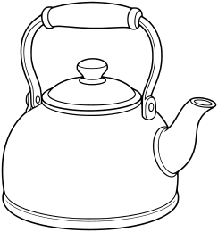

Whole rounded metal kettle with upright arched handle above, domed lid with knob and short curved spout, three-quarter view. No face, stove, steam or words. Keep handle hole clear and details simple. Distinct from our smiling teapot character.

- **Tags:** nursery-rhymes, Polly Put the Kettle On, objects, storybook-kettle
- **Roles:** subject, accent
- **Detail:** moderate; **Facing:** none
- **Dimensions:** 244 x 260 scene units; **Visible Bounds:** left=1.75, top=1.75, right=242.25, bottom=258.25
- **Placement:** Preserve aspect ratio; flip and scale to suit the scene. Source conversion is ready for visual review.
- **Files:** [SVG](../../src/assets/vector/nursery-rhymes-storybook-kettle.svg), [Definition](../../src/assets/vector/nursery-rhymes-storybook-kettle.svg), [Source](../../art/source/nursery-rhymes/storybook-kettle.png)
- **Scene Examples:** Not yet used in a built-in scene.

## Porridge Pot

`nursery-rhymes-porridge-pot`

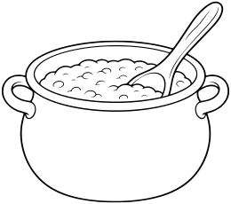

Whole rounded cooking pot with two simple loop side handles, broad rim and porridge surface visible, a wooden spoon resting diagonally inside. No steam, fire, face, words or stove. Large plain panels and coherent spoon overlap.

- **Tags:** nursery-rhymes, Pease Porridge Hot, objects, porridge-pot
- **Roles:** subject, accent
- **Detail:** moderate; **Facing:** none
- **Dimensions:** 260 x 230 scene units; **Visible Bounds:** left=2, top=1.75, right=258, bottom=228.25
- **Placement:** Preserve aspect ratio; flip and scale to suit the scene. Source conversion is ready for visual review.
- **Files:** [SVG](../../src/assets/vector/nursery-rhymes-porridge-pot.svg), [Definition](../../src/assets/vector/nursery-rhymes-porridge-pot.svg), [Source](../../art/source/nursery-rhymes/porridge-pot.png)
- **Scene Examples:** Not yet used in a built-in scene.

## Rain Boots

`fall-rain-boots`

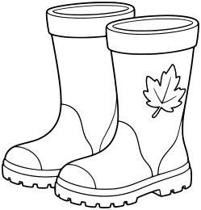

Two upright wellington boots in slight three-quarter view, one slightly behind other, broad cuffs and clearly drawn soles, one small outlined leaf decoration on outer boot. No face or puddle or background; both entire boots visible.

- **Tags:** fall, Fall Props, objects, rain-boots
- **Roles:** subject, accent
- **Detail:** moderate; **Facing:** none
- **Dimensions:** 249 x 260 scene units; **Visible Bounds:** left=2, top=2, right=247, bottom=258
- **Placement:** Preserve aspect ratio; flip and scale to suit the scene. Source conversion is ready for visual review.
- **Files:** [SVG](../../src/assets/vector/fall-rain-boots.svg), [Definition](../../src/assets/vector/fall-rain-boots.svg), [Source](../../art/source/fall/rain-boots.png)
- **Scene Examples:** Not yet used in a built-in scene.

## Wheelbarrow of Leaves

`fall-wheelbarrow-leaves`

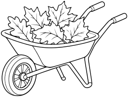

Whole three-quarter side view, sturdy tub with a small pile of about six LARGE outlined leaves, one wheel, two handles and two support legs. Handles, wheel and legs separate and mechanically coherent. No person, no ground.

- **Tags:** fall, Fall Props, objects, wheelbarrow-leaves
- **Roles:** subject, accent
- **Detail:** moderate; **Facing:** none
- **Dimensions:** 260 x 197 scene units; **Visible Bounds:** left=2, top=1.75, right=258.25, bottom=195
- **Placement:** Preserve aspect ratio; flip and scale to suit the scene. Source conversion is ready for visual review.
- **Files:** [SVG](../../src/assets/vector/fall-wheelbarrow-leaves.svg), [Definition](../../src/assets/vector/fall-wheelbarrow-leaves.svg), [Source](../../art/source/fall/wheelbarrow-leaves.png)
- **Scene Examples:** Not yet used in a built-in scene.

## Garden Rake

`fall-rake`

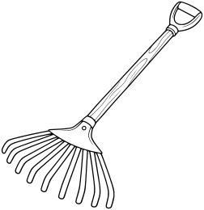

Whole diagonal garden rake with a straight wooden handle and wide fan-shaped head with about nine thick clearly separated tines, small closed handle grip. No person, leaves or ground. Strong simple silhouette with intentional gaps between tines.

- **Tags:** fall, Fall Props, objects, rake
- **Roles:** subject, accent
- **Detail:** moderate; **Facing:** none
- **Dimensions:** 252 x 260 scene units; **Visible Bounds:** left=1.75, top=1.75, right=250, bottom=258.25
- **Placement:** Preserve aspect ratio; flip and scale to suit the scene. Source conversion is ready for visual review.
- **Files:** [SVG](../../src/assets/vector/fall-rake.svg), [Definition](../../src/assets/vector/fall-rake.svg), [Source](../../art/source/fall/rake.png)
- **Scene Examples:** Not yet used in a built-in scene.

## Hay Bale

`fall-hay-bale`

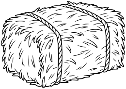

Three-quarter view, rounded rectangular bale held by two broad twine bands, a few deliberate curved straw marks to suggest hay without dense hatching. White interiors and medium outlines. No loose flying straw or ground.

- **Tags:** fall, Fall Harvest, objects, hay-bale
- **Roles:** subject, accent
- **Detail:** moderate; **Facing:** none
- **Dimensions:** 260 x 185 scene units; **Visible Bounds:** left=1.75, top=1.75, right=258.25, bottom=183.25
- **Placement:** Preserve aspect ratio; flip and scale to suit the scene. Source conversion is ready for visual review.
- **Files:** [SVG](../../src/assets/vector/fall-hay-bale.svg), [Definition](../../src/assets/vector/fall-hay-bale.svg), [Source](../../art/source/fall/hay-bale.png)
- **Scene Examples:** Not yet used in a built-in scene.

## Flying Kite

`fall-flying-kite`

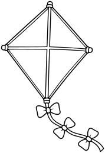

Whole large diamond kite, simple cross spars dividing four broad white panels, short gently curved tail with three large clearly closed bows. No string extending out of frame, no sky, clouds or person. All tips and tail contained with margins.

- **Tags:** fall, Fall Activities, objects, flying-kite
- **Roles:** subject, accent
- **Detail:** moderate; **Facing:** none
- **Dimensions:** 178 x 260 scene units; **Visible Bounds:** left=1.75, top=1.75, right=176.25, bottom=258.25
- **Placement:** Preserve aspect ratio; flip and scale to suit the scene. Source conversion is ready for visual review.
- **Files:** [SVG](../../src/assets/vector/fall-flying-kite.svg), [Definition](../../src/assets/vector/fall-flying-kite.svg), [Source](../../art/source/fall/flying-kite.png)
- **Scene Examples:** Not yet used in a built-in scene.

## Autumn Scarf

`fall-autumn-scarf`

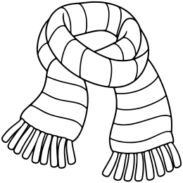

One scarf loosely folded in a soft S-like drape, broad outlined stripe bands and short thick fringe at both ends. No dense knitted texture, no face, person or other clothes. Entire scarf visible as one cohesive accessory sticker.

- **Tags:** fall, Fall Clothing, objects, autumn-scarf
- **Roles:** subject, accent
- **Detail:** moderate; **Facing:** none
- **Dimensions:** 260 x 260 scene units; **Visible Bounds:** left=2, top=2, right=258, bottom=258.25
- **Placement:** Preserve aspect ratio; flip and scale to suit the scene. Source conversion is ready for visual review.
- **Files:** [SVG](../../src/assets/vector/fall-autumn-scarf.svg), [Definition](../../src/assets/vector/fall-autumn-scarf.svg), [Source](../../art/source/fall/autumn-scarf.png)
- **Scene Examples:** Not yet used in a built-in scene.

## Mittens

`fall-mittens`

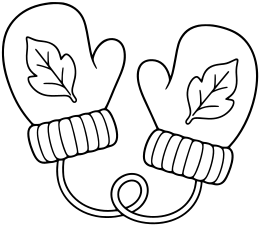

Two plump knitted mittens slightly angled toward each other, broad ribbed cuffs and one simple outlined leaf motif on each, small connecting cord curling in a closed loop entirely within frame. No detailed knit texture, no hands or background.

- **Tags:** fall, Fall Clothing, objects, mittens
- **Roles:** subject, accent
- **Detail:** moderate; **Facing:** none
- **Dimensions:** 260 x 226 scene units; **Visible Bounds:** left=2, top=2, right=258.25, bottom=224.25
- **Placement:** Preserve aspect ratio; flip and scale to suit the scene. Source conversion is ready for visual review.
- **Files:** [SVG](../../src/assets/vector/fall-mittens.svg), [Definition](../../src/assets/vector/fall-mittens.svg), [Source](../../art/source/fall/mittens.png)
- **Scene Examples:** Not yet used in a built-in scene.

## Harvest Lantern

`fall-harvest-lantern`

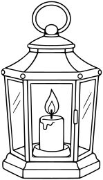

Whole lantern with loop carrying handle, broad metal frame, four glass window panels and one simple candle inside with small flame. No glow rays, shading, scenery or text. Clear closed handle opening and spacious coloring areas.

- **Tags:** fall, Fall Props, objects, harvest-lantern
- **Roles:** subject, accent
- **Detail:** moderate; **Facing:** none
- **Dimensions:** 149 x 260 scene units; **Visible Bounds:** left=1.75, top=1.75, right=147.25, bottom=258.25
- **Placement:** Preserve aspect ratio; flip and scale to suit the scene. Source conversion is ready for visual review.
- **Files:** [SVG](../../src/assets/vector/fall-harvest-lantern.svg), [Definition](../../src/assets/vector/fall-harvest-lantern.svg), [Source](../../art/source/fall/harvest-lantern.png)
- **Scene Examples:** Not yet used in a built-in scene.

## Teddy Bear

`category-expansion-teddy-bear`

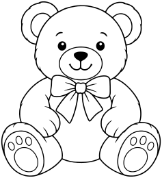

One seated plush teddy bear with round ears, soft paws, clear arm outlines and a simple bow, friendly small face, broad coloring areas.

- **Tags:** category-expansion, objects, teddy-bear
- **Roles:** subject, accent
- **Detail:** moderate; **Facing:** none
- **Dimensions:** 237 x 260 scene units; **Visible Bounds:** left=1.75, top=2, right=235.25, bottom=258
- **Placement:** Preserve aspect ratio; flip and scale to suit the scene. Source conversion is ready for visual review.
- **Files:** [SVG](../../src/assets/vector/category-expansion-teddy-bear.svg), [Definition](../../src/assets/vector/category-expansion-teddy-bear.svg), [Source](../../art/source/category-expansion/teddy-bear.png)
- **Scene Examples:** Not yet used in a built-in scene.

## Toy Blocks

`category-expansion-toy-blocks`

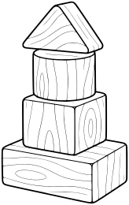

A small stable stack of four chunky wooden toy blocks of different basic shapes, clean three-quarter view, no letters or numbers, no loose extra pieces.

- **Tags:** category-expansion, objects, toy-blocks
- **Roles:** subject, accent
- **Detail:** moderate; **Facing:** none
- **Dimensions:** 164 x 260 scene units; **Visible Bounds:** left=2, top=1.75, right=162.25, bottom=258.25
- **Placement:** Preserve aspect ratio; flip and scale to suit the scene. Source conversion is ready for visual review.
- **Files:** [SVG](../../src/assets/vector/category-expansion-toy-blocks.svg), [Definition](../../src/assets/vector/category-expansion-toy-blocks.svg), [Source](../../art/source/category-expansion/toy-blocks.png)
- **Scene Examples:** Not yet used in a built-in scene.

## Toy Drum

`category-expansion-toy-drum`

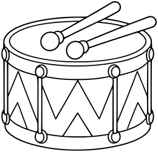

One simple toy marching drum with broad zigzag side panels, clear top drumhead and two chunky drumsticks resting across it. Clean readable overlaps.

- **Tags:** category-expansion, objects, toy-drum
- **Roles:** subject, accent
- **Detail:** moderate; **Facing:** none
- **Dimensions:** 260 x 251 scene units; **Visible Bounds:** left=2.25, top=2, right=258, bottom=248.75
- **Placement:** Preserve aspect ratio; flip and scale to suit the scene. Source conversion is ready for visual review.
- **Files:** [SVG](../../src/assets/vector/category-expansion-toy-drum.svg), [Definition](../../src/assets/vector/category-expansion-toy-drum.svg), [Source](../../art/source/category-expansion/toy-drum.png)
- **Scene Examples:** Not yet used in a built-in scene.

## Soccer Ball

`category-expansion-soccer-ball`

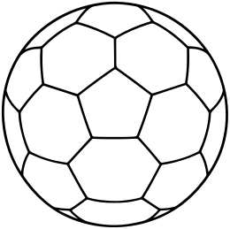

One classic soccer ball with broad pentagon and hexagon panels following its round surface. All panels white inside, no solid black panels.

- **Tags:** category-expansion, objects, soccer-ball
- **Roles:** subject, accent
- **Detail:** moderate; **Facing:** none
- **Dimensions:** 260 x 259 scene units; **Visible Bounds:** left=2, top=1.75, right=258, bottom=257
- **Placement:** Preserve aspect ratio; flip and scale to suit the scene. Source conversion is ready for visual review.
- **Files:** [SVG](../../src/assets/vector/category-expansion-soccer-ball.svg), [Definition](../../src/assets/vector/category-expansion-soccer-ball.svg), [Source](../../art/source/category-expansion/soccer-ball.png)
- **Scene Examples:** Not yet used in a built-in scene.

## Treasure Chest

`fantasy-treasure-chest`

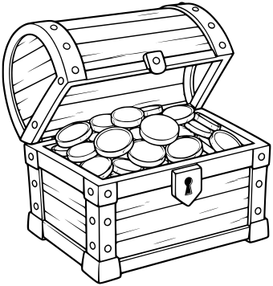

One open wooden treasure chest in three-quarter view, simple metal bands, broad lid and a small mound of large coins inside. No floating coins or text.

- **Tags:** fantasy, fantasy props, treasure-chest
- **Roles:** subject, accent
- **Detail:** moderate; **Facing:** none
- **Dimensions:** 340 x 356 scene units; **Visible Bounds:** left=2.75, top=2.5, right=337.5, bottom=353.5
- **Placement:** Preserve aspect ratio; position and scale to suit the scene. Review enclosed negative spaces after conversion.
- **Files:** [SVG](../../src/assets/vector/fantasy-treasure-chest.svg), [Definition](../../src/assets/vector/fantasy-treasure-chest.svg), [Source](../../art/source/fantasy/treasure-chest.png)
- **Scene Examples:** Not yet used in a built-in scene.

## Spellbook

`fantasy-spellbook`

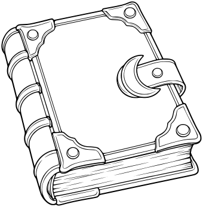

One closed thick fantasy spellbook in three-quarter view, broad plain cover, simple crescent clasp and large corner pieces. No words, letters, runes or sigils.

- **Tags:** fantasy, fantasy props, spellbook
- **Roles:** subject, accent
- **Detail:** moderate; **Facing:** none
- **Dimensions:** 340 x 347 scene units; **Visible Bounds:** left=2.25, top=2.5, right=337.5, bottom=344.5
- **Placement:** Preserve aspect ratio; position and scale to suit the scene. Review enclosed negative spaces after conversion.
- **Files:** [SVG](../../src/assets/vector/fantasy-spellbook.svg), [Definition](../../src/assets/vector/fantasy-spellbook.svg), [Source](../../art/source/fantasy/spellbook.png)
- **Scene Examples:** Not yet used in a built-in scene.

## Potion Bottle

`fantasy-potion-bottle`

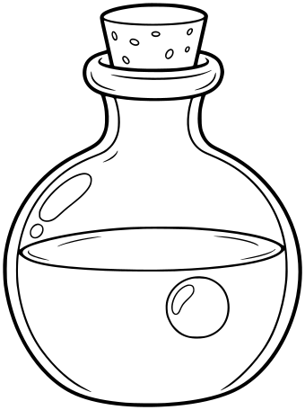

One rounded stoppered potion flask, broad neck, simple cork, enclosed liquid level and one large bubble inside, no label or surrounding effects.

- **Tags:** fantasy, fantasy props, potion-bottle
- **Roles:** subject, accent
- **Detail:** moderate; **Facing:** none
- **Dimensions:** 340 x 456 scene units; **Visible Bounds:** left=3.25, top=3.5, right=336.75, bottom=452.75
- **Placement:** Preserve aspect ratio; position and scale to suit the scene. Review enclosed negative spaces after conversion.
- **Files:** [SVG](../../src/assets/vector/fantasy-potion-bottle.svg), [Definition](../../src/assets/vector/fantasy-potion-bottle.svg), [Source](../../art/source/fantasy/potion-bottle.png)
- **Scene Examples:** Not yet used in a built-in scene.

## Dragon Egg

`fantasy-dragon-egg`

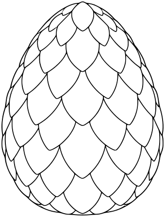

One large unhatched dragon egg standing upright, broad overlapping scale-like shell panels, no cracks, pedestal or surrounding nest.

- **Tags:** fantasy, fantasy props, dragon-egg
- **Roles:** subject, accent
- **Detail:** moderate; **Facing:** none
- **Dimensions:** 340 x 448 scene units; **Visible Bounds:** left=3, top=3, right=337, bottom=444.75
- **Placement:** Preserve aspect ratio; position and scale to suit the scene. Review enclosed negative spaces after conversion.
- **Files:** [SVG](../../src/assets/vector/fantasy-dragon-egg.svg), [Definition](../../src/assets/vector/fantasy-dragon-egg.svg), [Source](../../art/source/fantasy/dragon-egg.png)
- **Scene Examples:** Not yet used in a built-in scene.

## Crystal Cluster

`fantasy-crystal-cluster`

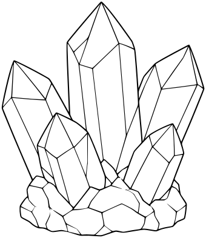

One compact cluster of five large faceted fantasy crystals joined at a broad rock base, clear polygonal planes and overlaps, no glow or particles.

- **Tags:** fantasy, fantasy props, crystal-cluster
- **Roles:** subject, accent
- **Detail:** moderate; **Facing:** none
- **Dimensions:** 340 x 393 scene units; **Visible Bounds:** left=2.75, top=2.5, right=337.5, bottom=390.25
- **Placement:** Preserve aspect ratio; position and scale to suit the scene. Review enclosed negative spaces after conversion.
- **Files:** [SVG](../../src/assets/vector/fantasy-crystal-cluster.svg), [Definition](../../src/assets/vector/fantasy-crystal-cluster.svg), [Source](../../art/source/fantasy/crystal-cluster.png)
- **Scene Examples:** Not yet used in a built-in scene.

## Cave Stalagmites

`interiors-cave-stalagmites`

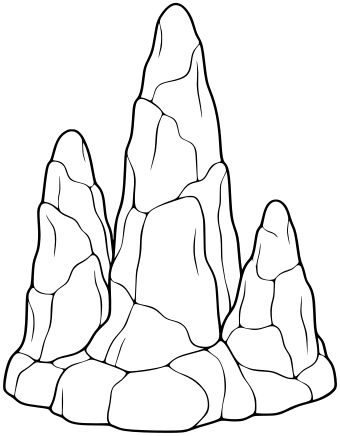

One low cluster of three smooth tapering stalagmites joined at a small rocky base, clear broad facets, no surrounding floor.

- **Tags:** interiors, caves, cave-stalagmites
- **Roles:** subject, accent
- **Detail:** moderate; **Facing:** none
- **Dimensions:** 340 x 436 scene units; **Visible Bounds:** left=3, top=3, right=337, bottom=432.75
- **Placement:** Preserve aspect ratio; position and scale to suit the scene. Review enclosed negative spaces after conversion.
- **Files:** [SVG](../../src/assets/vector/interiors-cave-stalagmites.svg), [Definition](../../src/assets/vector/interiors-cave-stalagmites.svg), [Source](../../art/source/interiors/cave-stalagmites.png)
- **Scene Examples:** Not yet used in a built-in scene.

## Hanging Stalactites

`interiors-hanging-stalactites`

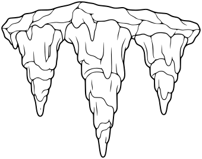

One small cluster of three broad downward-pointing stalactites attached to a short uneven rocky ceiling strip. Isolated hanging prop, complete strip in frame, no room.

- **Tags:** interiors, caves, hanging-stalactites
- **Roles:** subject, accent
- **Detail:** moderate; **Facing:** none
- **Dimensions:** 340 x 269 scene units; **Visible Bounds:** left=2.25, top=2.25, right=337.75, bottom=266.75
- **Placement:** Preserve aspect ratio; position and scale to suit the scene. Review enclosed negative spaces after conversion.
- **Files:** [SVG](../../src/assets/vector/interiors-hanging-stalactites.svg), [Definition](../../src/assets/vector/interiors-hanging-stalactites.svg), [Source](../../art/source/interiors/hanging-stalactites.png)
- **Scene Examples:** Not yet used in a built-in scene.

## Cave Stone Arch

`interiors-cave-stone-arch`

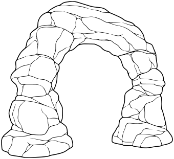

One freestanding natural rock arch with two sturdy rock feet and a broad irregular curved roof. Opening clearly WHITE and empty, a clean continuous inner contour, no scenery inside.

- **Tags:** interiors, caves, cave-stone-arch
- **Roles:** subject, accent
- **Detail:** moderate; **Facing:** none
- **Dimensions:** 340 x 311 scene units; **Visible Bounds:** left=2.25, top=2.25, right=337.75, bottom=308.75
- **Placement:** Preserve aspect ratio; position and scale to suit the scene. Review enclosed negative spaces after conversion.
- **Files:** [SVG](../../src/assets/vector/interiors-cave-stone-arch.svg), [Definition](../../src/assets/vector/interiors-cave-stone-arch.svg), [Source](../../art/source/interiors/cave-stone-arch.png)
- **Scene Examples:** Not yet used in a built-in scene.

## Small Campfire

`interiors-small-campfire`

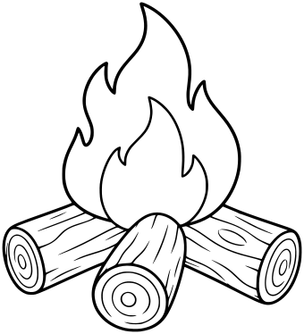

One small campfire with three chunky logs in a clear stable arrangement and two broad enclosed flame shapes rising above. No smoke, sparks, ash or ground.

- **Tags:** interiors, caves, small-campfire
- **Roles:** subject, accent
- **Detail:** moderate; **Facing:** none
- **Dimensions:** 340 x 374 scene units; **Visible Bounds:** left=2.5, top=2.5, right=337.5, bottom=371.5
- **Placement:** Preserve aspect ratio; position and scale to suit the scene. Review enclosed negative spaces after conversion.
- **Files:** [SVG](../../src/assets/vector/interiors-small-campfire.svg), [Definition](../../src/assets/vector/interiors-small-campfire.svg), [Source](../../art/source/interiors/small-campfire.png)
- **Scene Examples:** Not yet used in a built-in scene.

## Tavern Table

`interiors-tavern-table`

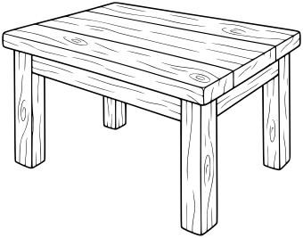

One sturdy rustic rectangular wooden table in mild three-quarter view, thick top and four clearly coherent legs, simple broad plank divisions. Empty tabletop, no cloth or other objects.

- **Tags:** interiors, taverns, tavern-table
- **Roles:** subject, accent
- **Detail:** moderate; **Facing:** none
- **Dimensions:** 340 x 267 scene units; **Visible Bounds:** left=2.25, top=2.25, right=337.75, bottom=264.5
- **Placement:** Preserve aspect ratio; position and scale to suit the scene. Review enclosed negative spaces after conversion.
- **Files:** [SVG](../../src/assets/vector/interiors-tavern-table.svg), [Definition](../../src/assets/vector/interiors-tavern-table.svg), [Source](../../art/source/interiors/tavern-table.png)
- **Scene Examples:** Not yet used in a built-in scene.

## Tavern Stool

`interiors-tavern-stool`

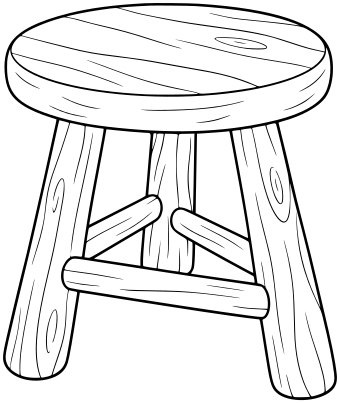

One chunky three-legged wooden stool, rounded seat and readable leg braces, gentle three-quarter view. No other objects.

- **Tags:** interiors, taverns, tavern-stool
- **Roles:** subject, accent
- **Detail:** moderate; **Facing:** none
- **Dimensions:** 340 x 403 scene units; **Visible Bounds:** left=3, top=3, right=337, bottom=400
- **Placement:** Preserve aspect ratio; position and scale to suit the scene. Review enclosed negative spaces after conversion.
- **Files:** [SVG](../../src/assets/vector/interiors-tavern-stool.svg), [Definition](../../src/assets/vector/interiors-tavern-stool.svg), [Source](../../art/source/interiors/tavern-stool.png)
- **Scene Examples:** Not yet used in a built-in scene.

## Wooden Barrel

`interiors-wooden-barrel`

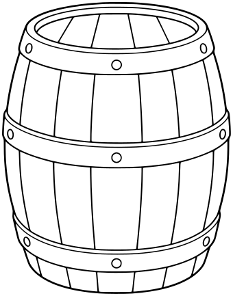

One upright wooden barrel with broad staves, three simple metal hoops and a clear closed top, mild three-quarter view. No fine wood grain.

- **Tags:** interiors, taverns, wooden-barrel
- **Roles:** subject, accent
- **Detail:** moderate; **Facing:** none
- **Dimensions:** 340 x 433 scene units; **Visible Bounds:** left=3, top=3, right=336.75, bottom=429.75
- **Placement:** Preserve aspect ratio; position and scale to suit the scene. Review enclosed negative spaces after conversion.
- **Files:** [SVG](../../src/assets/vector/interiors-wooden-barrel.svg), [Definition](../../src/assets/vector/interiors-wooden-barrel.svg), [Source](../../art/source/interiors/wooden-barrel.png)
- **Scene Examples:** Not yet used in a built-in scene.

## Tavern Tankard

`interiors-tavern-tankard`

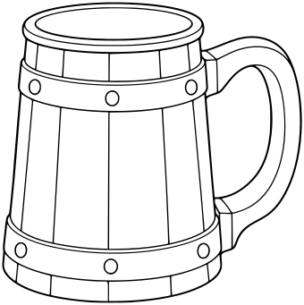

One large plain medieval tankard, broad cylindrical body with simple bands and a sturdy open handle. Empty open rim, no liquid, foam, label or decoration.

- **Tags:** interiors, taverns, tavern-tankard
- **Roles:** subject, accent
- **Detail:** moderate; **Facing:** none
- **Dimensions:** 340 x 341 scene units; **Visible Bounds:** left=2.5, top=2.5, right=337.75, bottom=338.5
- **Placement:** Preserve aspect ratio; position and scale to suit the scene. Review enclosed negative spaces after conversion.
- **Files:** [SVG](../../src/assets/vector/interiors-tavern-tankard.svg), [Definition](../../src/assets/vector/interiors-tavern-tankard.svg), [Source](../../art/source/interiors/tavern-tankard.png)
- **Scene Examples:** Not yet used in a built-in scene.

## Royal Throne

`interiors-royal-throne`

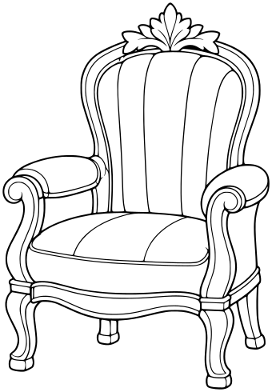

One elegant freestanding throne chair in mild three-quarter view, tall rounded back with simple leaf crest, broad cushion panels, armrests and four sturdy legs. No crown, gemstones or excessive scrollwork.

- **Tags:** interiors, palaces, royal-throne
- **Roles:** subject, accent
- **Detail:** moderate; **Facing:** none
- **Dimensions:** 340 x 490 scene units; **Visible Bounds:** left=3.25, top=3.25, right=336.75, bottom=486.75
- **Placement:** Preserve aspect ratio; position and scale to suit the scene. Review enclosed negative spaces after conversion.
- **Files:** [SVG](../../src/assets/vector/interiors-royal-throne.svg), [Definition](../../src/assets/vector/interiors-royal-throne.svg), [Source](../../art/source/interiors/royal-throne.png)
- **Scene Examples:** Not yet used in a built-in scene.

## Palace Column

`interiors-palace-column`

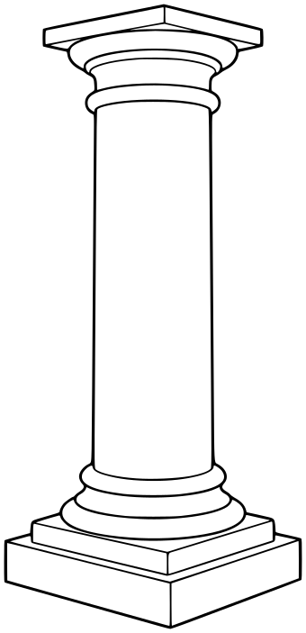

One complete freestanding classical column with broad square base, smooth shaft and a simple rounded capital, clear whole object with margin. No ruins, floor or surrounding architecture.

- **Tags:** interiors, palaces, palace-column
- **Roles:** subject, accent
- **Detail:** moderate; **Facing:** none
- **Dimensions:** 340 x 703 scene units; **Visible Bounds:** left=4.5, top=4.75, right=335.5, bottom=698.5
- **Placement:** Preserve aspect ratio; position and scale to suit the scene. Review enclosed negative spaces after conversion.
- **Files:** [SVG](../../src/assets/vector/interiors-palace-column.svg), [Definition](../../src/assets/vector/interiors-palace-column.svg), [Source](../../art/source/interiors/palace-column.png)
- **Scene Examples:** Not yet used in a built-in scene.

## Palace Vase

`interiors-palace-vase`

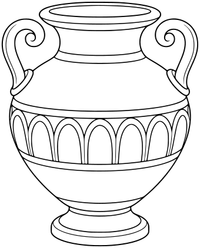

One elegant large palace vase with two curled side handles, broad rounded body, simple wide decorative band and closed base. No flowers, tiny ornament or pedestal.

- **Tags:** interiors, palaces, palace-vase
- **Roles:** subject, accent
- **Detail:** moderate; **Facing:** none
- **Dimensions:** 340 x 422 scene units; **Visible Bounds:** left=2.75, top=3, right=337, bottom=419
- **Placement:** Preserve aspect ratio; position and scale to suit the scene. Review enclosed negative spaces after conversion.
- **Files:** [SVG](../../src/assets/vector/interiors-palace-vase.svg), [Definition](../../src/assets/vector/interiors-palace-vase.svg), [Source](../../art/source/interiors/palace-vase.png)
- **Scene Examples:** Not yet used in a built-in scene.

## Royal Cabinet

`interiors-royal-cabinet`

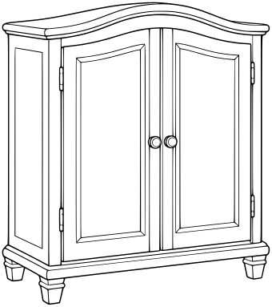

One freestanding elegant two-door cabinet, simple curved top, broad rectangular door panels, two round handles and short sturdy feet, mild three-quarter view. No objects on top.

- **Tags:** interiors, palaces, royal-cabinet
- **Roles:** subject, accent
- **Detail:** moderate; **Facing:** none
- **Dimensions:** 340 x 383 scene units; **Visible Bounds:** left=2.5, top=2.75, right=337.25, bottom=380
- **Placement:** Preserve aspect ratio; position and scale to suit the scene. Review enclosed negative spaces after conversion.
- **Files:** [SVG](../../src/assets/vector/interiors-royal-cabinet.svg), [Definition](../../src/assets/vector/interiors-royal-cabinet.svg), [Source](../../art/source/interiors/royal-cabinet.png)
- **Scene Examples:** Not yet used in a built-in scene.

## Hall Bench

`interiors-hall-bench`

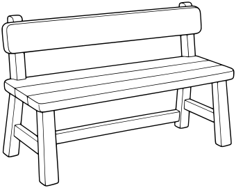

One long simple wooden hall bench with a broad flat seat, short backrest and four sturdy legs with clear bracing, mild three-quarter view. No upholstery or other objects.

- **Tags:** interiors, halls, hall-bench
- **Roles:** subject, accent
- **Detail:** moderate; **Facing:** none
- **Dimensions:** 340 x 270 scene units; **Visible Bounds:** left=2.25, top=2.5, right=337.75, bottom=267.75
- **Placement:** Preserve aspect ratio; position and scale to suit the scene. Review enclosed negative spaces after conversion.
- **Files:** [SVG](../../src/assets/vector/interiors-hall-bench.svg), [Definition](../../src/assets/vector/interiors-hall-bench.svg), [Source](../../art/source/interiors/hall-bench.png)
- **Scene Examples:** Not yet used in a built-in scene.

## Wall Banner

`interiors-wall-banner`

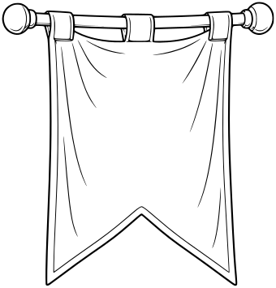

One hanging plain medieval cloth banner on a short horizontal pole with two round finials. Broad fabric panel ending in a single swallowtail notch, gentle fold lines, no emblem, letters or symbols.

- **Tags:** interiors, halls, wall-banner
- **Roles:** subject, accent
- **Detail:** moderate; **Facing:** none
- **Dimensions:** 340 x 355 scene units; **Visible Bounds:** left=2.75, top=2.5, right=337.25, bottom=352.25
- **Placement:** Preserve aspect ratio; position and scale to suit the scene. Review enclosed negative spaces after conversion.
- **Files:** [SVG](../../src/assets/vector/interiors-wall-banner.svg), [Definition](../../src/assets/vector/interiors-wall-banner.svg), [Source](../../art/source/interiors/wall-banner.png)
- **Scene Examples:** Not yet used in a built-in scene.

## Wall Torch

`interiors-wall-torch`

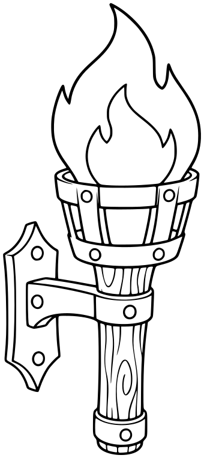

One simple medieval wall-mounted torch, sturdy wooden handle held in a broad iron bracket with a small backing plate. Two large enclosed flame shapes, no sparks, smoke or wall scene.

- **Tags:** interiors, halls, wall-torch
- **Roles:** subject, accent
- **Detail:** moderate; **Facing:** none
- **Dimensions:** 340 x 762 scene units; **Visible Bounds:** left=5.25, top=5, right=335, bottom=757
- **Placement:** Preserve aspect ratio; position and scale to suit the scene. Review enclosed negative spaces after conversion.
- **Files:** [SVG](../../src/assets/vector/interiors-wall-torch.svg), [Definition](../../src/assets/vector/interiors-wall-torch.svg), [Source](../../art/source/interiors/wall-torch.png)
- **Scene Examples:** Not yet used in a built-in scene.

## Arched Window

`interiors-arched-window`

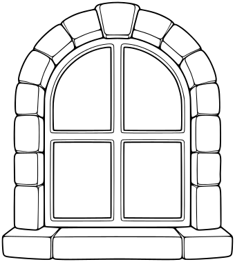

One standalone arched stone window frame with four broad WHITE glass panes divided by a simple cross mullion. Thick broad stone surround, no view, curtains, wall area or black panes.

- **Tags:** interiors, halls, arched-window
- **Roles:** subject, accent
- **Detail:** moderate; **Facing:** none
- **Dimensions:** 340 x 380 scene units; **Visible Bounds:** left=2.75, top=2.75, right=337.25, bottom=377.25
- **Placement:** Preserve aspect ratio; position and scale to suit the scene. Review enclosed negative spaces after conversion.
- **Files:** [SVG](../../src/assets/vector/interiors-arched-window.svg), [Definition](../../src/assets/vector/interiors-arched-window.svg), [Source](../../art/source/interiors/arched-window.png)
- **Scene Examples:** Not yet used in a built-in scene.

## Stone Fireplace

`interiors-stone-fireplace`

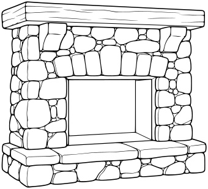

One freestanding rustic stone fireplace surround with broad mantle, rectangular hearth opening outlined with WHITE interior and clear inner firebox contour, low hearth slab. No fire, logs, tools or wall scene.

- **Tags:** interiors, cottages, stone-fireplace
- **Roles:** subject, accent
- **Detail:** moderate; **Facing:** none
- **Dimensions:** 340 x 309 scene units; **Visible Bounds:** left=2.25, top=2.25, right=337.5, bottom=306.75
- **Placement:** Preserve aspect ratio; position and scale to suit the scene. Review enclosed negative spaces after conversion.
- **Files:** [SVG](../../src/assets/vector/interiors-stone-fireplace.svg), [Definition](../../src/assets/vector/interiors-stone-fireplace.svg), [Source](../../art/source/interiors/stone-fireplace.png)
- **Scene Examples:** Not yet used in a built-in scene.

## Cooking Pot

`interiors-cooking-pot`

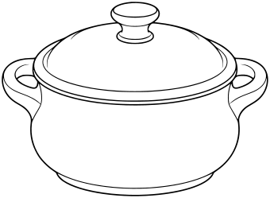

One squat round rustic cooking pot with two broad side handles and a closed domed lid with a simple knob, mild three-quarter view. No stove, food or steam.

- **Tags:** interiors, cottages, cooking-pot
- **Roles:** subject, accent
- **Detail:** moderate; **Facing:** none
- **Dimensions:** 340 x 249 scene units; **Visible Bounds:** left=2.25, top=2.25, right=337.75, bottom=246.75
- **Placement:** Preserve aspect ratio; position and scale to suit the scene. Review enclosed negative spaces after conversion.
- **Files:** [SVG](../../src/assets/vector/interiors-cooking-pot.svg), [Definition](../../src/assets/vector/interiors-cooking-pot.svg), [Source](../../art/source/interiors/cooking-pot.png)
- **Scene Examples:** Not yet used in a built-in scene.

## Cottage Cupboard

`interiors-cottage-cupboard`

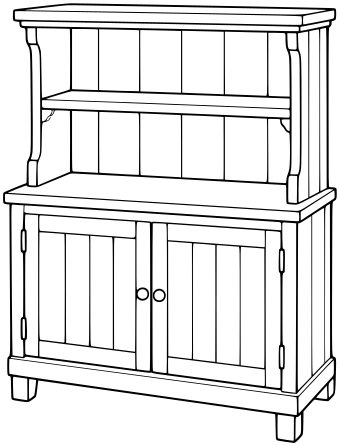

One freestanding rustic wooden kitchen cupboard, two broad lower doors and two open upper shelves inside a simple frame. Shelves empty, broad clean plank lines, no props or tiny grain.

- **Tags:** interiors, cottages, cottage-cupboard
- **Roles:** subject, accent
- **Detail:** moderate; **Facing:** none
- **Dimensions:** 340 x 446 scene units; **Visible Bounds:** left=3, top=3.25, right=336.75, bottom=443
- **Placement:** Preserve aspect ratio; position and scale to suit the scene. Review enclosed negative spaces after conversion.
- **Files:** [SVG](../../src/assets/vector/interiors-cottage-cupboard.svg), [Definition](../../src/assets/vector/interiors-cottage-cupboard.svg), [Source](../../art/source/interiors/cottage-cupboard.png)
- **Scene Examples:** Not yet used in a built-in scene.

## Empty Woven Basket

`interiors-empty-woven-basket`

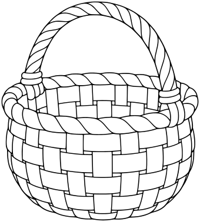

One empty rounded woven basket with a broad arched handle, wide open rim and large simple checker weave panels. No contents, no tiny crosshatching.

- **Tags:** interiors, cottages, empty-woven-basket
- **Roles:** subject, accent
- **Detail:** moderate; **Facing:** none
- **Dimensions:** 340 x 378 scene units; **Visible Bounds:** left=2.75, top=2.5, right=337.5, bottom=375.25
- **Placement:** Preserve aspect ratio; position and scale to suit the scene. Review enclosed negative spaces after conversion.
- **Files:** [SVG](../../src/assets/vector/interiors-empty-woven-basket.svg), [Definition](../../src/assets/vector/interiors-empty-woven-basket.svg), [Source](../../art/source/interiors/empty-woven-basket.png)
- **Scene Examples:** Not yet used in a built-in scene.

## Home Sofa

`interiors-home-sofa`

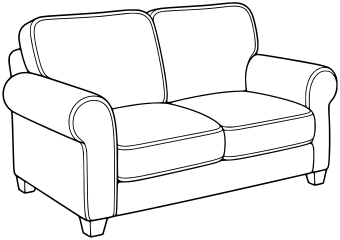

One comfortable two-seat sofa in mild three-quarter view, broad two back cushions and two seat cushions, rounded armrests and four short feet. No pillows, blanket, buttons or other objects.

- **Tags:** interiors, living rooms, home-sofa
- **Roles:** subject, accent
- **Detail:** moderate; **Facing:** none
- **Dimensions:** 340 x 240 scene units; **Visible Bounds:** left=2.5, top=2.25, right=337.75, bottom=237.5
- **Placement:** Preserve aspect ratio; position and scale to suit the scene. Review enclosed negative spaces after conversion.
- **Files:** [SVG](../../src/assets/vector/interiors-home-sofa.svg), [Definition](../../src/assets/vector/interiors-home-sofa.svg), [Source](../../art/source/interiors/home-sofa.png)
- **Scene Examples:** Not yet used in a built-in scene.

## Home Armchair

`interiors-home-armchair`

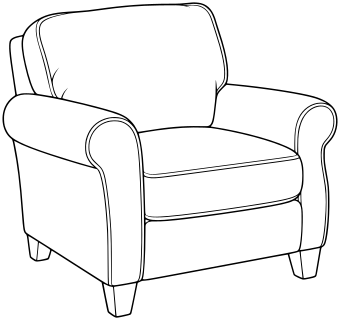

One comfortable upholstered armchair in mild three-quarter view, broad back cushion, single seat cushion, rounded arms and short legs. No pattern or throw pillow.

- **Tags:** interiors, living rooms, home-armchair
- **Roles:** subject, accent
- **Detail:** moderate; **Facing:** none
- **Dimensions:** 340 x 320 scene units; **Visible Bounds:** left=2.5, top=2.5, right=337.5, bottom=317.75
- **Placement:** Preserve aspect ratio; position and scale to suit the scene. Review enclosed negative spaces after conversion.
- **Files:** [SVG](../../src/assets/vector/interiors-home-armchair.svg), [Definition](../../src/assets/vector/interiors-home-armchair.svg), [Source](../../art/source/interiors/home-armchair.png)
- **Scene Examples:** Not yet used in a built-in scene.

## Coffee Table

`interiors-coffee-table`

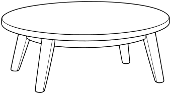

One simple low oval coffee table with a broad smooth top and four short wooden legs, mild three-quarter view. Empty tabletop, no shelf or other objects.

- **Tags:** interiors, living rooms, coffee-table
- **Roles:** subject, accent
- **Detail:** moderate; **Facing:** none
- **Dimensions:** 340 x 187 scene units; **Visible Bounds:** left=2.25, top=2.25, right=337.75, bottom=184.75
- **Placement:** Preserve aspect ratio; position and scale to suit the scene. Review enclosed negative spaces after conversion.
- **Files:** [SVG](../../src/assets/vector/interiors-coffee-table.svg), [Definition](../../src/assets/vector/interiors-coffee-table.svg), [Source](../../art/source/interiors/coffee-table.png)
- **Scene Examples:** Not yet used in a built-in scene.

## Floor Lamp

`interiors-floor-lamp`

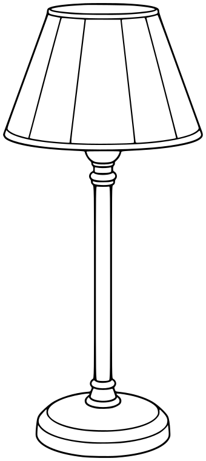

One simple freestanding floor lamp with broad tapered fabric shade, straight sturdy pole and round weighted base. Closed simple shade panels, no cord, light rays or surroundings.

- **Tags:** interiors, living rooms, floor-lamp
- **Roles:** subject, accent
- **Detail:** moderate; **Facing:** none
- **Dimensions:** 340 x 760 scene units; **Visible Bounds:** left=5, top=5, right=334.75, bottom=755
- **Placement:** Preserve aspect ratio; position and scale to suit the scene. Review enclosed negative spaces after conversion.
- **Files:** [SVG](../../src/assets/vector/interiors-floor-lamp.svg), [Definition](../../src/assets/vector/interiors-floor-lamp.svg), [Source](../../art/source/interiors/floor-lamp.png)
- **Scene Examples:** Not yet used in a built-in scene.

## Office Desk

`interiors-office-desk`

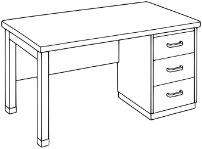

One simple contemporary office desk in mild three-quarter view with broad empty rectangular worktop, two sturdy legs at one side and a three-drawer pedestal at the other. No computer, stationery or chair.

- **Tags:** interiors, offices, office-desk
- **Roles:** subject, accent
- **Detail:** moderate; **Facing:** none
- **Dimensions:** 340 x 250 scene units; **Visible Bounds:** left=2.25, top=2.25, right=337.75, bottom=247.5
- **Placement:** Preserve aspect ratio; position and scale to suit the scene. Review enclosed negative spaces after conversion.
- **Files:** [SVG](../../src/assets/vector/interiors-office-desk.svg), [Definition](../../src/assets/vector/interiors-office-desk.svg), [Source](../../art/source/interiors/office-desk.png)
- **Scene Examples:** Not yet used in a built-in scene.

## Office Chair

`interiors-office-chair`

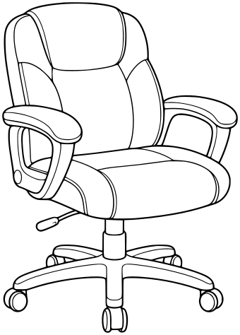

One practical swivel office chair in mild three-quarter view, broad backrest and padded seat, two armrests, short central column and five-leg caster base. Clear coherent wheel structure, no texture.

- **Tags:** interiors, offices, office-chair
- **Roles:** subject, accent
- **Detail:** moderate; **Facing:** none
- **Dimensions:** 340 x 474 scene units; **Visible Bounds:** left=3.25, top=3.25, right=336.75, bottom=470.75
- **Placement:** Preserve aspect ratio; position and scale to suit the scene. Review enclosed negative spaces after conversion.
- **Files:** [SVG](../../src/assets/vector/interiors-office-chair.svg), [Definition](../../src/assets/vector/interiors-office-chair.svg), [Source](../../art/source/interiors/office-chair.png)
- **Scene Examples:** Not yet used in a built-in scene.

## Filing Cabinet

`interiors-filing-cabinet`

One freestanding three-drawer office filing cabinet in mild three-quarter view, broad drawers with simple handles and small blank label holders. No text, paper or clutter.

- **Tags:** interiors, offices, filing-cabinet
- **Roles:** subject, accent
- **Detail:** moderate; **Facing:** none
- **Dimensions:** 340 x 420 scene units; **Visible Bounds:** left=3, top=3, right=337.25, bottom=417
- **Placement:** Preserve aspect ratio; position and scale to suit the scene. Review enclosed negative spaces after conversion.
- **Files:** [SVG](../../src/assets/vector/interiors-filing-cabinet.svg), [Definition](../../src/assets/vector/interiors-filing-cabinet.svg), [Source](../../art/source/interiors/filing-cabinet.png)
- **Scene Examples:** Not yet used in a built-in scene.

## Desktop Computer

`interiors-desktop-computer`

One simple desktop computer setup as a single compact prop: broad flat monitor on a short stable stand, one simple keyboard directly in front and a small mouse beside it. Screen WHITE with inner bezel contour, keyboard uses only a few broad key rows, no text, logo, cables or desk.

- **Tags:** interiors, offices, desktop-computer
- **Roles:** subject, accent
- **Detail:** moderate; **Facing:** none
- **Dimensions:** 340 x 326 scene units; **Visible Bounds:** left=2.25, top=2.5, right=337.75, bottom=323.75
- **Placement:** Preserve aspect ratio; position and scale to suit the scene. Review enclosed negative spaces after conversion.
- **Files:** [SVG](../../src/assets/vector/interiors-desktop-computer.svg), [Definition](../../src/assets/vector/interiors-desktop-computer.svg), [Source](../../art/source/interiors/desktop-computer.png)
- **Scene Examples:** Not yet used in a built-in scene.

## Single Bed

`interiors-single-bed`

One simple cozy single bed in mild three-quarter view, broad rounded wooden headboard and low footboard, one clear pillow and one plain neatly spread blanket with broad fold line. Four coherent short bed legs, no patterns or other props.

- **Tags:** interiors, bedrooms, single-bed
- **Roles:** subject, accent
- **Detail:** moderate; **Facing:** none
- **Dimensions:** 340 x 308 scene units; **Visible Bounds:** left=2.5, top=2.5, right=337.5, bottom=305.5
- **Placement:** Preserve aspect ratio; position and scale to suit the scene. Review enclosed negative spaces after conversion.
- **Files:** [SVG](../../src/assets/vector/interiors-single-bed.svg), [Definition](../../src/assets/vector/interiors-single-bed.svg), [Source](../../art/source/interiors/single-bed.png)
- **Scene Examples:** Not yet used in a built-in scene.

## Bedside Table

`interiors-bedside-table`

One small simple wooden bedside table in mild three-quarter view, broad square top, one drawer with round handle and open lower shelf, four short legs. Empty top and shelf.

- **Tags:** interiors, bedrooms, bedside-table
- **Roles:** subject, accent
- **Detail:** moderate; **Facing:** none
- **Dimensions:** 340 x 348 scene units; **Visible Bounds:** left=2.5, top=2.5, right=337.5, bottom=345.5
- **Placement:** Preserve aspect ratio; position and scale to suit the scene. Review enclosed negative spaces after conversion.
- **Files:** [SVG](../../src/assets/vector/interiors-bedside-table.svg), [Definition](../../src/assets/vector/interiors-bedside-table.svg), [Source](../../art/source/interiors/bedside-table.png)
- **Scene Examples:** Not yet used in a built-in scene.

## Bedroom Wardrobe

`interiors-bedroom-wardrobe`

One freestanding two-door wooden wardrobe in mild three-quarter view, broad plain door panels, two simple handles, shallow curved top and four short feet. No mirror, clothes or decoration.

- **Tags:** interiors, bedrooms, bedroom-wardrobe
- **Roles:** subject, accent
- **Detail:** moderate; **Facing:** none
- **Dimensions:** 340 x 435 scene units; **Visible Bounds:** left=3, top=3, right=337, bottom=431.75
- **Placement:** Preserve aspect ratio; position and scale to suit the scene. Review enclosed negative spaces after conversion.
- **Files:** [SVG](../../src/assets/vector/interiors-bedroom-wardrobe.svg), [Definition](../../src/assets/vector/interiors-bedroom-wardrobe.svg), [Source](../../art/source/interiors/bedroom-wardrobe.png)
- **Scene Examples:** Not yet used in a built-in scene.

## Bedroom Dresser

`interiors-bedroom-dresser`

One low freestanding bedroom dresser in mild three-quarter view with three broad drawers, two round knobs per drawer and short sturdy feet. Empty flat top, no mirror or other objects.

- **Tags:** interiors, bedrooms, bedroom-dresser
- **Roles:** subject, accent
- **Detail:** moderate; **Facing:** none
- **Dimensions:** 340 x 298 scene units; **Visible Bounds:** left=2.25, top=2.25, right=337.5, bottom=295.5
- **Placement:** Preserve aspect ratio; position and scale to suit the scene. Review enclosed negative spaces after conversion.
- **Files:** [SVG](../../src/assets/vector/interiors-bedroom-dresser.svg), [Definition](../../src/assets/vector/interiors-bedroom-dresser.svg), [Source](../../art/source/interiors/bedroom-dresser.png)
- **Scene Examples:** Not yet used in a built-in scene.

