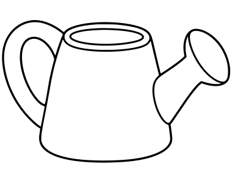
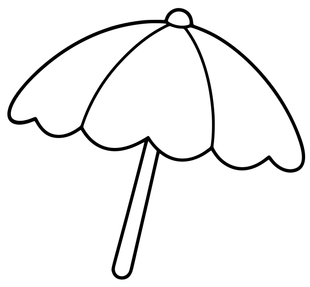
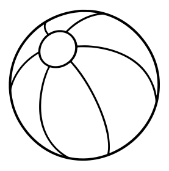
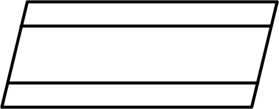

# Objects

[All Assets](../CATALOG.md) | [Searchable Visual Browser](index.html) | [Machine Index](index.json)

Generated by `node scripts/build-asset-catalog.mjs`; edit metadata in `art/stickers.json`.

## Watering Can

`spring-watering-can`

Garden watering can with handle and spout.

- **Tags:** watering-can, tool, garden, spring
- **Roles:** foreground, accent
- **Detail:** moderate; **Facing:** none
- **Dimensions:** 380 x 288 scene units; **Visible Bounds:** left=3.25, top=33, right=377, bottom=267.5
- **Placement:** Use flipX to change facing where useful. Preserve aspect ratio and leave comfortable coloring space.
- **Files:** [SVG](../../src/assets/vector/spring-watering-can.svg), [Definition](../../src/assets/vector/spring-watering-can.json), [Source](../../art/source/spring/watering-can.png)
- **Scene Examples:** [springScene.ts](../../src/editor/springScene.ts)

## Umbrella

`beach-umbrella`

Beach umbrella on a pole.

- **Tags:** umbrella, beach, summer, picnic
- **Roles:** subject, background
- **Detail:** moderate; **Facing:** none
- **Dimensions:** 627 x 580 scene units; **Visible Bounds:** left=15, top=16, right=617, bottom=565
- **Placement:** Use flipX to change facing where useful. Preserve aspect ratio and leave comfortable coloring space.
- **Files:** [SVG](../../src/assets/vector/beach-umbrella.svg), [Definition](../../src/assets/vector/beach-umbrella.json), [Source](../../art/source/beach/umbrella.png)
- **Scene Examples:** [beachScene.ts](../../src/editor/beachScene.ts)

## Ball

`beach-ball`

Striped beach ball with large colorable panels.

- **Tags:** ball, toy, beach, summer, play
- **Roles:** foreground, accent
- **Detail:** simple; **Facing:** none
- **Dimensions:** 277 x 280 scene units; **Visible Bounds:** left=14.5, top=16, right=262, bottom=263
- **Placement:** Use flipX to change facing where useful. Preserve aspect ratio and leave comfortable coloring space.
- **Files:** [SVG](../../src/assets/vector/beach-ball.svg), [Definition](../../src/assets/vector/beach-ball.json), [Source](../../art/source/beach/ball.png)
- **Scene Examples:** [beachScene.ts](../../src/editor/beachScene.ts)

## Towel

`beach-towel`

Flat rectangular beach towel with decorative lines.

- **Tags:** towel, beach, picnic, summer
- **Roles:** foreground, accent
- **Detail:** simple; **Facing:** none
- **Dimensions:** 460 x 180 scene units; **Visible Bounds:** left=0.5, top=0.5, right=459.5, bottom=179.5
- **Placement:** Use flipX to change facing where useful. Preserve aspect ratio and leave comfortable coloring space.
- **Files:** [SVG](../../src/assets/vector/beach-towel.svg), [Definition](../../src/assets/vector/beach-towel.json), [Source](../../art/source/beach/towel.svg)
- **Scene Examples:** [beachScene.ts](../../src/editor/beachScene.ts)

## Explorer Spaceship

`space-spaceship`

Long explorer spaceship with windows, fins and engines.

- **Tags:** spaceship, rocket, vehicle, space, exploration
- **Roles:** subject
- **Detail:** detailed; **Facing:** left
- **Dimensions:** 960 x 479 scene units; **Visible Bounds:** left=5.5, top=6, right=954, bottom=473
- **Placement:** High detail; use as a large focal subject. The source contains STAR-EXPLORER lettering.
- **Files:** [SVG](../../src/assets/vector/space-spaceship.svg), [Definition](../../src/assets/vector/space-spaceship.json), [Source](../../art/source/space/spaceship.jpg)
- **Scene Examples:** Not yet used in a built-in scene.

## Present

`winter-present`

Wrapped gift box with a bow.

- **Tags:** gift, present, christmas, birthday, celebration
- **Roles:** foreground, accent
- **Detail:** moderate; **Facing:** none
- **Dimensions:** 150 x 151 scene units; **Visible Bounds:** left=2.5, top=11.25, right=147.5, bottom=148.75
- **Placement:** Use flipX to change facing where useful. Preserve aspect ratio and leave comfortable coloring space.
- **Files:** [SVG](../../src/assets/vector/winter-present.svg), [Definition](../../src/assets/vector/winter-present.json), [Source](../../art/source/winter/present.svg)
- **Scene Examples:** [winterScene.ts](../../src/editor/winterScene.ts)

## Bunting

`counting-bunting`

Long string of hanging triangular pennants.

- **Tags:** bunting, party, celebration, counting, garden
- **Roles:** background, accent
- **Detail:** simple; **Facing:** none
- **Dimensions:** 1800 x 76 scene units; **Visible Bounds:** left=4, top=5, right=1796, bottom=72.75
- **Placement:** Use flipX to change facing where useful. Preserve aspect ratio and leave comfortable coloring space.
- **Files:** [SVG](../../src/assets/vector/counting-bunting.svg), [Definition](../../src/assets/vector/counting-bunting.json), [Source](../../art/source/counting/bunting.svg)
- **Scene Examples:** [countingScene.ts](../../src/editor/countingScene.ts)

