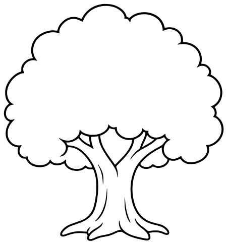
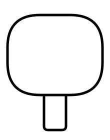
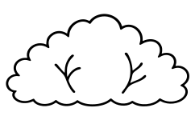
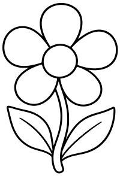
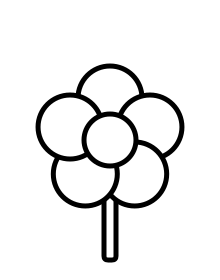
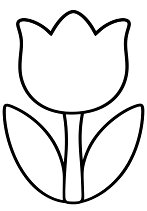

# Plants

[All Assets](../CATALOG.md) | [Searchable Visual Browser](index.html) | [Machine Index](index.json)

Generated by `node scripts/build-asset-catalog.mjs`; edit metadata in `art/stickers.json`.

## Apple Tree

`garden-tree`

Leafy broad-canopy tree with visible branches; fruit is a separate asset.

- **Tags:** tree, nature, garden, safari, woodland
- **Roles:** background, subject
- **Detail:** moderate; **Facing:** none
- **Dimensions:** 450 x 486 scene units; **Visible Bounds:** left=7.75, top=7.75, right=443.25, bottom=477.75
- **Placement:** The canopy has no attached apples; use this as a generic leafy tree, or add garden-apple separately for an orchard.
- **Files:** [SVG](../../src/assets/vector/garden-tree.svg), [Definition](../../src/assets/vector/garden-tree.json), [Source](../../art/source/generated/tree.png)
- **Scene Examples:** [gardenScene.ts](../../src/editor/gardenScene.ts), [safariScene.ts](../../src/editor/safariScene.ts)

## Simple Tree

`tree`

Simple rounded canopy and straight trunk with large fill areas.

- **Tags:** tree, nature, woodland, safari, park
- **Roles:** background, subject
- **Detail:** simple; **Facing:** none
- **Dimensions:** 220 x 280 scene units; **Visible Bounds:** left=12.5, top=27.5, right=207.5, bottom=262.5
- **Placement:** Use flipX to change facing where useful. Preserve aspect ratio and leave comfortable coloring space.
- **Files:** [SVG](../../src/assets/vector/tree.svg), [Definition](../../src/assets/vector/tree.json), [Source](../../art/source/shapes/tree.svg)
- **Scene Examples:** Not yet used in a built-in scene.

## Palm Tree

`beach-palm`

Curved palm tree with large fronds.

- **Tags:** palm, tree, tropical, beach, safari, island
- **Roles:** background, subject
- **Detail:** moderate; **Facing:** none
- **Dimensions:** 566 x 690 scene units; **Visible Bounds:** left=27.5, top=31, right=532, bottom=668
- **Placement:** Use flipX to change facing where useful. Preserve aspect ratio and leave comfortable coloring space.
- **Files:** [SVG](../../src/assets/vector/beach-palm.svg), [Definition](../../src/assets/vector/beach-palm.json), [Source](../../art/source/beach/palm.png)
- **Scene Examples:** [beachScene.ts](../../src/editor/beachScene.ts)

## Pine Tree

`winter-pine`

Evergreen pine tree.

- **Tags:** pine, tree, forest, winter, christmas
- **Roles:** background, subject
- **Detail:** moderate; **Facing:** none
- **Dimensions:** 290 x 344 scene units; **Visible Bounds:** left=11.25, top=4, right=279, bottom=339.75
- **Placement:** Use flipX to change facing where useful. Preserve aspect ratio and leave comfortable coloring space.
- **Files:** [SVG](../../src/assets/vector/winter-pine.svg), [Definition](../../src/assets/vector/winter-pine.json), [Source](../../art/source/winter/pine.png)
- **Scene Examples:** [winterScene.ts](../../src/editor/winterScene.ts)

## Bush

`garden-bush`

Low rounded leafy bush.

- **Tags:** bush, leaves, garden, safari, woodland
- **Roles:** background, foreground
- **Detail:** simple; **Facing:** none
- **Dimensions:** 242 x 150 scene units; **Visible Bounds:** left=7.5, top=17.5, right=235, bottom=133
- **Placement:** Use flipX to change facing where useful. Preserve aspect ratio and leave comfortable coloring space.
- **Files:** [SVG](../../src/assets/vector/garden-bush.svg), [Definition](../../src/assets/vector/garden-bush.json), [Source](../../art/source/generated/bush.png)
- **Scene Examples:** [gardenScene.ts](../../src/editor/gardenScene.ts), [safariScene.ts](../../src/editor/safariScene.ts)

## Grass

`garden-grass`

Small tuft of grass with bold open shapes.

- **Tags:** grass, tuft, safari, garden, meadow
- **Roles:** foreground, accent
- **Detail:** simple; **Facing:** none
- **Dimensions:** 88 x 47 scene units; **Visible Bounds:** left=1.5, top=2, right=85.5, bottom=44.5
- **Placement:** Use flipX to change facing where useful. Preserve aspect ratio and leave comfortable coloring space.
- **Files:** [SVG](../../src/assets/vector/garden-grass.svg), [Definition](../../src/assets/vector/garden-grass.json), [Source](../../art/source/generated/grass.svg)
- **Scene Examples:** [gardenScene.ts](../../src/editor/gardenScene.ts), [safariScene.ts](../../src/editor/safariScene.ts)

## Flower

`garden-flower`

Tall garden flower on a leafy stem.

- **Tags:** flower, garden, spring, nature
- **Roles:** foreground, accent
- **Detail:** moderate; **Facing:** none
- **Dimensions:** 200 x 294 scene units; **Visible Bounds:** left=4, top=5, right=196.5, bottom=289.5
- **Placement:** Use flipX to change facing where useful. Preserve aspect ratio and leave comfortable coloring space.
- **Files:** [SVG](../../src/assets/vector/garden-flower.svg), [Definition](../../src/assets/vector/garden-flower.json), [Source](../../art/source/generated/flower.png)
- **Scene Examples:** [gardenScene.ts](../../src/editor/gardenScene.ts)

## Simple Flower

`flower`

Simple rounded-petal flower with broad coloring areas.

- **Tags:** flower, garden, spring, nature
- **Roles:** accent, foreground
- **Detail:** simple; **Facing:** none
- **Dimensions:** 220 x 280 scene units; **Visible Bounds:** left=35.5, top=63.5, right=184.5, bottom=262.5
- **Placement:** Use flipX to change facing where useful. Preserve aspect ratio and leave comfortable coloring space.
- **Files:** [SVG](../../src/assets/vector/flower.svg), [Definition](../../src/assets/vector/flower.json), [Source](../../art/source/shapes/flower.svg)
- **Scene Examples:** Not yet used in a built-in scene.

## Blossom

`garden-blossom`

Small five-petal blossom with a short closed stem.

- **Tags:** flower, blossom, garden, spring
- **Roles:** accent, foreground
- **Detail:** simple; **Facing:** none
- **Dimensions:** 64 x 57 scene units; **Visible Bounds:** left=5, top=0.5, right=59, bottom=56
- **Placement:** Use flipX to change facing where useful. Preserve aspect ratio and leave comfortable coloring space.
- **Files:** [SVG](../../src/assets/vector/garden-blossom.svg), [Definition](../../src/assets/vector/garden-blossom.json), [Source](../../art/source/generated/blossom.svg)
- **Scene Examples:** [gardenScene.ts](../../src/editor/gardenScene.ts)

## Tulip

`spring-tulip`

Single upright tulip with long leaves.

- **Tags:** tulip, flower, spring, garden
- **Roles:** foreground, accent
- **Detail:** moderate; **Facing:** none
- **Dimensions:** 294 x 420 scene units; **Visible Bounds:** left=5.25, top=19.75, right=288.75, bottom=406.75
- **Placement:** Use flipX to change facing where useful. Preserve aspect ratio and leave comfortable coloring space.
- **Files:** [SVG](../../src/assets/vector/spring-tulip.svg), [Definition](../../src/assets/vector/spring-tulip.json), [Source](../../art/source/spring/tulip.png)
- **Scene Examples:** [springScene.ts](../../src/editor/springScene.ts)

## Mushroom

`garden-mushroom`

Small capped mushroom.

- **Tags:** mushroom, garden, woodland, fantasy
- **Roles:** foreground, accent
- **Detail:** simple; **Facing:** none
- **Dimensions:** 150 x 138 scene units; **Visible Bounds:** left=2, top=2.5, right=148, bottom=136.5
- **Placement:** Use flipX to change facing where useful. Preserve aspect ratio and leave comfortable coloring space.
- **Files:** [SVG](../../src/assets/vector/garden-mushroom.svg), [Definition](../../src/assets/vector/garden-mushroom.json), [Source](../../art/source/generated/mushroom.png)
- **Scene Examples:** [gardenScene.ts](../../src/editor/gardenScene.ts)

