# Plants

[All Assets](../CATALOG.md) | [Searchable Visual Browser](index.html) | [Machine Index](index.json)

Generated by `node scripts/build-asset-catalog.mjs`; edit metadata in `art/stickers.json`.

## Apple Tree

`garden-tree`

Leafy broad-canopy tree with visible branches; fruit is a separate asset.

- **Tags:** tree, nature, garden, safari, woodland
- **Roles:** background, subject
- **Detail:** moderate; **Facing:** none
- **Dimensions:** 450 x 486 scene units; **Visible Bounds:** left=7.75, top=7.75, right=443.25, bottom=477.75
- **Placement:** The canopy has no attached apples; use this as a generic leafy tree, or add garden-apple separately for an orchard.
- **Files:** [SVG](../../src/assets/vector/garden-tree.svg), [Definition](../../src/assets/vector/garden-tree.svg), [Source](../../art/source/generated/tree.png)
- **Scene Examples:** [gardenScene.ts](../../src/editor/gardenScene.ts), [safariScene.ts](../../src/editor/safariScene.ts)

## Simple Tree

`tree`

Simple rounded canopy and straight trunk with large fill areas.

- **Tags:** tree, nature, woodland, safari, park
- **Roles:** background, subject
- **Detail:** simple; **Facing:** none
- **Dimensions:** 220 x 280 scene units; **Visible Bounds:** left=12.5, top=27.5, right=207.5, bottom=262.5
- **Placement:** Use flipX to change facing where useful. Preserve aspect ratio and leave comfortable coloring space.
- **Files:** [SVG](../../src/assets/vector/tree.svg), [Definition](../../src/assets/vector/tree.svg), [Source](../../art/source/shapes/tree.svg)
- **Scene Examples:** Not yet used in a built-in scene.

## Palm Tree

`beach-palm`

Curved palm tree with large fronds.

- **Tags:** palm, tree, tropical, beach, safari, island
- **Roles:** background, subject
- **Detail:** moderate; **Facing:** none
- **Dimensions:** 566 x 690 scene units; **Visible Bounds:** left=27.5, top=31, right=532, bottom=668
- **Placement:** Use flipX to change facing where useful. Preserve aspect ratio and leave comfortable coloring space.
- **Files:** [SVG](../../src/assets/vector/beach-palm.svg), [Definition](../../src/assets/vector/beach-palm.svg), [Source](../../art/source/beach/palm.png)
- **Scene Examples:** [beachScene.ts](../../src/editor/beachScene.ts)

## Pine Tree

`winter-pine`

Evergreen pine tree.

- **Tags:** pine, tree, forest, winter, christmas
- **Roles:** background, subject
- **Detail:** moderate; **Facing:** none
- **Dimensions:** 290 x 344 scene units; **Visible Bounds:** left=11.25, top=4, right=279, bottom=339.75
- **Placement:** Use flipX to change facing where useful. Preserve aspect ratio and leave comfortable coloring space.
- **Files:** [SVG](../../src/assets/vector/winter-pine.svg), [Definition](../../src/assets/vector/winter-pine.svg), [Source](../../art/source/winter/pine.png)
- **Scene Examples:** [winterScene.ts](../../src/editor/winterScene.ts)

## Bush

`garden-bush`

Low rounded leafy bush.

- **Tags:** bush, leaves, garden, safari, woodland
- **Roles:** background, foreground
- **Detail:** simple; **Facing:** none
- **Dimensions:** 242 x 150 scene units; **Visible Bounds:** left=7.5, top=17.5, right=235, bottom=133
- **Placement:** Use flipX to change facing where useful. Preserve aspect ratio and leave comfortable coloring space.
- **Files:** [SVG](../../src/assets/vector/garden-bush.svg), [Definition](../../src/assets/vector/garden-bush.svg), [Source](../../art/source/generated/bush.png)
- **Scene Examples:** [gardenScene.ts](../../src/editor/gardenScene.ts), [safariScene.ts](../../src/editor/safariScene.ts)

## Grass

`garden-grass`

Small tuft of grass with bold open shapes.

- **Tags:** grass, tuft, safari, garden, meadow
- **Roles:** foreground, accent
- **Detail:** simple; **Facing:** none
- **Dimensions:** 88 x 47 scene units; **Visible Bounds:** left=1.5, top=2, right=85.5, bottom=44.5
- **Placement:** Use flipX to change facing where useful. Preserve aspect ratio and leave comfortable coloring space.
- **Files:** [SVG](../../src/assets/vector/garden-grass.svg), [Definition](../../src/assets/vector/garden-grass.svg), [Source](../../art/source/generated/grass.svg)
- **Scene Examples:** [gardenScene.ts](../../src/editor/gardenScene.ts), [safariScene.ts](../../src/editor/safariScene.ts)

## Flower

`garden-flower`

Tall garden flower on a leafy stem.

- **Tags:** flower, garden, spring, nature
- **Roles:** foreground, accent
- **Detail:** moderate; **Facing:** none
- **Dimensions:** 200 x 294 scene units; **Visible Bounds:** left=4, top=5, right=196.5, bottom=289.5
- **Placement:** Use flipX to change facing where useful. Preserve aspect ratio and leave comfortable coloring space.
- **Files:** [SVG](../../src/assets/vector/garden-flower.svg), [Definition](../../src/assets/vector/garden-flower.svg), [Source](../../art/source/generated/flower.png)
- **Scene Examples:** [gardenScene.ts](../../src/editor/gardenScene.ts)

## Simple Flower

`flower`

Simple rounded-petal flower with broad coloring areas.

- **Tags:** flower, garden, spring, nature
- **Roles:** accent, foreground
- **Detail:** simple; **Facing:** none
- **Dimensions:** 220 x 280 scene units; **Visible Bounds:** left=35.5, top=63.5, right=184.5, bottom=262.5
- **Placement:** Use flipX to change facing where useful. Preserve aspect ratio and leave comfortable coloring space.
- **Files:** [SVG](../../src/assets/vector/flower.svg), [Definition](../../src/assets/vector/flower.svg), [Source](../../art/source/shapes/flower.svg)
- **Scene Examples:** Not yet used in a built-in scene.

## Blossom

`garden-blossom`

Small five-petal blossom with a short closed stem.

- **Tags:** flower, blossom, garden, spring
- **Roles:** accent, foreground
- **Detail:** simple; **Facing:** none
- **Dimensions:** 64 x 57 scene units; **Visible Bounds:** left=5, top=0.5, right=59, bottom=56
- **Placement:** Use flipX to change facing where useful. Preserve aspect ratio and leave comfortable coloring space.
- **Files:** [SVG](../../src/assets/vector/garden-blossom.svg), [Definition](../../src/assets/vector/garden-blossom.svg), [Source](../../art/source/generated/blossom.svg)
- **Scene Examples:** [gardenScene.ts](../../src/editor/gardenScene.ts)

## Tulip

`spring-tulip`

Single upright tulip with long leaves.

- **Tags:** tulip, flower, spring, garden
- **Roles:** foreground, accent
- **Detail:** moderate; **Facing:** none
- **Dimensions:** 294 x 420 scene units; **Visible Bounds:** left=5.25, top=19.75, right=288.75, bottom=406.75
- **Placement:** Use flipX to change facing where useful. Preserve aspect ratio and leave comfortable coloring space.
- **Files:** [SVG](../../src/assets/vector/spring-tulip.svg), [Definition](../../src/assets/vector/spring-tulip.svg), [Source](../../art/source/spring/tulip.png)
- **Scene Examples:** [springScene.ts](../../src/editor/springScene.ts)

## Mushroom

`garden-mushroom`

Small capped mushroom.

- **Tags:** mushroom, garden, woodland, fantasy
- **Roles:** foreground, accent
- **Detail:** simple; **Facing:** none
- **Dimensions:** 150 x 138 scene units; **Visible Bounds:** left=2, top=2.5, right=148, bottom=136.5
- **Placement:** Use flipX to change facing where useful. Preserve aspect ratio and leave comfortable coloring space.
- **Files:** [SVG](../../src/assets/vector/garden-mushroom.svg), [Definition](../../src/assets/vector/garden-mushroom.svg), [Source](../../art/source/generated/mushroom.png)
- **Scene Examples:** [gardenScene.ts](../../src/editor/gardenScene.ts)

## Lullaby Tree

`nursery-rhymes-cradle-tree`

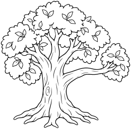

Whole tree with broad rounded canopy and clearly visible sturdy branching trunk, one strong horizontal branch extending to right suitable for placing another sticker nearby. Large simple leaf-cluster shapes, visible roots, no cradle or baby attached, no scenery or ground line.

- **Tags:** nursery-rhymes, Rock-a-bye Baby, plants, cradle-tree
- **Roles:** foreground, accent
- **Detail:** moderate; **Facing:** none
- **Dimensions:** 260 x 257 scene units; **Visible Bounds:** left=1.75, top=1.75, right=258.25, bottom=255.25
- **Placement:** Preserve aspect ratio; flip and scale to suit the scene. Source conversion is ready for visual review.
- **Files:** [SVG](../../src/assets/vector/nursery-rhymes-cradle-tree.svg), [Definition](../../src/assets/vector/nursery-rhymes-cradle-tree.svg), [Source](../../art/source/nursery-rhymes/cradle-tree.png)
- **Scene Examples:** Not yet used in a built-in scene.

## Silver Garden Bells

`nursery-rhymes-garden-bells`

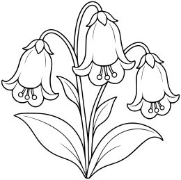

Whole small plant with three large hanging bell-shaped flowers, broad leaves and short stems meeting at base. Flowers have clear closed bell outlines and simple flared petal rims, no metal texture or faces, no pot or ground. Fits a nursery rhyme garden.

- **Tags:** nursery-rhymes, Mary Mary Quite Contrary, plants, garden-bells
- **Roles:** foreground, accent
- **Detail:** moderate; **Facing:** none
- **Dimensions:** 260 x 259 scene units; **Visible Bounds:** left=2, top=1.75, right=258.25, bottom=257.25
- **Placement:** Preserve aspect ratio; flip and scale to suit the scene. Source conversion is ready for visual review.
- **Files:** [SVG](../../src/assets/vector/nursery-rhymes-garden-bells.svg), [Definition](../../src/assets/vector/nursery-rhymes-garden-bells.svg), [Source](../../art/source/nursery-rhymes/garden-bells.png)
- **Scene Examples:** Not yet used in a built-in scene.

## Maple Leaf

`fall-maple-leaf`

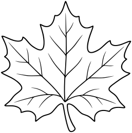

Recognizable five-lobed broad maple leaf with gently pointed tips and thick short stem. Clean central vein and a few simple branching veins that terminate deliberately, spacious coloring areas. No face, no extra leaves.

- **Tags:** fall, Fall Leaves, plants, maple-leaf
- **Roles:** foreground, accent
- **Detail:** moderate; **Facing:** none
- **Dimensions:** 257 x 260 scene units; **Visible Bounds:** left=1.75, top=1.75, right=255.25, bottom=258.25
- **Placement:** Preserve aspect ratio; flip and scale to suit the scene. Source conversion is ready for visual review.
- **Files:** [SVG](../../src/assets/vector/fall-maple-leaf.svg), [Definition](../../src/assets/vector/fall-maple-leaf.svg), [Source](../../art/source/fall/maple-leaf.png)
- **Scene Examples:** Not yet used in a built-in scene.

## Autumn Tree

`fall-autumn-tree`

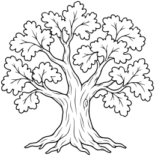

Whole sturdy tree with visible roots and trunk flaring at bottom, several branching limbs, rounded canopy containing a restrained number of LARGE recognizable oak-like leaf clusters, some open gaps in canopy suggesting autumn. No individual tiny leaves, no falling detached leaves or ground, no face.

- **Tags:** fall, Fall Landscapes, plants, autumn-tree
- **Roles:** foreground, accent
- **Detail:** moderate; **Facing:** none
- **Dimensions:** 258 x 260 scene units; **Visible Bounds:** left=1.75, top=1.75, right=256.25, bottom=258.25
- **Placement:** Preserve aspect ratio; flip and scale to suit the scene. Source conversion is ready for visual review.
- **Files:** [SVG](../../src/assets/vector/fall-autumn-tree.svg), [Definition](../../src/assets/vector/fall-autumn-tree.svg), [Source](../../art/source/fall/autumn-tree.png)
- **Scene Examples:** Not yet used in a built-in scene.

## Leaf Pile

`fall-leaf-pile`

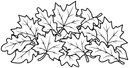

A cohesive shallow pile of overlapping LARGE maple and oak leaves, about ten to fourteen clearly drawn leaves, naturally layered with a few edges protruding. No tiny clutter, no rake or animals, no ground line. Wide silhouette suitable foreground sticker.

- **Tags:** fall, Fall Leaves, plants, leaf-pile
- **Roles:** foreground, accent
- **Detail:** moderate; **Facing:** none
- **Dimensions:** 260 x 138 scene units; **Visible Bounds:** left=1.75, top=1.75, right=258.25, bottom=136.25
- **Placement:** Preserve aspect ratio; flip and scale to suit the scene. Source conversion is ready for visual review.
- **Files:** [SVG](../../src/assets/vector/fall-leaf-pile.svg), [Definition](../../src/assets/vector/fall-leaf-pile.svg), [Source](../../art/source/fall/leaf-pile.png)
- **Scene Examples:** Not yet used in a built-in scene.

## Oak Leaf

`fall-oak-leaf`

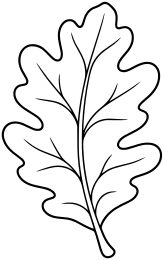

Recognizable elongated oak leaf with rounded lobes on each side and short stem, clean central vein and a few branching veins, generous white areas. No extra leaves, no face or texture.

- **Tags:** fall, Fall Leaves, plants, oak-leaf
- **Roles:** foreground, accent
- **Detail:** moderate; **Facing:** none
- **Dimensions:** 164 x 260 scene units; **Visible Bounds:** left=1.75, top=1.75, right=162, bottom=258.25
- **Placement:** Preserve aspect ratio; flip and scale to suit the scene. Source conversion is ready for visual review.
- **Files:** [SVG](../../src/assets/vector/fall-oak-leaf.svg), [Definition](../../src/assets/vector/fall-oak-leaf.svg), [Source](../../art/source/fall/oak-leaf.png)
- **Scene Examples:** Not yet used in a built-in scene.

## Wheat Sheaf

`fall-wheat-sheaf`

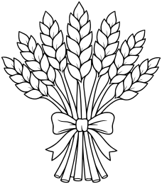

About seven broad wheat heads arranged in a compact fan, long stems tied with one simple bow at lower middle. Large paired grain forms, no wispy hair-like awns or hatching, whole sheaf visible.

- **Tags:** fall, Fall Harvest, plants, wheat-sheaf
- **Roles:** foreground, accent
- **Detail:** moderate; **Facing:** none
- **Dimensions:** 228 x 260 scene units; **Visible Bounds:** left=2, top=1.75, right=226.25, bottom=258.25
- **Placement:** Preserve aspect ratio; flip and scale to suit the scene. Source conversion is ready for visual review.
- **Files:** [SVG](../../src/assets/vector/fall-wheat-sheaf.svg), [Definition](../../src/assets/vector/fall-wheat-sheaf.svg), [Source](../../art/source/fall/wheat-sheaf.png)
- **Scene Examples:** Not yet used in a built-in scene.

## Cornstalk

`fall-cornstalk`

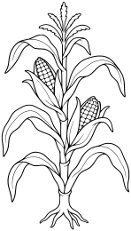

Whole stalk from simple root/base to tassel, two ears with broad kernels partly exposed, about six long arching leaves, simple short broad tassel shapes. No ground or extra plants, no tiny fibers. Strong clear closed leaf contours.

- **Tags:** fall, Fall Harvest, plants, cornstalk
- **Roles:** foreground, accent
- **Detail:** moderate; **Facing:** none
- **Dimensions:** 148 x 260 scene units; **Visible Bounds:** left=1.75, top=1.75, right=146.25, bottom=258.25
- **Placement:** Preserve aspect ratio; flip and scale to suit the scene. Source conversion is ready for visual review.
- **Files:** [SVG](../../src/assets/vector/fall-cornstalk.svg), [Definition](../../src/assets/vector/fall-cornstalk.svg), [Source](../../art/source/fall/cornstalk.png)
- **Scene Examples:** Not yet used in a built-in scene.

## Apple Tree

`fall-apple-tree`

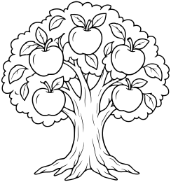

Whole tree with sturdy trunk, visible roots and rounded canopy containing five LARGE clearly outlined apples and a few large leaves. Open simple branching visible near canopy base. No loose apples, basket, ground or face. Spacious coloring areas.

- **Tags:** fall, Fall Harvest, plants, apple-tree
- **Roles:** foreground, accent
- **Detail:** moderate; **Facing:** none
- **Dimensions:** 244 x 260 scene units; **Visible Bounds:** left=2, top=1.75, right=242, bottom=258.25
- **Placement:** Preserve aspect ratio; flip and scale to suit the scene. Source conversion is ready for visual review.
- **Files:** [SVG](../../src/assets/vector/fall-apple-tree.svg), [Definition](../../src/assets/vector/fall-apple-tree.svg), [Source](../../art/source/fall/apple-tree.png)
- **Scene Examples:** Not yet used in a built-in scene.

## Woodland Mushroom Cluster

`fall-mushroom-cluster`

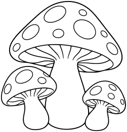

One broad domed mushroom and two smaller ones nestled at base, thick stems, simple cap spots outlined and left white, a few wide gill lines only where visible under cap. No faces, grass or ground. Clean natural whimsical shapes.

- **Tags:** fall, Fall Woodland, plants, mushroom-cluster
- **Roles:** foreground, accent
- **Detail:** moderate; **Facing:** none
- **Dimensions:** 251 x 260 scene units; **Visible Bounds:** left=2, top=2, right=249, bottom=258
- **Placement:** Preserve aspect ratio; flip and scale to suit the scene. Source conversion is ready for visual review.
- **Files:** [SVG](../../src/assets/vector/fall-mushroom-cluster.svg), [Definition](../../src/assets/vector/fall-mushroom-cluster.svg), [Source](../../art/source/fall/mushroom-cluster.png)
- **Scene Examples:** Not yet used in a built-in scene.

## Hollow Log

`fall-hollow-log`

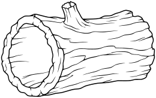

Whole low horizontal log in three-quarter view, large open hollow end on left with thick rim, short broken branch nub on top, few broad bark lines. No animals, mushrooms, leaves or ground. Hollow interior white for coloring, no large black fills.

- **Tags:** fall, Fall Woodland, plants, hollow-log
- **Roles:** foreground, accent
- **Detail:** moderate; **Facing:** none
- **Dimensions:** 260 x 164 scene units; **Visible Bounds:** left=1.75, top=1.75, right=258.25, bottom=162
- **Placement:** Preserve aspect ratio; flip and scale to suit the scene. Source conversion is ready for visual review.
- **Files:** [SVG](../../src/assets/vector/fall-hollow-log.svg), [Definition](../../src/assets/vector/fall-hollow-log.svg), [Source](../../art/source/fall/hollow-log.png)
- **Scene Examples:** Not yet used in a built-in scene.

## Chrysanthemum Pot

`fall-chrysanthemum-pot`

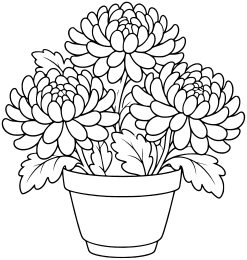

One broad simple flowerpot with THREE large round chrysanthemum flower heads and a few broad leaves. Each bloom drawn with two to three rings of broad petals, no dense tiny petals or hatching. No writing, ground or other pots.

- **Tags:** fall, Fall Plants, plants, chrysanthemum-pot
- **Roles:** foreground, accent
- **Detail:** moderate; **Facing:** none
- **Dimensions:** 247 x 260 scene units; **Visible Bounds:** left=1.75, top=1.75, right=245.25, bottom=258
- **Placement:** Preserve aspect ratio; flip and scale to suit the scene. Source conversion is ready for visual review.
- **Files:** [SVG](../../src/assets/vector/fall-chrysanthemum-pot.svg), [Definition](../../src/assets/vector/fall-chrysanthemum-pot.svg), [Source](../../art/source/fall/chrysanthemum-pot.png)
- **Scene Examples:** Not yet used in a built-in scene.

## Seaweed Fronds

`collection-expansion-seaweed-fronds`

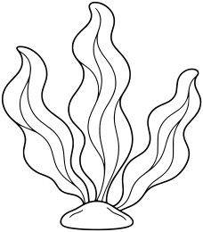

One rooted cluster of three broad gently waving seaweed fronds attached to a small smooth base stone. Clear closed ribbon shapes, no bubbles, sea floor or other objects.

- **Tags:** collection-expansion, Underwater, plants, seaweed-fronds
- **Roles:** foreground, accent
- **Detail:** moderate; **Facing:** none
- **Dimensions:** 228 x 260 scene units; **Visible Bounds:** left=2, top=2, right=226.25, bottom=258.25
- **Placement:** Preserve aspect ratio; flip and scale to suit the scene. Source conversion is ready for visual review.
- **Files:** [SVG](../../src/assets/vector/collection-expansion-seaweed-fronds.svg), [Definition](../../src/assets/vector/collection-expansion-seaweed-fronds.svg), [Source](../../art/source/collection-expansion/seaweed-fronds.png)
- **Scene Examples:** Not yet used in a built-in scene.

