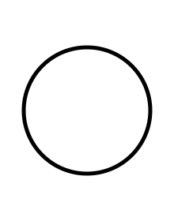
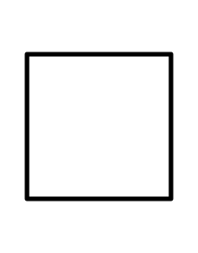
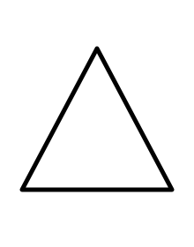

# Shapes

[All Assets](../CATALOG.md) | [Searchable Visual Browser](index.html) | [Machine Index](index.json)

Generated by `node scripts/build-asset-catalog.mjs`; edit metadata in `art/stickers.json`.

## Circle

`circle`

Plain round shape for simple designs.

- **Tags:** geometry, round, abstract, space
- **Roles:** subject, accent
- **Detail:** simple; **Facing:** none
- **Dimensions:** 220 x 280 scene units; **Visible Bounds:** left=27.5, top=57.5, right=192.5, bottom=222.5
- **Placement:** Use flipX to change facing where useful. Preserve aspect ratio and leave comfortable coloring space.
- **Files:** [SVG](../../src/assets/vector/circle.svg), [Definition](../../src/assets/vector/circle.svg), [Source](../../art/source/shapes/circle.svg)
- **Scene Examples:** Not yet used in a built-in scene.

## Square

`square`

Plain square shape for blocks or abstract compositions.

- **Tags:** geometry, block, abstract
- **Roles:** subject, accent
- **Detail:** simple; **Facing:** none
- **Dimensions:** 220 x 280 scene units; **Visible Bounds:** left=27.5, top=57.5, right=192.5, bottom=222.5
- **Placement:** Use flipX to change facing where useful. Preserve aspect ratio and leave comfortable coloring space.
- **Files:** [SVG](../../src/assets/vector/square.svg), [Definition](../../src/assets/vector/square.svg), [Source](../../art/source/shapes/square.svg)
- **Scene Examples:** Not yet used in a built-in scene.

## Triangle

`triangle`

Plain triangle shape for geometric compositions.

- **Tags:** geometry, pointed, abstract
- **Roles:** subject, accent
- **Detail:** simple; **Facing:** none
- **Dimensions:** 220 x 280 scene units; **Visible Bounds:** left=22.5, top=52.5, right=197.5, bottom=217.5
- **Placement:** Use flipX to change facing where useful. Preserve aspect ratio and leave comfortable coloring space.
- **Files:** [SVG](../../src/assets/vector/triangle.svg), [Definition](../../src/assets/vector/triangle.svg), [Source](../../art/source/shapes/triangle.svg)
- **Scene Examples:** Not yet used in a built-in scene.

