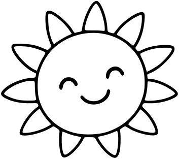
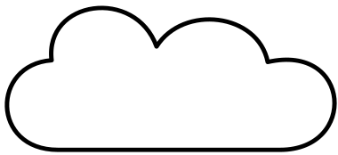
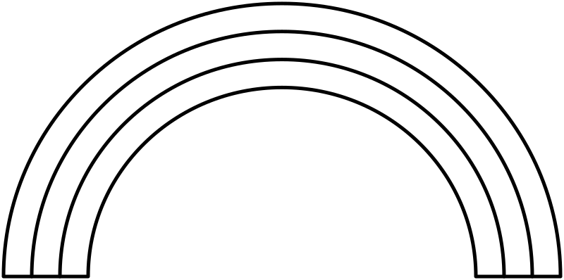

# Sky

[All Assets](../CATALOG.md) | [Searchable Visual Browser](index.html) | [Machine Index](index.json)

Generated by `node scripts/build-asset-catalog.mjs`; edit metadata in `art/stickers.json`.

## Sun With Rays

`garden-sun`

Round sun surrounded by pointed rays.

- **Tags:** sun, sky, safari, beach, spring, weather
- **Roles:** background, accent
- **Detail:** simple; **Facing:** none
- **Dimensions:** 353 x 313 scene units; **Visible Bounds:** left=2, top=1.75, right=350.75, bottom=310.75
- **Placement:** Use flipX to change facing where useful. Preserve aspect ratio and leave comfortable coloring space.
- **Files:** [SVG](../../src/assets/vector/garden-sun.svg), [Definition](../../src/assets/vector/garden-sun.json), [Source](../../art/source/cottage-garden-PAINT-READY.bmp)
- **Scene Examples:** [gardenScene.ts](../../src/editor/gardenScene.ts), [safariScene.ts](../../src/editor/safariScene.ts)

## Round Sun

`spring-sun`

Simple round sun for an uncluttered sky.

- **Tags:** sun, sky, safari, beach, spring, weather
- **Roles:** background, accent
- **Detail:** simple; **Facing:** none
- **Dimensions:** 260 x 260 scene units; **Visible Bounds:** left=2.5, top=2.5, right=257.5, bottom=257.5
- **Placement:** Use flipX to change facing where useful. Preserve aspect ratio and leave comfortable coloring space.
- **Files:** [SVG](../../src/assets/vector/spring-sun.svg), [Definition](../../src/assets/vector/spring-sun.json), [Source](../../art/source/spring/sun.svg)
- **Scene Examples:** [beachScene.ts](../../src/editor/beachScene.ts), [springScene.ts](../../src/editor/springScene.ts)

## Cloud

`garden-cloud`

Rounded cloud outline with large coloring space.

- **Tags:** cloud, sky, safari, beach, garden, weather
- **Roles:** background, accent
- **Detail:** simple; **Facing:** none
- **Dimensions:** 306 x 169 scene units; **Visible Bounds:** left=2, top=2, right=303.75, bottom=166.75
- **Placement:** Use flipX to change facing where useful. Preserve aspect ratio and leave comfortable coloring space.
- **Files:** [SVG](../../src/assets/vector/garden-cloud.svg), [Definition](../../src/assets/vector/garden-cloud.json), [Source](../../art/source/cottage-garden-PAINT-READY.bmp)
- **Scene Examples:** [gardenScene.ts](../../src/editor/gardenScene.ts), [safariScene.ts](../../src/editor/safariScene.ts)

## Simple Cloud

`spring-cloud`

Simple wide rounded cloud.

- **Tags:** cloud, sky, safari, spring, weather
- **Roles:** background, accent
- **Detail:** simple; **Facing:** none
- **Dimensions:** 380 x 174 scene units; **Visible Bounds:** left=5.25, top=6.5, right=378.5, bottom=170.5
- **Placement:** Use flipX to change facing where useful. Preserve aspect ratio and leave comfortable coloring space.
- **Files:** [SVG](../../src/assets/vector/spring-cloud.svg), [Definition](../../src/assets/vector/spring-cloud.json), [Source](../../art/source/spring/cloud.svg)
- **Scene Examples:** [beachScene.ts](../../src/editor/beachScene.ts), [safariScene.ts](../../src/editor/safariScene.ts), [springScene.ts](../../src/editor/springScene.ts)

## Rainbow

`garden-rainbow`

Broad arched rainbow with separate bands to color.

- **Tags:** rainbow, sky, spring, garden, fantasy
- **Roles:** background
- **Detail:** simple; **Facing:** none
- **Dimensions:** 800 x 398 scene units; **Visible Bounds:** left=2.5, top=2.5, right=797.5, bottom=395.5
- **Placement:** Use flipX to change facing where useful. Preserve aspect ratio and leave comfortable coloring space.
- **Files:** [SVG](../../src/assets/vector/garden-rainbow.svg), [Definition](../../src/assets/vector/garden-rainbow.json), [Source](../../art/source/generated/rainbow.svg)
- **Scene Examples:** [gardenScene.ts](../../src/editor/gardenScene.ts)

## Star

`counting-star`

Five-pointed star outline.

- **Tags:** star, sky, space, winter, celebration
- **Roles:** accent, background
- **Detail:** simple; **Facing:** none
- **Dimensions:** 70 x 69 scene units; **Visible Bounds:** left=2.5, top=2.5, right=67.5, bottom=65.5
- **Placement:** Use flipX to change facing where useful. Preserve aspect ratio and leave comfortable coloring space.
- **Files:** [SVG](../../src/assets/vector/counting-star.svg), [Definition](../../src/assets/vector/counting-star.json), [Source](../../art/source/counting/star.svg)
- **Scene Examples:** [countingScene.ts](../../src/editor/countingScene.ts), [winterScene.ts](../../src/editor/winterScene.ts)

