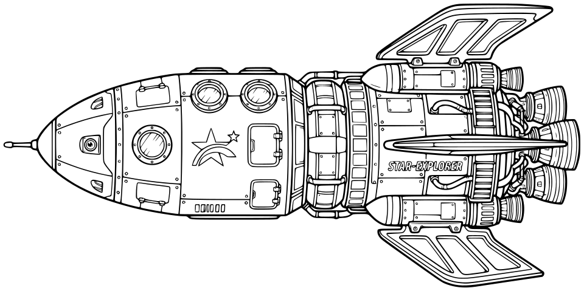
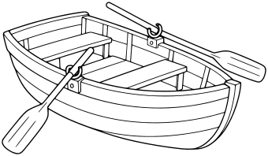
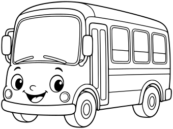
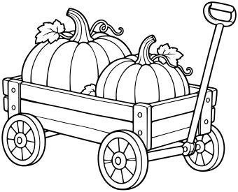
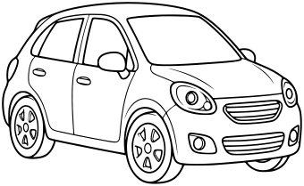
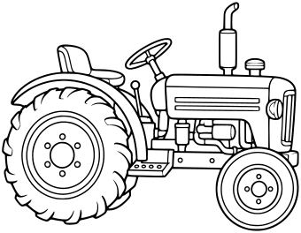
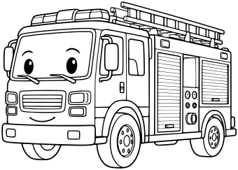
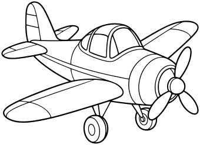

# Vehicles

[All Assets](../CATALOG.md) | [Searchable Visual Browser](index.html) | [Machine Index](index.json)

Generated by `node scripts/build-asset-catalog.mjs`; edit metadata in `art/stickers.json`.

## Explorer Spaceship

`space-spaceship`

Long explorer spaceship with windows, fins and engines.

- **Tags:** spaceship, rocket, vehicle, space, exploration
- **Roles:** subject
- **Detail:** detailed; **Facing:** left
- **Dimensions:** 960 x 479 scene units; **Visible Bounds:** left=5.5, top=6, right=954, bottom=473
- **Placement:** High detail; use as a large focal subject. The source contains STAR-EXPLORER lettering.
- **Files:** [SVG](../../src/assets/vector/space-spaceship.svg), [Definition](../../src/assets/vector/space-spaceship.svg), [Source](../../art/source/space/spaceship.jpg)
- **Scene Examples:** Not yet used in a built-in scene.

## Rowboat with Oars

`nursery-rhymes-rowboat`

Three-quarter side view, simple curved hull, two bench seats visible, two oars resting in sensible positions through rowlocks extending outward. No people, no water, no horizon or ground, all oar tips visible. Broad wood planks, no dense grain.

- **Tags:** nursery-rhymes, Row Row Row Your Boat, vehicles, rowboat
- **Roles:** subject, accent
- **Detail:** moderate; **Facing:** none
- **Dimensions:** 340 x 198 scene units; **Visible Bounds:** left=2.25, top=2.5, right=337.75, bottom=195.75
- **Placement:** Preserve aspect ratio; flip and scale to suit the scene. Source conversion is ready for visual review.
- **Files:** [SVG](../../src/assets/vector/nursery-rhymes-rowboat.svg), [Definition](../../src/assets/vector/nursery-rhymes-rowboat.svg), [Source](../../art/source/nursery-rhymes/rowboat.png)
- **Scene Examples:** Not yet used in a built-in scene.

## Friendly Bus

`nursery-rhymes-friendly-bus`

Whole bus in three-quarter side view facing left, big front windshield, side door and three broad passenger windows, two visible wheels and simple bumper/lights. Small smiling face suggested on front bumper area. NO words, numerals, passengers or street, no excessive mechanical detail.

- **Tags:** nursery-rhymes, The Wheels on the Bus, vehicles, friendly-bus
- **Roles:** subject, accent
- **Detail:** moderate; **Facing:** none
- **Dimensions:** 340 x 254 scene units; **Visible Bounds:** left=2.25, top=2.25, right=337.75, bottom=251.5
- **Placement:** Preserve aspect ratio; flip and scale to suit the scene. Source conversion is ready for visual review.
- **Files:** [SVG](../../src/assets/vector/nursery-rhymes-friendly-bus.svg), [Definition](../../src/assets/vector/nursery-rhymes-friendly-bus.svg), [Source](../../art/source/nursery-rhymes/friendly-bus.png)
- **Scene Examples:** Not yet used in a built-in scene.

## Pumpkin Wagon

`fall-pumpkin-wagon`

Whole side three-quarter view, low planked wagon containing two large pumpkins, four wheels with three visible if perspective requires, long pull handle angled upward and fully in frame. No words, person or ground. Clear mechanical connections and broad pumpkin ribs.

- **Tags:** fall, Fall Harvest, vehicles, pumpkin-wagon
- **Roles:** subject, accent
- **Detail:** moderate; **Facing:** none
- **Dimensions:** 340 x 275 scene units; **Visible Bounds:** left=2.25, top=2.25, right=337.75, bottom=272.25
- **Placement:** Preserve aspect ratio; flip and scale to suit the scene. Source conversion is ready for visual review.
- **Files:** [SVG](../../src/assets/vector/fall-pumpkin-wagon.svg), [Definition](../../src/assets/vector/fall-pumpkin-wagon.svg), [Source](../../art/source/fall/pumpkin-wagon.png)
- **Scene Examples:** Not yet used in a built-in scene.

## Compact Car

`category-expansion-compact-car`

A friendly rounded compact passenger car, three-quarter side view, two visible wheels, large closed windows, clear doors and headlights. No driver.

- **Tags:** category-expansion, vehicles, compact-car
- **Roles:** subject, accent
- **Detail:** moderate; **Facing:** none
- **Dimensions:** 340 x 209 scene units; **Visible Bounds:** left=2.25, top=2.25, right=337.75, bottom=206.5
- **Placement:** Preserve aspect ratio; flip and scale to suit the scene. Source conversion is ready for visual review.
- **Files:** [SVG](../../src/assets/vector/category-expansion-compact-car.svg), [Definition](../../src/assets/vector/category-expansion-compact-car.svg), [Source](../../art/source/category-expansion/compact-car.png)
- **Scene Examples:** Not yet used in a built-in scene.

## Farm Tractor

`category-expansion-farm-tractor`

A classic farm tractor side view with one large rear wheel and smaller front wheel, open seat, steering wheel and short exhaust. No driver or trailer.

- **Tags:** category-expansion, vehicles, farm-tractor
- **Roles:** subject, accent
- **Detail:** moderate; **Facing:** none
- **Dimensions:** 340 x 264 scene units; **Visible Bounds:** left=2.25, top=2.5, right=337.5, bottom=261.5
- **Placement:** Preserve aspect ratio; flip and scale to suit the scene. Source conversion is ready for visual review.
- **Files:** [SVG](../../src/assets/vector/category-expansion-farm-tractor.svg), [Definition](../../src/assets/vector/category-expansion-farm-tractor.svg), [Source](../../art/source/category-expansion/farm-tractor.png)
- **Scene Examples:** Not yet used in a built-in scene.

## Fire Engine

`category-expansion-fire-engine`

A friendly fire engine three-quarter side view, closed cab, two visible wheels, simple roof ladder and broad equipment panels. No lettering or badges.

- **Tags:** category-expansion, vehicles, fire-engine
- **Roles:** subject, accent
- **Detail:** moderate; **Facing:** none
- **Dimensions:** 340 x 243 scene units; **Visible Bounds:** left=2.25, top=2.25, right=338, bottom=240.75
- **Placement:** Preserve aspect ratio; flip and scale to suit the scene. Source conversion is ready for visual review.
- **Files:** [SVG](../../src/assets/vector/category-expansion-fire-engine.svg), [Definition](../../src/assets/vector/category-expansion-fire-engine.svg), [Source](../../art/source/category-expansion/fire-engine.png)
- **Scene Examples:** Not yet used in a built-in scene.

## Propeller Airplane

`category-expansion-propeller-airplane`

A small friendly propeller airplane three-quarter view, clearly separated wings, tail and rounded cockpit, simple landing wheels. No pilot.

- **Tags:** category-expansion, vehicles, propeller-airplane
- **Roles:** subject, accent
- **Detail:** moderate; **Facing:** none
- **Dimensions:** 340 x 247 scene units; **Visible Bounds:** left=2.5, top=2.25, right=337.75, bottom=244.5
- **Placement:** Preserve aspect ratio; flip and scale to suit the scene. Source conversion is ready for visual review.
- **Files:** [SVG](../../src/assets/vector/category-expansion-propeller-airplane.svg), [Definition](../../src/assets/vector/category-expansion-propeller-airplane.svg), [Source](../../art/source/category-expansion/propeller-airplane.png)
- **Scene Examples:** Not yet used in a built-in scene.
