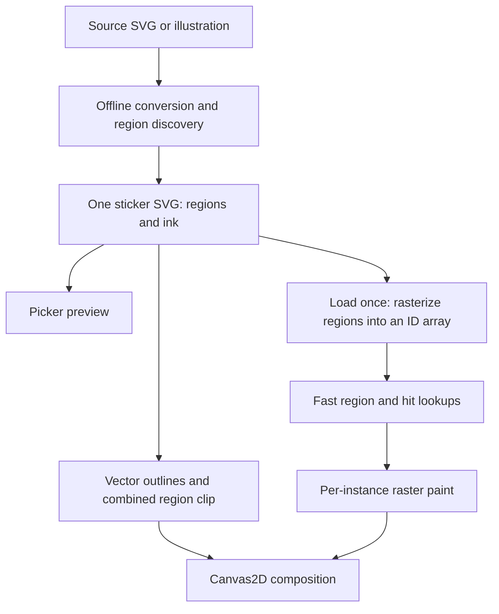

# How stickers work

Every sticker is shipped as one SVG. The same file supplies the sticker-picker image,
vector line art, paintable regions and metadata. There are no per-sticker JSON masks
or raster region-map files in the production package.



## From source to sticker

`art/stickers.json` supplies source paths, crop rectangles, logical dimensions,
transparent cutouts, placement metadata and searchable descriptions. Original sources
live in `art/source/`; the app does not download those original illustrations.

The offline builder preserves authored SVG geometry or traces raster line art with
ImageMagick and Potrace. It analyzes the resulting ink at four samples per logical
unit for assets up to 300,000 logical pixels, or two for larger assets. It discovers
closed regions, excludes authored cutouts, and extends region ownership beneath the
ink to approximately its centerline. That raster analysis is an offline intermediate.
Each region is then traced into a closed vector path in the generated SVG.

```xml
<svg viewBox="0 0 623 560" data-region-format="1"
     data-region-scale="2" data-bounds="...">
  <g id="regions" fill="white">
    <path id="region-1" data-bounds="..." transform="matrix(...)" d="..."/>
    <!-- Each independently fillable region is a closed path. -->
  </g>
  <g id="ink">
    <path id="ink-1" fill="black" stroke="none" transform="matrix(...)" d="..."/>
  </g>
</svg>
```

Region IDs are generated for reproducibility and diagnostics. They are optional for
conforming authored region paths: the loader assigns unused numeric IDs in document
order when they are absent. IDs are internal to the lookup array, not stored in the
user's paint runs. The union of regions supplies the backing/silhouette; a separate
serialized silhouette is unnecessary.

Authored overlapping white shapes need more than dropping their fill attributes.
The converter emits inverse vector clip paths so later shapes still hide earlier
ink. Those clips are shared by browser SVG previews and Canvas2D line rendering.
Horizon closures remain part of region analysis without adding visible box edges.

## What happens on load

The app fetches the SVG URL on demand. The picker and editor use the same URL, and
Vite emits external files rather than inlining the whole collection into startup
JavaScript. Lightweight catalog JSON contains dimensions and placement metadata only.
The full library is not fetched or decoded at startup.

The loader parses vector paths and builds one shared lookup array:

- Each region is rasterized into a cropped temporary alpha mask at the declared scale.
- Covered samples receive that region's integer ID. Separate masks avoid antialiased
  RGB mixtures inventing IDs at boundaries.
- Zero means outside. This same array supplies hit coverage; no extra hit mask is stored.
- IDs up to 255 use one byte per sample; larger IDs use two bytes.
- Temporary masks are released after preparation. Instances of the same sticker share
  the resulting immutable array and vector geometry.

Source text has a 24-entry cache. Decoded definitions stay available during editing
and are released when leaving the editor; paint remains per instance. Picture previews
also prepare definitions; there is no separate scene-thumbnail pipeline yet.

## Painting, filling and rendering

Each placed sticker has its own raster paint array and canvas at 150 DPI relative to
96 logical scene units per inch. The interaction map can have a finer resolution than
paint so thin details remain identifiable. Scaling a sticker transforms its paint; it
does not convert paint to vectors or add more stored paint pixels.

Brush strokes modify paint pixels, with lookup IDs keeping writes within the sticker.
Bucket clicks choose the visible sticker or paper, then flood that surface's connected
paint pixels within a region and existing color boundary. Paint can continue behind
foreground stickers on the selected surface, so moving them does not expose unfilled
background silhouettes. Erasing restores the unpainted surface.

Canvas2D draws the white base and raster paint clipped to the union of region paths,
then draws vector ink above it. Phaser adapts input and draws selection graphics.
Outlines remain vector-based while zooming, rotating, previewing and exporting.
PNG export redraws the same artwork at output resolution.

## Saving and compatibility

Version-3 saves contain asset IDs, placement, order, transforms, outline colors and
non-default paint runs. They do not embed library definitions or runtime lookup arrays.
This migration preserves asset IDs, logical dimensions, paint density and storage keys;
no saved-picture rewrite is performed.

Tracing and rerasterizing region boundaries is not bit-identical to the old shipped
maps. The library comparison records these differences and the changed outer-ink hit
coverage. Future geometry changes still require compatibility review even when the
save schema stays the same.

## Measured migration

For the current 71 assets / 2,541 regions, SVG asset files total about 2.42 MB raw or
0.89 MB gzip, versus 28.0 MB raw or 2.45 MB gzip for the previous JSON/SVG pairs.
All definitions loaded together would use about 139 MB of lookup arrays versus
268 MB previously. Normal loading remains on demand; native paths, paint buffers,
canvas backings and temporary allocations are additional costs.

See the [library migration report](experiments/SVG-MIGRATION.md) for exact numbers,
fidelity, browser checks and reproduction, and the [house experiment](experiments/GARDEN-HOUSE.md)
for the comparison of direct vector queries with runtime array generation. The
[JSON baseline](experiments/JSON-BASELINE.md) is retained as historical documentation.

## Main code

- `scripts/build-stickers.mjs`, `scripts/svg-regions.mjs`: offline conversion.
- `src/editor/svgDefinition.ts`: SVG decoding and vector clips.
- `src/editor/rasterizeRegions.ts`: shared lookup construction.
- `src/editor/vectorStickers.ts`: loading and caches.
- `src/editor/Artwork.ts`: painting, fills, placement and compositing.
- `src/game/VectorViewport.ts`: visible-resolution rendering.

## Raster horizon sources

For raster sources marked `horizon`, the full canvas is retained. Only white connected to the top edge is classified as outside sky; side and bottom edges implicitly close the terrain. This avoids visible frame lines. Review the resulting sky/ground boundary and intentional gaps. Authored SVG horizons retain their existing hidden-closure analysis.

`horizonOverscan` is an optional placement multiplier. New square backgrounds use 1200 ? 1200 logical units and 1.2 overscan so they extend beyond the paper width while allowing vertical adjustment. Original source pixels are not runtime resolution.

For sources whose trees reach the top edge, `skySeeds` can explicitly identify outside sky instead of treating every top-edge white area as sky. `analysisGapClosure` optionally closes small breaks in the analysis raster only; it never changes visible ink. Birch Woodland uses a one-unit closure and an explicit sky seed to keep its open ground paintable.

## Interior backgrounds

Raster sources marked `interior: true` preserve the full canvas and treat every white component, including edge-connected walls and floors, as a paintable region. Unlike outdoor horizons, they have no transparent sky. Visible ink is unchanged; canvas boundaries implicitly close regions. The runtime centers these backgrounds behind stickers and scales to cover either page orientation with 5% overscan. Sources remain 1200 ? 1200 logical units; PNG dimensions are not runtime lookup resolution.
