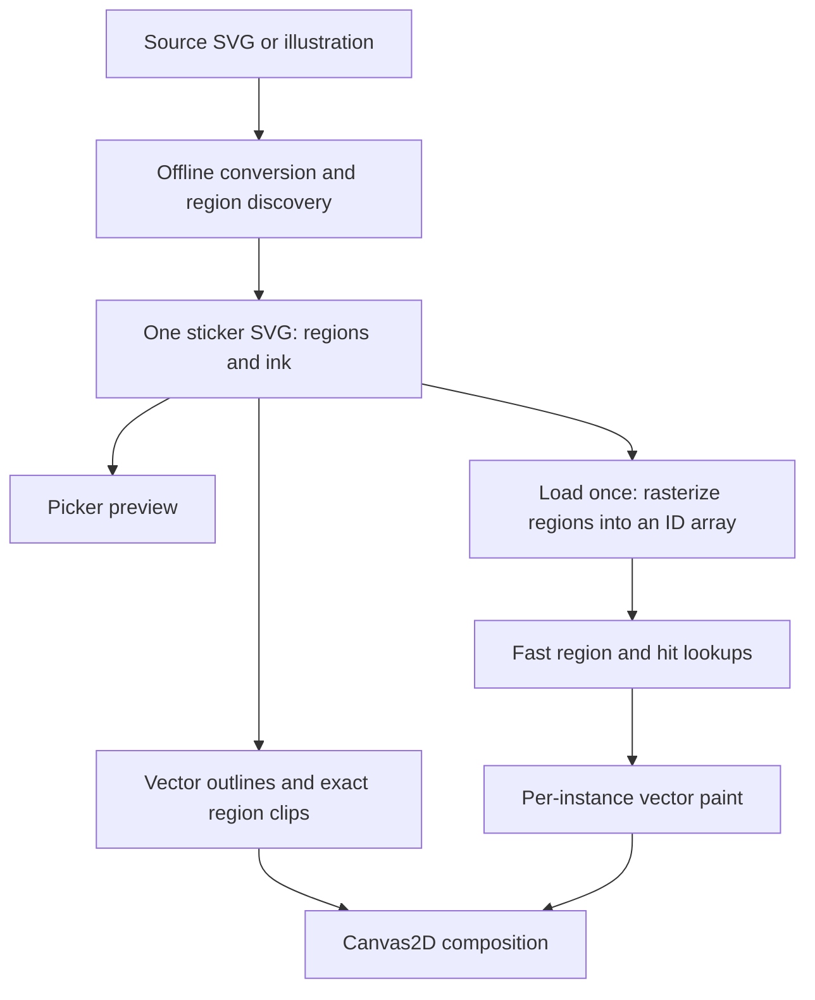

# How stickers work

Every sticker is shipped as one SVG. The same file supplies the sticker-picker image,
vector line art, paintable regions and metadata. There are no per-sticker JSON masks
or raster region-map files in the production package.



## From source to sticker

`art/stickers.json` supplies source paths, crop rectangles, logical dimensions,
transparent cutouts, placement metadata and searchable descriptions. Original sources
live in `art/source/`; the app does not download those original illustrations.

The offline builder preserves authored SVG geometry or traces raster line art with
ImageMagick and Potrace. Region discovery now supersamples the resulting ink at up to eight samples per logical
unit, bounded to 16 million analysis pixels for large scenery. This authoring density
is independent of the shipped 4x/2x interaction lookup. It discovers
closed regions, excludes authored cutouts, and extends region ownership beneath the
ink to approximately its centerline. That raster analysis is an offline intermediate.
Each region is traced into one closed vector path with a tighter fitting tolerance.
Region ownership stops at the discovered centerline; there is no extra overlap to push a lookup boundary toward a thin line edge. Higher sampling can recover thin regions or change IDs. Vector paint stores region IDs, and pre-release rebuilds may invalidate old development drawings. Existing assets are not silently bulk-regenerated.

For traced ink with a minimum-region rule, `discover-regions.mjs` measures individual connected white components at the largest proportional A4 fit, 150 DPI. `clean-ink-components.mjs` resolves the original Bezier contours with authoring-only Paper.js. True tiny holes are removed directly; raster-split pockets are intersected with their curved white contour and united into the ink. No bitmap patch is traced or overlaid. Tiny slivers are removed again after unions. The ink is rendered again and all regions are rediscovered from the final geometry.

Moon Sorceress remains the only asset with this tuning enabled (10.2 pixels squared). The historical cleanup reference has 199 regions, no remaining below-cutoff components, unchanged eye sparkles and no added detached black components. The current curated SVG source removes the misplaced hair behind the left sleeve and produces 195 regions. Review other assets before enabling or rebuilding them.

```xml
<svg viewBox="0 0 623 560" data-region-format="1"
     data-region-scale="2" data-bounds="...">
  <g id="regions" fill="white">
    <path id="region-1" data-bounds="..." transform="matrix(...)" d="..."/>
    <!-- Each independently fillable region is a closed path. -->
  </g>
  <g id="ink">
    <path id="ink-1" fill="black" stroke="none" transform="matrix(...)" d="..."/>
  </g>
</svg>
```

Region IDs are generated for reproducibility and diagnostics. They are optional for
conforming authored region paths: the loader assigns unused numeric IDs in document
order when they are absent. IDs connect the lookup and saved vector paint to the SVG region paths. The union of regions supplies the backing/silhouette; a separate
serialized silhouette is unnecessary.

Authored overlapping white shapes need more than dropping their fill attributes.
The converter emits inverse vector clip paths so later shapes still hide earlier
ink. Those clips are shared by browser SVG previews and Canvas2D line rendering.
Horizon closures remain part of region analysis without adding visible box edges.

## What happens on load

The app fetches the SVG URL on demand. The picker and editor use the same URL, and
Vite emits external files rather than inlining the whole collection into startup
JavaScript. Lightweight catalog JSON contains dimensions and placement metadata only.
The full library is not fetched or decoded at startup.

The loader parses vector paths and builds one shared lookup array:

- Each region is rasterized into a cropped temporary alpha mask at the declared scale.
- Covered samples receive that region's integer ID. Separate masks avoid antialiased
  RGB mixtures inventing IDs at boundaries.
- The lookup also samples the actual visible ink, including inverse clips. Ink-only
  samples inherit a nearby region for line clicks; isolated ink blocks clicks through
  to the page without inventing a fill region.
- A compact one-bit-per-sample flag distinguishes ink-only hit coverage from actual
  paint regions. Paint clipping still uses the SVG region union.
- IDs plus an ink-only marker use one byte per sample when possible, otherwise two
  (four only at the 65,535-ID limit). Temporary propagation scratch is released.
- Temporary masks are released after preparation. Instances of the same sticker share
  the resulting immutable array and vector geometry.

Source text has a 24-entry cache. Decoded definitions stay available during editing
and are released when leaving the editor; paint remains per instance. Picture previews
also prepare definitions; there is no separate scene-thumbnail pipeline yet.

## Painting, filling and rendering

Both stickers and paper own vector backing styles and merged brush blobs. Brushes, textures, fill patterns and erasing stay vector; there is no raster paint fallback. Connected-component polygon filling handles closed brush outlines. Rendering clips paint to the original SVG curves and overlays line art. Shared categorical lookup arrays are interaction data only.

See [Vector Painting](VECTOR-PAINT.md) for runtime geometry, worker merging, painting ownership and output resolution.

## Saving and development changes

Document/picture format 5 stores vector paint, transforms and asset IDs. It does not store color rasters or hit arrays. The app is pre-release: old drawing formats and compatibility engines have been removed. Bundled page geometry is updated directly; the local library uses a fresh namespace.

The Moon Sorceress is the reference asset for small-region cleanup and centerline tuning. The corrected Moon Sorceress is ready for inspection; bulk rebuilding remains deferred until review.
