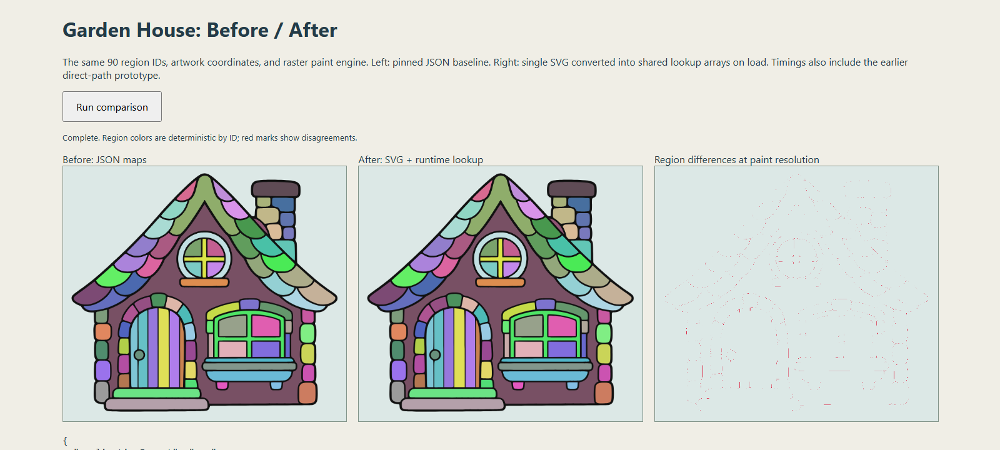

> Historical snapshot. The raster paint engine and its executable benchmarks have been retired; current runtime behavior is documented in `docs/VECTOR-PAINT.md`.

# Garden house: single-SVG region experiment

Historical experiment: the house validated SVG transport with runtime raster lookups.
The format has now been adopted for the [entire library](SVG-MIGRATION.md). This report
retains the first comparison and its measurements.
The pre-experiment cleanup was committed and pushed as `c460b3e`.

## Preserved baseline and reproducibility

- [Baseline manifest](../../experiments/garden-house/baseline.json): full commit, SHA-256,
  logical dimensions, raw/gzip sizes, exact map bytes and paint-surface estimates.
- [Original JSON](../../experiments/garden-house/baseline/garden-house.json) and
  [original preview SVG](../../experiments/garden-house/baseline/garden-house.svg).
  These fixtures live outside production imports/build output.
- [Measured prototype SVG](../../experiments/garden-house/single-svg-prototype.svg): runtime and preview use
  this same file. Runtime fetches its URL rather than embedding a second raw SVG copy
  in a JavaScript chunk. The production house JSON has been removed.
- [Direct-path prototype results](../../experiments/garden-house/results-direct.json) and
  [its image](../../experiments/garden-house/comparison-direct.png), retained unchanged.
- [Measured results](../../experiments/garden-house/results.json), including browser,
  medians/p95, accuracy, actual engine checks and post-GC heap/backing-store readings.
- [Visual comparison](../../experiments/garden-house/comparison.png).

```sh
npm run experiment:house:convert    # Trace regions from the pinned baseline
node scripts/build-stickers.mjs garden-house  # Rebuild from original source art
npm run experiment:house:benchmark  # Run local Edge/Chrome comparison
npm run dev
# Open /experiments/garden-house/index.html to view/rerun the comparison yourself.
```

Conversion requires Potrace; a source rebuild also requires ImageMagick. Set
`POTRACE_PATH` if necessary. The automated benchmark starts Vite on localhost:1433
and an isolated headless browser profile, then closes both. It does not access the
app's saved pictures. Set `BENCHMARK_BROWSER` for another Chromium executable.
To test the actual editor, choose Cottage Garden or add Garden House from Buildings.
An installed desktop copy needs rebuilding before it contains these changes.

## Structure

The 623 x 560 logical-unit house has 90 regions. The baseline analysis grid is
1246 x 1120. This trial vectors the existing offline labels at their current
centerline approximation, using Potrace with a fine tolerance and no speckle removal.
It does not compute new analytic centerlines from the original black contours.

```xml
<svg viewBox="0 0 623 560" data-region-format="1" data-bounds="...">
  <g id="regions" fill="white" fill-rule="nonzero">
    <path id="region-1" data-bounds="..." transform="matrix(...)" d="..."/>
    <!-- Stable original IDs through region-90 -->
  </g>
  <g id="ink">
    <path id="ink-1" transform="matrix(...)" fill="black" .../>
    <!-- Five original ink paths, unchanged -->
  </g>
</svg>
```

Regions are closed vector paths. Their union is the paint backing and clip; there
is no separate serialized silhouette, hit mask, image, or region grid. `data-bounds`
provides cheap bounds rejection before native path queries; it is not a pixel map.
Transforms are retained without rounding path coordinates. Holes use the traced path
winding. Each path keeps its original region ID.

The SVG decoder creates Path2D objects and rasterizes region masks once at load time.
The house uses the same 1246 x 1120 sampling grid as the baseline. Each region is drawn
into a cropped temporary alpha mask, then its integer ID is written to a shared lookup
array wherever coverage is at least 50%. IDs are never decoded from blended RGB colors.
First-region precedence resolves rare overlaps. Temporary canvas backings are released.

IDs 1-255 use a Uint8Array; larger IDs use Uint16Array. Zero is outside, so the region
array also supplies hit coverage. There is no second hit array. The definition cache
shares the array between all placed house instances. Painting and filling use array
queries; direct path queries remain available only to reproduce the earlier prototype.
The SVG and its transport size are unchanged by runtime rasterization.

Both backends feed the same `Artwork` paint engine. Per-instance raster paint, undo,
patterns, transforms and version-3 save layout remain as before. The normal builder,
scene previews and catalog generation now use this format for the entire library.

## Measured result

Local Windows / headless Edge 155, CPU canvas mode (`--disable-gpu`). Timings below
are medians after warm-up. They are one-machine comparisons, not browser-wide or
mobile guarantees. Gzip sizes use local default gzip compression, not server traffic.

| Measure | JSON maps + preview | SVG with direct queries | SVG with runtime lookup |
| --- | ---: | ---: | ---: |
| Files, uncompressed | 427,149 bytes | 67,754 bytes | 67,754 bytes |
| Files, gzip (separately compressed) | 53,448 bytes | 26,643 bytes | 26,643 bytes |
| Shared region/hit arrays | 2,965,480 bytes | 0 bytes | 1,395,520 bytes |
| Definition decode / preparation | 18.5 ms | 1.5 ms | 14.8 ms |
| 10,000 region queries | 0.1 ms | 27.5 ms | 0.2 ms |
| Render with synchronous pixel readback | 13.0 ms | 15.5 ms | 14.7 ms |
| Fresh artwork + first bucket fill | 14.5 ms | 920.2 ms | 13.2 ms |
| Repeated fill with ownership cached | 0.9 ms | 18.2 ms | 0.9 ms |
| Brush stroke with ownership cached | 1.5 ms | 9.3 ms | 1.5 ms |

All three approaches still allocate a 974 x 875 paint array for each house instance:
3,409,000 bytes, plus an estimated 3,409,000-byte RGBA canvas backing. Those are not
removed by the SVG format. Path2D/native graphics memory is also nonzero; zero typed
map bytes is not zero definition memory. Heap readings retain ten decoded definitions
per backend with forced GC and common source modules already loaded. See raw results
for JS heap, backing storage and embedder counters; they do not measure complete
process/GPU memory, peak temporary allocations, or establish a portable total-memory figure.

## Fidelity and behavior

- All 90 original region IDs are present and observable at the paint resolution.
- All five ink paths retain their original geometry and transforms.
- Across 852,250 paint-resolution samples, 2,852 (0.3346%) have a different region ID.
  The difference image is predominantly boundary pixels from tracing and
  rerasterizing the region paths. Direct paths versus the generated lookup differ at
  3,718 samples, with zero differences passing the eight-neighbor interior check. Two disagreeing samples also pass the eight-neighbor interior check;
  this remains a small fidelity issue for review, not an assertion of exact equivalence.
- SVG selection uses the union of regions. The old hit mask also included the outer
  half of ink, so click coverage along that edge intentionally differs in this trial.
- Actual `Artwork` checks passed for fill, save/restore, flip, rotation/scale,
  duplication, removal, PNG rendering and focused rejection of outside brushwork,
  for all three representations. Additional browser checks cover shared cache reuse,
  holes, overlap precedence, outside queries, byte-width selection and absence of
  blended region IDs. This does not replace hands-on touch/native-dialog review.



## Interpretation

SVG is the compact transport and source geometry; the efficient runtime format is a
shared array generated on load. The initial experiment omitted that preparation step
and repeatedly queried vector paths inside pixel loops, which caused the large slowdown.
The corrected implementation keeps the smaller download while returning fill/brush
costs to the same range as the original array-based engine.

Map memory is about 53% lower for this house because its 90 IDs fit in one byte and
hit coverage is derived from nonzero IDs. More complex assets can require two bytes.
Preparation has a one-time cost, and native vector memory and raster paint remain.
The experiment originally left the rest of the library unchanged; the subsequent
[full migration](SVG-MIGRATION.md) records its fidelity and runtime checks. Measurements are local CPU comparisons, not a claim
that every asset/device will have the same timing.

The experiment changes no saved document schema, but its boundary differences mean
existing paint can be clipped slightly differently. Keep the baseline fixture and
commit if reverting the pilot; do not overwrite saved pictures to compare formats.
