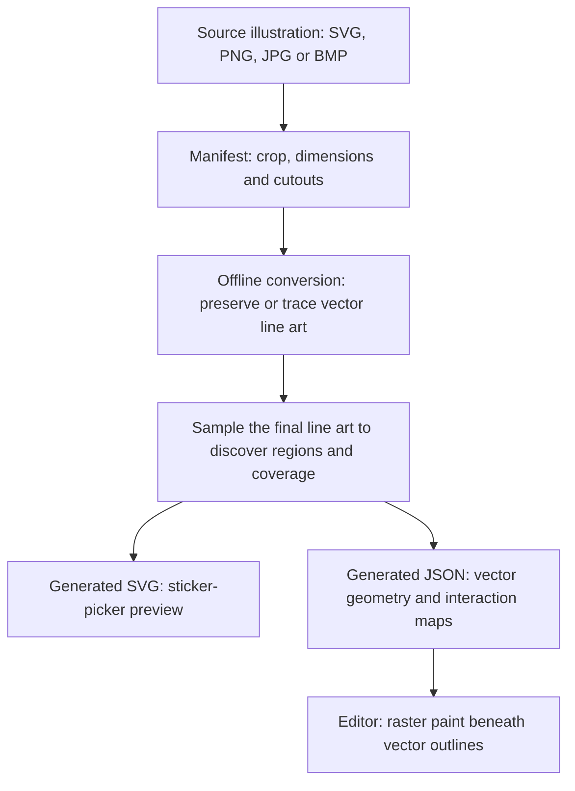

> Historical snapshot. The raster paint engine and its executable benchmarks have been retired; current runtime behavior is documented in `docs/VECTOR-PAINT.md`.

# How stickers actually work

Historical reference: this describes the JSON-map baseline before the SVG migration. `garden-house` was the first asset with an
historical [single-SVG pilot](GARDEN-HOUSE.md), with a preserved baseline,
measured performance and no shipped region map. The size snapshot below predates
that pilot.
The visible line art is vector-based. Editable stickers are loaded from generated
JSON packages containing vector geometry plus raster interaction data. The paired
SVG is a generated preview, not the editor's runtime source file.

## From source artwork to an editable sticker

1. **Source and manifest.** `art/source/` contains original artwork. `art/stickers.json`
   supplies IDs, dimensions, source/crop information, cutouts, placement and searchable
   metadata. These source images are not downloaded as editor paint layers.
2. **Vector preparation.** `scripts/build-stickers.mjs` reads authored SVG shapes, or
   traces raster line art with ImageMagick and Potrace. Traced black lines generally
   become filled vector contours; authored SVG shapes may retain strokes. Higher
   quality input still matters: conversion cannot recover detail missing from a source.
3. **Interaction analysis.** The builder rasterizes the final vector ink at four samples
   per logical unit for smaller assets, or two for larger assets. It finds enclosed
   regions, applies explicit cutouts, propagates region IDs beneath ink, and derives
   the paint silhouette and selection coverage. Horizons can include hidden closure
   boundaries for analysis without drawing a rectangle around the scenery.
4. **Generated outputs.** The builder emits `<id>.svg` and `<id>.json`, plus a lightweight
   dimensions/placement catalog and authoring reports. Both outputs derive from the
   same prepared artwork. Editing the generated SVG alone does not update the JSON.
   Change the source/manifest and rebuild to keep them consistent.

## What is in each JSON?

| Field | Role | Representation |
| --- | --- | --- |
| `commands`, `matrix` | Visible vector line art and its coordinate transform | Path strings, fill/stroke instructions and numbers |
| `silhouettePaths`, `silhouetteMatrix` | White backing shape and clip boundary for paint | Vector paths derived from the offline analysis |
| `regionRuns`, `regionScale` | Which enclosed coloring region contains a sampled point | Run-length-encoded pairs of run length and region ID, stored as base64 |
| `hitCoverage` | Whether the point belongs to the sticker, including its ink | One bit per sampled point, stored as base64 |
| `width`, `height`, `bounds`, `regionCount` | Dimensions, placement bounds and conversion information | Small metadata fields |

The JSON therefore includes real vector artwork, not just a raster substitute for
the SVG. Much of the apparent file size comes from interaction masks, especially
`hitCoverage`. Base64 makes binary data representable as text; it is not compression.
The region map is run-length encoded, while hit coverage is bit-packed but not
otherwise internally compressed. HTTP gzip/Brotli is a separate hosting concern.

## Loading and rendering

The sticker picker uses `` previews from the generated SVG URLs. It displays
six choices per page. Small SVGs can be inlined by Vite; larger ones are separate
files. Eagerly importing the URL map does not fetch every external SVG image.

Opening a picture, adding a sticker, or rendering a saved-picture/template preview
calls `prepareStickers`. Each unique asset JSON is a lazy import. In a production
Vite build it becomes a separate JavaScript chunk exporting the JSON string, which
is then parsed. Reusing a sticker shares its prepared definition rather than
requesting a new copy for every instance. A scene preview currently prepares its
full editing definitions; there is no separate lightweight scene-thumbnail pipeline.

`vectorStickers.ts` converts geometry into browser `Path2D` objects, expands region
runs into a `Uint16Array`, and decodes hit coverage into a byte array. `Artwork` then
creates an independent paint surface for each placed sticker. Its compositing order is:

1. White backing plus that sticker's raster paint, clipped to its vector silhouette.
2. Vector line art drawn above the paint.
3. The next sticker, following the document's layer order.

Canvas2D draws the result at visible device resolution. Phaser handles pointer
adaptation and the selection overlay, rather than rendering sticker SVG files as
sprites. Zooming, rotating or flipping redraws the vector paths, so outlines stay
smooth. The display is ultimately pixels on a canvas; it is not a DOM tree of SVGs.
PNG export redraws the same artwork at output resolution.

## Painting and bucket behavior

Every instance has raster paint at 150 DPI relative to 96 logical scene units per
inch. Scaling a sticker does not turn paint into vectors or allocate proportionally
more paint detail. Brush marks and patterns modify these pixels. Line art stays
separate and protected above them; erasing restores the unpainted surface.

The bucket first identifies the visible sticker or paper at the click. It maps the
point into that surface's local coordinates, then flood-fills paint pixels subject
to the precomputed region ID and current paint color. It is not directly setting an
SVG path's fill attribute. This allows partial brush work, patterns and internal
paint boundaries to coexist with protected outlines.

After choosing the surface, a fill can continue across that surface behind other
stickers. Moving a foreground sticker therefore should not expose a blank silhouette
left by the foreground object's earlier position. Paint moves with its owning
sticker because it is stored in the sticker's local coordinates.

## Saves and shared definitions

A saved document records page dimensions, asset IDs, transforms, outline colors,
layer order and each surface's non-default paint runs. It does not copy the library
SVG or the complete JSON definition into every save. Multiple lions share line art
and interaction maps, but each lion has its own paint buffer and paint canvas.
Undo snapshots also contain document/paint data, not complete library definitions.

This makes asset IDs and logical geometry part of save compatibility. Rebuilding a
sticker with incompatible dimensions or region geometry can affect existing paint;
changing artwork requires deliberate compatibility review.

## Disk, network and memory are different costs

Measured from the 71-asset library and current production output on 2026-10-18.
MB here means 1,000,000 bytes. Gzip figures are local estimates, not observed server
responses, and assume each file is compressed separately.

| Production output | Uncompressed | Gzip estimate |
| --- | ---: | ---: |
| 71 sticker-definition JS chunks | 26.77 MB | 1.95 MB |
| Other JavaScript, including Phaser and small inlined assets | 1.82 MB | 0.49 MB |
| External SVG assets | 1.21 MB | 0.48 MB |

Fonts and CSS are additional smaller files. Original authoring images are outside
this runtime payload. The entire definition library is not fetched at startup;
actual transfer depends on the pictures/previews/stickers visited and HTTP caching.
Tauri bundles these files locally, so their uncompressed size also affects the
installed payload even though its installer is compressed.

Across the source JSON files, hit-coverage strings occupy about 21.04 MB, region-run
strings 4.43 MB, and vector commands plus silhouette paths about 1.27 MB. These are
representation sizes; the coverage strings are mostly repetitive and compress well.
For example, the meadow's JSON is 1.85 MB raw but approximately 9 KB gzipped.

Decoded memory is a different issue. Expanding every region map would take about
252.5 MB (241 MiB) for those arrays alone. That is an illustration of loading all
71 definitions together, not a measurement of ordinary startup memory. Paint arrays,
backing canvases, hit masks, geometry, caches and browser overhead add further costs.
The parsed-source cache is capped at 24 entries; decoded definitions currently stay
until `releaseStickerDefinitions` clears them when leaving the editor. Native
module-import caching is outside that custom cache. Preview-only browsing does not
have its own bounded decoded-definition cache.

## Where this differs from an SVG-centric model

SVG-derived geometry controls the visible line art. The separate generated SVG file
is currently a preview product, while the editable runtime package duplicates that
geometry inside JSON and adds precomputed pixel maps. Choosing a new color does not
simply recolor an SVG region: it changes a raster paint layer clipped to the sticker.

This design supports arbitrary brush marks, patterns, paint boundaries and portable
per-object paint. Its present storage format and preview loading also carry costs.
Possible future changes include compact binary maps, lighter scene thumbnails,
bounded decoded caches, or more directly reusing SVG geometry. Those are separate
engineering decisions; none is implemented as part of this explanation. A renderer
that fills authored SVG regions directly would require a different representation
for regions and a clear plan for raster brush/pattern behavior.

## Code references

- `scripts/build-stickers.mjs`: offline tracing, region/mask analysis and output.
- `src/ui/stickerCatalog.ts`, `StickerBrowser.tsx`: SVG picker thumbnails.
- `src/editor/vectorStickers.ts`: lazy imports and definition decoding.
- `src/editor/Artwork.ts`: surface paint, hit testing, fill and compositing.
- `src/game/VectorViewport.ts`: visible-resolution canvas rendering.
- `src/ui/SavedPreview.tsx`: full-definition picture previews.
- `src/editor/document.ts`, `savedPicture.ts`: saved document data.

See [engine details](../HYBRID-ENGINE.md) and [application architecture](../ARCHITECTURE.md).
